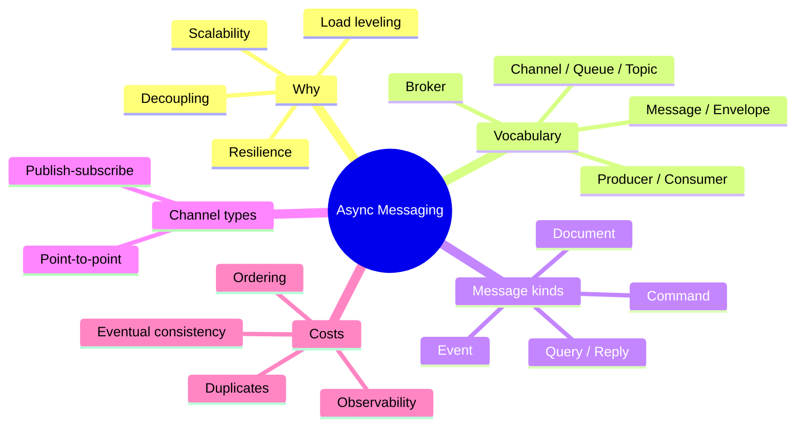
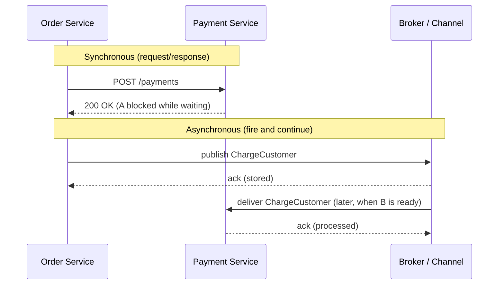
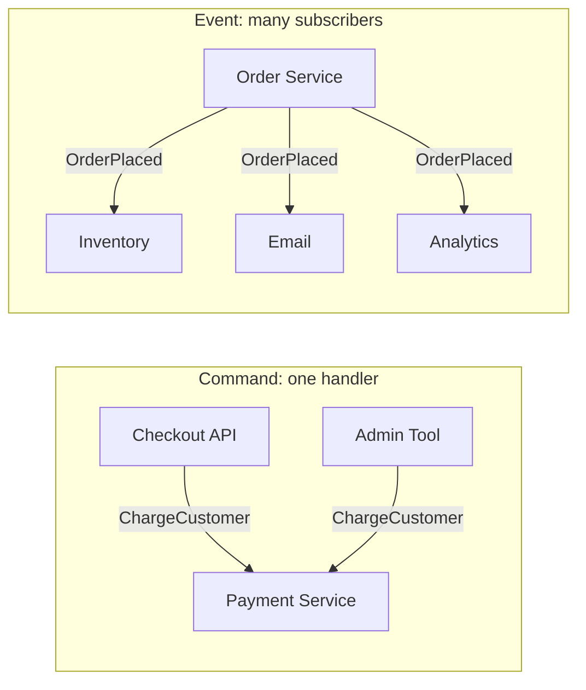
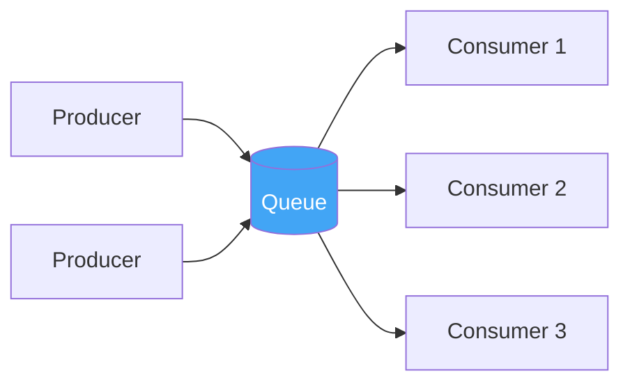
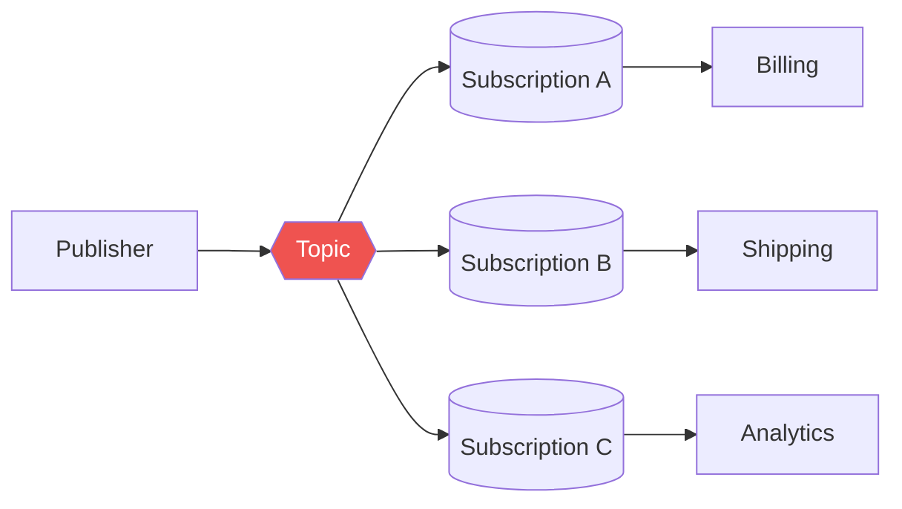
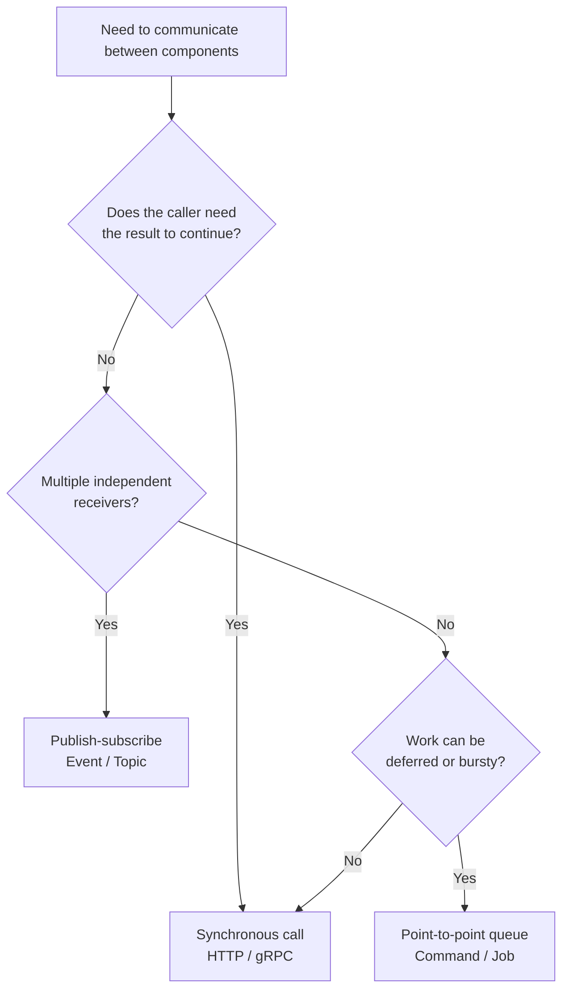

# 1. Introduction to Asynchronous Messaging

## Table of Contents

- [1.1 Why Messaging Exists](#11-why-messaging-exists)
- [1.2 Synchronous vs Asynchronous Communication](#12-synchronous-vs-asynchronous-communication)
- [1.3 Core Vocabulary](#13-core-vocabulary)
- [1.4 Message Kinds: Command, Event, Query, Document](#14-message-kinds-command-event-query-document)
- [1.5 Anatomy of a Message](#15-anatomy-of-a-message)
- [1.6 The Two Fundamental Channel Types](#16-the-two-fundamental-channel-types)
- [1.7 Coupling: What Messaging Removes and What It Doesn't](#17-coupling-what-messaging-removes-and-what-it-doesnt)
- [1.8 The Costs of Going Asynchronous](#18-the-costs-of-going-asynchronous)
- [1.9 Map of This Material](#19-map-of-this-material)
- [1.10 Interview Talking Points](#110-interview-talking-points)

---

> **Purpose:** Build the mental model and vocabulary that every later topic (message bus, event bus, brokers, RabbitMQ, Kafka) relies on. If you can explain *why* messaging exists and *what it costs*, the product details become easy.



---

## 1.1 Why Messaging Exists

In a system made of many services, components need to talk to each other. The simplest way is a direct call: service A calls service B over HTTP/gRPC and waits for the answer. That works — until it doesn't:

| Problem with direct calls | What happens | How messaging helps |
|---|---|---|
| **Temporal coupling** | If B is down, A fails too | The message waits in a durable channel until B is back |
| **Load spikes** | A burst of traffic overwhelms B | The queue absorbs the burst (*load leveling*); B drains at its own pace |
| **Fan-out** | A must know and call every interested service (B, C, D…) | A publishes once; any number of subscribers receive it |
| **Slow work in the request path** | User waits for email sending, PDF generation, etc. | Work is handed off and processed in the background |
| **Cascading failures** | Timeouts propagate through call chains | Failures are isolated behind the channel |
| **Scaling** | Hard to scale B independently of A | Add more consumers (*competing consumers*) |

> **One-line definition:** *Asynchronous messaging is a way for software components to communicate by sending self-contained messages through an intermediary channel, without requiring the sender and receiver to be available at the same time.*

---

## 1.2 Synchronous vs Asynchronous Communication



| Dimension | Synchronous (HTTP, gRPC) | Asynchronous (messaging) |
|---|---|---|
| Availability requirement | Both sides up at the same time | Only the channel must be up |
| Latency of the caller | Waits for full processing | Returns as soon as the message is stored |
| Result | Immediate response | Eventually, via reply message, event or polling |
| Consistency model | Easier to reason about (immediate) | Eventual consistency |
| Failure handling | Retries / circuit breakers in the caller | Redelivery, dead-letter queues, idempotent consumers |
| Discoverability | Caller must know the callee's address | Caller knows only the channel (or nothing, in pub/sub) |
| Debugging | Single stack trace / trace span | Distributed, needs correlation IDs and tracing |

**Rule of thumb:** use synchronous calls when the caller *needs the answer to continue* (e.g. "is this password correct?"). Use messaging when the caller only needs to know the request was *accepted* (e.g. "send a confirmation email").

---

## 1.3 Core Vocabulary

| Term | Meaning |
|---|---|
| **Message** | A self-contained unit of data (headers + body) sent from one component to another |
| **Producer / Publisher / Sender** | The component that creates and sends messages |
| **Consumer / Subscriber / Receiver** | The component that receives and processes messages |
| **Channel** | The logical pipe a message travels through (a queue, a topic, a subject, a stream) |
| **Queue** | A channel where each message is delivered to **one** consumer (point-to-point) |
| **Topic** | A channel where each message is delivered to **every** subscription (publish-subscribe) |
| **Broker** | Server software that hosts channels, stores messages and delivers them (RabbitMQ, ActiveMQ, Kafka…) |
| **Routing** | Deciding which channel(s)/consumer(s) receive a message (by key, header, content…) |
| **Acknowledgement (ack)** | Signal from consumer to broker: "I processed this, you may delete it" |
| **Dead-letter queue (DLQ)** | Where messages go after repeated processing failures |
| **Message bus** | An architectural layer (often a broker + conventions/library) that lets many applications exchange messages through a shared, uniform infrastructure |
| **Event bus** | A publish-subscribe mechanism specialized in broadcasting **events** (facts that happened) to interested listeners — in-process or distributed |
| **Event stream / log** | An append-only, replayable, ordered sequence of records (Kafka, Kinesis, Pulsar) |

> **Watch out:** these words are used loosely in the industry. "Bus", "broker", "queue" and "topic" are often used interchangeably in conversation. In an interview, *define your terms first* — it signals seniority.

---

## 1.4 Message Kinds: Command, Event, Query, Document

Not all messages mean the same thing. The **intent** of a message determines how it should be named, routed and handled.

| Kind | Intent | Naming | Senders → Receivers | Can be rejected? | Example |
|---|---|---|---|---|---|
| **Command** | "Please do this" | Imperative verb | Many → **exactly one** logical handler | Yes (validation, business rules) | `ChargeCustomer`, `SendEmail` |
| **Event** | "This happened" | Past tense | **One** owner → many (0..N) subscribers | No — it's a fact | `OrderPlaced`, `PaymentFailed` |
| **Query / Request** | "Tell me something" | Question / Get… | One → one, expects a reply | N/A | `GetCustomerCreditLimit` |
| **Reply** | Answer to a query/command | …Result / …Response | One → original requester | N/A | `CreditLimitResult` |
| **Document** | "Here is some data" | Noun | Transfer of state, no implied action | N/A | `CustomerSnapshot` |



**Why the distinction matters:**

- A **command** has an owner on the *receiving* side (the Payment service owns `ChargeCustomer`). It is typically sent to a **queue**.
- An **event** has an owner on the *sending* side (the Order service owns `OrderPlaced`). It is typically published to a **topic/exchange**, and the publisher does not know or care who listens.
- Mixing them leads to "events" like `SendWelcomeEmailEvent` — which is really a command in disguise and re-introduces coupling.

> This distinction is the seed of the **message bus vs event bus** comparison (see the dedicated file).

---

## 1.5 Anatomy of a Message

```json
{
  "headers": {
    "messageId": "6b1d6a1e-6a2f-4f1b-9a63-1c3f1c2b6f10",
    "correlationId": "order-48213",
    "causationId": "3f6a2b77-0f0e-4a52-b6a1-6e4d1b3f8c22",
    "messageType": "Sales.Events.OrderPlaced.v2",
    "contentType": "application/json",
    "timestamp": "2026-10-11T09:31:04Z",
    "replyTo": null,
    "source": "order-service",
    "traceparent": "00-4bf92f3577b34da6a3ce929d0e0e4736-00f067aa0ba902b7-01"
  },
  "body": {
    "orderId": "48213",
    "customerId": "c-991",
    "total": 129.90,
    "currency": "EUR"
  }
}
```

| Header | Why it exists |
|---|---|
| `messageId` | Unique identity → enables **deduplication / idempotency** |
| `correlationId` | Groups all messages belonging to one business flow / request |
| `causationId` | The ID of the message that *caused* this one → builds a causal chain |
| `messageType` | Lets the consumer pick a handler and deserializer; include a **version** |
| `contentType` | Serialization format (JSON, Avro, Protobuf, MessagePack) |
| `timestamp` | Ordering hints, TTL decisions, debugging |
| `replyTo` | Address for the reply in request/reply |
| `traceparent` | W3C trace context → distributed tracing across async hops |

**Design guidelines for message bodies:**

1. Keep messages **small** — large payloads go to blob storage, the message carries a reference (*Claim Check* pattern).
2. Make messages **self-describing** — a consumer should not need to call back the producer to understand it (unless you deliberately choose *event notification*).
3. Treat the schema as a **public contract** — version it, evolve it backwards-compatibly.
4. Prefer **immutable** message types in code (records / readonly).

---

## 1.6 The Two Fundamental Channel Types

Every messaging product, no matter how fancy, is built on two primitives.

### Point-to-Point (Queue)



- Each message is processed by **exactly one** consumer instance.
- Multiple consumers on one queue = **competing consumers** → horizontal scaling and load balancing.
- Natural fit for **commands** and **work/job distribution**.

### Publish-Subscribe (Topic)



- Each message is delivered to **every subscription** (a copy per subscriber group).
- Within one subscription, you can again have competing consumers.
- Natural fit for **events** and broadcast notifications.

> **Key insight:** Most real systems combine both: a topic fans out to one *queue per subscribing service*, and each service scales with competing consumers on its own queue. RabbitMQ (exchange → queues), Azure Service Bus (topic → subscriptions), AWS (SNS → SQS) and Kafka (topic → consumer groups) all implement this same shape.

---

## 1.7 Coupling: What Messaging Removes and What It Doesn't

| Type of coupling | Removed by messaging? | Notes |
|---|---|---|
| **Temporal** (both must be up) | ✅ Yes | The broker stores messages |
| **Location** (know the address) | ✅ Yes | Producers know only the channel name |
| **Platform / language** | ✅ Mostly | As long as the serialization format is shared |
| **Cardinality** (know how many receivers) | ✅ With pub/sub | Publisher is unaware of subscriber count |
| **Schema / contract** | ❌ No | Consumers still depend on the message format — versioning is essential |
| **Semantic** | ❌ No | Consumers still rely on what the message *means* |
| **Broker** | ⚠️ Introduced | You now depend on the broker's availability and features |

> Messaging trades **runtime coupling** for **contract coupling**. Senior engineers manage the contracts deliberately (schema registry, versioning rules, consumer-driven contract tests).

---

## 1.8 The Costs of Going Asynchronous

Messaging is not free. Every one of these must be designed for:

1. **Eventual consistency** — after publishing `OrderPlaced`, the inventory isn't updated *yet*. UIs and APIs must tolerate that.
2. **Duplicates** — most brokers guarantee *at-least-once* delivery, so consumers must be **idempotent**.
3. **Ordering** — messages can arrive out of order (retries, parallel consumers, partitions).
4. **Poison messages** — a message that always fails can block a queue or loop forever without a DLQ.
5. **Dual-write problem** — "save to DB and publish" is not atomic without the **Transactional Outbox**.
6. **Observability** — a single user action becomes a graph of asynchronous hops; you need correlation IDs, tracing and queue-depth metrics.
7. **Operational overhead** — the broker is a critical, stateful piece of infrastructure (clustering, upgrades, monitoring, capacity).
8. **Harder testing** — end-to-end tests must wait for asynchronous effects.



---

## 1.9 Map of This Material

| # | File | Focus |
|---|---|---|
| 1 | Introduction to Asynchronous Messaging | Vocabulary and mental models (this file) |
| 2 | Message Bus Fundamentals | What a message bus is, topologies, how to use it, when to use it |
| 3 | Messaging Patterns | Enterprise Integration Patterns used in practice |
| 4 | Delivery Guarantees & Reliability | Acks, at-least-once, idempotency, ordering, outbox |
| 5 | Message Broker Landscape | Kinds of brokers and the major products compared |
| 6 | RabbitMQ Deep Dive | Exchanges, queues, bindings, reliability, operations |
| 7 | Apache Kafka & Event Streaming | Log-based messaging, partitions, consumer groups |
| 8 | Service Bus Frameworks | MassTransit, NServiceBus, Spring Cloud Stream, Dapr… |
| 9 | Event Bus Fundamentals | In-process and distributed event buses |
| 10 | Event-Driven Architecture Patterns | Notification, ECST, Event Sourcing, CQRS, Sagas |
| 11 | Event Bus Products | EventBridge, Event Grid, Eventarc, in-process libraries |
| 12 | Message Bus vs Event Bus | Differences and decision framework |
| 13 | Interview Questions | Question bank and system design scenarios |

---

## 1.10 Interview Talking Points

| Question | Strong answer in one breath |
|---|---|
| Why use messaging instead of HTTP? | To remove temporal coupling, absorb load spikes, fan out to many consumers and move slow work off the request path — at the cost of eventual consistency and operational complexity. |
| Queue vs topic? | Queue = each message to one consumer (work distribution); topic = each message to every subscription (broadcast). Real systems combine them. |
| Command vs event? | A command asks one owner to do something and may be rejected; an event states a fact owned by the publisher and can have zero or many subscribers. |
| What does messaging *not* decouple? | The schema and semantics of messages — the contract. |
| Biggest pitfalls? | Duplicates (need idempotency), ordering assumptions, poison messages (need DLQ), the dual-write problem (need outbox), and poor observability. |
