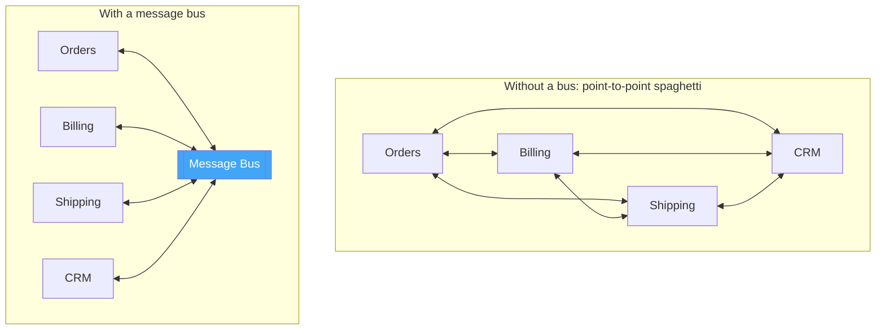
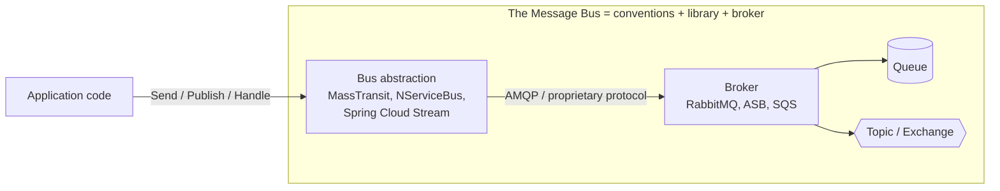
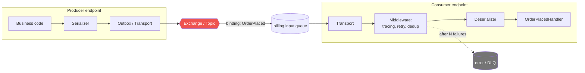
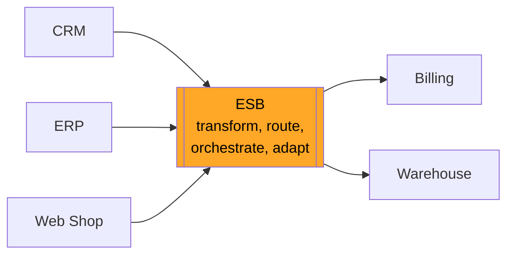

# 2. Message Bus Fundamentals

## Table of Contents

- [2.1 What Is a Message Bus?](#21-what-is-a-message-bus)
- [2.2 Message Bus vs Message Broker vs Message Queue](#22-message-bus-vs-message-broker-vs-message-queue)
- [2.3 Architecture and Building Blocks](#23-architecture-and-building-blocks)
- [2.4 Topologies: Hub-and-Spoke, Bus, Brokerless](#24-topologies-hub-and-spoke-bus-brokerless)
- [2.5 Kinds of Message Buses](#25-kinds-of-message-buses)
- [2.6 How to Use a Message Bus — Step by Step](#26-how-to-use-a-message-bus--step-by-step)
- [2.7 Code Examples](#27-code-examples)
- [2.8 When to Use a Message Bus](#28-when-to-use-a-message-bus)
- [2.9 When NOT to Use a Message Bus](#29-when-not-to-use-a-message-bus)
- [2.10 The Enterprise Service Bus (ESB) — and Why It Fell Out of Favor](#210-the-enterprise-service-bus-esb--and-why-it-fell-out-of-favor)
- [2.11 Interview Talking Points](#211-interview-talking-points)

---

> **Purpose:** Understand precisely what a "message bus" is, the pieces it is made of, how to introduce one into a system and — just as important — when it is the wrong tool.

---

## 2.1 What Is a Message Bus?

A **message bus** is a shared communication infrastructure that lets multiple, independent applications exchange messages through a **common set of channels, a common message format and common conventions**, without connecting to each other directly.

The name comes from the hardware **bus** in a computer: a single shared pathway that every device plugs into. Instead of wiring every component to every other component (N×(N−1) connections), each component plugs into the bus once (N connections).



In the *Enterprise Integration Patterns* book (Hohpe & Woolf), a Message Bus is defined by three things:

1. **A common communication infrastructure** — the channels (usually provided by a broker).
2. **A common data model / canonical format** — everyone agrees how messages look.
3. **A common command/event set** — everyone agrees what messages exist and what they mean.

> **Practical definition:** In modern codebases, "message bus" usually means *a broker (RabbitMQ, Azure Service Bus, SQS/SNS, Kafka…) plus a client-side abstraction (MassTransit, NServiceBus, Spring Cloud Stream, Wolverine, Dapr…) that gives the application a uniform `Send` / `Publish` / `Handle` API, handles serialization, routing, retries, dead-lettering and observability.*

---

## 2.2 Message Bus vs Message Broker vs Message Queue

These terms overlap; here is how to keep them apart.

| Concept | Level | What it is | Examples |
|---|---|---|---|
| **Message queue** | Data structure / channel | A FIFO-ish buffer that holds messages until a consumer takes them | An SQS queue, a RabbitMQ queue |
| **Message broker** | Server / product | Software that hosts queues/topics, stores messages, routes and delivers them | RabbitMQ, ActiveMQ, Azure Service Bus, Kafka |
| **Message bus** | Architectural pattern / layer | The overall shared messaging backbone + agreed formats and conventions; often a broker wrapped by a library | "Our MassTransit-on-RabbitMQ bus", NServiceBus, an ESB |
| **Event bus** | Specialization | A bus focused on publish/subscribe of *events* | Guava EventBus, AWS EventBridge |



**Interview phrasing:** *"A queue is a channel, a broker is the server that hosts channels, and a message bus is the architectural backbone — broker plus conventions — that lets all services communicate uniformly."*

---

## 2.3 Architecture and Building Blocks

| Building block | Responsibility |
|---|---|
| **Endpoints** | Logical services connected to the bus; each has an input queue |
| **Channels** | Queues (point-to-point) and topics/exchanges (pub/sub) |
| **Routing** | Maps message types to destinations (by type, routing key, headers or content) |
| **Serialization** | Converts objects ↔ bytes (JSON, Avro, Protobuf); usually with type metadata |
| **Message envelope** | Headers: id, correlation, type, timestamps, trace context |
| **Handlers** | Application code invoked per message type |
| **Pipeline / middleware** | Cross-cutting concerns: logging, retries, validation, tracing, transactions, deduplication |
| **Error handling** | Immediate retries, delayed (second-level) retries, dead-letter / error queues |
| **Subscription management** | Who receives which events; created at startup or declared in infrastructure-as-code |
| **Monitoring** | Queue depth, consumer lag, processing time, error rate, DLQ size |



---

## 2.4 Topologies: Hub-and-Spoke, Bus, Brokerless

| Topology | Description | Pros | Cons | Examples |
|---|---|---|---|---|
| **Hub-and-spoke (centralized broker)** | All messages go through a central broker cluster | Simple to operate and secure, central routing | Broker is a critical dependency; possible bottleneck | RabbitMQ, ActiveMQ, Azure Service Bus |
| **Bus (distributed log / partitioned)** | Many broker nodes share partitions; clients talk to partition leaders | Massive horizontal scale, replay | More complex semantics (partitions, offsets) | Kafka, Pulsar |
| **Brokerless (peer-to-peer)** | Library-level sockets, no central server | Ultra-low latency, no extra infra | No durability by default; you build reliability yourself | ZeroMQ, nanomsg |
| **Managed / serverless** | Cloud provider runs the broker | No ops, pay-per-use, auto-scale | Vendor lock-in, quotas, less control | SQS/SNS, Google Pub/Sub, EventBridge |

---

## 2.5 Kinds of Message Buses

### By scope

| Kind | Scope | Typical use |
|---|---|---|
| **In-process bus (mediator)** | Inside one application/process, in memory | Decouple handlers inside a monolith/modular monolith (MediatR, Wolverine local queues, Spring events) |
| **Distributed message bus** | Across processes and machines via a broker | Microservices integration |
| **Enterprise Service Bus (ESB)** | Organization-wide, with transformation/orchestration in the bus | Legacy enterprise integration (MuleSoft, IBM Integration Bus, BizTalk) |

### By delivery model

| Kind | How it works | Products |
|---|---|---|
| **Queue-based (smart broker, dumb consumer)** | Broker tracks per-message state, deletes after ack, routes by rules | RabbitMQ, ActiveMQ, SQS, Azure Service Bus |
| **Log-based (dumb broker, smart consumer)** | Broker appends to a partitioned log; consumers track their own offsets; messages retained and replayable | Kafka, Pulsar, Kinesis, Redis Streams, Azure Event Hubs |
| **Push-based event routers** | Broker pushes (often over HTTP/webhooks) to subscribers matching filters | AWS EventBridge, Azure Event Grid, Google Eventarc |
| **Lightweight pub/sub** | Fire-and-forget, minimal persistence, very fast | NATS Core, Redis Pub/Sub, MQTT QoS 0 |

### By messaging style supported

- **Send (command, 1:1)** — to a specific logical endpoint's queue.
- **Publish (event, 1:N)** — to a topic; the bus routes to all subscribers.
- **Request/Reply** — send with `replyTo` + `correlationId`, await response.
- **Scheduled / deferred** — deliver at a future time (timeouts, reminders).

---

## 2.6 How to Use a Message Bus — Step by Step

1. **Identify the boundaries.** Which services own which data and capabilities? Messages flow *between* bounded contexts.
2. **Classify each interaction.** Command (1 owner, may fail), event (fact, N subscribers) or query (needs a reply — often better as sync HTTP/gRPC).
3. **Design message contracts.** Name them (`PlaceOrder`, `OrderPlaced`), define schemas, add versioning, put them in a shared contracts package or schema registry.
4. **Choose the broker and abstraction.** Based on throughput, ordering, replay needs, cloud, team skills (see the product files).
5. **Define the topology.** Queues per endpoint, topics/exchanges per event type, routing keys, DLQs. Prefer infrastructure-as-code or convention-based auto-provisioning.
6. **Make producers reliable.** Use publisher confirms, and the **Transactional Outbox** when publishing must be atomic with a DB write.
7. **Make consumers safe.** Idempotent handlers, manual acks *after* processing, bounded retries with backoff, DLQ, prefetch tuned.
8. **Add observability.** Correlation IDs, W3C trace context propagation, structured logs, metrics (queue depth, consumer lag, age of oldest message, DLQ count) and alerts.
9. **Plan for evolution.** Additive schema changes, tolerant readers, version in the message type, deprecation process.
10. **Test.** Unit test handlers in isolation; use in-memory transports or Testcontainers for integration tests; contract tests between producer and consumer.

---

## 2.7 Code Examples

### 2.7.1 A minimal in-process message bus (TypeScript)

```typescript
type Handler<T> = (message: T) => Promise<void>;

interface Message { readonly type: string; }

class InMemoryBus {
  private commandHandlers = new Map<string, Handler<any>>();
  private eventHandlers = new Map<string, Handler<any>[]>();

  // Commands: exactly one handler
  registerCommand<T extends Message>(type: string, handler: Handler<T>) {
    if (this.commandHandlers.has(type)) throw new Error(`Handler already registered for ${type}`);
    this.commandHandlers.set(type, handler);
  }

  // Events: zero or many handlers
  subscribe<T extends Message>(type: string, handler: Handler<T>) {
    const list = this.eventHandlers.get(type) ?? [];
    list.push(handler);
    this.eventHandlers.set(type, list);
  }

  async send<T extends Message>(command: T) {
    const handler = this.commandHandlers.get(command.type);
    if (!handler) throw new Error(`No handler for command ${command.type}`);
    await handler(command);
  }

  async publish<T extends Message>(event: T) {
    const handlers = this.eventHandlers.get(event.type) ?? [];
    // Isolate failures so one subscriber cannot break the others
    await Promise.allSettled(handlers.map(h => h(event)));
  }
}

// Usage
const bus = new InMemoryBus();
bus.registerCommand<{ type: 'PlaceOrder'; orderId: string }>('PlaceOrder', async cmd => {
  // ... persist order ...
  await bus.publish({ type: 'OrderPlaced', orderId: cmd.orderId });
});
bus.subscribe('OrderPlaced', async e => console.log('Send confirmation email', e));
bus.subscribe('OrderPlaced', async e => console.log('Reserve stock', e));

await bus.send({ type: 'PlaceOrder', orderId: '42' });
```

### 2.7.2 Distributed bus with MassTransit on RabbitMQ (C#)

```csharp
// ── Contracts (shared package) ─────────────────────────
public record SubmitOrder(Guid OrderId, string CustomerId, decimal Total);   // command
public record OrderSubmitted(Guid OrderId, DateTime SubmittedAt);           // event

// ── Configuration ──────────────────────────────────────
builder.Services.AddMassTransit(x =>
{
    x.AddConsumer<SubmitOrderConsumer>();
    x.AddConsumer<OrderSubmittedEmailConsumer>();

    x.UsingRabbitMq((context, cfg) =>
    {
        cfg.Host("localhost", "/", h => { h.Username("guest"); h.Password("guest"); });

        // Retry policy applied to all endpoints
        cfg.UseMessageRetry(r => r.Exponential(5, TimeSpan.FromSeconds(1),
                                               TimeSpan.FromMinutes(1), TimeSpan.FromSeconds(2)));

        cfg.ConfigureEndpoints(context); // convention-based queues, exchanges and bindings
    });
});

// ── Producer ───────────────────────────────────────────
public class OrdersController(ISendEndpointProvider send) : ControllerBase
{
    [HttpPost]
    public async Task<IActionResult> Post(SubmitOrder cmd)
    {
        var endpoint = await send.GetSendEndpoint(new Uri("queue:submit-order"));
        await endpoint.Send(cmd);
        return Accepted();   // 202: accepted for async processing
    }
}

// ── Command consumer (one logical owner) ───────────────
public class SubmitOrderConsumer(IOrderRepository repo) : IConsumer<SubmitOrder>
{
    public async Task Consume(ConsumeContext<SubmitOrder> ctx)
    {
        await repo.Save(ctx.Message);
        await ctx.Publish(new OrderSubmitted(ctx.Message.OrderId, DateTime.UtcNow)); // event
    }
}

// ── Event consumer (one of many subscribers) ───────────
public class OrderSubmittedEmailConsumer : IConsumer<OrderSubmitted>
{
    public Task Consume(ConsumeContext<OrderSubmitted> ctx)
        => Console.Out.WriteLineAsync($"Email for order {ctx.Message.OrderId}");
}
```

### 2.7.3 Raw broker usage (Python, RabbitMQ via `pika`)

```python
import json, pika

conn = pika.BlockingConnection(pika.ConnectionParameters("localhost"))
ch = conn.channel()

ch.queue_declare(queue="submit-order", durable=True)
ch.confirm_delivery()  # publisher confirms

ch.basic_publish(
    exchange="",                  # default exchange routes by queue name
    routing_key="submit-order",
    body=json.dumps({"orderId": "42", "total": 99.5}),
    properties=pika.BasicProperties(
        delivery_mode=pika.DeliveryMode.Persistent,
        content_type="application/json",
        message_id="b3c1...",
    ),
)

def handle(ch, method, props, body):
    order = json.loads(body)
    try:
        process(order)                                  # must be idempotent
        ch.basic_ack(delivery_tag=method.delivery_tag)
    except Exception:
        ch.basic_nack(delivery_tag=method.delivery_tag, requeue=False)  # -> DLX if configured

ch.basic_qos(prefetch_count=20)
ch.basic_consume(queue="submit-order", on_message_callback=handle)
ch.start_consuming()
```

> **Notice the difference:** with a raw client you hand-code acks, retries, serialization and topology. A bus framework turns this into conventions so every team does it the same way.

---

## 2.8 When to Use a Message Bus

| Scenario | Why a bus fits |
|---|---|
| **Microservices that must stay independently deployable and available** | Removes temporal coupling between services |
| **Background / long-running work** (emails, reports, video encoding, imports) | Offloads work from the request path; scales workers independently |
| **Bursty traffic** (flash sales, batch uploads) | Queue absorbs spikes (load leveling) |
| **Fan-out of business events** to many consumers | Publisher doesn't need to know subscribers |
| **Long-running business processes** (order → payment → shipping) | Sagas / process managers coordinate via messages, survive restarts |
| **Integrating heterogeneous systems** (legacy + cloud, different languages) | Common protocol and canonical message format |
| **Reliable retries** for flaky downstream dependencies | Redelivery + backoff + DLQ instead of failing the user request |
| **Modular monolith** (in-process bus) | Keeps modules decoupled now, makes later extraction into services easy |

---

## 2.9 When NOT to Use a Message Bus

| Situation | Better choice |
|---|---|
| The caller needs an immediate answer (validation, read queries, auth) | Synchronous HTTP/gRPC |
| A small app with a couple of components and a single DB | Direct method calls; maybe an in-process mediator |
| Strong, immediate consistency across components is a hard requirement | A single transactional boundary (same DB/service) |
| The team has no capacity to operate/monitor a broker | Managed service, or stay synchronous until needed |
| You're only adding it "because microservices" | YAGNI — messaging adds failure modes |
| Streaming analytics over large history with replay | A log-based platform (Kafka) rather than a classic queue-based bus |
| Low-latency request/response inside one data center | gRPC; a bus adds latency and indirection |

> **Senior signal:** "Distributed messaging buys availability and scalability with consistency and complexity. I introduce it where the decoupling pays for itself — usually at bounded-context boundaries and for background work — and keep synchronous calls for queries."

---

## 2.10 The Enterprise Service Bus (ESB) — and Why It Fell Out of Favor

An **ESB** puts *logic* into the bus itself: message transformation, content-based routing, orchestration, protocol adaptation, sometimes business rules.



| ESB promise | What often happened |
|---|---|
| Central place for integration logic | Became a bottleneck owned by one "integration team" |
| Reuse through canonical models | Huge, slow-changing canonical schemas |
| Orchestration in the bus | Business logic hidden in XML/config, hard to test and version |
| One platform for everything | Expensive licenses, single point of failure |

The microservices movement replaced it with the principle **"smart endpoints, dumb pipes"** (Martin Fowler / James Lewis): keep the bus a simple, reliable transport, and put business logic in the services. Modern message buses (MassTransit, NServiceBus, Kafka, cloud brokers) follow this principle.

---

## 2.11 Interview Talking Points

| Question | Strong answer |
|---|---|
| What is a message bus? | A shared messaging backbone — channels plus common formats and conventions — that lets services communicate without direct connections. Usually a broker plus a client abstraction. |
| Bus vs broker? | The broker is the server product; the bus is the architectural layer/pattern built on it (and can even be in-process). |
| Why use a bus framework instead of the raw client? | It standardizes serialization, routing, retries, DLQs, outbox, sagas, tracing and testing across teams. |
| When would you not use one? | When the caller needs a synchronous answer, the system is small, or strong immediate consistency is required. |
| What was wrong with the ESB? | It centralized business logic and transformations in the pipe; modern systems prefer smart endpoints and dumb pipes. |
