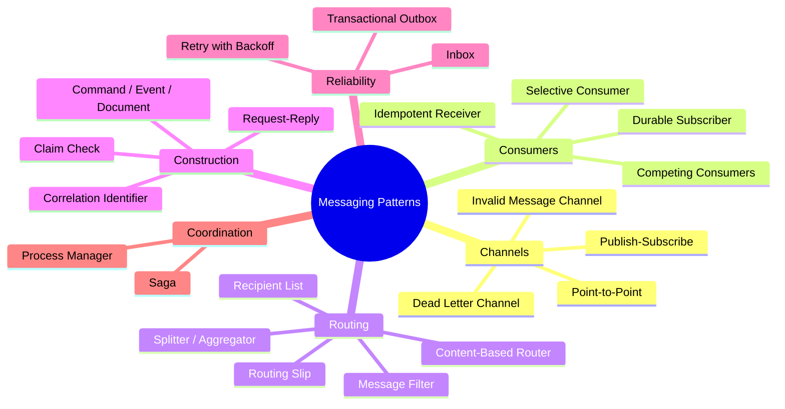
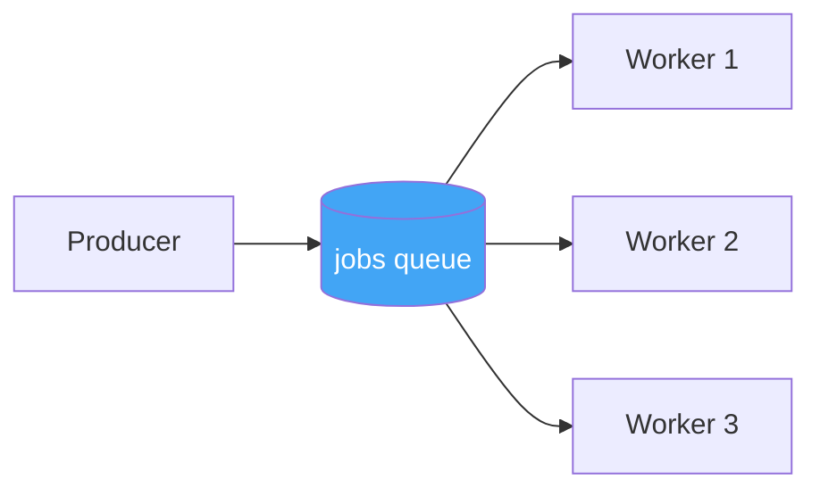
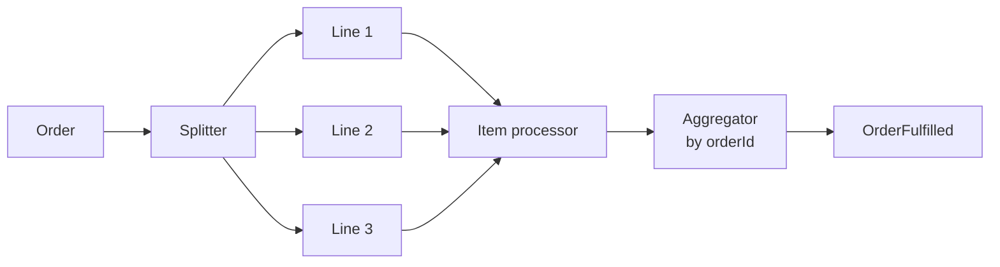
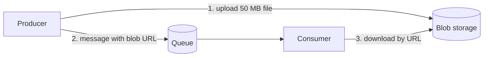
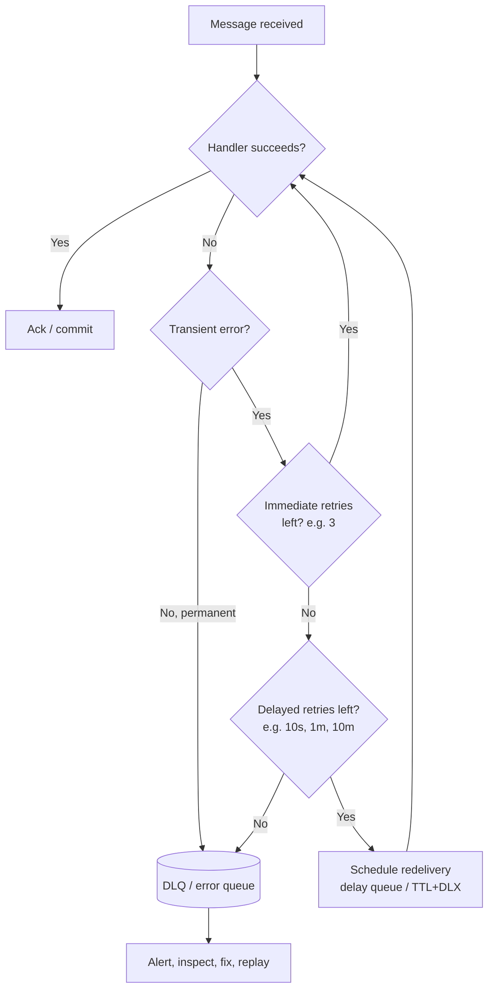
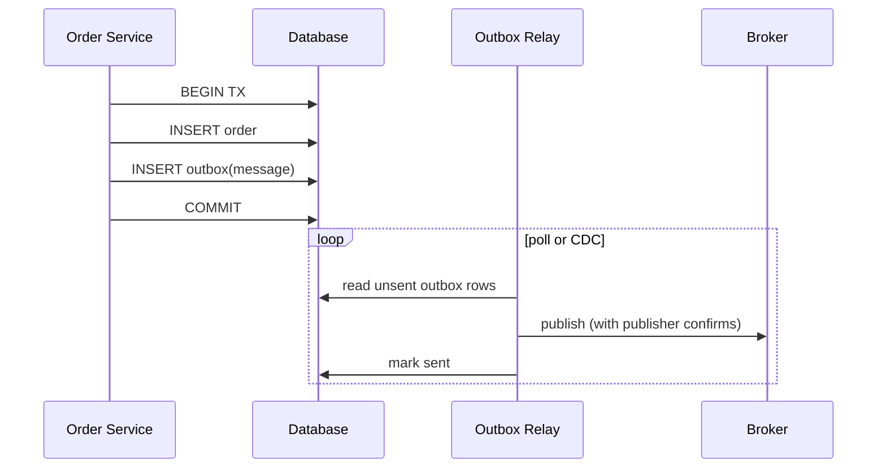
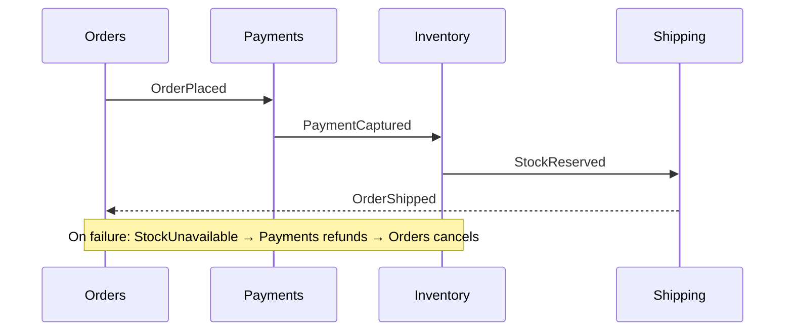
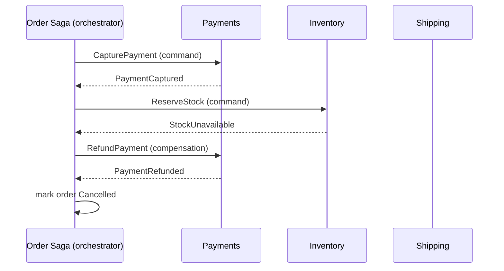

# 3. Messaging Patterns

## Table of Contents

- [3.1 Pattern Map](#31-pattern-map)
- [3.2 Channel Patterns](#32-channel-patterns)
- [3.3 Consumer Patterns](#33-consumer-patterns)
- [3.4 Routing Patterns](#34-routing-patterns)
- [3.5 Message Construction Patterns](#35-message-construction-patterns)
- [3.6 Error-Handling Patterns](#36-error-handling-patterns)
- [3.7 Reliability Patterns: Outbox and Inbox](#37-reliability-patterns-outbox-and-inbox)
- [3.8 Process Coordination: Sagas and Process Managers](#38-process-coordination-sagas-and-process-managers)
- [3.9 Flow-Control Patterns](#39-flow-control-patterns)
- [3.10 Pattern Selection Cheat Sheet](#310-pattern-selection-cheat-sheet)

---

> **Purpose:** The Enterprise Integration Patterns (EIP) catalog (Hohpe & Woolf, 2003) is still the shared language for messaging. This file covers the patterns you will actually meet in RabbitMQ, Kafka, Azure Service Bus, SQS and bus frameworks — with when and why to use each.

---

## 3.1 Pattern Map



---

## 3.2 Channel Patterns

### Point-to-Point Channel
One message → one receiver. Use for commands and jobs. *(RabbitMQ queue, SQS queue, ASB queue.)*

### Publish-Subscribe Channel
One message → a copy for every subscriber. Use for events. *(RabbitMQ fanout/topic exchange, SNS, ASB topic, Kafka topic with multiple consumer groups.)*

### Datatype Channel
One channel per message type (`orders.order-placed`). Makes routing, permissions, monitoring and schema enforcement simple. Bus frameworks often create one exchange/topic per message type automatically.

### Dead Letter Channel (DLQ)
Where the broker puts messages it **cannot deliver or process**: expired TTL, rejected without requeue, exceeded max delivery count, queue length overflow.

### Invalid Message Channel
Where the *consumer* puts messages it can read but considers **invalid** (bad schema, failed validation). Separating it from the DLQ helps: invalid messages are a producer bug; DLQ messages may be transient failures.

---

## 3.3 Consumer Patterns

### Competing Consumers



- Multiple instances read the same queue; the broker hands each message to one of them.
- **Scales throughput horizontally** and gives fault tolerance (a crashed worker's unacked messages are redelivered).
- **Trade-off:** you lose global ordering. If order matters per entity, partition by key (Kafka partitions, ASB sessions, SQS FIFO message groups, RabbitMQ consistent-hash exchange / single-active-consumer).

### Idempotent Receiver
A consumer that produces the same result whether a message is processed once or many times. **Mandatory** with at-least-once delivery. Techniques are detailed in the reliability file (dedup table, natural idempotency, conditional updates).

### Selective Consumer / Message Filter
The consumer only takes messages matching criteria (headers, properties). Prefer broker-side filtering (bindings, subscription filters, EventBridge patterns) so unwanted messages never reach the consumer.

### Durable Subscriber
A subscription that keeps receiving (storing) messages while the subscriber is offline. In RabbitMQ: a durable queue bound to the exchange; in Kafka: a consumer group with committed offsets; in ASB: a topic subscription.

### Polling vs Event-Driven Consumer

| Style | How | Products |
|---|---|---|
| **Push (event-driven)** | Broker pushes to the consumer over an open connection | RabbitMQ `basic.consume`, ASB processor, NATS |
| **Pull (polling)** | Consumer asks for batches | Kafka `poll()`, SQS `ReceiveMessage` (use long polling, up to 20 s), Pub/Sub pull |
| **Push over HTTP** | Broker calls a webhook | Pub/Sub push, EventBridge targets, Event Grid |

---

## 3.4 Routing Patterns

| Pattern | What it does | Implementation examples |
|---|---|---|
| **Content-Based Router** | Routes based on message content/headers | RabbitMQ topic/headers exchange, EventBridge rules, ASB SQL filters |
| **Message Filter** | Drops messages that don't match | Subscription filters |
| **Recipient List** | Sends to a computed list of destinations | Code in a router service |
| **Splitter** | Splits one message into many (an order → one message per line item) | Consumer that publishes N messages |
| **Aggregator** | Combines related messages into one (wait for all line items) | Stateful consumer keyed by correlation ID, with completion condition + timeout |
| **Scatter-Gather** | Broadcast a request, aggregate replies (get quotes from N suppliers) | Pub/sub + aggregator |
| **Routing Slip** | The message carries its own itinerary of steps | MassTransit Courier, workflow engines |
| **Message Translator** | Converts between formats | Anti-corruption layer at a boundary |



---

## 3.5 Message Construction Patterns

### Request-Reply over Messaging

```mermaid
sequenceDiagram
    participant R as Requester
    participant Q as request queue
    participant S as Replier
    participant RQ as reply queue (exclusive)
    R->>Q: GetPrice {correlationId: 7, replyTo: reply-q-abc}
    Q->>S: deliver
    S->>RQ: PriceResult {correlationId: 7}
    RQ->>R: deliver; match correlationId 7
```

- The requester sets `replyTo` (a temporary or per-instance queue) and a `correlationId`.
- RabbitMQ offers **Direct Reply-To** (`amq.rabbitmq.reply-to`) to avoid creating reply queues.
- **Use sparingly** — it reintroduces temporal coupling. If you need an immediate answer, HTTP/gRPC is usually simpler.

### Correlation Identifier
Every message in a business flow carries the same `correlationId`; each message also records its `causationId` (the message that triggered it). Essential for tracing, aggregators and sagas.

### Claim Check



Brokers have size limits (SQS 256 KiB historically, raised to 1 MiB in 2025; ASB 256 KB Standard / up to 100 MB Premium; Kafka 1 MB default). Store the payload elsewhere and send a reference.

### Message Expiration (TTL)
Set a time-to-live for messages that become worthless after a while (price quotes, OTP codes). Expired messages are dropped or dead-lettered.

### Message Sequence
Large logical messages split into numbered chunks (`sequenceNumber`, `total`) and reassembled by the receiver. Prefer Claim Check when possible.

---

## 3.6 Error-Handling Patterns

### The retry ladder



| Technique | Purpose |
|---|---|
| **Immediate retries** | Handle blips (deadlock, brief network glitch) |
| **Delayed / exponential backoff retries** | Give a failing dependency time to recover; add **jitter** to avoid thundering herds |
| **Max delivery count** | Prevent infinite loops of poison messages |
| **Dead-letter queue** | Park failed messages for inspection and replay |
| **Error classification** | Don't retry permanent errors (validation, deserialization) — send straight to DLQ |
| **Circuit breaker on consumers** | Pause consumption when a downstream dependency is down instead of burning retries |

### Poison message
A message that fails every time (bad data, bug). Without a max delivery count it loops forever and, in ordered queues, **blocks everything behind it** (head-of-line blocking). Always configure a DLQ and alert on DLQ depth.

### DLQ operations checklist
- Store the original message **plus** failure reason, exception, attempt count, original queue.
- Provide tooling to **inspect, fix and replay** (move back to the original queue).
- Alert on DLQ growth; treat a non-empty DLQ as an incident signal, not a trash can.

---

## 3.7 Reliability Patterns: Outbox and Inbox

### The dual-write problem

```csharp
// ❌ Not atomic: the process can crash between the two lines
await db.SaveChangesAsync();          // order saved
await bus.Publish(new OrderPlaced()); // never sent → other services never learn about the order
```

Reversing the order is equally wrong: the event can be published for an order that then fails to save.

### Transactional Outbox



- Business data and the outgoing message are written in **the same local transaction**.
- A relay publishes outbox rows to the broker — by **polling** the table or via **Change Data Capture** (Debezium reading the DB log).
- The relay can crash after publishing but before marking sent → **duplicates are possible**, so consumers must still be idempotent.
- Built into MassTransit, NServiceBus, Wolverine, Brighter; Debezium has an Outbox Event Router.

```sql
CREATE TABLE outbox (
  id            UUID PRIMARY KEY,
  aggregate_id  VARCHAR(64) NOT NULL,
  type          VARCHAR(200) NOT NULL,
  payload       JSONB NOT NULL,
  occurred_at   TIMESTAMPTZ NOT NULL DEFAULT now(),
  sent_at       TIMESTAMPTZ NULL
);
CREATE INDEX ix_outbox_unsent ON outbox (occurred_at) WHERE sent_at IS NULL;
```

### Inbox (Idempotent Consumer table)

```csharp
public async Task Handle(OrderPlaced msg, MessageContext ctx)
{
    await using var tx = await db.Database.BeginTransactionAsync();

    // Unique constraint on (consumer, message_id) makes this the dedup gate
    var inserted = await db.Database.ExecuteSqlInterpolatedAsync(
        $"INSERT INTO inbox (consumer, message_id) VALUES ('billing', {ctx.MessageId}) ON CONFLICT DO NOTHING");
    if (inserted == 0) return;                      // already processed → skip

    await billing.CreateInvoice(msg.OrderId);       // business effect
    await db.SaveChangesAsync();
    await tx.CommitAsync();                         // dedup record + effect commit together
}
```

**Outbox + Inbox = effectively-once processing** on top of at-least-once delivery.

---

## 3.8 Process Coordination: Sagas and Process Managers

A business process spanning several services cannot use one ACID transaction. A **saga** is a sequence of local transactions, each publishing a message that triggers the next; on failure, **compensating actions** undo previous steps.

### Choreography (event-driven, no coordinator)



### Orchestration (central process manager)



| | Choreography | Orchestration |
|---|---|---|
| Coupling | Services react to each other's events | Services know only the orchestrator's commands |
| Visibility of the flow | Implicit, spread across services | Explicit, in one state machine |
| Best for | Simple flows, 2–4 steps | Complex flows, timeouts, many branches |
| Risk | "Event spaghetti", cyclic dependencies | Orchestrator becomes a god-service |
| Tools | Plain pub/sub | MassTransit state machines, NServiceBus sagas, Temporal, AWS Step Functions, Camunda |

Saga design rules: every step must be **idempotent**; compensations must be **retryable**; use **timeouts** (scheduled messages) for steps that never answer; store saga state durably with optimistic concurrency.

---

## 3.9 Flow-Control Patterns

| Pattern | Purpose | Example |
|---|---|---|
| **Prefetch / QoS** | Limit unacked messages per consumer to balance load | RabbitMQ `basic.qos(prefetch=20)` |
| **Backpressure** | Slow producers when consumers fall behind | Bounded queues (`x-max-length` + `reject-publish`), RabbitMQ flow control/memory alarms |
| **Throttling / rate limiting** | Protect a downstream API with quotas | Concurrency limit per consumer, token bucket |
| **Batching** | Improve throughput by processing in groups | Kafka `max.poll.records`, SQS batch receive (10) |
| **Priority queue** | Urgent messages first | RabbitMQ priority queues (`x-max-priority`), separate queues per priority (usually better) |
| **Delayed delivery** | Process later (reminders, retries) | ASB scheduled messages, SQS `DelaySeconds` (≤15 min), RabbitMQ delayed-message plugin |
| **Message grouping / sessions** | Ordered processing per key with parallelism across keys | ASB sessions, SQS FIFO `MessageGroupId`, Kafka partition key |

---

## 3.10 Pattern Selection Cheat Sheet

| Problem | Pattern |
|---|---|
| Scale out processing | Competing Consumers |
| Notify many services of a fact | Publish-Subscribe |
| Messages fail repeatedly | Max delivery count + Dead Letter Channel |
| Duplicates from at-least-once delivery | Idempotent Receiver / Inbox |
| DB write and publish must be atomic | Transactional Outbox |
| Large payloads | Claim Check |
| Track a flow across services | Correlation Identifier + tracing |
| Multi-service business transaction | Saga (choreography or orchestration) |
| Ordered processing per entity | Partition key / session / message group |
| Protect slow downstream | Prefetch, throttling, circuit breaker |
| Get an answer asynchronously | Request-Reply (or prefer sync call) |
| Combine N related messages | Aggregator with timeout |
