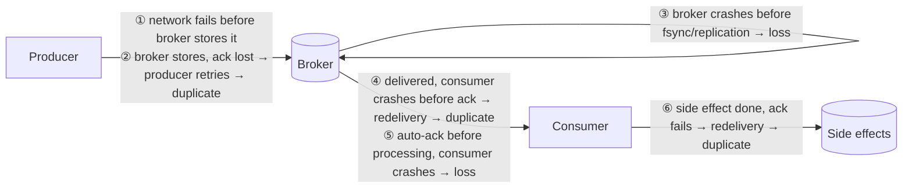
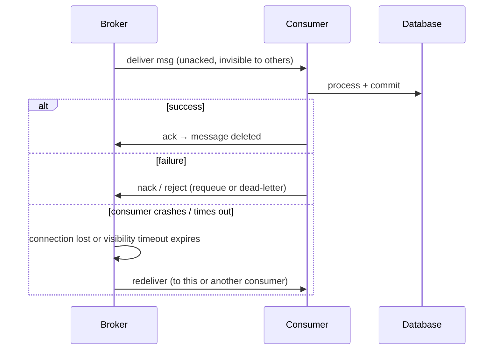
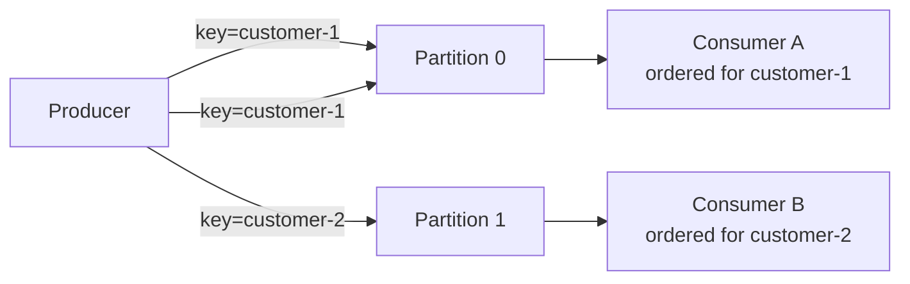

# 4. Delivery Guarantees & Reliability

## Table of Contents

- [4.1 Where Messages Get Lost or Duplicated](#41-where-messages-get-lost-or-duplicated)
- [4.2 The Three Delivery Semantics](#42-the-three-delivery-semantics)
- [4.3 Producer-Side Reliability](#43-producer-side-reliability)
- [4.4 Broker-Side Durability](#44-broker-side-durability)
- [4.5 Consumer-Side Reliability: Acknowledgements](#45-consumer-side-reliability-acknowledgements)
- [4.6 Idempotency Techniques](#46-idempotency-techniques)
- [4.7 Exactly-Once: Myth, Marketing and Reality](#47-exactly-once-myth-marketing-and-reality)
- [4.8 Message Ordering](#48-message-ordering)
- [4.9 Schema Evolution and Versioning](#49-schema-evolution-and-versioning)
- [4.10 Observability for Messaging](#410-observability-for-messaging)
- [4.11 Security](#411-security)
- [4.12 Interview Talking Points](#412-interview-talking-points)

---

> **Purpose:** The hardest interview questions about messaging are about guarantees: *"Can this message be lost? Processed twice? Out of order?"* This file gives you precise answers.

---

## 4.1 Where Messages Get Lost or Duplicated



There are **three hops** where something can go wrong: producer → broker, inside the broker, broker → consumer. Each guarantee you claim must cover all three.

---

## 4.2 The Three Delivery Semantics

| Semantics | Meaning | How it's achieved | Risk | Use for |
|---|---|---|---|---|
| **At-most-once** | Delivered 0 or 1 times | Fire-and-forget publish; ack *before* processing (auto-ack) | **Loss** | Metrics, telemetry, presence, live prices |
| **At-least-once** | Delivered 1 or more times | Producer retries until confirmed; consumer acks *after* processing | **Duplicates** | The default for business messages |
| **Exactly-once** | Effect happens exactly once | At-least-once + deduplication/idempotency, or transactional systems (Kafka EOS within Kafka) | Complexity, scope limits | Payments, ledgers, counters |

> **Golden rule:** design for **at-least-once delivery + idempotent consumers**. That combination gives you *effectively-once processing* and works on every broker.

---

## 4.3 Producer-Side Reliability

| Mechanism | What it does | Products |
|---|---|---|
| **Publisher confirms / acks** | Broker confirms the message is stored (and replicated) | RabbitMQ publisher confirms; Kafka `acks=all`; SQS/ASB/Pub/Sub return success on send |
| **Retries with backoff** | Resend when no confirmation | All clients |
| **Idempotent producer** | Broker deduplicates producer retries | Kafka `enable.idempotence=true` (default since Kafka 3.0); SQS FIFO dedup ID; ASB duplicate detection; NATS JetStream `Nats-Msg-Id` |
| **Mandatory flag / unroutable handling** | Detect messages that matched no queue | RabbitMQ `mandatory` + `basic.return`, alternate exchange |
| **Transactional Outbox** | Atomic DB write + publish intent | Framework feature or Debezium CDC |
| **Local buffering** | Survive brief broker outages | Kafka producer buffer, client-side outbox |

```java
// Kafka producer configured for durability
Properties props = new Properties();
props.put(ProducerConfig.BOOTSTRAP_SERVERS_CONFIG, "kafka:9092");
props.put(ProducerConfig.ACKS_CONFIG, "all");                 // wait for all in-sync replicas
props.put(ProducerConfig.ENABLE_IDEMPOTENCE_CONFIG, "true");  // no duplicates from retries
props.put(ProducerConfig.RETRIES_CONFIG, Integer.MAX_VALUE);
props.put(ProducerConfig.DELIVERY_TIMEOUT_MS_CONFIG, 120_000);
```

---

## 4.4 Broker-Side Durability

| Concern | RabbitMQ | Kafka | Cloud managed |
|---|---|---|---|
| Survive broker restart | Durable queue + persistent messages | Always on disk (log segments) | Built in |
| Survive node loss | **Quorum queues** (Raft replication) | Replication factor ≥ 3, `min.insync.replicas=2` | Multi-AZ by default (SQS, ASB Premium, Pub/Sub) |
| Retention after consumption | Deleted on ack (streams retain) | Retained by time/size, independent of consumption | SQS: until deleted (max 14 days); Pub/Sub: configurable |

> **Durability costs latency.** fsync and replication add milliseconds. That's why at-most-once telemetry pipelines skip them.

---

## 4.5 Consumer-Side Reliability: Acknowledgements



| Product | Ack model | Redelivery trigger |
|---|---|---|
| RabbitMQ | `basic.ack` / `basic.nack` / `basic.reject` per delivery tag | Channel/connection closes with unacked messages; consumer ack timeout (default 30 min) |
| Kafka | Commit the **offset** (position) per partition | Consumer restarts from last committed offset — everything after it is reprocessed |
| SQS | `DeleteMessage` with receipt handle | **Visibility timeout** expires (default 30 s, max 12 h) |
| Azure Service Bus | Peek-lock: `Complete` / `Abandon` / `DeadLetter` / `Defer` | Lock expires; `MaxDeliveryCount` (default 10) → DLQ |
| Google Pub/Sub | `ack` / `nack` | Ack deadline expires |

**Rules:**
1. **Ack after the side effect is durable**, never before (unless you deliberately want at-most-once).
2. If processing can exceed the lock/visibility timeout, **extend it** (heartbeat / lock renewal) or the message will be redelivered while you're still working on it.
3. With Kafka, **commit offsets after processing**; auto-commit can commit before processing completes → loss on crash.

---

## 4.6 Idempotency Techniques

| Technique | How | Example |
|---|---|---|
| **Naturally idempotent operation** | Operation gives the same result when repeated | `SET status = 'Shipped'`, upsert, `PUT` |
| **Deduplication store (inbox)** | Record processed message IDs with a unique constraint, in the same transaction as the effect | `INSERT INTO inbox(message_id) ... ON CONFLICT DO NOTHING` |
| **Business key uniqueness** | Unique constraint on the business identifier | One invoice per `order_id` |
| **Conditional / versioned update** | Apply only if the version matches | `UPDATE account SET balance = ?, version = 8 WHERE id = ? AND version = 7` |
| **Idempotency key to downstream APIs** | Pass the message ID to external APIs that support it | Stripe `Idempotency-Key` header |
| **Event sequence numbers** | Ignore events older than the last applied | Projection stores `last_event_number` per aggregate |

```python
def handle_payment_captured(msg, conn):
    with conn.transaction():
        inserted = conn.execute(
            "INSERT INTO processed_messages (consumer, message_id) VALUES (%s, %s) "
            "ON CONFLICT DO NOTHING", ("ledger", msg.id)).rowcount
        if inserted == 0:
            return  # duplicate — already applied
        conn.execute(
            "INSERT INTO ledger_entries (order_id, amount) VALUES (%s, %s)",
            (msg.order_id, msg.amount))
```

> **Pitfall:** checking `if not exists(messageId)` and inserting later, in separate transactions, is a race condition. The dedup record and the effect must commit **atomically**, enforced by a unique constraint. Dedup tables also need a retention/cleanup policy.

---

## 4.7 Exactly-Once: Myth, Marketing and Reality

- In a distributed system with failures, **exactly-once *delivery* is impossible** in general (Two Generals problem): the sender can never be sure the ack wasn't lost.
- What products offer is **exactly-once *processing* within a bounded scope**:

| Offering | Real scope |
|---|---|
| **Kafka EOS** (idempotent producer + transactions + `isolation.level=read_committed`) | Read-process-write **within Kafka** (consume from topic A, produce to topic B, commit offsets atomically). Side effects in external DBs are not covered. |
| **SQS FIFO** | Deduplicates messages with the same dedup ID **within a 5-minute window** |
| **Azure Service Bus duplicate detection** | Deduplicates by `MessageId` within a configurable window |
| **Google Pub/Sub exactly-once delivery** | For pull subscriptions in a region, acked messages aren't redelivered — consumer must still handle ack failures |

**Interview answer:** *"Exactly-once delivery isn't achievable end-to-end; we get effectively-once processing by combining at-least-once delivery with idempotent consumers, and an outbox on the producer side."*

---

## 4.8 Message Ordering

### Why order breaks

- **Competing consumers** process in parallel; message 2 can finish before message 1.
- **Retries / redelivery** put a failed message back after later ones.
- **Multiple producers** have no global clock.
- **Partitioned systems** order only within a partition.

### Ordering strategies

| Strategy | How | Products |
|---|---|---|
| **Per-key ordering via partitioning** | All messages for one entity go to the same partition/group; parallelism across keys | Kafka partition key, SQS FIFO `MessageGroupId`, ASB sessions, Pub/Sub ordering keys, RabbitMQ consistent-hash exchange or single active consumer |
| **Single consumer** | One consumer per queue | RabbitMQ single active consumer (failover) — limits throughput |
| **Sequence numbers + resequencer** | Consumer buffers and reorders | Custom, adds latency |
| **Make order irrelevant** | Design commutative/idempotent operations, or carry version numbers and discard stale updates | Best option when possible |



> **Ask in interviews:** "Do we need *global* order or *per-entity* order?" Global order means a single partition/consumer and kills scalability; per-entity order is almost always what the business actually needs.

---

## 4.9 Schema Evolution and Versioning

Messages outlive deployments: producers and consumers are upgraded at different times, and old messages may still sit in queues or logs.

| Change | Backward compatible? | Notes |
|---|---|---|
| Add an optional field | ✅ | Old consumers ignore it (tolerant reader) |
| Remove an optional field | ⚠️ | Safe only if no consumer depends on it |
| Rename a field | ❌ | Add the new field, deprecate the old, remove later |
| Change a field's type | ❌ | Introduce a new field or new message version |
| Change the meaning of a field | ❌❌ | Silent corruption; always a new message type |

**Practices:**
- **Tolerant Reader:** consumers ignore unknown fields and use defaults for missing ones.
- **Version in the type name** (`OrderPlaced.v2`) or a `schemaVersion` header; run v1 and v2 side by side during migration.
- **Schema registry** (Confluent Schema Registry, Apicurio, AWS Glue, Azure Schema Registry) with compatibility modes (BACKWARD, FORWARD, FULL) enforced at publish time.
- **Binary formats** (Avro, Protobuf) give compact payloads and explicit evolution rules; JSON is human-friendly but needs discipline (JSON Schema).
- **Consumer-driven contract tests** (Pact supports message contracts).

---

## 4.10 Observability for Messaging

| Signal | What to watch | Why |
|---|---|---|
| **Queue depth / consumer lag** | Messages waiting (RabbitMQ ready count, Kafka lag, SQS `ApproximateNumberOfMessagesVisible`) | Consumers falling behind |
| **Age of oldest message** | SQS `ApproximateAgeOfOldestMessage`, lag in time | User-facing delay; SLA breaches |
| **Throughput** | Publish/deliver/ack rates | Capacity planning |
| **Processing latency** | Handler duration, end-to-end latency (publish → processed) | Performance regressions |
| **Error & retry rates** | Nacks, redeliveries | Failing dependencies, poison messages |
| **DLQ size** | Count + growth | Data that needs human attention |
| **Unacked messages** | RabbitMQ `messages_unacknowledged` | Stuck consumers, prefetch too high |
| **Broker health** | Memory/disk alarms, connection churn, partition under-replication | Imminent outage |

**Distributed tracing across async hops:** propagate the W3C `traceparent` header in message headers. OpenTelemetry has semantic conventions for messaging spans (`messaging.system`, `messaging.destination.name`, `messaging.operation`), and producer/consumer spans are linked so a trace follows the message across services.

---

## 4.11 Security

- **Transport encryption:** TLS between clients and brokers, and between broker nodes.
- **Authentication:** username/password, x.509 client certificates, OAuth 2.0 tokens (RabbitMQ supports OAuth 2), SASL (Kafka: SCRAM, OAUTHBEARER, mTLS), IAM (AWS/GCP), Entra ID / managed identities (Azure).
- **Authorization:** least privilege per queue/topic — producers write only, consumers read only (RabbitMQ vhost permissions, Kafka ACLs, IAM policies, ASB SAS/RBAC).
- **Payload protection:** encrypt sensitive fields (PII, card data) end-to-end; brokers and DLQs are often less protected than databases.
- **Multi-tenancy:** RabbitMQ virtual hosts, Kafka ACL prefixes/quotas, separate namespaces/accounts.
- **Input validation:** consumers must validate messages like any external input — a malicious or buggy producer can inject bad data.

---

## 4.12 Interview Talking Points

| Question | Strong answer |
|---|---|
| Can a message be lost? Where? | Between producer and broker (no confirms), inside the broker (no persistence/replication), between broker and consumer (auto-ack before processing). Fix with confirms, durable replicated queues and manual acks after processing. |
| Can it be processed twice? | Yes, with at-least-once: lost acks, crashes before ack, producer retries. Make consumers idempotent. |
| Exactly-once? | Not end-to-end; get effectively-once with at-least-once + idempotency (+ outbox). Kafka EOS covers Kafka-to-Kafka flows only. |
| How do you keep order? | Per-key ordering through partition keys/sessions/message groups; avoid global ordering; or design order-independent handlers. |
| How do you evolve message schemas? | Additive, backward-compatible changes; tolerant readers; versioned types; schema registry with compatibility checks. |
| What would you monitor? | Lag/queue depth, age of oldest message, error/retry rate, DLQ size, end-to-end latency, broker health, with traces across hops. |
