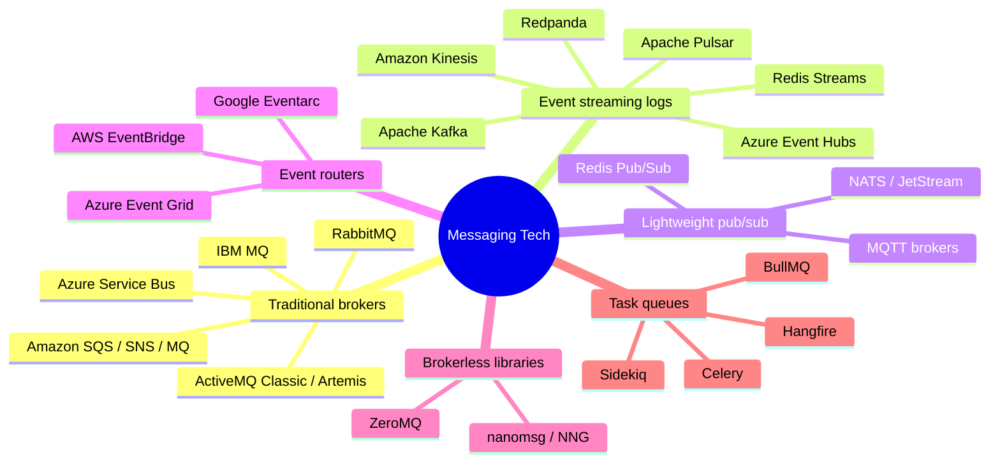
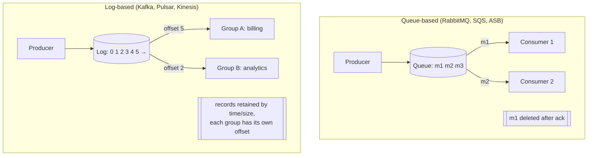
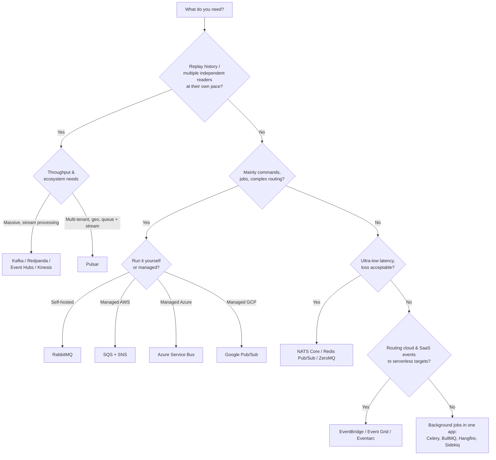

# 5. Message Broker Landscape — Kinds and Products

## Table of Contents

- [5.1 Families of Messaging Technology](#51-families-of-messaging-technology)
- [5.2 Queue-Based vs Log-Based: The Core Split](#52-queue-based-vs-log-based-the-core-split)
- [5.3 Protocols](#53-protocols)
- [5.4 Product Profiles](#54-product-profiles)
- [5.5 Big Comparison Table](#55-big-comparison-table)
- [5.6 Cloud Equivalents](#56-cloud-equivalents)
- [5.7 How to Choose](#57-how-to-choose)
- [5.8 Interview Talking Points](#58-interview-talking-points)

---

> **Purpose:** Know the major messaging products well enough to compare them, justify a choice in a system design interview, and avoid classic mismatches (e.g. using Kafka as a job queue, or RabbitMQ as an event store).

---

## 5.1 Families of Messaging Technology

| Family | Core idea | Sweet spot |
|---|---|---|
| **Traditional message brokers** | Smart broker: routing, per-message acks, deletes after consumption | Commands, work queues, complex routing, enterprise integration |
| **Event streaming platforms (logs)** | Append-only partitioned log; consumers track offsets; retention & replay | High-throughput event pipelines, event sourcing feeds, analytics, CDC |
| **Lightweight pub/sub** | Minimal overhead, often in-memory | Real-time signals, IoT, service-to-service notifications |
| **Event routers (serverless)** | Rule-based filtering and push delivery to targets | SaaS/cloud event integration, serverless workflows |
| **Brokerless libraries** | Messaging patterns over sockets, no server | Ultra-low latency, embedded, HPC |
| **Task/job queues** | Library on top of Redis/RabbitMQ/DB for background jobs | Background jobs inside one application stack |

---

## 5.2 Queue-Based vs Log-Based: The Core Split

| Aspect | Queue-based broker | Log-based streaming |
|---|---|---|
| Message lifetime | Deleted once acked | Retained for a period (or forever / compacted) |
| Consumer state | Tracked by the broker per message | Tracked by the consumer as an offset per partition |
| Replay | Not possible (once consumed, gone) — except RabbitMQ Streams | Rewind offsets and reprocess any time |
| Ordering | Per queue, broken by competing consumers | Strict per partition |
| Parallelism | Add consumers freely | Bounded by the number of partitions per group |
| Routing | Rich (exchanges, filters, headers) | Simple (topic + key); filtering done by consumers |
| Per-message features | TTL, priority, delay, per-message DLQ | Limited; retries/DLQ built by the application |
| Throughput | Tens of thousands of msgs/s per node (more with streams) | Millions of msgs/s per cluster |
| Best for | Commands, task distribution, RPC, complex routing | Event streams, analytics, event-driven data integration, replay |

> **Memorable phrasing:** *RabbitMQ is a post office (deliver and forget); Kafka is a newspaper archive (publish once, anyone can read any issue, any time).*

---

## 5.3 Protocols

| Protocol | Description | Supported by |
|---|---|---|
| **AMQP 0-9-1** | Binary protocol with exchanges, queues, bindings | RabbitMQ (native), LavinMQ |
| **AMQP 1.0** | OASIS standard, different model (links, nodes) | Azure Service Bus, ActiveMQ Artemis, Solace, RabbitMQ 4.x (native) |
| **MQTT** | Lightweight pub/sub for IoT; QoS 0/1/2, retained messages, last will | Mosquitto, EMQX, HiveMQ, RabbitMQ plugin, AWS IoT Core, Azure Event Grid |
| **STOMP** | Simple text protocol, good for browsers/websockets | ActiveMQ, RabbitMQ plugin |
| **Kafka protocol** | Binary protocol of Kafka, now a de facto standard | Kafka, Redpanda, Azure Event Hubs, Amazon MSK, WarpStream, Confluent |
| **JMS** | A Java **API**, not a wire protocol | ActiveMQ, IBM MQ, Artemis |
| **HTTP/webhooks** | Push/pull over HTTP | Cloud services, EventBridge, Event Grid, Pub/Sub push |
| **NATS protocol** | Simple text protocol | NATS |
| **CloudEvents** | Standard **event envelope** format (not a transport), CNCF | EventBridge (via mapping), Event Grid, Eventarc, Knative, Kafka bindings |

---

## 5.4 Product Profiles

### RabbitMQ
- **Type:** Traditional broker (Erlang), AMQP 0-9-1 native, AMQP 1.0 native since 4.0, MQTT/STOMP via plugins.
- **Model:** Producers publish to **exchanges** (direct, fanout, topic, headers); **bindings** route to **queues** (classic, **quorum** — Raft-replicated, **streams** — append-only logs with replay).
- **Strengths:** flexible routing, per-message acks, DLX, TTL, priorities, mature tooling, great .NET/Java/Python/Node clients, easy to run.
- **Weaknesses:** not designed for long retention/replay at massive scale (streams help); clustering needs care.
- **Use for:** microservice commands/events, work queues, RPC, complex routing.
- → See the dedicated deep-dive file.

### Apache Kafka
- **Type:** Distributed event streaming platform (JVM). KRaft mode replaces ZooKeeper (ZooKeeper removed in Kafka 4.0).
- **Model:** Topics split into **partitions** (ordered logs), replicated across brokers; **consumer groups** share partitions; offsets committed by consumers.
- **Strengths:** huge throughput, durable retention, replay, log compaction, ecosystem (Kafka Connect, Kafka Streams, ksqlDB, Schema Registry, Flink integration).
- **Weaknesses:** operational complexity, no per-message routing/priorities/delays, retries and DLQs are DIY, parallelism capped by partitions (share groups / "queues for Kafka", KIP-932, are arriving to address queue use cases).
- **Use for:** event backbones, CDC, stream processing, analytics pipelines, event sourcing feeds.
- → See the dedicated deep-dive file.

### ActiveMQ (Classic and Artemis)
- **Type:** Java broker, JMS 1.1/2.0 (Artemis also Jakarta Messaging 3.x), multi-protocol (OpenWire, AMQP 1.0, STOMP, MQTT).
- **Strengths:** JMS ecosystem, XA transactions, multi-protocol; Artemis is the high-performance next generation (and the base of Red Hat AMQ Broker), while Amazon MQ offers managed ActiveMQ Classic.
- **Use for:** Java enterprise integration, JMS-based legacy systems.

### IBM MQ
- **Type:** Enterprise broker with decades of use in banking/mainframes.
- **Strengths:** rock-solid transactional delivery, mainframe integration, exactly-once with XA.
- **Use for:** regulated industries and existing IBM estates.

### Amazon SQS & SNS
- **SQS:** fully managed queues. **Standard** (nearly unlimited throughput, at-least-once, best-effort ordering) and **FIFO** (ordered per `MessageGroupId`, dedup within 5 min). Visibility timeout, long polling (≤20 s), DLQ via redrive policy, retention 1 min–14 days (default 4 days), delay up to 15 min.
- **SNS:** managed pub/sub topics; fans out to SQS, Lambda, HTTP, email, SMS; message filtering policies. **SNS → SQS fan-out** is the classic AWS pub/sub pattern.
- **Use for:** AWS-native decoupling with zero ops.

### Amazon MQ
Managed **RabbitMQ** or **ActiveMQ** — lift-and-shift of existing broker workloads to AWS.

### Azure Service Bus
- **Type:** Managed enterprise broker (AMQP 1.0).
- **Features:** queues, **topics with subscriptions** and SQL/correlation filters, **sessions** (FIFO per session ID, stateful), dead-letter sub-queues, duplicate detection, scheduled messages, deferral, transactions across entities, peek-lock and receive-and-delete modes, auto-forwarding.
- **Tiers:** Basic (queues only), Standard (topics), Premium (dedicated resources, large messages up to 100 MB, geo-DR, VNet).
- **Use for:** Azure microservices, enterprise workflows needing ordering and transactions.

### Azure Event Hubs
Managed event streaming (log-based), **Kafka protocol compatible**, partitions + consumer groups, Capture to storage. The Azure equivalent of Kafka/Kinesis.

### Google Cloud Pub/Sub
- Global managed pub/sub: topics + subscriptions (pull, push, BigQuery/Cloud Storage export).
- Ack deadlines, ordering keys, exactly-once delivery (pull), dead-letter topics, retention and **seek/replay** (to a timestamp or snapshot).
- **Use for:** GCP-native messaging and ingestion; sits between a queue and a log.

### Amazon Kinesis Data Streams
Managed log-based streaming with **shards** (similar to partitions), retention 24 h up to 365 days. AWS-native alternative to Kafka (Amazon MSK is managed Kafka).

### Apache Pulsar
- **Type:** Streaming + queuing in one; compute (brokers) separated from storage (**Apache BookKeeper**), tiered storage to object stores.
- **Subscriptions:** exclusive, failover, **shared** (queue semantics) and **key_shared** (ordered per key with parallelism).
- **Strengths:** multi-tenancy, geo-replication built in, both queue and stream semantics.
- **Weaknesses:** more moving parts (brokers + bookies + metadata store), smaller ecosystem than Kafka.

### Redpanda
Kafka-API-compatible streaming engine written in C++ (no JVM, no ZooKeeper), single binary, lower tail latency. Drop-in for Kafka clients.

### NATS & JetStream
- **NATS Core:** extremely fast, simple **subject-based** pub/sub (`orders.*.created`, `orders.>` wildcards), at-most-once, request-reply built in, queue groups for load balancing.
- **JetStream:** persistence layer — streams, consumers (push/pull), at-least-once, dedup by message ID, key-value and object stores.
- **Use for:** cloud-native microservices, edge/IoT, low-latency service mesh-style messaging.

### Redis Pub/Sub and Redis Streams
- **Pub/Sub:** fire-and-forget broadcast, no persistence — offline subscribers miss messages.
- **Streams:** append-only log with **consumer groups** (`XADD`, `XREADGROUP`, `XACK`, pending entries list, `XCLAIM`/`XAUTOCLAIM` for stuck messages).
- **Use for:** lightweight queues/streams when Redis is already in the stack; not a replacement for a durable broker at scale (memory-bound).

### MQTT brokers (Mosquitto, EMQX, HiveMQ, VerneMQ)
Pub/sub for constrained devices: tiny headers, QoS 0/1/2, retained messages, last-will messages, persistent sessions. Often bridged into Kafka or a cloud pipeline.

### ZeroMQ
A messaging **library**, not a broker: socket patterns (REQ/REP, PUB/SUB, PUSH/PULL, ROUTER/DEALER) with in-memory queues. No persistence; you build the topology. Used in trading systems, scientific computing, Jupyter kernels.

### Task queues (Celery, Sidekiq, BullMQ, Hangfire, RQ)
Libraries for **background jobs** within an application ecosystem, using Redis/RabbitMQ/SQL as the backing store. They add job semantics: retries, scheduling, priorities, rate limiting, dashboards. Great for "run this function later"; not for cross-team integration contracts.

---

## 5.5 Big Comparison Table

| Product | Model | Delivery | Ordering | Replay | Routing | Throughput | Ops burden |
|---|---|---|---|---|---|---|---|
| **RabbitMQ** | Queue broker (+ streams) | At-most / at-least once | Per queue (single consumer) | Streams only | ★★★★★ exchanges | High | Medium |
| **Kafka** | Partitioned log | At-least once; EOS within Kafka | Per partition | ✅ | ★★ topic + key | ★★★★★ | High (lower with managed) |
| **Pulsar** | Segmented log + queues | At-least once; EOS (transactions) | Per partition / key_shared | ✅ | ★★★ | ★★★★★ | High |
| **ActiveMQ Artemis** | Queue broker (JMS) | At-least once; XA | Per queue / message groups | ❌ | ★★★★ | High | Medium |
| **NATS JetStream** | Subject pub/sub + streams | At-most (core) / at-least (JS) | Per stream | ✅ | ★★★★ subjects | ★★★★ | Low |
| **Redis Streams** | In-memory log | At-least once | Per stream | ✅ (memory-bound) | ★ | ★★★★ | Low (if Redis exists) |
| **Amazon SQS** | Managed queue | At-least once (Standard), dedup (FIFO) | FIFO per group | ❌ | ★ | ★★★★★ (Standard) | None |
| **Amazon SNS** | Managed pub/sub | At-least once | FIFO topics | ❌ | ★★★ filter policies | ★★★★★ | None |
| **Azure Service Bus** | Managed broker | At-least once; dedup; transactions | Sessions | ❌ | ★★★★ SQL filters | High | None |
| **Google Pub/Sub** | Managed pub/sub | At-least / exactly-once (pull) | Ordering keys | Seek/snapshot | ★★★ filters | ★★★★★ | None |
| **Kinesis / Event Hubs** | Managed log | At-least once | Per shard/partition | ✅ | ★ | ★★★★★ | Low |
| **ZeroMQ** | Library | At-most once | Per socket | ❌ | Patterns | ★★★★★ latency | You build it |

---

## 5.6 Cloud Equivalents

| Capability | AWS | Azure | Google Cloud | Open source |
|---|---|---|---|---|
| Queue | SQS | Service Bus queues / Storage Queues | Pub/Sub (pull) / Cloud Tasks | RabbitMQ, ActiveMQ |
| Pub/sub topic | SNS | Service Bus topics | Pub/Sub | RabbitMQ exchanges, NATS |
| Event streaming log | Kinesis, MSK (Kafka) | Event Hubs | Pub/Sub, Managed Kafka | Kafka, Pulsar, Redpanda |
| Event router / event bus | EventBridge | Event Grid | Eventarc | Knative Eventing, Argo Events |
| Managed traditional broker | Amazon MQ | — (Service Bus) | — | — |
| Workflow orchestration | Step Functions | Durable Functions, Logic Apps | Workflows | Temporal, Camunda |

---

## 5.7 How to Choose

**Questions to ask before choosing:**

1. Commands/jobs or events/streams? Do consumers need **replay**?
2. Required **throughput** and **latency**? Message **size**?
3. **Ordering** requirements: none, per key, global?
4. **Delivery guarantee** needed? Tolerance for duplicates/loss?
5. **Routing complexity**: simple fan-out or content-based routing?
6. **Retention**: minutes, days, forever?
7. **Operational capacity**: can the team run a cluster, or must it be managed?
8. **Cloud / vendor** constraints, **cost** model, **compliance** (data residency, encryption)?
9. **Ecosystem**: connectors, stream processing, client libraries for your languages?

---

## 5.8 Interview Talking Points

| Question | Strong answer |
|---|---|
| RabbitMQ vs Kafka? | RabbitMQ is a smart broker that routes and deletes messages after ack — ideal for commands, work queues and routing. Kafka is a distributed log that retains events for replay with per-partition ordering and massive throughput — ideal for event streams and data pipelines. |
| SQS vs SNS? | SQS is a queue (pull, one consumer per message); SNS is a pub/sub topic (push to many). Combine them for fan-out with durable per-service queues. |
| Why not Redis as a broker? | Pub/Sub loses messages for offline subscribers; Streams are memory-bound with fewer guarantees and tooling than dedicated brokers — fine for lightweight use. |
| When Pulsar over Kafka? | When you need native multi-tenancy, geo-replication, tiered storage and both queue (shared subscriptions) and stream semantics in one system. |
| What's CloudEvents? | A CNCF specification for a common event envelope (id, source, type, time, data…), so events are portable across brokers and clouds. |
