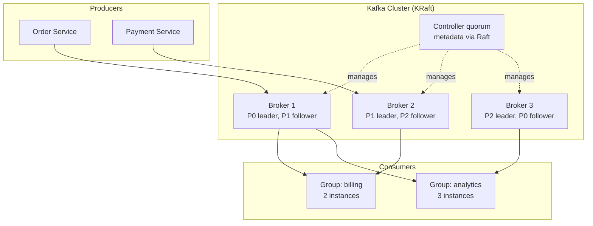
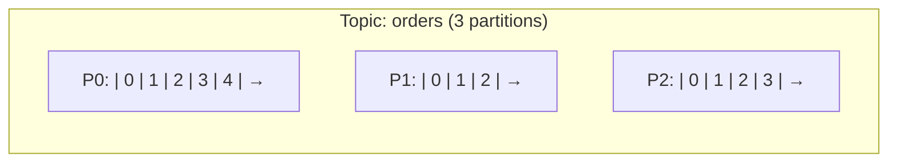
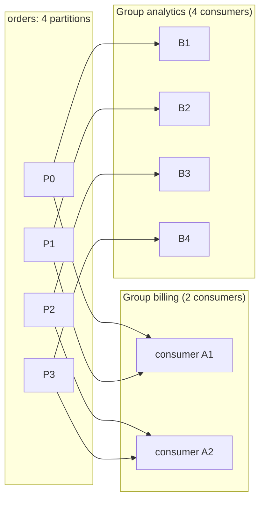
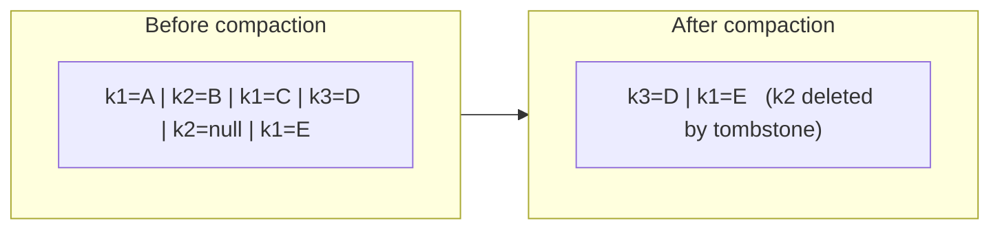
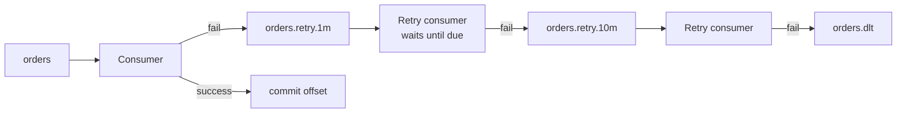

# 7. Apache Kafka & Event Streaming

## Table of Contents

- [7.1 What Event Streaming Is](#71-what-event-streaming-is)
- [7.2 Kafka Architecture](#72-kafka-architecture)
- [7.3 Topics, Partitions, Offsets](#73-topics-partitions-offsets)
- [7.4 Producers](#74-producers)
- [7.5 Consumers and Consumer Groups](#75-consumers-and-consumer-groups)
- [7.6 Replication and Durability](#76-replication-and-durability)
- [7.7 Retention and Log Compaction](#77-retention-and-log-compaction)
- [7.8 Exactly-Once Semantics](#78-exactly-once-semantics)
- [7.9 Retries and Dead-Letter Topics](#79-retries-and-dead-letter-topics)
- [7.10 The Kafka Ecosystem](#710-the-kafka-ecosystem)
- [7.11 Kafka as a Message Bus vs Event Bus](#711-kafka-as-a-message-bus-vs-event-bus)
- [7.12 Pitfalls](#712-pitfalls)
- [7.13 Interview Talking Points](#713-interview-talking-points)

---

> **Purpose:** Kafka is the dominant event streaming platform and appears in almost every system design interview involving events, analytics or high throughput. Understand partitions, consumer groups and guarantees — and why Kafka is *not* just "a faster RabbitMQ".

---

## 7.1 What Event Streaming Is

Event streaming treats data as an **unbounded, ordered, replayable sequence of events** stored in a durable **log**. Instead of "send a message to someone", the model is "**append a fact to a log**; anyone may read it, now or later, at their own pace".

| Messaging (queue) mindset | Streaming (log) mindset |
|---|---|
| Message is a task to be done | Event is a fact that happened |
| Consumed → deleted | Retained → replayable |
| Broker tracks what each consumer got | Consumer tracks its own position (offset) |
| New consumer sees only new messages | New consumer can read history from the beginning |

---

## 7.2 Kafka Architecture



| Component | Role |
|---|---|
| **Broker** | Server storing partitions and serving reads/writes |
| **Controller (KRaft)** | Manages cluster metadata (topics, partitions, leaders) using Raft. ZooKeeper mode was deprecated and **removed in Kafka 4.0** |
| **Topic** | Named stream of records (e.g. `orders`) |
| **Partition** | Ordered, append-only log; unit of parallelism, ordering and replication |
| **Replica** | Copy of a partition on another broker; one **leader**, N **followers** |
| **Producer** | Appends records to partitions |
| **Consumer group** | Set of consumers sharing the work of reading a topic |

---

## 7.3 Topics, Partitions, Offsets



- A **record** = key, value, headers, timestamp.
- Each record in a partition gets a monotonically increasing **offset**.
- **Ordering is guaranteed only within a partition.**
- The **key** decides the partition (`hash(key) % partitions` by default) → all events for the same key (e.g. `orderId`) go to the same partition, in order.
- No key → records are spread (sticky partitioner batches to one partition at a time).
- Partition count can be increased but **not decreased**, and increasing it changes key→partition mapping (breaks per-key ordering for existing keys). Choose it deliberately (based on target throughput / max consumer parallelism).

---

## 7.4 Producers

| Setting | Meaning | Recommended for durability |
|---|---|---|
| `acks` | `0` = no wait, `1` = leader stored, `all` = all in-sync replicas stored | `all` |
| `enable.idempotence` | Broker dedups retries per producer session (sequence numbers) | `true` (default since 3.0) |
| `retries` / `delivery.timeout.ms` | How long to keep retrying | High retries, bounded by timeout |
| `max.in.flight.requests.per.connection` | Parallel requests; ≤ 5 keeps ordering with idempotence | ≤ 5 |
| `linger.ms` / `batch.size` | Wait to batch records → throughput | e.g. 5–20 ms |
| `compression.type` | `lz4`, `zstd`, `snappy`, `gzip` | `lz4` or `zstd` |

```typescript
// KafkaJS producer
import { Kafka, CompressionTypes } from 'kafkajs';

const kafka = new Kafka({ clientId: 'order-service', brokers: ['kafka:9092'] });
const producer = kafka.producer({ idempotent: true, maxInFlightRequests: 5 });
await producer.connect();

await producer.send({
  topic: 'orders',
  acks: -1,                                   // all in-sync replicas
  compression: CompressionTypes.GZIP,
  messages: [{
    key: order.id,                            // same order → same partition → ordered
    value: JSON.stringify({ type: 'OrderPlaced', ...order }),
    headers: { 'content-type': 'application/json', traceparent },
  }],
});
```

---

## 7.5 Consumers and Consumer Groups



- Within a group, **each partition is assigned to exactly one consumer** → queue-like load balancing + per-partition ordering.
- **Different groups** each get **all** records → pub/sub.
- More consumers than partitions → extra consumers sit **idle**. Max parallelism per group = partition count.
- **Offsets** are committed to the internal `__consumer_offsets` topic. On restart or rebalance, consumption resumes from the last committed offset.
- **Rebalancing** happens when consumers join/leave; the **cooperative sticky** assignor and the new **consumer group protocol (KIP-848, GA in 4.0)** reduce stop-the-world pauses.
- `auto.offset.reset`: `earliest` (read from start) or `latest` (only new records) when no committed offset exists.

```python
# confluent-kafka consumer with manual commits (at-least-once)
from confluent_kafka import Consumer

c = Consumer({
    "bootstrap.servers": "kafka:9092",
    "group.id": "billing",
    "enable.auto.commit": False,
    "auto.offset.reset": "earliest",
    "isolation.level": "read_committed",
})
c.subscribe(["orders"])

while True:
    msg = c.poll(1.0)
    if msg is None or msg.error():
        continue
    handle(msg.key(), msg.value())         # idempotent processing
    c.commit(message=msg, asynchronous=False)
```

> **Head-of-line blocking:** because a partition is processed in order, one slow or failing record blocks all records behind it in that partition. Plan retries accordingly (see 7.9).

**Share groups (KIP-932, "Queues for Kafka")** — introduced as early access in Kafka 4.0 — let multiple consumers read the *same* partition with per-record acknowledgement, giving queue semantics (no ordering) without the partition-count limit.

---

## 7.6 Replication and Durability

| Concept | Description |
|---|---|
| **Replication factor** | Number of copies of each partition (typically 3) |
| **ISR (in-sync replicas)** | Replicas caught up with the leader |
| **`min.insync.replicas`** | Minimum ISR count required for an `acks=all` write to succeed (typically 2 with RF=3) |
| **Leader election** | If the leader fails, a follower from the ISR becomes leader |
| **`unclean.leader.election.enable`** | `false` (default): never elect an out-of-sync replica → no data loss, possible unavailability |

**RF=3, `min.insync.replicas=2`, `acks=all`** tolerates one broker failure with no data loss and continued writes.

---

## 7.7 Retention and Log Compaction

| Policy | Behavior | Use for |
|---|---|---|
| `cleanup.policy=delete` | Delete segments older than `retention.ms` or beyond `retention.bytes` | Event streams (e.g. 7 days) |
| `cleanup.policy=compact` | Keep at least the **latest record per key**; a `null` value (**tombstone**) deletes the key | Changelogs, current-state topics, CDC, KTables |
| `compact,delete` | Both | Latest state with an age limit |
| **Tiered storage** (KIP-405) | Old segments offloaded to object storage | Long retention at low cost |



---

## 7.8 Exactly-Once Semantics

Kafka's EOS combines:
1. **Idempotent producer** — no duplicates from retries.
2. **Transactions** — atomically write to multiple partitions *and* commit consumer offsets (`sendOffsetsToTransaction`).
3. **`isolation.level=read_committed`** consumers — skip aborted transactional records.

```java
producer.initTransactions();
while (true) {
    ConsumerRecords<String, String> records = consumer.poll(Duration.ofMillis(200));
    producer.beginTransaction();
    for (var r : records) {
        producer.send(new ProducerRecord<>("invoices", r.key(), toInvoice(r.value())));
    }
    producer.sendOffsetsToTransaction(currentOffsets(records), consumer.groupMetadata());
    producer.commitTransaction();   // output records + input offsets commit atomically
}
```

**Scope:** consume-transform-produce **within Kafka** (Kafka Streams uses this with `processing.guarantee=exactly_once_v2`). Writing to an external DB or calling an API is **not** covered — use idempotent sinks, upserts or outbox/inbox.

---

## 7.9 Retries and Dead-Letter Topics

Kafka has no built-in per-message retry/DLQ (unlike RabbitMQ/SQS). Common approaches:



| Approach | Pros | Cons |
|---|---|---|
| **Blocking retry** in the consumer (retry N times with backoff, then DLT) | Preserves order | Blocks the partition while retrying |
| **Non-blocking retry topics** (Spring Kafka `@RetryableTopic`, Uber's pattern) | Partition keeps flowing | Breaks per-key ordering for retried records |
| **Dead-letter topic** (Kafka Connect `errors.deadletterqueue.topic.name`, Spring `DeadLetterPublishingRecoverer`) | Park poison records with error headers | Needs tooling to inspect and replay |

---

## 7.10 The Kafka Ecosystem

| Component | Purpose |
|---|---|
| **Kafka Connect** | Source/sink connectors (DBs, S3, Elasticsearch…) without custom code |
| **Debezium** | CDC: streams database changes (binlog/WAL) into Kafka — powers outbox relays |
| **Kafka Streams** | Java library for stateful stream processing (joins, windows, aggregations, KTables) |
| **ksqlDB** | SQL over streams |
| **Apache Flink** | Distributed stream processing engine, widely used with Kafka |
| **Schema Registry** | Avro/Protobuf/JSON Schema management with compatibility rules |
| **MirrorMaker 2 / Cluster Linking** | Cross-cluster replication, DR, migration |
| **Managed services** | Confluent Cloud, Amazon MSK (incl. Serverless), Aiven, Azure Event Hubs (Kafka API), Google Managed Service for Apache Kafka |
| **Compatible engines** | Redpanda, WarpStream (object-storage-native), AutoMQ |

---

## 7.11 Kafka as a Message Bus vs Event Bus

| Use | Fit | Notes |
|---|---|---|
| **Event backbone / distributed event bus** | ★★★★★ | Durable, replayable, many independent consumer groups |
| **Event sourcing feed / CDC** | ★★★★☆ | Great as a transport; as the *primary* event store it lacks per-aggregate optimistic concurrency and per-entity stream reads |
| **Command bus / work queue** | ★★☆☆☆ | No per-message ack, priorities, delays or routing; parallelism capped by partitions (share groups help) |
| **Request/reply** | ★☆☆☆☆ | Possible (reply topics) but awkward and higher latency |

---

## 7.12 Pitfalls

| Pitfall | Consequence | Mitigation |
|---|---|---|
| Too few partitions | Can't scale consumers | Size for peak parallelism; growth plan |
| Too many partitions | Metadata overhead, slower recovery | Reasonable count per broker; KRaft raises limits |
| Hot keys | One partition overloaded | Better key choice, key salting (loses ordering) |
| Auto-commit before processing | Message loss on crash | Manual commit after processing |
| Long processing in poll loop | Exceeds `max.poll.interval.ms` → rebalance storm | Smaller batches, async processing with pause/resume |
| Assuming global ordering | Bugs | Order only per partition/key |
| Using Kafka for tiny-scale job queues | Operational overkill | RabbitMQ/SQS/task queue |
| Unbounded schema drift | Broken consumers | Schema Registry with compatibility |

---

## 7.13 Interview Talking Points

| Question | Strong answer |
|---|---|
| How does Kafka scale? | Topics are split into partitions spread across brokers; producers write in parallel; each consumer group divides partitions among its instances. |
| How is ordering guaranteed? | Only within a partition; use a key (e.g. orderId) so related events land in the same partition. |
| What happens when a consumer dies? | The group rebalances; its partitions move to other members, which resume from the last committed offset — so records after it are reprocessed (at-least-once). |
| How do you avoid data loss? | RF=3, `min.insync.replicas=2`, `acks=all`, idempotent producer, unclean leader election off, commit offsets after processing. |
| What is log compaction? | Retains the latest value per key (tombstones delete), turning a topic into a durable changelog of current state. |
| Kafka vs RabbitMQ in one sentence? | Kafka is a replayable distributed log optimized for high-throughput event streams; RabbitMQ is a smart broker optimized for routing and per-message delivery of commands and tasks. |
