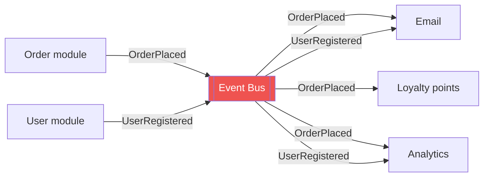
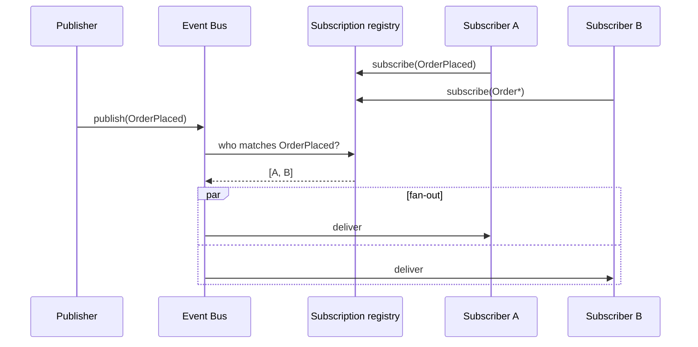
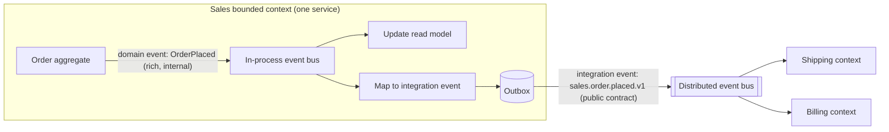

# 9. Event Bus Fundamentals

## Table of Contents

- [9.1 What Is an Event Bus?](#91-what-is-an-event-bus)
- [9.2 What Is an Event?](#92-what-is-an-event)
- [9.3 How an Event Bus Works](#93-how-an-event-bus-works)
- [9.4 Kinds of Event Buses](#94-kinds-of-event-buses)
- [9.5 Domain Events vs Integration Events](#95-domain-events-vs-integration-events)
- [9.6 Event Design: Thin vs Fat Events](#96-event-design-thin-vs-fat-events)
- [9.7 How to Use an Event Bus — Step by Step](#97-how-to-use-an-event-bus--step-by-step)
- [9.8 Code Examples](#98-code-examples)
- [9.9 When to Use an Event Bus](#99-when-to-use-an-event-bus)
- [9.10 When NOT to Use an Event Bus](#910-when-not-to-use-an-event-bus)
- [9.11 Common Problems and Fixes](#911-common-problems-and-fixes)
- [9.12 Interview Talking Points](#912-interview-talking-points)

---

> **Purpose:** Understand the event bus as a specialized publish-subscribe mechanism for broadcasting *facts*, in its in-process, frontend and distributed forms — and how to use it without creating invisible spaghetti.

---

## 9.1 What Is an Event Bus?

An **event bus** is a publish-subscribe mechanism through which components **publish events** (notifications that something happened) and other components **subscribe** to the event types they care about. Publishers and subscribers don't know about each other; the bus delivers each event to **all** matching subscribers.



**Key properties:**
- **One-to-many:** each event can have zero, one or many subscribers.
- **Fire-and-forget from the publisher's perspective:** the publisher does not expect a reply and doesn't care who listens.
- **Events are facts:** past-tense, immutable, can't be rejected.
- **Subscription by type/topic/pattern:** subscribers declare interest by event type or filter.

> **One-line definition:** *An event bus decouples the component that knows something happened from the components that need to react to it.*

---

## 9.2 What Is an Event?

An event is an **immutable record of something significant that happened in the past**, owned by the component where it happened.

| Characteristic | Description |
|---|---|
| **Past tense name** | `OrderPlaced`, `PaymentFailed`, `InventoryReserved` |
| **Immutable** | Once published, never changed — corrections are new events (`OrderCorrected`) |
| **Owned by the publisher** | The publishing context defines its schema and meaning |
| **Carries context** | Who/what/when: id, timestamp, source, subject, data |
| **No expectations** | Publisher does not dictate what subscribers do |

### Standard envelope: CloudEvents

```json
{
  "specversion": "1.0",
  "id": "a8f2c4e0-1d1b-4c55-9e0f-2b8f0c1d9e77",
  "source": "/sales/order-service",
  "type": "com.acme.sales.order.placed.v1",
  "subject": "orders/48213",
  "time": "2026-10-11T09:31:04Z",
  "datacontenttype": "application/json",
  "data": { "orderId": "48213", "customerId": "c-991", "total": 129.90 }
}
```

CloudEvents (CNCF) standardizes the metadata so events are portable across Event Grid, Eventarc, Knative, Dapr, Kafka and HTTP.

---

## 9.3 How an Event Bus Works



Core mechanics:

1. **Subscription registry** — mapping of event type/pattern → handlers (in memory, or broker bindings/rules).
2. **Publish** — the publisher hands an event to the bus.
3. **Matching** — by exact type, topic hierarchy, wildcard, or content filter (rules).
4. **Dispatch** — synchronous (same call stack) or asynchronous (queue/thread/broker).
5. **Delivery guarantees** — in-memory buses: none beyond the process; distributed buses: at-least-once with retries and DLQ.
6. **Error isolation** — one failing subscriber should not affect others.

---

## 9.4 Kinds of Event Buses

### By scope

| Kind | Where | Durability | Examples |
|---|---|---|---|
| **In-process (application) event bus** | Inside one process | None (unless backed by outbox) | Guava EventBus, Spring application events, MediatR notifications, Node `EventEmitter`, NestJS `EventBus` |
| **Frontend / UI event bus** | In the browser app | None | RxJS `Subject`, DOM `CustomEvent`/`EventTarget`, mitt, Vue `mitt`, Angular services with Subjects |
| **Distributed event bus** | Across services via a broker | Durable | RabbitMQ fanout/topic exchanges, Kafka topics, SNS, ASB topics, Google Pub/Sub |
| **Serverless event router** | Cloud-managed, rule-based push | Durable, with retries | AWS EventBridge, Azure Event Grid, Google Eventarc |
| **Event mesh** | Network of interconnected brokers across regions/clouds | Durable | Solace PubSub+, Knative Eventing, NATS superclusters |

### By dispatch model

| Model | Behavior | Trade-off |
|---|---|---|
| **Synchronous** | Publisher's call returns after all handlers ran | Simple, transactional, but slow handlers block the publisher and errors propagate |
| **Asynchronous (in-process)** | Handlers run on other threads/tasks | Non-blocking, but lost on crash |
| **Asynchronous (brokered)** | Events stored in a broker, delivered later | Durable and scalable, eventual consistency |

### By event style (covered in depth in the EDA patterns file)

| Style | Payload | Example |
|---|---|---|
| **Event notification** | Minimal — "something changed, ask me if you care" | `{ "type": "OrderPlaced", "orderId": "48213" }` |
| **Event-carried state transfer** | Full relevant state | `OrderPlaced` with lines, totals, address |
| **Event sourcing events** | Fine-grained state changes stored as the source of truth | `ItemAddedToCart`, `CartCheckedOut` |

---

## 9.5 Domain Events vs Integration Events



| | Domain event | Integration event |
|---|---|---|
| Scope | Inside one bounded context | Across bounded contexts/services |
| Transport | In-process bus, same transaction | Broker (distributed event bus), via outbox |
| Schema | Can change freely with the domain model | **Public contract**, versioned, stable |
| Content | May reference internal types/entities | Primitive, serializable, minimal internal detail |
| Timing | Often dispatched before/at commit | Published after commit (outbox) |
| Example | `OrderLineQuantityChanged` | `sales.order.placed.v1` |

> **Senior signal:** never publish your internal domain events directly to other services — map them to integration events at the boundary (an anti-corruption layer for your own model).

---

## 9.6 Event Design: Thin vs Fat Events

| | Thin (notification) | Fat (state transfer) |
|---|---|---|
| Payload | IDs and minimal info | All data consumers typically need |
| Consumer behavior | Calls back the publisher's API for details | Processes immediately, keeps a local copy |
| Coupling | Runtime coupling (callback) | Schema coupling (bigger contract) |
| Load on publisher | Callback traffic spikes after each event | None |
| Freshness | Consumer reads current state | Event carries state at event time |
| Privacy | Sensitive data stays in the source | Data spreads to many services |

**Guidelines:**
- Include what **most** consumers need to act without calling back; keep it focused on the fact.
- Include **identifiers**, **timestamp**, **version/sequence number** of the entity (so consumers can drop stale events).
- Avoid leaking **PII** unnecessarily; consider references or encryption.
- One event = one business fact. Avoid generic `EntityUpdated` with diff blobs — they force consumers to reverse-engineer meaning.

---

## 9.7 How to Use an Event Bus — Step by Step

1. **Find the facts.** Event storming: what business events happen (`OrderPlaced`, `PaymentCaptured`)? Who owns them?
2. **Decide the scope.** In-process for intra-module reactions; distributed for cross-service integration; serverless router for cloud/SaaS events.
3. **Design the event contracts.** Past-tense names, CloudEvents-style metadata, versioned types, schema in a registry/catalog.
4. **Publish reliably.** Publish *after* the state change commits — use the **outbox** (distributed) or **after-commit listeners** (`@TransactionalEventListener`, domain events dispatched in `SaveChanges`).
5. **Subscribe with intent.** Each subscriber owns its subscription (queue/consumer group/rule) and handles events **idempotently**.
6. **Isolate failures.** Per-subscriber retries and DLQs; never let one subscriber's failure block the others.
7. **Document the flows.** Event catalog (EventCatalog, AsyncAPI) listing producers, consumers and schemas — otherwise choreography becomes invisible.
8. **Observe.** Trace context propagation, per-subscription lag, DLQ alerts, end-to-end latency.

---

## 9.8 Code Examples

### 9.8.1 Typed in-process event bus (TypeScript)

```typescript
type EventMap = {
  OrderPlaced: { orderId: string; total: number };
  UserRegistered: { userId: string; email: string };
};

type Listener<T> = (payload: T) => void | Promise<void>;

class TypedEventBus<E extends Record<string, unknown>> {
  private listeners: { [K in keyof E]?: Set<Listener<E[K]>> } = {};

  on<K extends keyof E>(type: K, listener: Listener<E[K]>): () => void {
    (this.listeners[type] ??= new Set()).add(listener);
    return () => this.listeners[type]!.delete(listener);   // unsubscribe handle
  }

  async emit<K extends keyof E>(type: K, payload: E[K]): Promise<void> {
    const results = await Promise.allSettled(
      [...(this.listeners[type] ?? [])].map(l => l(payload)),
    );
    results.filter(r => r.status === 'rejected')
           .forEach(r => console.error(`Listener for ${String(type)} failed`, (r as PromiseRejectedResult).reason));
  }
}

const events = new TypedEventBus<EventMap>();
const off = events.on('OrderPlaced', e => console.log('Award points for', e.orderId));
await events.emit('OrderPlaced', { orderId: '42', total: 99 });
off(); // avoid memory leaks: always unsubscribe when the subscriber's lifetime ends
```

### 9.8.2 Frontend event bus with RxJS (Angular)

```typescript
import { Injectable } from '@angular/core';
import { Subject, filter, map, Observable } from 'rxjs';

interface AppEvent<T = unknown> { type: string; payload: T; }

@Injectable({ providedIn: 'root' })
export class EventBusService {
  private readonly bus$ = new Subject<AppEvent>();

  publish<T>(type: string, payload: T): void {
    this.bus$.next({ type, payload });
  }

  on<T>(type: string): Observable<T> {
    return this.bus$.pipe(filter(e => e.type === type), map(e => e.payload as T));
  }
}

// Subscriber (component): use takeUntilDestroyed() to avoid leaks
// this.bus.on<CartItem>('cart:item-added').pipe(takeUntilDestroyed()).subscribe(...)
```

> In modern frontends prefer **explicit state management** (signals, stores) over a global event bus for shared state; use a bus only for truly cross-cutting, fire-and-forget notifications (toasts, analytics, micro-frontend communication).

### 9.8.3 Spring domain events published after commit (Java)

```java
@Service
public class OrderService {
    private final ApplicationEventPublisher events;
    private final OrderRepository orders;

    @Transactional
    public void place(PlaceOrder cmd) {
        Order order = orders.save(Order.from(cmd));
        events.publishEvent(new OrderPlaced(order.getId(), order.getTotal()));
    }
}

@Component
class LoyaltyListener {
    // Runs only if the transaction commits — no events for rolled-back orders
    @TransactionalEventListener(phase = TransactionPhase.AFTER_COMMIT)
    void on(OrderPlaced e) { /* award points, or write to outbox for other services */ }
}
```

### 9.8.4 Distributed event bus: SNS → SQS fan-out (AWS CDK, TypeScript)

```typescript
const orderEvents = new sns.Topic(this, 'OrderEvents');

for (const service of ['billing', 'shipping', 'analytics']) {
  const dlq = new sqs.Queue(this, `${service}-dlq`);
  const queue = new sqs.Queue(this, `${service}-queue`, {
    deadLetterQueue: { queue: dlq, maxReceiveCount: 5 },
  });
  orderEvents.addSubscription(new subs.SqsSubscription(queue, {
    rawMessageDelivery: true,
    filterPolicy: service === 'shipping'
      ? { eventType: sns.SubscriptionFilter.stringFilter({ allowlist: ['OrderPlaced', 'OrderCancelled'] }) }
      : undefined,
  }));
}
```

---

## 9.9 When to Use an Event Bus

| Scenario | Why |
|---|---|
| Multiple, evolving reactions to the same fact | Add subscribers without touching the publisher (Open/Closed at the architecture level) |
| Cross-service data propagation | Services keep local read copies (ECST) instead of synchronous lookups |
| Audit, analytics, search indexing, notifications | Side concerns subscribe without polluting core logic |
| Modular monolith decoupling | Modules communicate via events, enabling later extraction |
| Reacting to infrastructure/SaaS events | S3 object created, Stripe payment, GitHub push → routed by an event router |
| Micro-frontends | Loose communication between independently deployed UI parts |
| Event sourcing / CQRS projections | Projections subscribe to the event stream |

---

## 9.10 When NOT to Use an Event Bus

| Situation | Problem | Better |
|---|---|---|
| You need a specific component to do something and know the outcome | That's a **command**, not an event | Message bus command or a direct call |
| You need an answer (query) | Events don't return values | Sync API / request-reply |
| Strict ordering and transactional consistency across steps | Async fan-out can't guarantee it | Single transaction or orchestrated saga |
| Only one subscriber will ever exist and it's in the same module | Indirection without benefit | Direct method call |
| Global state shared across a UI | Hidden data flows, hard debugging | State management (store/signals) |
| Business-critical workflows that need visibility | Choreography hides the flow | Orchestration (process manager / workflow engine) |

---

## 9.11 Common Problems and Fixes

| Problem | Description | Fix |
|---|---|---|
| **Event spaghetti** | Nobody knows who reacts to what; chains of events cause surprising effects | Event catalog, AsyncAPI docs, tracing; orchestrate complex flows |
| **Lost events** | Published before commit / in-memory bus crash | Outbox, after-commit listeners, durable broker |
| **Phantom events** | Event published, transaction rolled back | Publish after commit (outbox) |
| **Duplicate handling** | At-least-once delivery | Idempotent subscribers |
| **Out-of-order events** | `OrderShipped` before `OrderPlaced` | Entity version numbers, per-key ordering, tolerate/park |
| **Memory leaks (in-process/UI)** | Subscribers never unsubscribe | Return unsubscribe handles, lifecycle-bound subscriptions |
| **Synchronous handler failures break the publisher** | Exception bubbles up through `publish()` | Isolate handlers, async dispatch, per-handler error handling |
| **Event used as disguised command** | `SendEmailRequested` with one consumer | Use a command to that service's queue |
| **Infinite loops** | A reacts to B's event and emits an event B reacts to | Causation IDs, loop detection, design reviews |

---

## 9.12 Interview Talking Points

| Question | Strong answer |
|---|---|
| What is an event bus? | A publish-subscribe mechanism that broadcasts events — immutable facts — to any number of subscribers that don't know the publisher, and vice versa. |
| In-process vs distributed event bus? | In-process gives code decoupling inside one app with no durability; distributed uses a broker for cross-service, durable, at-least-once delivery. |
| Domain vs integration events? | Domain events are internal to a bounded context and can change freely; integration events are versioned public contracts published across services via an outbox. |
| Thin or fat events? | Thin events reduce schema coupling but cause callbacks; fat events (state transfer) let consumers act autonomously at the cost of a bigger contract. Usually: include what most consumers need. |
| Biggest risk with an event bus? | Invisible flows (event spaghetti) and lost/phantom events; mitigate with an event catalog, tracing, outbox and idempotent subscribers. |
