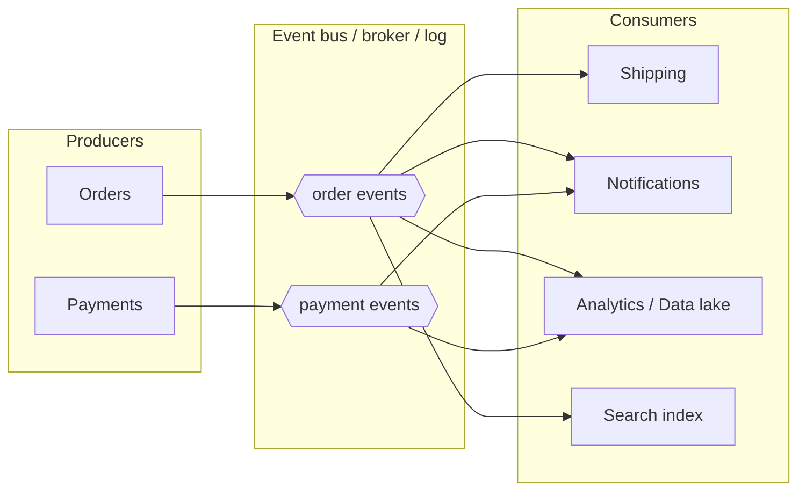
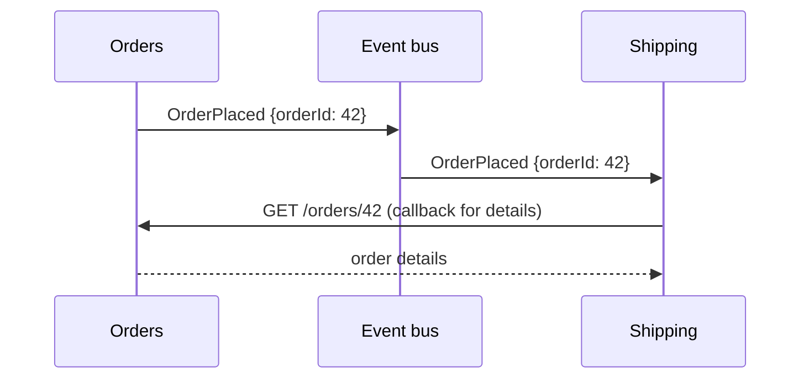
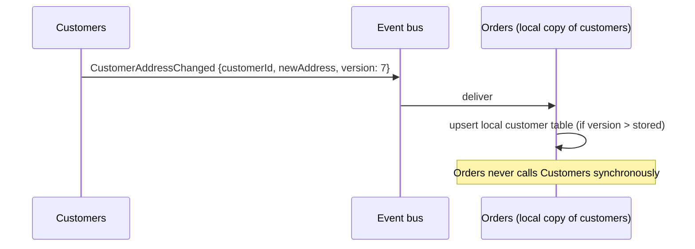
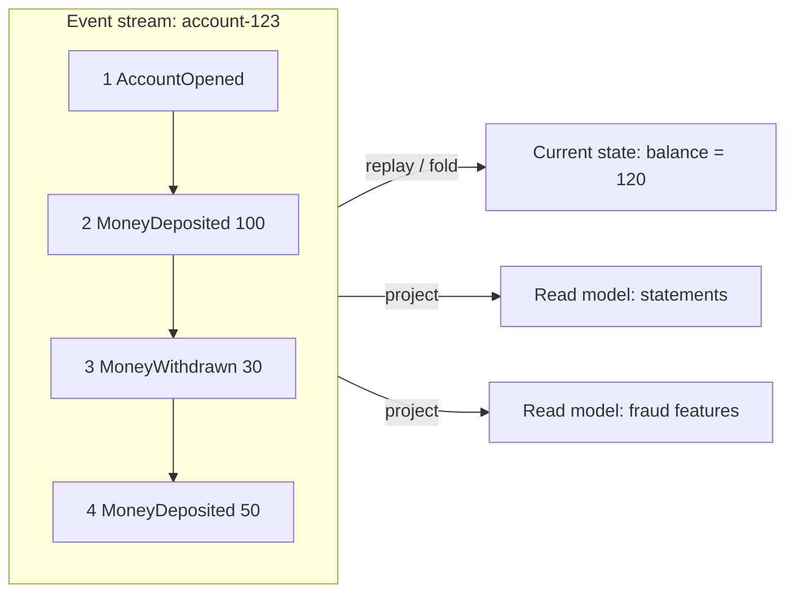
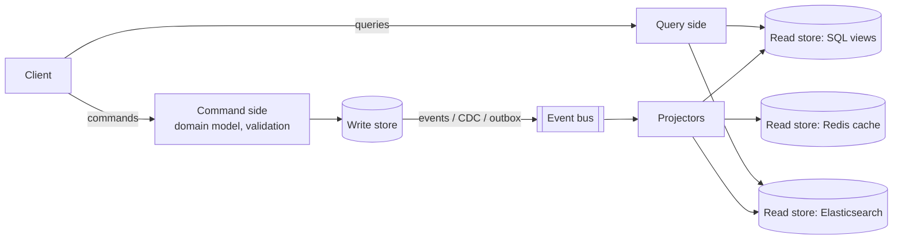
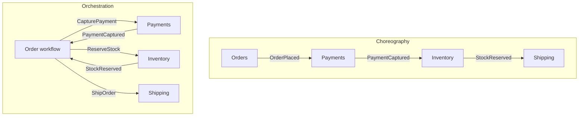
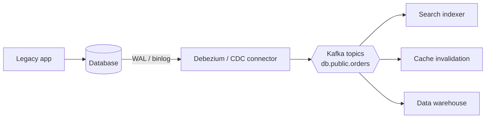
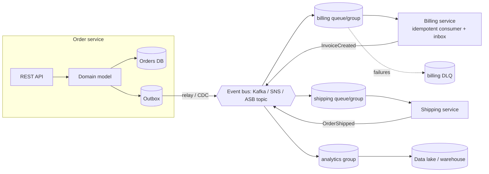

# 10. Event-Driven Architecture Patterns

## Table of Contents

- [10.1 What Event-Driven Architecture Means](#101-what-event-driven-architecture-means)
- [10.2 The Four Patterns (Fowler)](#102-the-four-patterns-fowler)
- [10.3 Event Notification](#103-event-notification)
- [10.4 Event-Carried State Transfer](#104-event-carried-state-transfer)
- [10.5 Event Sourcing](#105-event-sourcing)
- [10.6 CQRS](#106-cqrs)
- [10.7 Choreography vs Orchestration](#107-choreography-vs-orchestration)
- [10.8 Change Data Capture as an Event Source](#108-change-data-capture-as-an-event-source)
- [10.9 Event Contracts: AsyncAPI, Schema Registries, Catalogs](#109-event-contracts-asyncapi-schema-registries-catalogs)
- [10.10 Consistency, UX and Eventual Consistency](#1010-consistency-ux-and-eventual-consistency)
- [10.11 Reference Architecture](#1011-reference-architecture)
- [10.12 Interview Talking Points](#1012-interview-talking-points)

---

> **Purpose:** An event bus is a tool; event-driven architecture (EDA) is the style built with it. Know the distinct patterns that hide behind the word "event-driven" — they have very different trade-offs.

---

## 10.1 What Event-Driven Architecture Means

**EDA** is an architectural style where components communicate primarily by **producing and reacting to events**. The producer emits facts; consumers decide independently what to do.



**Benefits:** loose coupling, extensibility (new consumers without changing producers), scalability, resilience, natural audit trail, real-time reactions.
**Costs:** eventual consistency, harder reasoning about end-to-end flows, schema governance, duplicate/order handling, more infrastructure.

---

## 10.2 The Four Patterns (Fowler)

Martin Fowler's *"What do you mean by 'Event-Driven'?"* identifies four different things people mean:

| Pattern | Core idea | Main benefit | Main cost |
|---|---|---|---|
| **Event Notification** | Tell others something happened; minimal data | Very loose coupling | Callbacks for data, flow is implicit |
| **Event-Carried State Transfer (ECST)** | Events carry the state consumers need | Consumer autonomy & availability | Data duplication, bigger contracts |
| **Event Sourcing** | Store state *as* the sequence of events | Full history, audit, temporal queries | Complexity, schema evolution of history |
| **CQRS** | Separate write model from read model(s) | Optimized reads & writes independently | Two models, eventual consistency |

They can be combined but are **independent decisions**.

---

## 10.3 Event Notification



- **Use when:** consumers need different subsets of data, data changes often, or data is sensitive.
- **Watch out:** callback storms after bursts; temporal coupling returns through the callback; the event alone isn't enough to understand what happened.

---

## 10.4 Event-Carried State Transfer



- Consumers maintain **local replicas** of the data they need → they keep working when the source is down.
- Use **entity version numbers** to discard stale/out-of-order updates.
- **Compacted Kafka topics** are a natural fit: the topic is a replayable "current state" feed a new consumer can bootstrap from.
- **Watch out:** replicated data is eventually consistent; personal data proliferates (GDPR deletion must propagate — e.g. via tombstones/`CustomerForgotten` events).

---

## 10.5 Event Sourcing

Instead of storing the current state and overwriting it, **store every state change as an immutable event**; current state = fold (replay) of the events.



```typescript
type AccountEvent =
  | { type: 'AccountOpened'; accountId: string }
  | { type: 'MoneyDeposited'; amount: number }
  | { type: 'MoneyWithdrawn'; amount: number };

interface Account { id: string; balance: number; version: number; }

const evolve = (state: Account, e: AccountEvent): Account => {
  switch (e.type) {
    case 'AccountOpened':  return { id: e.accountId, balance: 0, version: state.version + 1 };
    case 'MoneyDeposited': return { ...state, balance: state.balance + e.amount, version: state.version + 1 };
    case 'MoneyWithdrawn': return { ...state, balance: state.balance - e.amount, version: state.version + 1 };
  }
};

const rehydrate = (events: AccountEvent[]) =>
  events.reduce(evolve, { id: '', balance: 0, version: 0 });

// Command handling with optimistic concurrency
function withdraw(events: AccountEvent[], amount: number): AccountEvent[] {
  const account = rehydrate(events);
  if (account.balance < amount) throw new Error('Insufficient funds');   // invariant on current state
  return [{ type: 'MoneyWithdrawn', amount }];  // append with expectedVersion = account.version
}
```

| Concept | Meaning |
|---|---|
| **Event store** | Append-only DB with per-stream reads and **optimistic concurrency** (`expectedVersion`) — EventStoreDB/KurrentDB, Marten (PostgreSQL), Axon Server, DynamoDB/Cosmos DB custom |
| **Projection** | Builds read models by subscribing to events |
| **Snapshot** | Periodic cached state to avoid replaying long streams |
| **Upcasting** | Transform old event versions to new shapes when reading |

- **Benefits:** perfect audit trail, time travel/debugging, rebuild new read models from history, natural event publication.
- **Costs:** steep learning curve, evolving historical event schemas, GDPR erasure (crypto-shredding), eventual consistency of projections.
- **Is Kafka an event store?** It's a great event **transport/log**, but lacks efficient per-aggregate stream reads and per-stream optimistic concurrency, so it's usually not the primary event store for aggregates.
- **Event sourcing ≠ event-driven integration:** internal fine-grained events (`ItemQuantityAdjusted`) should usually be mapped to coarser integration events before leaving the service.

---

## 10.6 CQRS

**Command Query Responsibility Segregation:** use different models for updating (commands) and reading (queries).



- Read models are denormalized for specific screens/queries; write model enforces invariants.
- The **event bus connects the two sides** → read models are eventually consistent.
- CQRS doesn't require event sourcing (and vice versa), though they pair well.
- **Use when** read and write workloads/shapes differ greatly (e.g. complex domain + search/reporting). **Avoid** for simple CRUD.

---

## 10.7 Choreography vs Orchestration



| Criterion | Choreography (event bus) | Orchestration (commands + coordinator) |
|---|---|---|
| Communication | Events | Commands + reply events |
| Who knows the flow | Nobody centrally | The orchestrator |
| Adding a step | Add a subscriber | Change the workflow |
| Monitoring the business process | Needs tracing/correlation across services | Workflow state is queryable |
| Failure/compensation logic | Distributed in each service | Centralized |
| Good for | Simple, stable flows; broadcasting facts | Complex, long-running, branching flows with timeouts |
| Tools | Event bus / broker | Temporal, Camunda/Zeebe, AWS Step Functions, Azure Durable Functions, MassTransit/NServiceBus sagas |

> **Typical answer:** *"Choreography for broadcasting facts to loosely related consumers; orchestration for a business process that has an owner, needs compensation and must be observable. Many systems mix them: an orchestrator inside a bounded context that publishes events to the rest of the system."*

---

## 10.8 Change Data Capture as an Event Source



- CDC turns database changes into an event stream **without changing the application** (great for legacy systems and the outbox relay).
- **Caveat:** raw CDC events are *table-level changes*, not *business events* — they leak the schema. Prefer the **outbox table + CDC** (Debezium Outbox Event Router) to publish intentional, business-level events.

---

## 10.9 Event Contracts: AsyncAPI, Schema Registries, Catalogs

| Tool | Purpose |
|---|---|
| **AsyncAPI** | OpenAPI-equivalent spec for event-driven APIs: channels, messages, schemas, bindings (Kafka, AMQP, MQTT); generates docs and code |
| **CloudEvents** | Standard envelope attributes |
| **Schema registries** | Confluent Schema Registry, Apicurio, AWS Glue Schema Registry, Azure Schema Registry, EventBridge Schema Registry — enforce compatibility |
| **EventCatalog** | Documentation site of domains, services, events, producers/consumers |
| **Pact (message pacts)** | Consumer-driven contract tests for events |

```yaml
asyncapi: 3.0.0
info:
  title: Order Service Events
  version: 1.2.0
channels:
  orderPlaced:
    address: sales.order.placed.v1
    messages:
      OrderPlaced:
        payload:
          type: object
          required: [orderId, customerId, total, occurredAt]
          properties:
            orderId: { type: string }
            customerId: { type: string }
            total: { type: number }
            occurredAt: { type: string, format: date-time }
operations:
  publishOrderPlaced:
    action: send
    channel: { $ref: '#/channels/orderPlaced' }
```

---

## 10.10 Consistency, UX and Eventual Consistency

Eventual consistency is a **product** problem as much as a technical one.

| Technique | Example |
|---|---|
| **Return 202 Accepted + status resource** | `POST /orders` → `202` with `Location: /orders/42/status` |
| **Optimistic UI** | Show "Order placed" immediately, reconcile later |
| **Read-your-own-writes** | Serve the user's own recent changes from the write model or a session cache |
| **Push updates** | WebSockets/SSE notify the UI when the async process completes |
| **Explicit pending states** | "Payment processing…" rather than pretending it's done |
| **Version/ETag checks** | Prevent acting on stale read models |

---

## 10.11 Reference Architecture



Checklist: outbox on producers · per-consumer queues/groups · idempotent consumers · DLQs with alerting · schema registry · trace propagation · event catalog · replay strategy.

---

## 10.12 Interview Talking Points

| Question | Strong answer |
|---|---|
| What does "event-driven" mean to you? | Clarify which pattern: event notification, event-carried state transfer, event sourcing or CQRS — they solve different problems. |
| Event sourcing pros/cons? | Full audit and replayable history, new projections from history; but complexity, schema evolution of stored events and eventual consistency of read models. |
| CQRS without event sourcing? | Yes — separate read models updated from the write side via events, outbox or CDC. |
| Choreography or orchestration? | Choreography for simple fan-out of facts; orchestration for owned, complex, compensating workflows — often combined. |
| How do you handle eventual consistency in the UI? | 202 + status endpoint, optimistic UI, read-your-writes, push notifications, explicit pending states. |
| CDC vs outbox? | CDC exposes table changes (schema leakage); outbox publishes intentional business events — and outbox + CDC combines both strengths. |
