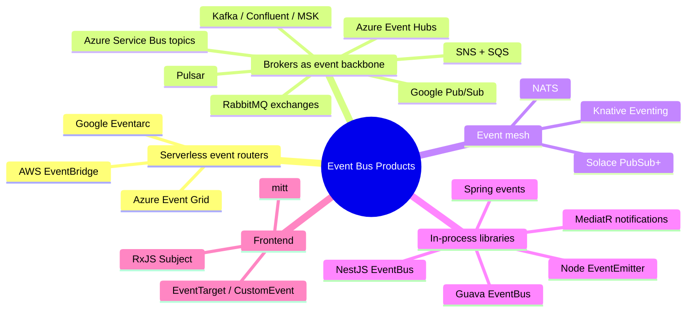
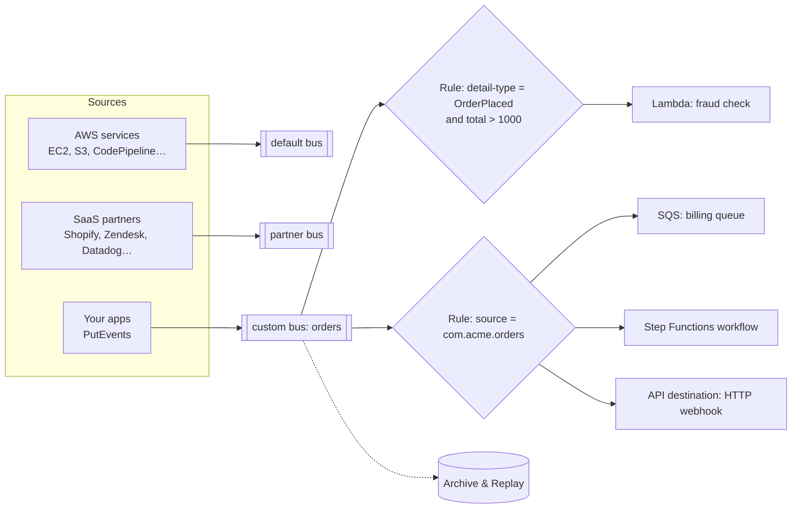
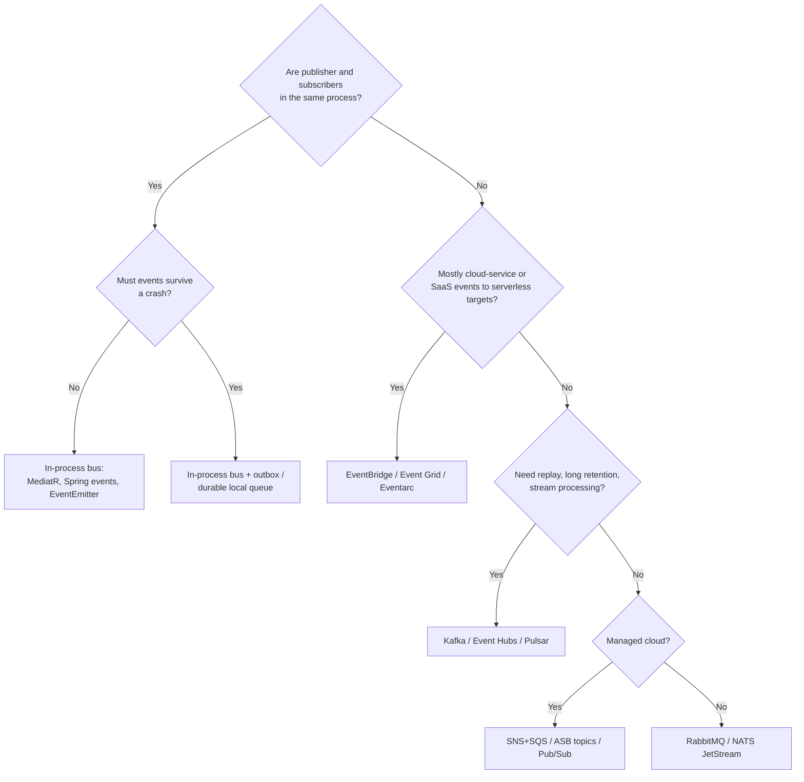

# 11. Event Bus Products

## Table of Contents

- [11.1 Product Categories](#111-product-categories)
- [11.2 AWS EventBridge](#112-aws-eventbridge)
- [11.3 Azure Event Grid](#113-azure-event-grid)
- [11.4 Google Eventarc](#114-google-eventarc)
- [11.5 Brokers Used as Distributed Event Buses](#115-brokers-used-as-distributed-event-buses)
- [11.6 Event Mesh: Solace, Knative, NATS](#116-event-mesh-solace-knative-nats)
- [11.7 In-Process and Frontend Event Bus Libraries](#117-in-process-and-frontend-event-bus-libraries)
- [11.8 Comparison Tables](#118-comparison-tables)
- [11.9 Choosing an Event Bus](#119-choosing-an-event-bus)
- [11.10 Interview Talking Points](#1110-interview-talking-points)

---

> **Purpose:** Know the products that call themselves (or act as) an *event bus*: cloud event routers, brokers used as event backbones, event meshes, and in-process libraries.

---

## 11.1 Product Categories



---

## 11.2 AWS EventBridge

A serverless **event bus** service that routes events from AWS services, SaaS partners and your own applications to targets based on **rules**.



| Feature | Description |
|---|---|
| **Event buses** | `default` (AWS service events), partner buses, custom buses; cross-account and cross-region routing |
| **Rules & event patterns** | JSON content filtering: exact, prefix, suffix, numeric ranges, `anything-but`, `exists`, wildcards |
| **Targets** | Lambda, SQS, SNS, Step Functions, Kinesis, ECS tasks, API destinations (any HTTP endpoint), other buses… (up to 5 targets per rule) |
| **Input transformation** | Reshape the event before delivery |
| **Schema registry & discovery** | Infer schemas from events, generate code bindings |
| **Archive & replay** | Store events and replay them to a bus |
| **Retries & DLQ** | Retry with backoff up to 24 h / 185 attempts; DLQ (SQS) per target |
| **EventBridge Pipes** | Point-to-point source → filter → enrich → target (e.g. DynamoDB stream → Lambda enrichment → Step Functions) |
| **EventBridge Scheduler** | Managed cron/one-off schedules invoking targets |

```json
{
  "source": ["com.acme.orders"],
  "detail-type": ["OrderPlaced"],
  "detail": {
    "total": [{ "numeric": [">", 1000] }],
    "country": [{ "anything-but": ["US"] }]
  }
}
```

```typescript
// Publishing with AWS SDK v3
import { EventBridgeClient, PutEventsCommand } from '@aws-sdk/client-eventbridge';

await new EventBridgeClient({}).send(new PutEventsCommand({
  Entries: [{
    EventBusName: 'orders',
    Source: 'com.acme.orders',
    DetailType: 'OrderPlaced',
    Detail: JSON.stringify({ orderId: '48213', total: 1299, country: 'DE' }),
  }],
}));
```

**Strengths:** zero ops, rich content filtering, huge AWS/SaaS integration, archive/replay. **Limits:** event size quota (historically 256 KB — check current quotas), higher latency than a broker (typically tens to hundreds of ms), no ordering guarantees, at-least-once delivery, per-region quotas.

---

## 11.3 Azure Event Grid

A fully managed, push-based **event routing** service, CloudEvents-native.

| Feature | Description |
|---|---|
| **System topics** | Events from Azure services (Blob Storage created, Resource Group changes, Key Vault…) |
| **Custom topics / domains** | Your own events; domains = many topics for multi-tenant scenarios |
| **Namespaces** | Newer model supporting **pull delivery** (queue-like) and **MQTT** broker capabilities |
| **Event subscriptions** | Filters (event type, subject prefix/suffix, advanced filters on data), push to Functions, Webhooks, Service Bus, Event Hubs, Storage Queues |
| **Delivery** | At-least-once, retry with exponential backoff (up to 24 h by default), dead-lettering to Blob Storage |
| **Schemas** | CloudEvents 1.0 and Event Grid schema |

**Azure messaging trio — when to use which:**

| Service | Kind | Use for |
|---|---|---|
| **Event Grid** | Event router (discrete events, push) | Reacting to state changes: "a blob was created" |
| **Event Hubs** | Event streaming (log, Kafka API) | Telemetry, high-volume streams, analytics |
| **Service Bus** | Enterprise message broker | Commands, ordered/transactional business messages |

---

## 11.4 Google Eventarc

Routes events from Google Cloud sources (Cloud Storage, Audit Logs from 100+ services, Pub/Sub, Firebase) and third parties to **Cloud Run, Cloud Functions, GKE, Workflows** — using **CloudEvents** over **Pub/Sub** as the transport.

- **Eventarc Standard:** triggers with filters per source/event type.
- **Eventarc Advanced:** a central **message bus** resource with enrollments, pipelines, transformations and fan-out across projects (closer to EventBridge-style buses).
- Use **Google Pub/Sub** directly when you need a general-purpose distributed event bus with full control over subscriptions.

---

## 11.5 Brokers Used as Distributed Event Buses

| Product | How it acts as an event bus | Notes |
|---|---|---|
| **Kafka (Confluent, MSK, Redpanda)** | Topic per event stream; consumer group per subscribing service | Replay & retention; the de facto event backbone at scale |
| **Azure Event Hubs** | Kafka-compatible event streaming | Capture to storage; consumer groups |
| **SNS + SQS** | SNS topic fans out to per-service SQS queues (with filter policies) | Classic AWS pub/sub with durable buffering |
| **Azure Service Bus topics** | Topic + subscription per service, SQL filters | Ordering via sessions, transactions |
| **Google Pub/Sub** | Topic + subscription per service; filters; push or pull | Global, seek/replay |
| **RabbitMQ** | Fanout/topic exchanges + queue per subscriber; streams for replay | Rich routing; what MassTransit uses for `Publish` |
| **Pulsar** | Topics with multiple subscriptions (exclusive, shared, key_shared) | Multi-tenant, geo-replicated |
| **NATS JetStream** | Subjects + durable consumers | Lightweight, edge-friendly |
| **Redis Streams** | Stream + consumer groups | Lightweight, memory-bound |

---

## 11.6 Event Mesh: Solace, Knative, NATS

An **event mesh** is a network of interconnected event brokers that dynamically routes events between applications regardless of where they run (on-prem, multiple clouds, edge).

| Product | Highlights |
|---|---|
| **Solace PubSub+** | Hierarchical topics with wildcards, dynamic message routing between brokers across regions/clouds, supports AMQP/MQTT/JMS/REST, Event Portal for catalog/governance |
| **Knative Eventing** | Kubernetes Brokers/Triggers, CloudEvents over HTTP, pluggable channels (Kafka, RabbitMQ) |
| **NATS superclusters / leaf nodes** | Global mesh with subject-based routing, gateways between clusters, leaf nodes at the edge |

---

## 11.7 In-Process and Frontend Event Bus Libraries

| Library | Platform | Style | Notes |
|---|---|---|---|
| **MediatR `INotification`** | .NET | `Publish(notification)` → all `INotificationHandler<T>` | Sequential by default; configurable publish strategy |
| **Wolverine** | .NET | Local message publishing with durable local queues | Same API as remote |
| **Spring `ApplicationEventPublisher`** | Java | `@EventListener`, `@TransactionalEventListener`, `@Async` | Spring Modulith adds an event publication registry (durable, retries) |
| **Guava EventBus** | Java | `@Subscribe` methods; `AsyncEventBus` | Simple; Guava docs discourage it for new code |
| **Vert.x Event Bus** | JVM | Address-based pub/sub and request/reply; can be clustered | Bridges to browser via SockJS |
| **Node `EventEmitter`** | Node.js | `on/emit`; synchronous listeners | Beware memory leaks (`MaxListenersExceededWarning`) |
| **NestJS CQRS `EventBus`** | Node.js | `@EventsHandler`, sagas as RxJS streams | In-process |
| **RxJS `Subject`** | Browser/Node | Observable streams with operators | Powerful filtering and composition |
| **`EventTarget` / `CustomEvent`** | Browser | Native DOM events | Works across micro-frontends via `window` |
| **mitt / tiny-emitter** | Browser | Tiny emitters (~200 bytes) | Simple global bus (Vue 3 removed `$on`, mitt is the common replacement) |
| **`BroadcastChannel`** | Browser | Pub/sub across tabs/windows of the same origin | Cross-tab sync |

```csharp
// MediatR notification = in-process event
public record OrderPlaced(Guid OrderId) : INotification;

public class SendConfirmationEmail : INotificationHandler<OrderPlaced>
{
    public Task Handle(OrderPlaced n, CancellationToken ct) => /* send email */ Task.CompletedTask;
}

public class AwardLoyaltyPoints : INotificationHandler<OrderPlaced>
{
    public Task Handle(OrderPlaced n, CancellationToken ct) => /* add points */ Task.CompletedTask;
}

// Publisher
await mediator.Publish(new OrderPlaced(order.Id), ct);   // both handlers run
```

---

## 11.8 Comparison Tables

### Cloud event routers

| | AWS EventBridge | Azure Event Grid | Google Eventarc |
|---|---|---|---|
| Model | Buses + rules + targets | Topics + subscriptions (push; pull in namespaces) | Triggers (Standard) / message bus (Advanced) |
| Envelope | EventBridge format (CloudEvents via transforms) | CloudEvents 1.0 / Event Grid schema | CloudEvents |
| Filtering | Rich JSON patterns | Type, subject, advanced data filters | Attribute filters; CEL in Advanced |
| Replay | Archive & replay | No built-in replay | No (Pub/Sub seek underneath) |
| Retries / DLQ | Up to 24 h, SQS DLQ | Up to 24 h, Blob dead-letter | Via Pub/Sub retry + dead-letter topics |
| Ordering | No | No | No |
| SaaS sources | Many partner integrations | Partner topics | Third-party providers |

### Event bus options by need

| Need | Recommended |
|---|---|
| React to cloud resource events serverlessly | EventBridge / Event Grid / Eventarc |
| Durable, replayable event backbone between microservices | Kafka / Event Hubs / Pulsar |
| Simple managed fan-out with durable per-consumer buffers | SNS → SQS, ASB topics, Google Pub/Sub |
| Rich routing on-prem | RabbitMQ topic exchanges |
| Hybrid / multi-cloud / edge | Solace, NATS, Knative |
| Decouple modules in one process | MediatR, Spring events, NestJS EventBus |
| UI component / micro-frontend notifications | RxJS Subject, CustomEvent, mitt |

---

## 11.9 Choosing an Event Bus



---

## 11.10 Interview Talking Points

| Question | Strong answer |
|---|---|
| What is EventBridge used for? | A serverless event bus routing AWS, SaaS and custom events to targets via content-based rules, with schema registry, archive/replay and per-target retries/DLQ. |
| Event Grid vs Event Hubs vs Service Bus? | Event Grid routes discrete events (push), Event Hubs ingests high-volume streams (log), Service Bus delivers business messages with ordering and transactions. |
| Would you use EventBridge or Kafka as an event backbone? | EventBridge for serverless, low-to-moderate volume integration with rich filtering and no ops; Kafka for high throughput, ordering per key, long retention and stream processing. |
| How do micro-frontends communicate? | Through a minimal event bus (CustomEvent on window, BroadcastChannel, or a shared RxJS bus) with versioned event contracts — never by sharing internal state. |
| Risks of in-process event buses? | No durability, synchronous exceptions, hidden coupling and memory leaks from forgotten subscriptions. |
