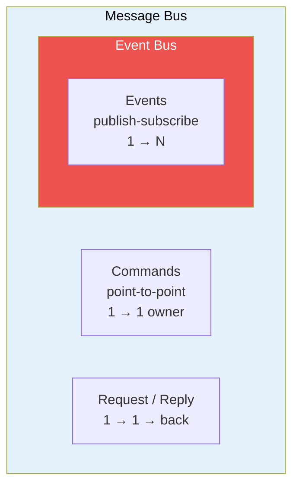
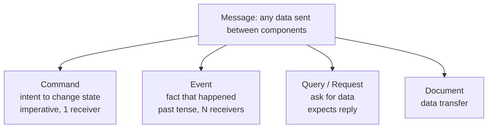
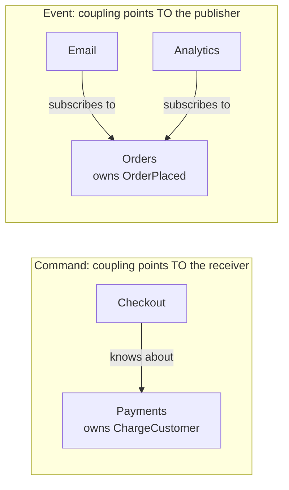
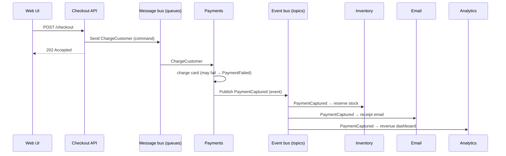
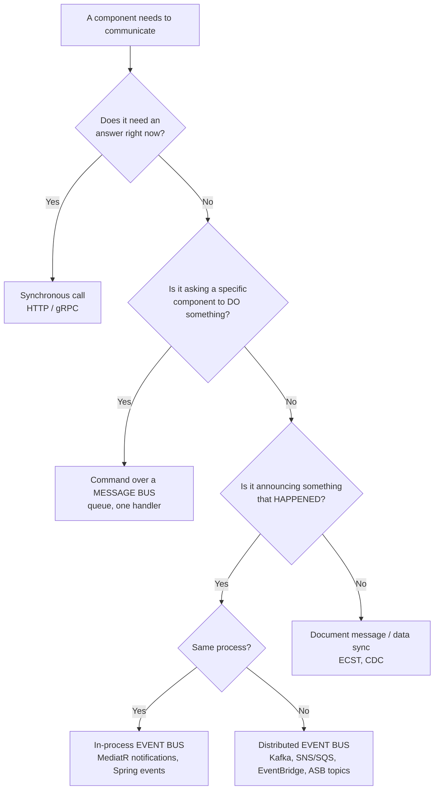

# 12. Message Bus vs Event Bus — Differences and Decision Framework

## Table of Contents

- [12.1 The Short Answer](#121-the-short-answer)
- [12.2 Side-by-Side Comparison](#122-side-by-side-comparison)
- [12.3 Messages vs Events vs Commands](#123-messages-vs-events-vs-commands)
- [12.4 Ownership and Coupling Direction](#124-ownership-and-coupling-direction)
- [12.5 Same Infrastructure, Different Semantics](#125-same-infrastructure-different-semantics)
- [12.6 Related Terms Disambiguated](#126-related-terms-disambiguated)
- [12.7 Worked Example: E-Commerce Checkout](#127-worked-example-e-commerce-checkout)
- [12.8 Decision Framework](#128-decision-framework)
- [12.9 Common Misconceptions](#129-common-misconceptions)
- [12.10 Interview Answer Template](#1210-interview-answer-template)

---

> **Purpose:** Pull everything together: what really distinguishes a message bus from an event bus, how they overlap, and how to decide which interaction style to use.

---

## 12.1 The Short Answer

> **A message bus is a general-purpose messaging backbone that carries any kind of message — commands, events, requests and replies — via point-to-point and publish-subscribe channels. An event bus is a specialization that only broadcasts events (facts that already happened) to any number of subscribers via publish-subscribe.**

Put differently:
- **Message bus = "tell someone to do something" *and* "tell everyone something happened".**
- **Event bus = only "tell everyone something happened".**

Every event bus is conceptually a (restricted) message bus; not every message bus is an event bus.



---

## 12.2 Side-by-Side Comparison

| Dimension | Message Bus | Event Bus |
|---|---|---|
| **Primary purpose** | Reliable communication and integration between components | Broadcasting state changes/facts to interested parties |
| **Message kinds** | Commands, events, queries, replies, documents | Events only |
| **Channel types** | Queues (point-to-point) **and** topics (pub/sub) | Topics / pub-sub only |
| **Cardinality** | 1:1 (commands), 1:N (events), 1:1:1 (request/reply) | 1:N (0..N subscribers) |
| **Intent** | Imperative ("do X") or declarative ("X happened") | Declarative ("X happened") only |
| **Sender's knowledge of receivers** | Command sender knows the logical destination | Publisher knows nothing about subscribers |
| **Expectation of outcome** | Commands may expect success/failure feedback | None — fire and forget |
| **Can the receiver reject?** | Yes (a command can fail validation/business rules) | No — a fact can't be rejected (only ignored) |
| **Ownership of the contract** | Commands: owned by the **receiver**; events: by the **sender** | Owned by the **publisher** |
| **Typical naming** | `PlaceOrder`, `ChargeCustomer`, `GetQuote` | `OrderPlaced`, `CustomerCharged` |
| **Ordering & delivery needs** | Often strict: per-entity ordering, exactly-once effect for commands | Usually tolerant: idempotent subscribers, ordering per entity if needed |
| **Scope** | In-process (mediator) or distributed (broker + framework) | In-process (EventEmitter, Spring events) or distributed (EventBridge, Kafka, SNS) |
| **Typical technologies** | RabbitMQ, Azure Service Bus, SQS, ActiveMQ, IBM MQ, MassTransit, NServiceBus, Spring Cloud Stream, MediatR | EventBridge, Event Grid, Eventarc, Kafka, SNS, Google Pub/Sub, Guava EventBus, Node EventEmitter, RxJS Subject |
| **Architectural style** | Messaging / integration (EIP), sagas & orchestration | Event-driven architecture, choreography, ECST, CQRS projections |
| **Main risk** | Temporal coupling via request/reply, command-centric distributed monolith | Invisible flows ("event spaghetti"), disguised commands |

---

## 12.3 Messages vs Events vs Commands



> **All events are messages, but not all messages are events.** That single sentence explains the whole message bus vs event bus distinction.

| | Command | Event |
|---|---|---|
| Tense | Imperative: `ShipOrder` | Past: `OrderShipped` |
| Receivers | Exactly one logical handler | Zero to many |
| Coupling | Sender depends on receiver's capability | Subscribers depend on publisher's facts |
| Failure | Sender may care and react | Publisher doesn't care |
| Channel | Queue | Topic |
| Example flow | Checkout → `ChargeCustomer` → Payments | Payments → `CustomerCharged` → Orders, Email, Analytics |

---

## 12.4 Ownership and Coupling Direction



- With **commands**, the *sender* depends on the receiver (it must know a capability exists). The receiver defines the contract.
- With **events**, the *subscribers* depend on the publisher. The publisher defines the contract and stays ignorant of its consumers.
- This is **dependency inversion at the architecture level**: events let upstream services stay stable while downstream services evolve.

**Design heuristic:** if adding a new reaction requires changing the sender → you're using commands; if not → events.

---

## 12.5 Same Infrastructure, Different Semantics

The same product can play both roles; the distinction lies in **how you use it**:

| Product | As a message bus (commands) | As an event bus (events) |
|---|---|---|
| **RabbitMQ** | Send to a queue via the default/direct exchange | Publish to a fanout/topic exchange with a queue per subscriber |
| **Azure Service Bus** | Queues | Topics + subscriptions |
| **AWS** | SQS queue | SNS topic → SQS queues, or EventBridge |
| **Kafka** | Command topic with one consumer group (awkward) | Topic with many consumer groups (natural) |
| **MassTransit / NServiceBus** | `Send()` | `Publish()` |
| **MediatR** | `Send(IRequest)` → one handler | `Publish(INotification)` → all handlers |
| **NestJS** | `CommandBus.execute()` | `EventBus.publish()` |

```csharp
// Same bus, two semantics
await bus.Send(new ChargeCustomer(orderId, amount));     // command → payments queue, one handler
await bus.Publish(new OrderPlaced(orderId));             // event   → every subscriber
```

---

## 12.6 Related Terms Disambiguated

| Term | What it is | Relationship |
|---|---|---|
| **Message queue** | A channel with point-to-point semantics | A building block of a message bus |
| **Message broker** | Server that hosts queues/topics | The infrastructure under a message/event bus |
| **Message bus** | Architectural messaging backbone | Superset (commands + events + requests) |
| **Event bus** | Pub/sub of events | Specialization of a message bus |
| **Service bus** | Usually a message bus product/framework (Azure Service Bus, NServiceBus) | Same as message bus in practice |
| **Enterprise Service Bus (ESB)** | Message bus with transformation/orchestration logic in the middle | Legacy, "smart pipes" |
| **Event stream / log** | Durable, ordered, replayable sequence of events | Often the storage behind a distributed event bus (Kafka) |
| **Event broker** | Broker optimized for events (Solace, Kafka, Event Grid) | Infrastructure for event buses |
| **Event mesh** | Network of interconnected event brokers | Distributed event bus across regions/clouds |
| **Mediator** | In-process dispatcher of requests/notifications | In-process message bus |
| **Observer pattern** | Object-level subscribe/notify | The in-memory ancestor of the event bus |
| **Pub/Sub** | Messaging pattern: publish once, many receive | The pattern an event bus implements |

### Observer vs Event Bus vs Pub/Sub

| | Observer | In-process event bus | Distributed pub/sub |
|---|---|---|---|
| Who knows whom | Observers register directly on the subject | Both sides know only the bus | Both sides know only the topic |
| Scope | Object level | Process level | System level |
| Delivery | Synchronous calls | Sync or async | Async via broker |
| Durability | None | None | Durable |

---

## 12.7 Worked Example: E-Commerce Checkout



| Interaction | Style | Why |
|---|---|---|
| Checkout → Payments `ChargeCustomer` | **Command via message bus queue** | Exactly one owner; may fail; checkout needs the outcome eventually |
| Payments → world `PaymentCaptured` | **Event via event bus** | A fact; any number of services react; Payments shouldn't know them |
| Inventory → Checkout "is item in stock?" | **Synchronous query** | Needs an immediate answer |
| Adding a fraud-scoring service later | **New event subscriber** | No change to Payments — the payoff of the event bus |

---

## 12.8 Decision Framework



| If you need… | Choose |
|---|---|
| Work distribution, background jobs | Message bus (queues, competing consumers) |
| A specific service to perform an action with retries | Message bus command |
| Long-running workflow with compensation | Message bus + saga/orchestrator (commands), emitting events |
| Many independent reactions to a fact | Event bus |
| Data replication to other services | Event bus with ECST events |
| Real-time analytics, replay, audit | Event bus backed by a log (Kafka) |
| Cloud resource / SaaS reactions | Serverless event bus (EventBridge, Event Grid) |
| Decoupling modules in a monolith | In-process mediator (commands) + in-process event bus (events) |

---

## 12.9 Common Misconceptions

| Misconception | Reality |
|---|---|
| "Event bus and message bus are synonyms" | Overlapping, but a message bus also carries commands and requests via point-to-point channels |
| "Kafka is a message queue" | Kafka is a distributed log; queue semantics are emulated with consumer groups (and share groups) |
| "Events make systems decoupled, period" | They remove runtime coupling but add schema/semantic coupling and hidden flows |
| "Everything should be an event" | Disguised commands (`SendEmailRequested`) re-introduce coupling with worse visibility; use commands where an owner must act |
| "An event bus guarantees exactly-once" | Distributed buses are at-least-once; subscribers must be idempotent |
| "An in-process event bus makes my monolith a microservice architecture" | It gives code decoupling only — no independent deployment, scaling or durability |
| "RabbitMQ is a message bus, Kafka is an event bus" | Both can serve both roles; RabbitMQ shines for commands and routing, Kafka for event streams — semantics come from usage |

---

## 12.10 Interview Answer Template

> **"What's the difference between a message bus and an event bus?"**
>
> 1. **Define:** "A message bus is a general messaging backbone carrying commands, events and requests through queues and topics. An event bus is a specialization that broadcasts events — immutable facts — to any number of subscribers."
> 2. **Key distinction:** "The difference is the *intent* of the message: a command asks one owner to do something and can be rejected; an event announces something that already happened and has zero to many subscribers. All events are messages, but not all messages are events."
> 3. **Coupling:** "Commands couple the sender to the receiver's capability; events invert that dependency so the publisher doesn't know its consumers."
> 4. **Technology:** "The same broker can do both — RabbitMQ queues vs fanout exchanges, `Send` vs `Publish` in MassTransit, SQS vs SNS/EventBridge. Kafka is a natural event backbone; RabbitMQ/Service Bus excel at commands."
> 5. **Judgment:** "I use commands over a message bus for work that has an owner and needs reliable execution, events over an event bus for broadcasting facts and data propagation, and synchronous calls when I need an immediate answer. For complex workflows I orchestrate with commands and publish events for everyone else."
