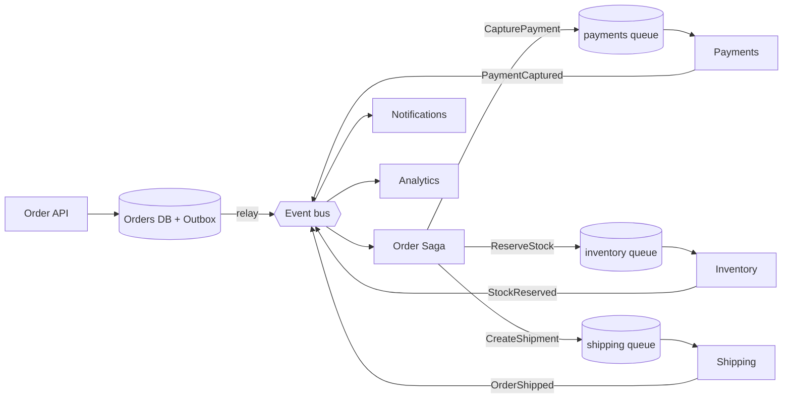

# 13. Interview Questions — Message Bus & Event Bus

## Table of Contents

- [13.1 Fundamentals](#131-fundamentals)
- [13.2 Reliability and Guarantees](#132-reliability-and-guarantees)
- [13.3 RabbitMQ](#133-rabbitmq)
- [13.4 Kafka and Streaming](#134-kafka-and-streaming)
- [13.5 Event Bus and Event-Driven Architecture](#135-event-bus-and-event-driven-architecture)
- [13.6 Cloud Products](#136-cloud-products)
- [13.7 Troubleshooting Scenarios](#137-troubleshooting-scenarios)
- [13.8 System Design Scenarios](#138-system-design-scenarios)
- [13.9 Rapid-Fire Round](#139-rapid-fire-round)

---

> **Purpose:** Practice answering out loud. Each answer is a model "strong answer" — aim to cover the same points in your own words, then add a concrete example from your experience.

---

## 13.1 Fundamentals

**Q1. What problem does asynchronous messaging solve?**
It removes temporal coupling (sender and receiver needn't be up together), levels load spikes, enables fan-out to many consumers, moves slow work off the request path and isolates failures. The price is eventual consistency, duplicates/ordering concerns and broker operations.

**Q2. Define message bus, message broker and message queue.**
A queue is a point-to-point channel; a broker is the server hosting channels (RabbitMQ, ASB); a message bus is the architectural backbone — broker plus conventions and usually a client framework — that lets all services exchange messages uniformly.

**Q3. Queue vs topic?**
A queue delivers each message to one consumer among competitors (work distribution); a topic delivers a copy to every subscription (broadcast). Usually combined: topic → one queue per subscribing service → competing consumers.

**Q4. Command vs event vs query?**
Command: imperative, one owner, can be rejected (`ChargeCustomer`). Event: past-tense fact, owned by the publisher, 0..N subscribers (`CustomerCharged`). Query: request for data expecting a reply — often better as a synchronous call.

**Q5. When would you *not* introduce a message bus?**
When the caller needs an immediate answer, the system is small, strong immediate consistency is required, or the team can't operate a broker. Messaging adds failure modes; it must pay for itself.

**Q6. What is the "smart endpoints, dumb pipes" principle?**
Keep the messaging infrastructure a simple, reliable transport and put business logic in services — a reaction to ESBs that centralized transformation and orchestration in the bus.

---

## 13.2 Reliability and Guarantees

**Q7. Explain at-most-once, at-least-once and exactly-once.**
At-most-once may lose messages (ack before processing). At-least-once may duplicate (retry until acked; ack after processing). Exactly-once delivery isn't achievable end-to-end; we get effectively-once processing via at-least-once + idempotent consumers (+ outbox), or within scoped systems like Kafka transactions.

**Q8. How do you make a consumer idempotent?**
Naturally idempotent operations (upserts, set-state), a dedup/inbox table keyed by message ID written in the same transaction as the effect with a unique constraint, business-key uniqueness, version checks, and idempotency keys for external APIs.

**Q9. What is the dual-write problem and how does the outbox solve it?**
Writing to the DB and publishing to the broker can't be atomic — a crash between them loses or invents events. The outbox writes the message into an outbox table in the same DB transaction; a relay (polling or CDC like Debezium) publishes it afterwards. Duplicates remain possible, so consumers stay idempotent.

**Q10. How do you handle poison messages?**
Classify errors (don't retry permanent ones), bounded immediate + delayed retries with backoff and jitter, a max delivery count, then move to a DLQ with error metadata, alert on DLQ depth, and provide tooling to fix and replay.

**Q11. How do you guarantee ordering?**
Clarify whether global or per-entity order is needed. Per-entity: partition key (Kafka), message group (SQS FIFO), sessions (ASB), ordering keys (Pub/Sub), consistent-hash exchange or single active consumer (RabbitMQ). Better still, design handlers to tolerate disorder using entity version numbers.

**Q12. How do you evolve message schemas safely?**
Backward-compatible additive changes, tolerant readers, version in type or header, run versions side by side, schema registry with compatibility enforcement, and contract tests.

**Q13. How do you trace a request across asynchronous hops?**
Propagate correlation/causation IDs and W3C `traceparent` in message headers; instrument producers and consumers with OpenTelemetry messaging spans linked across the hop; log with correlation IDs.

---

## 13.3 RabbitMQ

**Q14. Walk through RabbitMQ's routing model.**
Producers publish to an exchange with a routing key. Bindings connect exchanges to queues using binding keys or header rules. Direct = exact key match, fanout = all bound queues, topic = wildcard pattern (`*` one word, `#` zero or more), headers = header matching. Consumers read from queues and ack.

**Q15. How do you guarantee no message loss in RabbitMQ?**
Quorum (durable, replicated) queues, persistent messages, publisher confirms, mandatory flag or alternate exchange for unroutable messages, and manual consumer acks after processing.

**Q16. Classic vs quorum vs stream queues?**
Classic: single-node, for transient/exclusive queues. Quorum: Raft-replicated, durable default with poison-message delivery limits. Streams: append-only replayable logs for large fan-out and retention.

**Q17. What is prefetch and how do you tune it?**
The max number of unacked messages per consumer (`basic.qos`). Too high → one consumer hoards messages and memory grows; 1 → fair but slow. Start at tens to low hundreds and measure throughput vs latency.

**Q18. How do you implement delayed retries in RabbitMQ?**
DLX + TTL "wait queues" that dead-letter back to the work exchange (one per backoff step, tracking attempts via `x-death`), the delayed-message exchange plugin, or the bus framework's delayed redelivery. Cap attempts → DLQ.

**Q19. What happens when RabbitMQ runs low on memory or disk?**
Memory/disk alarms block publishing connections cluster-wide until resources recover; consumers continue. Prevent with short queues, consumer scaling, length limits and monitoring.

---

## 13.4 Kafka and Streaming

**Q20. Explain partitions and consumer groups.**
A topic is split into ordered partitions spread across brokers. Within a consumer group each partition is assigned to one consumer, giving parallelism and per-partition ordering; different groups each read the full topic independently.

**Q21. What happens when you add consumers beyond the partition count?**
Extra consumers sit idle; parallelism per group is capped by partitions (share groups / KIP-932 address queue-style consumption).

**Q22. How does Kafka avoid data loss?**
Replication factor 3, `min.insync.replicas=2`, producer `acks=all` with idempotence, unclean leader election disabled, and consumers committing offsets after processing.

**Q23. What is log compaction used for?**
Keeping the latest value per key (tombstones delete) so a topic acts as a durable changelog of current state — for KTables, caches, CDC, bootstrapping new consumers.

**Q24. What does Kafka's exactly-once really cover?**
Read-process-write flows inside Kafka: idempotent producer + transactions that atomically write outputs and commit input offsets, with `read_committed` consumers. External side effects need idempotency.

**Q25. RabbitMQ or Kafka for a background job system (image resizing)?**
RabbitMQ (or SQS): per-message acks, competing consumers without partition limits, retries/DLQ/delays built in, no need for replay. Kafka's strengths (retention, replay, massive throughput, ordering per key) aren't needed.

**Q26. Kafka or RabbitMQ for clickstream analytics?**
Kafka: very high throughput, retention, multiple independent consumer groups (real-time dashboards, data lake, ML features) and replay for reprocessing.

---

## 13.5 Event Bus and Event-Driven Architecture

**Q27. Message bus vs event bus?**
A message bus carries any message — commands (point-to-point), events (pub/sub), request/reply. An event bus only broadcasts events to 0..N subscribers. All events are messages, not all messages are events; commands couple sender to receiver, events invert the dependency.

**Q28. Domain events vs integration events?**
Domain events are internal to a bounded context, can change freely and are often dispatched in-process; integration events are stable, versioned public contracts published across services through an outbox.

**Q29. Thin vs fat events?**
Thin (notification) events carry IDs and force callbacks; fat (event-carried state transfer) events carry the needed state for consumer autonomy at the cost of bigger contracts and data duplication.

**Q30. Choreography vs orchestration?**
Choreography: services react to each other's events, no central coordinator — simple and loosely coupled, but flows become invisible. Orchestration: a coordinator sends commands and tracks state — explicit, easier compensation/timeouts, but a central component. Combine: orchestrate inside a context, publish events outward.

**Q31. Event sourcing vs event-driven?**
Event sourcing is a persistence pattern (state stored as events); event-driven is a communication style. You can do either without the other. Internal event-sourced events usually shouldn't be published raw — map to integration events.

**Q32. What is CQRS and how does an event bus fit?**
Separate write and read models; the write side emits events (or CDC/outbox) over a bus, projectors update denormalized read stores. Reads are eventually consistent.

**Q33. What's wrong with `SendWelcomeEmailEvent`?**
It's a command disguised as an event: it names an action for one specific consumer, coupling the publisher to that consumer. Publish `UserRegistered` and let the email service decide, or send a `SendWelcomeEmail` command explicitly.

**Q34. How do you prevent "event spaghetti"?**
Event catalog/AsyncAPI documentation, ownership rules, distributed tracing, causation IDs, limiting event chains, and orchestrating complex business processes.

---

## 13.6 Cloud Products

**Q35. SQS Standard vs FIFO?**
Standard: near-unlimited throughput, at-least-once, best-effort ordering. FIFO: ordered per `MessageGroupId`, deduplication within 5 minutes, lower throughput limits (higher with high-throughput mode).

**Q36. SNS + SQS fan-out — why both?**
SNS broadcasts; SQS gives each subscriber a durable buffer, independent retries/DLQ and its own consumption pace.

**Q37. EventBridge vs SNS?**
Both fan out. EventBridge adds rich content-based filtering, AWS/SaaS event sources, schema registry, archive/replay, input transformation and many target types; SNS offers higher throughput, lower latency and mobile/SMS/email endpoints.

**Q38. Azure Service Bus vs Event Grid vs Event Hubs?**
Service Bus: enterprise messaging (commands, sessions, transactions). Event Grid: push-based routing of discrete events. Event Hubs: high-volume event streaming (Kafka-compatible).

**Q39. What is CloudEvents?**
A CNCF specification for common event metadata (`id`, `source`, `type`, `subject`, `time`, `data`…) enabling interoperability across brokers, clouds and SDKs.

---

## 13.7 Troubleshooting Scenarios

**Q40. Queue depth keeps growing. What do you check?**
Consumer count (zero?), consumer errors/redelivery loops, processing latency (slow downstream?), prefetch settings, a poison message blocking ordered processing, broker alarms, a recent traffic spike. Fix: scale consumers, fix the failing dependency, move poison messages to DLQ, throttle producers, add backpressure.

**Q41. Customers receive duplicate emails. Why?**
At-least-once redelivery (consumer crashed after sending but before ack, ack timeout, visibility timeout shorter than processing time, rebalance in Kafka) and a non-idempotent handler. Fix: dedup on message ID/business key in an inbox, extend visibility/lock during processing, use provider idempotency keys.

**Q42. Kafka consumers keep rebalancing.**
Processing exceeds `max.poll.interval.ms`, heartbeats time out (GC pauses, `session.timeout.ms` too low), frequent deployments/autoscaling. Fix: smaller `max.poll.records`, offload work with pause/resume, tune timeouts, static membership, cooperative assignor or the new consumer group protocol.

**Q43. Events arrive out of order and corrupt a read model.**
Parallel consumers or retries reorder events. Fix: partition by entity ID, store entity version per row and ignore older versions, or buffer/park until missing versions arrive.

**Q44. Messages disappear without errors in RabbitMQ.**
Unroutable messages (no binding matches) silently dropped, TTL expiry without DLX, `x-max-length` drop-head overflow, auto-ack with consumer crashes, non-persistent messages on restart. Fix: mandatory flag/alternate exchange, DLX, confirms, manual acks, persistence.

---

## 13.8 System Design Scenarios

### Scenario A — Order processing for an e-commerce platform

**Prompt:** Design order placement → payment → inventory → shipping → notifications, resilient to service outages, 5k orders/min at peak.

**Strong outline:**
1. **API** accepts the order, stores it (`Pending`) and writes `OrderPlaced` to the **outbox** in the same transaction; returns `202` with a status URL.
2. **Event bus** (Kafka topic keyed by `orderId`, or SNS→SQS / ASB topics) distributes `OrderPlaced`.
3. **Order saga (orchestrator)** sends commands over the **message bus**: `CapturePayment` → `ReserveStock` → `CreateShipment`; handles replies, timeouts (scheduled messages) and compensations (`RefundPayment`, `ReleaseStock`).
4. **Notifications, analytics, search** subscribe to events (`OrderConfirmed`, `OrderShipped`) — choreography for side concerns.
5. **Reliability:** idempotent consumers with inbox tables, DLQs per consumer with alerts, retries with backoff, per-order ordering via key/session.
6. **Observability:** trace propagation, queue lag dashboards, saga state queryable for support.
7. **UX:** pending states, push updates via WebSocket/SSE.

### Scenario B — Notification service (email, SMS, push) for 50M users

- Producers publish domain events; a **notification router** subscribes, applies user preferences/templates, and sends **commands** to per-channel queues (`email`, `sms`, `push`).
- Per-channel worker pools with **rate limiting** to respect provider quotas; **priority** via separate queues (OTP vs marketing).
- Idempotency key per (user, notification) to avoid duplicates; DLQ + retry with provider failover.
- Kafka for event intake (replay for backfills), RabbitMQ/SQS for per-channel work queues.

### Scenario C — Real-time analytics pipeline

- Clients → ingestion API → **Kafka** (partitioned by user/session) → **Flink/Kafka Streams** for aggregations → OLAP store (ClickHouse/Druid/Pinot) + data lake (S3/Iceberg via Kafka Connect).
- Schema Registry (Avro/Protobuf), compacted topics for dimensions, tiered storage for long retention, replay to rebuild aggregates after bug fixes.

### Scenario D — Migrating a monolith to services

- Start with an **in-process event bus** between modules; define integration events.
- Introduce an **outbox** and publish integration events to a broker; new services subscribe (**strangler fig**).
- Use **CDC** for legacy tables you can't change, mapping to business events via an anti-corruption layer.
- Move commands to queues as modules become services; keep queries synchronous where needed.

---

## 13.9 Rapid-Fire Round

| Question | Answer |
|---|---|
| Default delivery guarantee to design for? | At-least-once + idempotent consumers |
| RabbitMQ topic wildcard for exactly one word? | `*` (and `#` for zero or more) |
| Kafka ordering scope? | Per partition |
| SQS max long-poll wait? | 20 seconds |
| SQS default visibility timeout? | 30 seconds |
| ASB feature for FIFO per key? | Sessions |
| Kafka ZooKeeper replacement? | KRaft (ZooKeeper removed in 4.0) |
| Pattern for large payloads? | Claim Check |
| Pattern for atomic DB write + publish? | Transactional Outbox |
| Pattern for multi-service transactions? | Saga |
| Standard event envelope? | CloudEvents |
| Spec for documenting async APIs? | AsyncAPI |
| RabbitMQ replicated queue type? | Quorum queue (Raft) |
| Where do failed messages go? | Dead-letter queue/topic |
| Name of an event? | Past tense (`OrderPlaced`) |
| Name of a command? | Imperative (`PlaceOrder`) |
