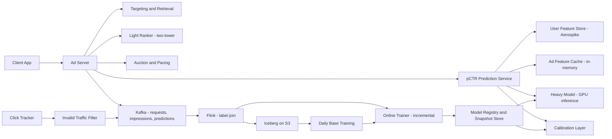

# Ads Click Prediction

**Category:** AI/ML System Design
**Difficulty:** 🔴 Hard
**Seniority:** staff
**Companies:** Meta, Google, Amazon, TikTok, Snap, Pinterest, Criteo
**Tags:** ctr-prediction, calibration, online-learning, sparse-features, feature-crosses, auction, delayed-feedback
**Time:** 60 min

---

## Problem Statement

Design the click-through-rate (pCTR) prediction system for a large social network's ads platform. For each ad request, the system scores candidate ads; the predicted CTR feeds the auction, where ads are ranked by expected value (bid x pCTR, plus quality terms) and advertisers are charged via a second-price or VCG-style mechanism.

Scale hint: 2B daily users, ~1M ad requests/s at peak, each request scoring ~500 candidate ads in the final ranking stage (500M predictions/s), p99 model latency under 30 ms, and billions of training examples per day. At staff level, the interviewer expects you to address calibration (because predictions are used as probabilities in money calculations), sparse high-cardinality features, online/continuous training, delayed feedback, and how model changes affect advertisers and the marketplace.

## Clarifying Questions

- Is the task pCTR only, or also conversion? *Focus on pCTR; mention pCVR as a sibling head.*
- How are predictions used? *Auction ranks by bid x pCTR (for CPC) or bid x pCTR x pCVR (for CPA); price computed from the next-best competitor, so calibration matters.*
- What is the candidate funnel? *Targeting/retrieval narrows millions of ads to ~10K, a light model to ~500, then the heavy pCTR model.*
- Freshness requirements? *New ads launch constantly; model should adapt within minutes to hours.*
- Privacy constraints? *Reduced third-party signals (ATT, cookie deprecation); rely more on first-party and contextual features.*
- Latency per request? *Total ad serving under 100 ms; heavy pCTR model gets ~30 ms.*
- What counts as a click? *A valid click after invalid-traffic filtering, attributed to an impression within 30 minutes.*

## Requirements

### Functional

- Predict calibrated P(click | user, ad, context) for every candidate in the final stage.
- Support multiple surfaces (feed, stories, video) and ad formats.
- Handle new ads and new advertisers (cold start).
- Provide predictions to the auction and pacing systems; log predictions for billing audits and analysis.

### Non-Functional

- p99 inference latency 30 ms for ~500 candidates per request; ~1M requests/s peak.
- Calibration error within plus or minus 2-3% overall and per major segment.
- Model freshness: updates deployed at least hourly.
- 99.99% availability; fallback model on failure (revenue directly depends on it).

### Out of Scope

- Auction mechanism design and budget pacing algorithms (consumers of pCTR).
- Ad creative generation and moderation.

## Problem Framing

- **ML task:** binary classification with probabilistic outputs. Label = 1 if the impression receives a valid click within the attribution window.
- **Why calibration matters:** expected value = bid x pCTR determines ranking and pricing. A model biased up by 10% for one advertiser over-charges or over-delivers them; ranking metrics like AUC are insensitive to this.
- **Business metrics:** revenue (eCPM), advertiser ROI (cost per click/conversion), user experience (ad hide/report rate, session time), advertiser retention.
- **Model metrics:** normalized cross-entropy (NE, log loss normalized by background CTR entropy) as the primary metric, AUC as secondary, calibration ratio (sum predicted / sum observed) overall and by segment.
- **Constraints:** extreme throughput (500M predictions/s), class imbalance (CTR ~1%), sparse features with billions of IDs, fast distribution shift (new ads, campaigns, seasonality), delayed feedback, and privacy restrictions.

## Data Pipeline

- **Event streams**
  - Ad request and impression logs with served features and predictions (feature logging) to Kafka.
  - Click logs from the click tracker, filtered by an invalid-traffic detection service (bots, click farms, accidental clicks under 1 s).
- **Label join (streaming):** Flink joins impressions with clicks by impression ID within a 30-minute window; impressions without a click after the window become negatives. Late clicks after emission are handled with delayed-feedback correction (see Training).
- **Volume:** ~100B impressions/day; negatives downsampled to ~5-10% with weights, positives kept at 100%. Calibration corrected for sampling: p = q / (q + (1 - q) / w) where w is the negative sampling rate.
- **Features**
  - User: demographics (coarse), interest embeddings, historical ad engagement rates by category, recent organic interactions (sequence of last 100 actions), device, OS.
  - Ad: ad ID, campaign ID, advertiser ID, creative embeddings (image/video/text encoders), ad category, landing page category, format, age of ad.
  - Context: surface, placement position, time, connection type, feed content around the slot.
  - Cross features: user x advertiser historical CTR, user category affinity x ad category, counting features over 1 h / 1 d / 7 d windows with smoothing.
  - Sparse IDs hashed into embedding tables (billions of rows); dense features normalized (log transform for counts).
- **Storage:** online feature store (Aerospike / Redis Cluster for user features, in-memory replicated stores for ad features); offline training data in Hive/Iceberg partitioned by hour; embedding tables checkpointed to distributed storage.

## Model Design

- **Baseline 1:** logistic regression with hashed sparse features and manual crosses (FTRL-Proximal online learning, Google 2013). Fast, well-calibrated, but needs manual feature engineering.
- **Baseline 2:** GBDT for feature transformation + LR (Facebook 2014). Learns crosses automatically but hard to update continuously and handle IDs.
- **Factorization machines / FFM:** model pairwise interactions via latent vectors; good for sparse data.
- **Chosen: deep sparse model (DLRM / DCN-v2 / DeepFM family)**
  - Embedding tables for sparse features (dimension 16-128 based on cardinality), dense features through a bottom MLP.
  - Feature interaction via DCN-v2 cross layers (explicit bounded-degree crosses) plus deep MLP; or DLRM-style pairwise dot products.
  - User behavior sequence modeled with target attention (DIN / DIEN) or a transformer, attending over recent actions relative to the candidate ad.
  - Multi-task heads: pCTR, pCVR (on clicked samples with ESMM-style entire-space modeling), negative feedback (hide/report), sharing the bottom with MMoE.
  - Output calibration layer: isotonic regression or Platt scaling per segment applied post-model, refreshed hourly.
- **Cold start for new ads:** creative content embeddings and advertiser/campaign-level features generalize; ID embedding initialized from similar ads (mean of neighbors in content space); exploration budget gives new ads impressions to collect data.
- **Two-tower light ranker upstream:** user and ad towers with dot product, ad embeddings precomputed, to shrink ~10K to ~500 cheaply.

```text
FUNCTION score_ads(request)
    SET u ← user_feature_store.get(request.user_id)
    SET ads ← targeting.eligible(request, u)                   // ~10K
    SET ads ← light_ranker.top_k(u, ads, 500)                  // two-tower dot product
    SET batch ← assemble_features(u, ads, request.context)
    SET logits ← heavy_model.forward(batch)                    // GPU, one batch per request
    FOR i, ad IN ENUMERATE(ads)
        SET q ← sigmoid(logits[i])
        SET p ← correct_for_negative_sampling(q, w)
        SET ad.pctr ← calibrator[segment(ad, request)].apply(p)
    log_predictions(request.id, ads, batch.feature_hash, model_version)
    RETURN ads                                                 // auction ranks by bid x pctr x quality
```

## Training & Evaluation

- **Training infrastructure:** hybrid parallelism, embedding tables (several TB) sharded across GPU HBM/host memory (TorchRec, HugeCTR) with model parallelism; dense layers data-parallel with all-reduce.
- **Continuous / online training:** a base model retrained daily on the last ~30 days; incremental training every 15-60 minutes on the newest data from the Flink label stream, with updated model snapshots pushed to serving hourly or faster. New IDs added dynamically to embedding tables; stale IDs evicted by frequency/TTL.
- **Delayed feedback:** clicks mostly arrive within minutes, conversions can take days. For pCTR, a 30-minute window captures nearly all clicks; for pCVR use delayed-feedback models (e.g. fake-negative weighting or a separate delay distribution model) to avoid biasing toward negatives.
- **Validation**
  - Progressive validation: evaluate each new hour of data before training on it (time-respecting, mirrors production).
  - Metrics: NE (primary, lower is better; a 0.1-0.2% NE gain is meaningful at this scale), AUC, calibration ratio overall and sliced by surface, advertiser size, country, ad age.
  - Check new-ad slice explicitly to measure cold-start quality.
- **Online A/B**
  - User-level split, 1-2 weeks. Primary: revenue per mille (with advertiser-side guardrails), advertiser value (conversions per dollar), user negative feedback rate, ad load stability.
  - Marketplace effects: a better model shifts spend between advertisers; budget-constrained campaigns create interference between arms. Use budget-split experiments (split advertiser budgets across arms) to avoid cannibalization bias.
  - Guardrails: calibration per segment in production, latency, fallback rate.

## Serving Architecture



1. Ad server gets eligible ads from targeting, prunes with the light ranker, and calls the pCTR service with ~500 candidates.
2. pCTR service fetches user features once per request and ad features from a local in-memory cache (ad features are shared across requests), assembles one batch, and runs GPU inference.
3. Calibrated pCTRs go to the auction, which ranks by bid x pCTR x quality and sets prices.
4. Predictions, features, and impressions are logged; clicks are filtered and joined in Flink; the online trainer consumes the joined stream and publishes snapshots.

**Latency budget (p99, pCTR service):**

| Step | Budget |
|---|---|
| User feature fetch | 5 ms |
| Ad feature lookup (local) | 2 ms |
| Feature assembly | 5 ms |
| GPU inference (500 candidates) | 12 ms |
| Calibration + response | 2 ms |
| Headroom | 4 ms |

**Capacity math:** 1M req/s x 500 = 500M predictions/s. With a ~5 MFLOP-per-example dense compute, that's 2.5 PFLOP/s; at ~25% effective utilization of an H100 (~1,000 TFLOPS FP16 dense) each GPU delivers ~250 TFLOP/s, so ~10 GPUs worth of FLOPs, but embedding lookups are memory-bandwidth bound and tail latency needs headroom, so realistically hundreds of GPU hosts globally. Embedding tables are replicated per serving host (hot rows in HBM, cold in host DRAM) or served from a sharded embedding service.

**Model rollout:** new snapshots validated on the latest hour (NE and calibration not worse than current by a threshold), then canaried at 1% traffic for 15 minutes with live calibration monitoring, then promoted. Keep the last good snapshot hot for instant rollback.

**Fallback:** if the heavy model is unavailable, use the light ranker scores passed through a dedicated calibrator; if features are missing, use defaults learned during training (feature dropout makes the model robust to missing inputs).

## Monitoring & Iteration

- **Calibration monitoring:** real-time predicted vs observed CTR by surface, country, advertiser tier, ad age; alert if ratio leaves [0.95, 1.05]. Miscalibration directly mis-prices auctions.
- **Prediction and feature drift:** distribution of pCTR, feature null rates, embedding table growth, and online-offline skew via logged features.
- **Data quality:** click tracker outages or invalid traffic spikes poison training; circuit breakers pause online training when label rates deviate sharply, and snapshots can be rolled back.
- **Feedback loops:** ads with low predicted CTR get few impressions, so their estimates never improve; reserve an exploration budget (e.g. upper-confidence boosts for new ads) and log propensities.
- **Advertiser impact:** monitor per-advertiser cost per result before/after launches; large shifts trigger review.
- **Privacy evolution:** as identifiers become restricted, shift to contextual and on-platform features, aggregated/privacy-preserving conversion signals, and modeled conversions.
- **Cost control:** feature pruning by importance, embedding dimension tuning by cardinality, mixed precision / int8 embeddings, candidate count tuning in the light ranker.

## Trade-offs

| Decision | Option A | Option B | Choice & Why |
|---|---|---|---|
| Model family | LR with FTRL | Deep sparse model (DCN-v2 / DLRM) | Deep: learns interactions and sequences; LR kept as fallback and sanity baseline |
| Training cadence | Daily batch | Daily base + incremental every 15-60 min | Incremental: new ads and trends shift within hours |
| Negative sampling | Train on all data | Downsample negatives with re-weighting | Downsample: 10x cheaper; correct calibration analytically |
| Primary metric | AUC | Normalized cross-entropy + calibration | NE + calibration: auction needs probabilities, not just rankings |
| Experiment design | User-level split | Budget-split experiments | Budget-split for marketplace-affecting changes to avoid cannibalization bias |

## Follow-up Questions

1. **Why is AUC not enough?** AUC measures ranking only; a model scaled by 2x has the same AUC but would double-charge advertisers. NE and calibration capture probability quality.
2. **How do you handle position bias in clicks?** Include position as a training feature (or a separate shallow tower) and set it to a fixed value at inference, so the model predicts position-independent CTR; the auction applies position effects separately.
3. **How do you handle a new advertiser with no history?** Content embeddings of creatives, landing page category, and advertiser vertical priors, plus exploration impressions; ID embeddings start from a learned default.
4. **How would you add conversion prediction?** Add a pCVR head trained in entire space (ESMM: pCTCVR = pCTR x pCVR) to avoid sample selection bias, with delayed-feedback correction for late conversions.
5. **What if online training picks up a data bug?** Validate each incremental update with progressive validation and calibration checks, pause training when label rates are anomalous, and roll back to the last good snapshot.
6. **How do you scale embedding tables to trillions of parameters?** Shard across hosts with model parallelism, use frequency-based eviction and hashing with collision tolerance, mixed-dimension embeddings, and cache hot rows on GPU.

## Common Mistakes

- Optimizing AUC and ignoring calibration, which the auction depends on.
- Forgetting to correct predictions for negative downsampling.
- Proposing daily retraining only, missing freshness needs for new ads.
- Ignoring delayed feedback and invalid traffic in label construction.
- No capacity math for hundreds of millions of predictions per second.
- Running user-level A/B tests on budget-constrained marketplaces without considering interference.

## Key Takeaways

- pCTR outputs are money; calibration and NE matter more than AUC.
- Deep sparse models with embedding tables, explicit crosses, and behavior sequences are the industry standard.
- Continuous training with progressive validation keeps the model fresh and safe.
- Careful label pipelines (attribution windows, invalid traffic, sampling correction) are as important as the model.
- Marketplace-aware experimentation and exploration prevent biased conclusions and feedback loops.
