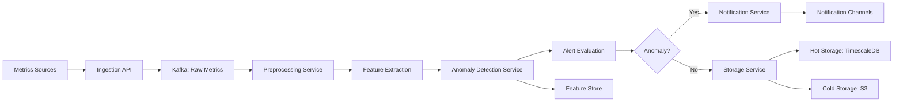
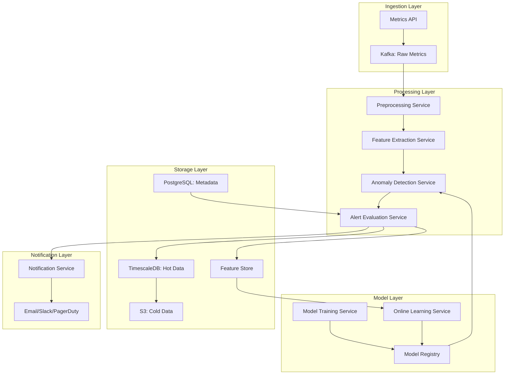

# Anomaly Detection for Metrics

**Category:** AI/ML System Design
**Difficulty:** 🟡 Medium
**Seniority:** mid-level
**Companies:** Datadog, Splunk
**Tags:** time-series, ML, alerting
**Time:** 60-90 min

---

## Problem Statement

Design an anomaly detection system for monitoring metrics (time-series data) that can automatically detect unusual patterns and trigger alerts. The system should handle various metric types (counters, gauges, histograms) from infrastructure and applications, detect different anomaly types (spikes, drops, trend changes, seasonal anomalies), and minimize false positives.

The platform ingests **10 million time-series metrics** with **1 billion data points per day**. Each metric has data points every 10-60 seconds. The system must detect anomalies in near real-time (< 1 minute from data ingestion) and support customizable alert thresholds and notification channels.

## Clarifying Questions

- What metric types? *Counters (monotonically increasing), gauges (current values), histograms (distributions), logs-derived metrics.*
- What data resolution? *10-60 second intervals, depending on metric importance.*
- What anomaly types? *Spikes, drops, sudden changes, gradual trends, seasonal anomalies, missing data.*
- What's the detection latency requirement? *< 1 minute from data point to alert.*
- What's the acceptable false positive rate? *< 5% of alerts should be false positives; allow tuning per alert.*
- Do we need multi-metric correlation? *Yes, detect anomalies across related metrics (e.g., CPU + memory).*
- Do we need to handle seasonality? *Yes, daily/weekly patterns (traffic spikes during business hours).*
- What notification channels? *Email, Slack, PagerDuty, webhooks.*
- How many alerts per day? *Target < 100 actionable alerts per customer per day.*

## Requirements

### Functional

- Ingest time-series data from multiple sources (agents, APIs).
- Detect anomalies using multiple algorithms (statistical, ML-based).
- Support different anomaly types: point anomalies, context anomalies, collective anomalies.
- Provide configurable alert conditions (thresholds, severity levels).
- Send alerts via multiple channels with routing rules.
- Store historical data for training and analysis.
- Provide dashboard for anomaly visualization and investigation.
- Support alert muting, snoozing, and maintenance windows.

### Non-Functional

- 10M time-series, 1B data points/day throughput.
- < 1 minute detection latency from data ingestion.
- 99.9% availability for alerting.
- Scalable storage for historical data (retention 13 months).
- Cost-efficient: optimize compute and storage.
- Low false positive rate with tunable sensitivity.

### Out of Scope

- Log analysis and anomaly detection (separate system).
- Root cause analysis (can suggest but not automated).
- Predictive alerting (forecasting future anomalies).
- Metric collection agents (assume data is available).

## Problem Framing

- **ML objective:** detect anomalous data points in time-series data with minimal false positives.
- **Pipeline stages:**

```text
Metric Ingestion → Preprocessing → Feature Extraction → 
Anomaly Detection → Alert Evaluation → Notification → Storage
```

- **Business metrics:** alert accuracy (precision/recall), false positive rate, mean time to detect (MTTD), customer satisfaction.
- **Model metrics:** precision, recall, F1-score, calibration of anomaly scores.
- **Constraints:** high throughput, low latency, diverse metric patterns, seasonality, concept drift.

## Data Pipeline

**Data sources**

- **Infrastructure metrics:** CPU, memory, disk, network from hosts/containers.
- **Application metrics:** request rates, error rates, latency, custom business metrics.
- **Cloud metrics:** AWS CloudWatch, Azure Monitor, GCP Cloud Monitoring.
- **Derived metrics:** computed from raw metrics (e.g., error rate = errors / requests).

**Storage**

- **Hot storage:** TimescaleDB or InfluxDB for recent data (7-30 days).
- **Cold storage:** S3 with Parquet for historical data (13 months).
- **Metadata store:** PostgreSQL for metric definitions, alert rules, configurations.
- **Feature store:** extracted features and anomaly scores.

**Ingestion pipeline**



**Preprocessing**

- **Data validation:** check for missing values, outliers, data type issues.
- **Imputation:** fill missing values using interpolation or forward-fill.
- **Normalization:** z-score normalization, min-max scaling per metric.
- **Downsampling:** aggregate high-resolution data to standard resolution.
- **Seasonality decomposition:** separate trend, seasonal, and residual components (STL decomposition).

**Feature extraction**

| Feature | Description | Window |
|---|---|---|
| Rolling mean | Average over window | 5m, 15m, 1h |
| Rolling std | Volatility over window | 5m, 15m, 1h |
| Percentiles | p25, p50, p75, p95, p99 | 5m, 1h |
| Rate of change | Derivative/difference | 1m, 5m |
| Seasonal residual | After removing seasonality | 1h, 1d |
| Histogram stats | For histogram metrics | 5m |

## Model Design

**Anomaly detection algorithms**

**Algorithm 1: Statistical (baseline)**

- **Z-score:** flag points where |(x - μ) / σ| > threshold (typically 3).
- **Moving average:** compare current value to moving average ± k × std.
- **Percentile-based:** flag values outside p5-p95 range.
- **Pros:** Simple, fast, interpretable, no training needed.
- **Cons:** Assumes normality, doesn't handle seasonality well, high false positives.

**Algorithm 2: Seasonal decomposition**

- **STL decomposition:** decompose into Seasonal, Trend, Residual.
- **Anomaly on residual:** flag points where residual > threshold.
- **Pros:** Handles seasonality, robust to trends.
- **Cons:** Requires sufficient history, slower computation.

**Algorithm 3: ML-based (Isolation Forest)**

- **Isolation Forest:** unsupervised, isolates anomalies by random splits.
- **Pros:** Handles high-dimensional features, no assumption on distribution.
- **Cons:** Requires training, less interpretable.

**Algorithm 4: Forecasting-based (Prophet/ARIMA)**

- **Forecast next value** using time-series model.
- **Anomaly if actual > forecast ± confidence interval.
- **Pros:** Handles trends and seasonality, provides confidence intervals.
- **Cons:** Computationally expensive, requires training per metric.

**Algorithm 5: Deep learning (LSTM Autoencoder)**

- **Train autoencoder** on normal data.
- **Anomaly if reconstruction error > threshold.
- **Pros:** Learns complex patterns, handles multivariate anomalies.
- **Cons:** Requires lots of data, expensive to train and serve.

**Chosen approach: Ensemble**

```text
FUNCTION detect_anomaly(metric, data_point, history):
    SET features ← extract_features(history)
    
    // Algorithm 1: Statistical z-score
    SET z_score ← abs(data_point - features.mean_15m) / features.std_15m
    SET score_1 ← min(z_score / 3.0, 1.0)  // Normalize to 0-1
    
    // Algorithm 2: Seasonal residual
    SET residual ← stl_decompose(history).residual
    SET score_2 ← min(abs(residual) / residual_threshold, 1.0)
    
    // Algorithm 3: Isolation Forest
    SET score_3 ← isolation_forest.predict(features)
    
    // Algorithm 4: Forecasting (for important metrics)
    IF metric.is_important:
        SET forecast ← prophet.predict(history)
        SET score_4 ← min(abs(data_point - forecast) / forecast.std, 1.0)
    ELSE:
        SET score_4 ← 0
    
    // Ensemble with weights
    SET anomaly_score ← 0.3*score_1 + 0.3*score_2 + 0.2*score_3 + 0.2*score_4
    
    RETURN {anomaly_score, scores: {z: score_1, seasonal: score_2, iforest: score_3, forecast: score_4}}
```

**Algorithm selection per metric type**

| Metric Type | Primary Algorithm | Secondary Algorithm |
|---|---|---|
| Counter (monotonic) | Rate of change + z-score | Forecasting |
| Gauge (noisy) | Moving average + percentile | Isolation Forest |
| Seasonal (traffic) | STL decomposition | Prophet |
| Stable (rarely changes) | Simple threshold | Z-score |

**Multi-metric correlation**

- **Correlation analysis:** compute correlation between related metrics.
- **Principal Component Analysis (PCA):** detect anomalies in reduced space.
- **Graph-based:** build metric dependency graph, propagate anomalies.

```text
FUNCTION detect_multivariate_anomaly(metrics_group):
    SET matrix ← align_metrics(metrics_group)  // Same timestamps
    SET pca ← PCA(matrix, n_components=3)
    SET reconstruction_error ← reconstruct(pca, matrix)
    IF reconstruction_error > threshold:
        RETURN {anomaly: true, contributing_metrics: top_contributors(pca)}
    ELSE:
        RETURN {anomaly: false}
```

## Training & Evaluation

**Training data**

- **Historical data:** 30-90 days of normal operation per metric.
- **Labeled anomalies:** past confirmed incidents (from alert history).
- **Synthetic anomalies:** inject anomalies into normal data for testing.

**Training strategy**

- **Per-metric models:** train separate models for each important metric.
- **Model families:** group similar metrics (e.g., all CPU metrics) for shared models.
- **Online learning:** update models incrementally with new data.
- **Concept drift detection:** monitor model performance, retrain if drift detected.

**Validation strategy**

- **Time-based split:** train on older data, validate on recent data.
- **Cross-validation:** rolling window cross-validation for time-series.
- **Holdout incidents:** keep some confirmed incidents for testing.

**Offline metrics**

- **Precision:** percentage of detected anomalies that are true anomalies.
- **Recall:** percentage of true anomalies detected.
- **F1-score:** harmonic mean of precision and recall.
- **False positive rate:** percentage of normal points flagged as anomalies.
- **Mean time to detect (MTTD):** average time from anomaly start to detection.

**Online evaluation**

- **Alert feedback:** users mark alerts as true/false positive.
- **Incident correlation:** match alerts to confirmed incidents.
- **A/B testing:** compare new algorithms on subset of metrics.

## System Architecture

**Service components**



**Scaling strategy**

- **Ingestion:** Horizontal scaling of API gateways and Kafka partitions.
- **Processing:** Worker pools with auto-scaling based on queue depth.
- **Model serving:** Batch processing for model inference; cache model outputs.
- **Storage:** TimescaleDB with partitioning by time and metric ID.

**Latency budget (p95)**

| Step | Budget |
|---|---|
| Ingestion to Kafka | 100ms |
| Preprocessing | 200ms |
| Feature extraction | 300ms |
| Anomaly detection | 200ms |
| Alert evaluation | 100ms |
| Notification | 100ms |
| **Total** | **~1s** (target < 1 min) |

**Capacity planning**

- 1B data points/day = 11.6K points/sec average, 50K peak.
- Feature extraction: 0.1ms per point → 5 cores needed.
- Anomaly detection: 0.5ms per point → 25 cores needed.
- Batch processing: process in windows (1-minute batches) for efficiency.
- Total: 50-100 cores for processing layer.

**Storage estimation**

- Hot storage (30 days): 1B × 30 = 30B points × 20 bytes = 600GB.
- Cold storage (13 months): 1B × 390 = 390B points × 10 bytes (compressed) = 3.9TB.
- Feature store: 10 features per point × 8 bytes = 80 bytes/point → 312GB for 30 days.

## Monitoring & Iteration

**Real-time monitoring**

- **Ingestion:** data points per second, queue depth, error rates.
- **Processing:** latency percentiles per stage, worker utilization.
- **Detection:** anomaly rate distribution, algorithm performance.
- **Alerts:** alert volume, false positive rate, notification delivery rate.

**Model monitoring**

- **Drift detection:** monitor feature distributions, anomaly score distributions.
- **Algorithm performance:** precision/recall per algorithm, per metric type.
- **Model age:** track when models were last trained/retrained.

**Retraining pipeline**

- **Weekly retraining** for forecasting models on important metrics.
- **Monthly retraining** for Isolation Forest and other ML models.
- **Online learning:** update statistical models (mean, std) continuously.
- **Automated rollback:** if new model performs worse, revert to previous version.

**Alert feedback loop**

- **Alert resolution:** users mark alerts as resolved, true/false positive.
- **Alert grouping:** related alerts grouped into incidents.
- **Snoozing:** users can snooze alerts during maintenance windows.
- **Rule tuning:** automatic suggestion for threshold adjustments based on feedback.

## Trade-offs

| Decision | Option A | Option B | Choice & Why |
|---|---|---|---|
| Detection algorithm | Single algorithm | Ensemble | Ensemble: combines strengths, reduces false positives |
| Model scope | Global model | Per-metric models | Hybrid: per-metric for important, shared for similar metrics |
| Processing mode | Real-time per point | Batch in windows | Hybrid: real-time for critical, batch for non-critical |
| Storage | Single database | Hot/cold separation | Hot/cold: optimize cost and performance |
| Alert evaluation | Simple threshold | Multi-condition rules | Multi-condition: more flexible, reduces false positives |

## Follow-up Questions

1. **How do you handle metrics with different scales and units?** Normalize per metric using z-score or percentile-based methods; store scaling parameters for consistent interpretation.
2. **How do you detect gradual trend changes vs sudden spikes?** Use different algorithms: z-score for spikes, forecasting/trend analysis for gradual changes; combine both in ensemble.
3. **How do you reduce alert fatigue from correlated metrics?** Group correlated metrics, deduplicate alerts, use multi-variate detection to find root cause metric.
4. **How do you handle new metrics with no history?** Use statistical baselines (first N points as baseline), apply generic algorithms, gradually build history.
5. **How do you optimize for cost at scale?** Downsample less important metrics, use cold storage for old data, batch processing for non-critical alerts, spot instances for training.

## Common Mistakes

- Using a single algorithm for all metric types without considering their characteristics.
- Ignoring seasonality, leading to false positives during expected patterns.
- Not handling missing data properly, causing false anomalies.
- Setting global thresholds without per-metric customization.
- Over-alerting without deduplication and grouping.
- Not incorporating user feedback to improve models.

## Key Takeaways

- Anomaly detection requires an ensemble of algorithms for different metric types and patterns.
- Pipeline: ingestion → preprocessing → feature extraction → detection → alerting.
- Seasonality decomposition is critical for metrics with daily/weekly patterns.
- Multi-metric correlation helps reduce false positives and find root causes.
- Hot/cold storage separation optimizes cost and performance.
- Alert feedback loop is essential for continuous improvement.
- Balance between detection sensitivity and false positive rate through tunable thresholds.
