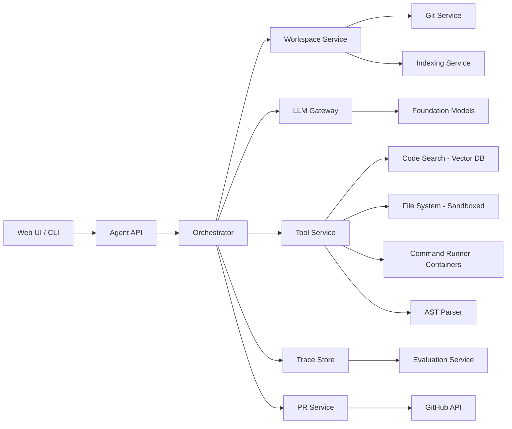

# Autonomous Coding Agent

**Category:** AI/ML System Design
**Difficulty:** 🔴 Hard
**Seniority:** Senior
**Companies:** GitHub, Anthropic
**Tags:** llm-agents, code-generation, tool-use
**Time:** 90-120 min

---

## Problem Statement

Design an autonomous coding agent that can independently complete software engineering tasks: given a natural language description (e.g., "add user authentication to the API" or "fix the memory leak in the image processing module"), the agent explores the codebase, makes code changes, runs tests, and iterates until the task is complete. The agent must be safe, efficient, and capable of handling complex multi-file changes across large repositories.

Scale hint: 10K developers, ~50K agent runs/day, each run averaging 20-50 LLM calls and 10-30 tool invocations (file reads, edits, test runs, git operations), with durations from 30 seconds to 30 minutes. Repository sizes range from small to monorepos with millions of lines of code. At senior level, you're expected to address code understanding at scale, tool orchestration, sandboxing, test-driven iteration, recovery from errors, and evaluation of code quality.

## Clarifying Questions

- What types of tasks? *Bug fixes, feature additions, refactoring, documentation, test generation.*
- What programming languages? *Multi-language support (Python, JavaScript/TypeScript, Java, Go, etc.).*
- What's the repository access model? *Read-only access to code, write access via git PRs; agent creates branches.*
- Can the agent run tests and commands? *Yes, in a sandboxed environment with dependencies installed.*
- How do we ensure safety? *All changes go through PR review; agent cannot merge directly; sandboxed execution.*
- What's the success criteria? *Tests pass, code review approved, task completed without human intervention.*
- How long can a run take? *Up to 30 minutes for complex tasks; must support pause/resume.*
- Do we have existing code context? *Yes, full repository access, plus issue tracker, documentation, and past commits.*

## Requirements

### Functional

- Parse natural language task descriptions and generate execution plans.
- Explore codebase: search, read files, understand project structure, dependencies, and conventions.
- Make code changes: create/edit files, refactor across multiple files, follow project style.
- Run tests and commands: execute test suites, linters, build scripts, and interpret results.
- Use git: create branches, commit changes, create pull requests with descriptions.
- Iterate autonomously: detect failures, analyze errors, and retry with different approaches.
- Provide visibility: streaming progress, intermediate results, and final summary.

### Non-Functional

- End-to-end task success rate > 70% for medium-complexity tasks.
- Average task completion time < 10 minutes for simple tasks, < 30 minutes for complex.
- Safety: no destructive actions outside designated workspace; sandboxed execution.
- Scalability: handle 50K runs/day with concurrent execution.
- Cost control: limit tokens and tool calls per task; average cost < $5 per task.

### Out of Scope

- Training foundation models (use existing LLMs).
- Building the LLM inference engine (consumed via API).
- Code review automation (human reviewers approve PRs).

## Problem Framing

- **Objective:** maximize autonomous task completion rate while minimizing cost, time, and safety risks.
- **Business metrics:** task success rate, human intervention rate, time saved per task, developer satisfaction, cost per successful task.
- **Agent metrics:** steps per task, tool call accuracy, test pass rate, code quality (lint, coverage), plan adherence, recovery from errors.
- **Key challenges:** understanding large codebases (millions of LOC), making correct multi-file changes, running and interpreting tests, handling ambiguous task descriptions, avoiding infinite loops, ensuring code quality, and cost control.
- **Why hard:** unlike code completion (single-file, single-edit), autonomous agents must understand context across files, execute commands, interpret results, and iterate. Errors compound; a bad edit can break tests in unrelated files.

## Data Pipeline

- **Repository indexing:**
  - Parse code structure: AST extraction, dependency graph, file relationships (imports, function calls).
  - Build semantic index: embed code chunks (functions, classes, files) using code-aware embeddings (e.g., CodeBERT, StarCoder embeddings).
  - Store in vector database (pgvector/Qdrant) for semantic search.
  - Maintain metadata: file paths, languages, test coverage, recent changes.
- **Context retrieval:**
  - Given a task, retrieve relevant files via keyword search (code search) + semantic search (embeddings).
  - Build dependency graph: identify files that might be affected by changes.
  - Extract project conventions: linting rules, formatting, testing framework, CI/CD setup.
- **Execution traces:**
  - Log every agent step: LLM calls (prompts, responses), tool invocations (args, results), test outputs, git operations.
  - Store traces for debugging, evaluation, and learning.
- **Feedback loop:**
  - Collect human feedback on PRs: approved/rejected, review comments, requested changes.
  - Track task outcomes: success/failure, reasons for failure.
  - Use feedback to improve prompts, tool selection, and planning.

## Model Design

- **Agent architecture:** ReAct-style loop with planning, tool use, and reflection.

```text
FUNCTION run_agent(task, repo_url)
    SET workspace ← clone_repo(repo_url, branch=agent_branch)
    SET context ← index_repo(workspace)
    SET plan ← planner_llm(task, context)
    SET state ← {workspace, plan, step=0, history=[]}
    WHILE NOT task_complete(state) AND state.step < MAX_STEPS
        SET action ← decide_action(state)
        SET result ← execute_tool(action, workspace)
        SET state ← update_state(state, action, result)
        IF result.is_error THEN
            SET reflection ← reflect_on_error(state)
            SET state.plan ← revise_plan(state.plan, reflection)
        END IF
        IF result.tests_failed THEN
            SET analysis ← analyze_test_failure(result.test_output, state)
            SET state.plan ← fix_plan(state.plan, analysis)
        END IF
        state.step ← state.step + 1
    END WHILE
    IF task_complete(state) THEN
        CREATE_PR(state.commits, task, state.summary)
    ELSE
        REPORT_FAILURE(state, reason)
    END IF
```

- **LLM roles:**
  - **Planner:** analyzes task, generates step-by-step plan, identifies relevant files and risks.
  - **Explorer:** searches codebase, reads files, understands structure and dependencies.
  - **Coder:** generates code changes, follows project style, handles edge cases.
  - **Tester:** writes tests, runs test suites, interprets results, fixes failures.
  - **Reflector:** analyzes errors, revises plans, suggests alternative approaches.

- **Tools:**
  - **Code search:** grep/ripgrep for keyword search, semantic search via embeddings.
  - **File operations:** read, write, edit files (diff-based edits for precision).
  - **Git operations:** branch, commit, diff, status, PR creation.
  - **Command execution:** run shell commands (tests, linters, build scripts) in sandbox.
  - **AST analysis:** parse code to understand structure, find usages, refactor safely.

- **Planning strategy:**
  - Initial plan: high-level steps (e.g., "1. Read authentication module, 2. Add login endpoint, 3. Write tests, 4. Run tests").
  - Dynamic revision: update plan based on findings (e.g., discovered existing auth library).
  - Dependency tracking: identify files affected by changes (imports, callers).

- **Error recovery:**
  - Test failures: parse error messages, identify failing tests, locate relevant code, generate fixes.
  - Lint errors: fix style issues automatically.
  - Build failures: resolve dependency issues, fix syntax errors.
  - Infinite loops: detect repeated actions, force reflection or abort.

- **Code quality:**
  - Follow project conventions: detect formatting (Prettier, Black), linting (ESLint, flake8), and apply automatically.
  - Generate tests: write unit tests for new code, aim for coverage.
  - Documentation: add docstrings, comments for complex logic.

## Training & Evaluation

- **Offline evaluation:**
  - Use benchmark datasets (SWE-bench, HumanEvalFix, repo-specific tasks).
  - Metrics: pass@1 (success on first try), pass@k (success within k attempts), steps to success, code quality (lint, test coverage).
  - Sandboxed environments: reproduce tasks in isolated containers with dependencies.
- **Component evaluation:**
  - Code search: recall@k for relevant files given a task.
  - Plan quality: human rating of generated plans.
  - Code generation: correctness of edits (diff match rate).
  - Test generation: test coverage and bug detection rate.
- **Online evaluation:**
  - Track PR acceptance rate, human revision rate, time to merge.
  - A/B test different prompts/planning strategies.
  - Collect developer feedback via surveys.
- **Fine-tuning:**
  - Fine-tune code models on successful trajectories (instruction tuning).
  - Distill planning capabilities from larger models to smaller, faster models.

## Serving Architecture



1. User submits task via UI/CLI; Orchestrator creates a run and allocates a workspace.
2. Workspace Service clones repo into a sandboxed filesystem (isolated per run).
3. Indexing Service builds semantic index of the repo (cached and reused).
4. Agent loop: Orchestrator calls LLM Gateway for decisions, Tool Service for actions.
5. Tool Service executes tools: code search (vector DB), file operations (sandboxed FS), commands (containers), git operations.
6. Progress streamed to UI; traces stored for debugging.
7. On success, PR Service creates a pull request with generated description.
8. Evaluation Service analyzes traces offline for improvement.

**Sandboxing:**
- Each run gets an isolated container with:
  - Clone of the repo (read-only base, writable overlay).
  - Project dependencies installed (cached layers).
  - Network access restricted (allowlist for package managers).
  - Resource limits: CPU, memory, disk, timeout.
- Commands run via non-root user; no access to host system.
- File changes tracked via overlay filesystem; only committed changes persisted.

**Latency & throughput:**
- Agent steps are sequential (LLM calls + tool execution); no strict latency requirement.
- Average step: LLM call (2-5 s) + tool execution (1-10 s) = 3-15 s.
- 50K runs/day × 30 steps/run = 1.5M steps/day ≈ 17 steps/s average, ~100/s peak.
- Async execution: hundreds of concurrent runs; LLM calls batched where possible.

**Cost control:**
- Token budget per task (e.g., 100K tokens).
- Step limit per task (e.g., 50 steps).
- Tool call limits (e.g., 100 file reads, 50 edits).
- Early termination if tests pass or task appears complete.

**Reliability:**
- Checkpoint state after each step; resume on failure.
- Idempotent tool operations (e.g., git commit with amend).
- Fallback: if LLM fails, retry with exponential backoff; if tool fails, log and continue.

## Monitoring & Iteration

- **Run metrics:** success rate, failure reasons (test failures, errors, timeout), steps per task, time per task, cost per task.
- **Quality metrics:** PR acceptance rate, human revision rate, lint errors, test coverage, code review comments.
- **LLM metrics:** token usage, latency, error rate, prompt effectiveness (success rate per prompt template).
- **Tool metrics:** tool call accuracy, failure rate, latency (e.g., code search recall, command execution success).
- **Safety monitoring:** sandbox escape attempts, suspicious commands, network access violations.
- **Feedback analysis:** cluster failure reasons, identify common patterns (e.g., "fails on TypeScript type errors"), improve prompts/tools.
- **Cost optimization:** use smaller models for simple tasks (file reads, simple edits), cache LLM responses for repeated queries, prune irrelevant context.

## Trade-offs

| Decision | Option A | Option B | Choice & Why |
|---|---|---|---|
| Planning | Detailed upfront plan | Iterative ReAct loop | Iterative: codebases are complex; plans change as agent explores |
| Code edits | Full file rewrite | Diff-based edits | Diff-based: more precise, easier to review, less token usage |
| Test strategy | Run all tests at end | Run tests incrementally | Incremental: faster feedback, catch errors early |
| Sandbox | Full VM per run | Container with overlay | Container: faster startup, sufficient isolation |
| LLM selection | Single large model | Router to multiple models | Router: use smaller models for simple tasks, large for complex |

## Follow-up Questions

1. **How does the agent handle large monorepos?** Semantic indexing with embeddings, dependency graph pruning, lazy loading of files, focus on relevant directories based on task.
2. **How do you prevent the agent from making destructive changes?** Sandbox isolation, git branches (no direct main branch edits), all changes require PR review, read-only access to production systems.
3. **How does the agent recover from test failures?** Parse test output to identify failing tests and error messages, locate relevant code using static analysis, generate targeted fixes, re-run tests iteratively.
4. **What if the agent gets stuck in an infinite loop?** Detect repeated actions (same tool call with same args), limit steps per task, force reflection step after N iterations, abort with human notification.
5. **How do you evaluate code quality beyond tests passing?** Run linters, formatters, static analysis tools; measure code coverage; use LLM-as-judge for code style and best practices; human review in PR process.
6. **How would you handle ambiguous task descriptions?** Agent asks clarifying questions (via UI or comments in PR), generates multiple possible interpretations and tries the most likely, uses past similar tasks as priors.

## Common Mistakes

- Trying to plan everything upfront without exploration; codebases are too complex.
- Making full file rewrites instead of targeted edits; hard to review and error-prone.
- Not running tests incrementally; errors compound and become hard to debug.
- Ignoring project conventions (style, testing framework); generates non-idiomatic code.
- No sandboxing; agent could accidentally delete files or run malicious commands.
- Not handling errors gracefully; agent gets stuck or makes things worse.
- Forgetting cost control; runaway token usage on complex tasks.

## Key Takeaways

- Autonomous coding agents need a loop of planning, exploration, action, and reflection.
- Code understanding at scale requires semantic indexing and dependency graphs.
- Sandbox isolation and git workflows are non-negotiable for safety.
- Incremental testing and error recovery are critical for reliability.
- Evaluate on real-world tasks (SWE-bench) with pass@k metrics, not just synthetic benchmarks.
- Cost control requires smart model routing and step limits.
- Human-in-the-loop via PR review ensures quality and provides feedback for improvement.
