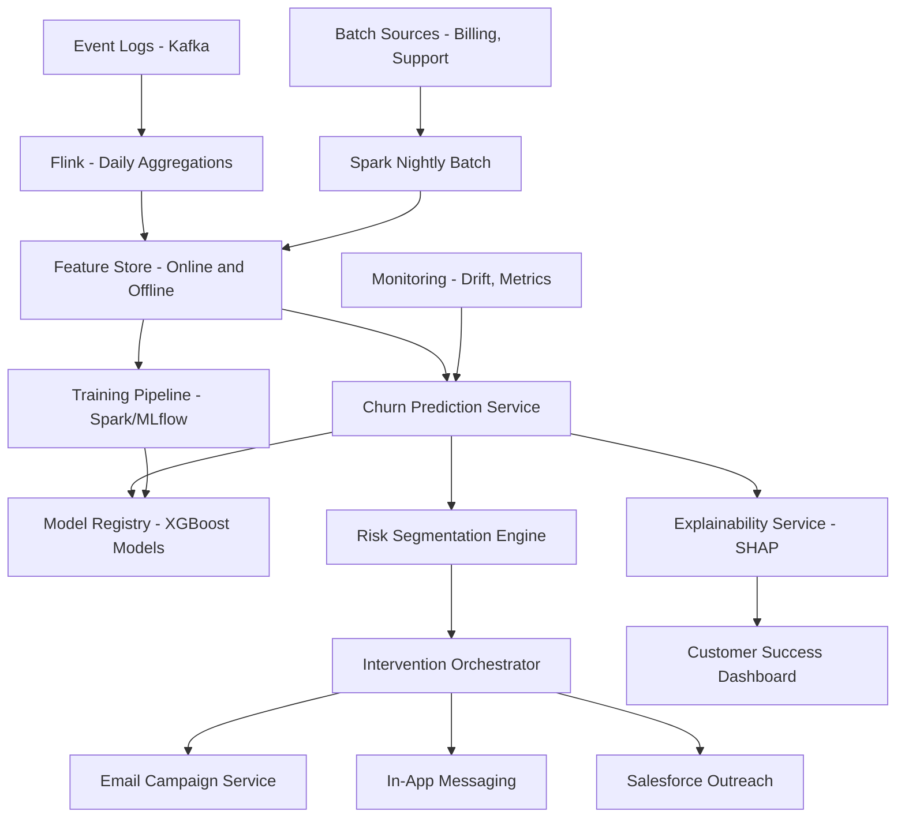

# Churn Prediction

**Category:** AI/ML System Design
**Difficulty:** 🟡 Medium
**Seniority:** Mid-level
**Companies:** Common ML use case (Telecom, SaaS, Subscription Services, E-commerce, Gaming)
**Tags:** classification, feature-engineering, monitoring, imbalanced-data, business-metrics
**Time:** 60-90 min

---

## Problem Statement

Design a churn prediction system for a subscription-based SaaS platform with 10M active users. The system should predict which customers are likely to cancel their subscription in the next 30 days, enabling proactive retention interventions (discounts, outreach, feature recommendations).

The platform has a monthly churn rate of ~3%, and the cost of losing a customer is estimated at 10x the cost of a retention offer. The system needs to generate daily churn risk scores for all active users, with explanations for customer success teams to take action.

## Clarifying Questions

- What defines churn? *Subscription cancellation or non-renewal after 30 days of inactivity.*
- What interventions are available? *Email campaigns, in-app messages, personalized discounts, account manager outreach, feature recommendations.*
- What's the prediction horizon? *30-day look-ahead for monthly churn prediction.*
- What data is available? *Usage logs, billing history, support tickets, survey responses, product events, demographic info.*
- What's the required latency? *Batch scoring overnight is acceptable; real-time scoring for high-risk users is a plus.*
- How do we evaluate success? *Reduction in churn rate, ROI of interventions, precision at top K for outreach capacity.*
- Are there different customer segments? *Yes: SMB, enterprise, freemium, trial users with different churn patterns.*

## Requirements

### Functional

- Generate daily churn probability scores for all active users.
- Provide feature importance/explanations for each prediction.
- Segment users by risk level for different intervention strategies.
- Track intervention outcomes to measure effectiveness.
- Support what-if analysis for retention scenarios.

### Non-Functional

- Process 10M users daily within a 4-hour batch window.
- Model accuracy: AUC > 0.85, precision at top 5% > 0.4.
- Feature freshness: usage data updated within 24 hours.
- Auditability: reproducible predictions for compliance and debugging.

### Out of Scope

- Real-time churn detection during a session (separate system).
- Lead scoring for prospective customers.
- Customer lifetime value prediction (related but separate).

## Problem Framing

- **ML objective:** estimate P(churn in next 30 days | user features, recent behavior).
- **Business objective:** maximize expected value of interventions: EV = P(churn) × LTV × intervention_success_rate - intervention_cost.
- **Decision policy:** rank users by expected loss, apply interventions to top K where intervention_cost < expected_loss.
- **Business metrics:** churn rate reduction, intervention ROI, customer lifetime value, net revenue retention (NRR).
- **Model metrics:** AUC, PR-AUC (better for imbalanced data), calibration, precision/recall at operating thresholds, lift over baseline.
- **Constraints:** class imbalance (3% churn), delayed labels (churn confirmed after 30+ days), feature drift as product evolves, intervention feedback loops.

## Data Pipeline

**Data sources**

- User profile: account age, plan type, company size, region, acquisition channel.
- Usage events: daily active users, feature usage, session duration, page views, API calls (event logs).
- Billing: payment history, plan changes, discounts, failed payments.
- Support: ticket volume, ticket types, resolution time, NPS scores.
- Product milestones: onboarding completion, key feature adoption, integrations set up.
- Engagement: email open rates, in-app message responses, survey participation.

**Label construction**

- **Positive label:** user cancels subscription or has 30+ days of inactivity within the prediction window.
- **Negative label:** user remains active and renews subscription.
- **Label delay:** churn confirmed 30-60 days after the prediction date; use a cutoff window for training data.
- **Censoring:** users still in trial or recently acquired may not have mature labels; exclude or treat separately.

**Features**

| Category | Examples | Freshness |
|---|---|---|
| Recency | Days since last login, last feature use, last support ticket | Daily |
| Frequency | Sessions/week, API calls/day, emails opened/month | Daily |
| Monetary | MRR, plan tier, payment failures, discount usage | Daily |
| Behavioral | Feature adoption scores, onboarding progress, workflow completion | Daily |
| Engagement | Session duration, pages per session, time in product | Daily |
| Support | Ticket count, unresolved tickets, CSAT scores | Daily |
| Temporal trends | Usage slope over 7/30/90 days, declining activity flags | Daily |
| Peer benchmark | Usage vs similar company size, feature adoption vs cohort | Weekly |

**Storage and computation**

- Event streaming (Kafka) → Flink for daily aggregations → feature store (Redis/online + Parquet/offline).
- Batch features computed nightly via Spark on 90-day rolling windows.
- Point-in-time feature snapshots stored for training to avoid leakage.
- Feature store (Feast/Tecton) ensures online/offline consistency.

## Model Design

**Model selection**

| Approach | Pros | Cons |
|---|---|---|
| Logistic regression | Interpretable, fast, baseline | Limited feature interactions |
| **Gradient-boosted trees (XGBoost/LightGBM)** | Best tabular performance, handles missing values, feature importance | Less interpretable than linear models |
| Random forest | Robust, handles non-linearity | Slower inference, less interpretable |
| Deep neural network | Learns complex patterns | Overkill for tabular, harder to explain |

**Chosen:** Gradient-boosted trees as primary model with:

- ~500 trees, depth 6-8, ~200 features.
- Segment-specific models for enterprise vs SMB (different churn patterns).
- Ensemble with logistic regression for calibration.
- SHAP values for per-prediction explanations.

```text
FUNCTION predict_churn_risk(user_id, prediction_date):
    SET features ← feature_store.get_features(user_id, prediction_date)
    SET features ← add_temporal_features(features, windows=[7, 30, 90])
    SET features ← add_peer_benchmarks(features, cohort=features.company_size)
    SET p_churn ← gbdt_model.predict(features)
    SET p_churn ← calibrate(p_churn)  // isotonic calibration
    SET risk_level ← categorize_risk(p_churn)
    SET top_features ← shap.explain(features, k=5)
    SET expected_loss ← p_churn × estimate_ltv(user_id)
    SET intervention ← select_intervention(risk_level, expected_loss, features)
    RETURN {
        user_id,
        p_churn,
        risk_level,
        expected_loss,
        top_features,
        intervention,
        model_version
    }
```

**Feature engineering highlights**

- **Trend features:** slope of usage over time (linear regression on last 30 days), declining activity flags.
- **Adoption scores:** weighted sum of key feature usage, normalized by cohort.
- **Health scores:** composite of engagement, support, and billing signals.
- **Cohort benchmarks:** user's usage percentile within similar company size/plan.

## Training & Evaluation

**Training data**

- 12-18 months of historical data with mature labels.
- For each month, create prediction snapshots at month-start with features, label based on churn within next 30 days.
- Balance classes via downsampling majority or upsampling minority with sample weights.

**Validation strategy**

- **Time-based split:** train on months 1-12, validate on month 13, test on month 14.
- Never random split: prevents leakage from future usage patterns.
- Group by user to prevent same user appearing in train and test.

**Offline metrics**

- AUC and PR-AUC (PR-AUC more informative for 3% prevalence).
- Precision/recall at top K (K = 1%, 5%, 10% of users) for intervention capacity planning.
- Calibration: predicted vs observed churn rate in probability bins.
- Lift: improvement over random baseline at various percentiles.
- Segment-specific metrics: enterprise vs SMB, new vs long-term customers.

**Online evaluation**

- Holdout test group: select top 5% at-risk users, split into intervention vs control.
- Measure churn reduction, intervention ROI, and feedback for model refinement.
- Monitor prediction drift monthly and retrain quarterly or when drift detected.

## System Architecture



**Batch scoring pipeline**

1. Nightly Spark job computes features for all active users from event logs and batch sources.
2. Features written to feature store (offline snapshot + online cache).
3. Churn prediction service loads latest model from registry.
4. Batch scoring processes 10M users in parallel (Spark or GPU-accelerated inference).
5. Results written to database for downstream systems (intervention, dashboards).
6. SHAP explanations computed for top-risk users.

**Latency and throughput**

- Feature computation: ~2 hours for 10M users on Spark cluster.
- Model inference: ~30 minutes for 10M users (XGBoost ~0.1ms per prediction).
- Total batch window: ~4 hours (comfortable within overnight window).

**Real-time scoring (optional)**

- For high-value enterprise users, compute on-demand risk scores using online feature store.
- Cache results for 24 hours to reduce compute.

## Monitoring & Iteration

- **Prediction monitoring:** drift in score distribution, feature distribution shifts (PSI), calibration decay.
- **Business metrics:** churn rate by risk segment, intervention conversion rates, ROI tracking.
- **Feature health:** missing feature rates, staleness, outlier detection.
- **Model performance:** monthly AUC checks on holdout data, segment-specific performance.
- **Intervention effectiveness:** A/B test results, feedback loops (interventions change behavior).
- **Retraining cadence:** quarterly full retrain, monthly calibration updates, trigger-based on significant drift.
- **Alerting:** model degradation (AUC drop > 5%), feature pipeline failures, intervention system issues.

## Trade-offs

| Decision | Option A | Option B | Choice & Why |
|---|---|---|---|
| Model complexity | Simple logistic regression | GBDT with segment-specific models | GBDT: better accuracy for complex churn patterns; segments capture heterogeneity |
| Prediction frequency | Weekly | Daily | Daily: enables timely interventions; weekly is too slow for proactive action |
| Feature window | 30 days | 90 days | 90 days: captures longer-term trends; 30-day for recent signals as additional features |
| Intervention targeting | Top 1% only | Top 10% with tiered interventions | Tiered: maximizes ROI by matching intervention cost to risk level |
| Label handling | Wait for confirmed churn | Use proxy labels (downgrade, inactivity) | Confirmed: more accurate; proxies can add noise but enable faster feedback |

## Follow-up Questions

1. **How do you handle the feedback loop where interventions change user behavior?** Use propensity scoring and counterfactual evaluation; maintain a holdout group that receives no intervention to measure natural churn.
2. **How do you handle new features with no historical data?** Use cold-start features (plan type, company size) and gradually incorporate usage features as data accumulates; segment new users separately.
3. **How do you ensure fairness across customer segments?** Evaluate metrics by segment (region, company size, plan type); calibrate models separately if needed; monitor for disparate intervention rates.
4. **What if the model performance degrades after a product launch?** Monitor feature drift and prediction distribution; retrain with post-launch data; add product-specific features to capture new behavior patterns.
5. **How do you prioritize which users get human outreach vs automated interventions?** Use expected loss and intervention cost; high-value, high-risk users get account manager outreach; mid-risk get automated campaigns.

## Common Mistakes

- Using random train/test splits instead of time-based splits.
- Ignoring label delay and training on immature labels.
- Optimizing AUC alone without considering business metrics and intervention capacity.
- Not monitoring for drift and retraining infrequently.
- Failing to account for intervention feedback loops in evaluation.
- Over-engineering with deep learning when GBDT suffices for tabular data.

## Key Takeaways

- Churn prediction is a cost-sensitive decision problem: prioritize precision at top K for intervention capacity.
- Feature engineering focused on temporal trends and behavioral changes is more valuable than static features.
- Time-based validation and point-in-time feature correctness are critical to avoid leakage.
- Segment-specific models capture heterogeneity across customer types.
- Monitor both model metrics and business outcomes; interventions create feedback loops that require careful evaluation.
