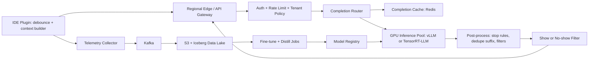

# Code Completion Assistant

**Category:** AI/ML System Design
**Difficulty:** 🟡 Medium
**Seniority:** senior
**Companies:** GitHub, Microsoft, Google, JetBrains, Sourcegraph, Replit, Amazon
**Tags:** llm, fill-in-the-middle, context-retrieval, low-latency-inference, caching, developer-tools
**Time:** 45 min

---

## Problem Statement

Design a Copilot-style inline code completion assistant. As a developer types in their IDE, the system suggests "ghost text" completions, from finishing a single line to writing a whole function body, and the developer accepts with Tab or keeps typing to ignore it.

Scale hint: 2M daily active developers, each triggering ~1,000 completion requests per day (after debouncing). That is ~2B requests/day, ~25K QPS on average and ~60K QPS at peak. Suggestions must show up within ~300 ms p50 / 800 ms p95 after the keystroke, or they feel laggy and developers ignore them. The interviewer wants to hear about gathering context from the IDE, fill-in-the-middle (FIM) models, the latency budget, caching and cancellation, and how to measure quality with acceptance and retention metrics.

## Clarifying Questions

- Inline completions only, or chat/agent too? *Inline ghost-text completions only; chat is a separate product.*
- Which IDEs and languages? *VS Code and JetBrains plugins; top 20 languages, with Python, TypeScript, Java and Go making up 80% of traffic.*
- Can code leave the customer's machine? *Yes, sent to our cloud over TLS; enterprise tier requires zero data retention and no training on their code.*
- Single-line or multi-line suggestions? *Both; the model decides, capped at ~15 lines.*
- Do we already have a model? *We may pretrain or fine-tune; assume access to permissively licensed code corpora and GPU capacity.*
- Repository-level context? *Yes, use open tabs and nearby files; a full-repo index is a stretch goal.*
- What does success mean? *More accepted code that stays in the file, measured by acceptance rate and retained characters, not just model loss.*

## Requirements

### Functional

- Return 1-3 completion candidates for a cursor position, given prefix, suffix and context.
- Support single-line and multi-line (block) completions, stopping at natural boundaries.
- Use cross-file context: open tabs, imported symbols, recently edited files.
- Let the client cancel in-flight requests when the user keeps typing.
- Collect telemetry: shown, accepted, partially accepted, and retained after 30 s / 2 min / 10 min.
- Filter for secrets, insecure patterns and verbatim matches to public code (optional for enterprise).

### Non-Functional

- Latency: time to first ghost-text p50 < 300 ms, p95 < 800 ms end to end, including network.
- Throughput: 60K QPS at peak; ~40% of requests get cancelled before they finish.
- Cost: under ~$0.50 per developer per month in GPU spend, so the model must be small and serving efficient.
- Privacy: no code persisted for enterprise users; per-tenant isolation; data stays in-region.
- Availability 99.9%; fail silently, so if completions are down the IDE just shows nothing.

### Out of Scope

- Chat, code review and agentic edits across files.
- Training the base foundation model from scratch (we cover fine-tuning and FIM training).

## Problem Framing

- **ML task:** conditional generation. Given `prefix`, `suffix` and `context snippets`, generate the "middle" tokens that the developer is most likely to write next. Trained with the fill-in-the-middle (FIM) objective, using special tokens `<PRE> ... <SUF> ... <MID>`.
- **Business metrics:** acceptance rate (accepted / shown, typically 25-35% for good systems), characters retained after N minutes, share of new code written by the assistant, weekly retention of developers, and paid seat conversion.
- **Model metrics:** exact match and edit similarity on held-out FIM samples, pass@1 on execution-based benchmarks (HumanEval-infilling, SAFIM, RepoEval / CrossCodeEval for cross-file).
- **Constraints:**
  - Latency dominates. A 70B model writes better code, but at 800 ms it would show nothing most of the time. Target a 1-7B model with time-to-first-token under 100 ms.
  - Cost: 2B requests/day × ~1,500 prompt tokens is ~3T prefill tokens/day, so prefill efficiency and prefix caching matter more than decode.
  - Show fewer, better suggestions. A bad suggestion costs the developer attention, so we also need a "should we show?" decision.

## Data Pipeline

**Training data**

- Permissively licensed public repositories (deduplicated, license-filtered, e.g. The Stack v2), plus internal or opt-in code for fine-tuning.
- Filtering: drop autogenerated or minified files, files with secrets (run detect-secrets/gitleaks), very long lines and near-duplicates (MinHash LSH).
- FIM transformation: for each document, pick a random span (at line, block or random character boundaries) as the middle and emit it as PSM (prefix-suffix-middle) or SPM. Apply FIM to ~50-90% of samples so plain left-to-right ability is kept.
- Repo-level samples: concatenate related files (by import graph) ahead of the target file, so the model learns to use cross-file context the way it will at inference.

**Online telemetry (feedback data)**

- Events: `shown`, `accepted`, `partial_accept` (word-by-word), `dismissed`, `retained@30s/2m/10m` (edit distance between the suggestion and the code that ends up in the file).
- Sent through Kafka to a data lake (S3 + Iceberg). Only metadata for zero-retention tenants; snippets only from users who opted in.
- Labels for the show/no-show filter and the reranker: accepted-and-retained = positive, shown-and-ignored = negative.

**Context gathering in the IDE (inference-time "features")**

```text
FUNCTION buildPrompt(doc, cursor, budgetTokens = 2048)
  SET prefix ← doc.text[max(0, cursor - 6000 chars) : cursor]
  SET suffix ← doc.text[cursor : cursor + 2000 chars]
  SET snippets ← []
  // 1. Language + file path header (cheap, high signal)
  ADD "// Path: " + doc.relativePath TO snippets
  // 2. Symbols from imports: signatures from the language server
  FOR sym IN lsp.resolveImports(doc) DO ADD signatureOf(sym) TO snippets
  // 3. Similar chunks from open tabs / recent files (Jaccard over 60-line sliding windows)
  SET window ← last 20 lines of prefix
  FOR file IN ide.openTabs + ide.recentlyEdited(limit = 20) DO
    FOR chunk IN slidingWindows(file, size = 60, stride = 10) DO
      SET score ← jaccard(tokens(window), tokens(chunk))
      CANDIDATE chunk WITH score
  ADD topK(candidates, k = 4) TO snippets
  // 4. Pack by priority: prefix tail > suffix head > snippets, truncate to budget
  RETURN packFIM(snippets, prefix, suffix, budgetTokens,
                 priority = [prefixTail, suffixHead, imports, similarChunks])
```

- Doing this on the client keeps it fast (no network round trip for retrieval) and private (only the chosen snippets leave the machine).
- Optional server-side repo index: an embedding index (e.g. a code embedding model + pgvector/FAISS per repo), built incrementally from commits, for repos larger than what fits in open tabs.

## Model Design

| Approach | Description | Verdict |
|----------|-------------|---------|
| N-gram / statistical | IntelliCode-style ranking of identifier completions | Fast, but only single tokens; a baseline |
| Left-to-right LM | GPT-style model fed only the prefix | Ignores the suffix, so it makes mistakes in the middle of a file |
| FIM decoder, 1-7B | StarCoder2-3B/7B, DeepSeek-Coder, Qwen2.5-Coder-1.5B/7B, Codestral-style trained with FIM | **Chosen**: best quality per millisecond |
| Large model 30B+ | Very strong, but TTFT 300+ ms and 10x the cost | Use for chat, or offline distillation |

**Chosen design**

- A **~3-7B FIM decoder** fine-tuned on our filtered corpus with repo-level context, a 8K-16K context window, and grouped-query attention (smaller KV cache, so more concurrent requests per GPU).
- **Distillation:** generate completions with a 30B+ teacher on real (opt-in) prompts, then fine-tune the small model on them. This closes much of the quality gap.
- **Speculative decoding:** a ~150M draft model or n-gram "prompt lookup" decoding. Code often copies from context, so prompt lookup gets high acceptance and 2-3x faster decode.
- **Stopping rules:** stop at end of line for single-line mode; for multi-line mode stop when indentation returns to the cursor's level, or on a blank line followed by a dedent. Use tree-sitter to check the suggestion parses (balanced brackets).
- **Show/no-show filter:** a tiny GBDT (LightGBM) on features such as mean token log-prob, suggestion length, language, cursor context (mid-word, after `.`, after newline) and the user's recent accept rate. It drops suggestions likely to be ignored and raises acceptance rate by 5-10 points.
- **Post-processing:** remove overlap with the suffix (the model often repeats the closing `)`), trim trailing whitespace, run a secrets regex, and optionally run a public-code match filter (hash n-grams of 150+ characters against an index of public code).

## Training & Evaluation

**Offline**

- **FIM exact match / edit similarity** on held-out repos (split by repo, not file, to avoid leakage), broken down by language and span type (line, block, random).
- **Execution-based:** HumanEval-infilling and SAFIM pass@1; for cross-file, CrossCodeEval and RepoBench, with retrieval turned on and off to measure what context gathering adds.
- **Realistic replay set:** 50K anonymized, opt-in real prompts (exact production prompt format) with the code the developer actually ended up writing. This correlates better with acceptance than benchmarks do.
- **Latency eval:** TTFT and total time on target hardware at production concurrency; a model that wins on quality but misses the latency SLO is rejected.
- Contamination check: dedupe eval repos against training data.

**Online (A/B by user, 1-2 weeks)**

- Primary: **retained characters per active user per day** (accepted code that survives 10 min with edit similarity above 0.8).
- Secondary: acceptance rate, p50/p95 latency, shown rate, cancellation rate.
- Guardrails: latency p95, error rate, GPU cost per request, rate of complaints or opt-outs.
- Watch out for acceptance rate alone: showing fewer, shorter suggestions raises acceptance while lowering total value. Always pair rate metrics with volume metrics.

## Serving Architecture



**Request flow**

1. The plugin debounces keystrokes (~75 ms idle), skips cases that rarely work (inside comments, mid-identifier with an obvious LSP completion), builds the FIM prompt locally and sends it over a persistent HTTP/2 connection to the nearest region.
2. If a newer keystroke arrives, the client **cancels** the stream; the server aborts generation and frees the KV cache. With ~40% of requests cancelled, this saves a lot of GPU time.
3. The router checks the **completion cache** (key = hash of the last ~500 chars of prefix + first 200 of suffix + model version). Also, on the client, if the user types characters that match the start of the current suggestion, keep showing the rest with no new request ("typing through").
4. On a miss, route with **session affinity** (same user → same GPU replica) so that **prefix/KV caching** (vLLM automatic prefix caching) reuses the prefill of the shared context between successive keystrokes.
5. The model streams tokens; post-processing applies stop rules and filters; the show/no-show filter decides; the response is streamed back.

**Latency budget (p50 target 300 ms)**

| Stage | Budget |
|-------|--------|
| Debounce | 75 ms |
| Client context build | 10-20 ms |
| Network RTT (regional) | 30-50 ms |
| Queue + prefill 1.5K tokens (with prefix cache hit) | 20-40 ms |
| Decode ~30 tokens at ~5 ms/token (speculative) | 100-150 ms |
| Post-process + render | 10 ms |

**Capacity:** 60K QPS peak, ~60% not cancelled, each request ~1.5K prefill + ~40 decode tokens. A 7B model on an H100 with continuous batching handles roughly 150-300 such requests/s at this latency, so ~200-400 GPUs at peak across regions, autoscaled with the working day across time zones.

## Monitoring & Iteration

- **Product dashboards:** acceptance rate, retained characters, shown rate and latency by language, IDE, region, model version.
- **Latency SLOs:** TTFT and end-to-end p95 per region; alert on queue depth; shed load by switching to single-line mode or a smaller model under pressure.
- **Drift:** new languages and frameworks (a new library version shifts APIs). Monitor acceptance by library/import; refresh fine-tuning data quarterly with recent code.
- **Feedback loop:** accepted-and-retained completions (from opt-in users) become fine-tuning and reranker training data; ignored suggestions become negatives for the show/no-show filter.
- **Guardrails:** secrets filter, insecure-pattern checks (e.g. SQL string concatenation) with a lightweight static analyzer, public-code match filter, tenant-level policy (block certain files, such as `.env`).
- **Cost control:** cancellation, caching, a smaller model for single-line mode, quantization (FP8/INT8 weights, roughly 1.5-2x throughput at nearly no quality loss), and following the sun with autoscaling.

## Trade-offs

| Decision | Option A | Option B | Choice & Why |
|----------|----------|----------|--------------|
| Model size | Small 1-7B FIM model | Large 30B+ model | Small: latency budget is ~150 ms of model time; distill from the large model to recover quality |
| Context retrieval | Client-side (open tabs, LSP, Jaccard) | Server-side embedding index of the repo | Client-side first: zero extra RTT and better privacy; add the server index for big repos |
| Request trigger | Every keystroke | Debounced plus skip heuristics | Debounced: halves request volume with no visible latency cost |
| Suggestion volume | Show everything the model generates | Filter with a confidence model | Filter: bad suggestions cost attention and trust |
| Caching | Exact completion cache only | Plus KV prefix caching with session affinity | Both: KV prefix reuse cuts prefill time a lot because consecutive prompts share 95% of tokens |
| Primary metric | Acceptance rate | Retained characters per user | Retained characters: acceptance rate can be gamed by showing less |

## Follow-up Questions

1. **How would you add whole-repository awareness?** Build a per-repo index (tree-sitter symbol graph + code embeddings) updated on commit, retrieve definitions of symbols near the cursor, and add them to the prompt within the token budget; check the gain on CrossCodeEval and in an A/B.
2. **How do you handle an enterprise that forbids storing code?** Zero-retention mode: process in memory only, no prompt logging, only aggregate metadata telemetry, a dedicated or region-pinned inference pool, and exclude that tenant's data from training.
3. **How do you personalize to a company's codebase?** Per-tenant LoRA adapters fine-tuned on their repos, served with multi-LoRA (vLLM/S-LoRA) on a shared base model, so adding a tenant does not add GPUs.
4. **The new model has better benchmark scores but acceptance dropped. Why?** Likely a prompt-format mismatch between training and serving, longer suggestions that are partly wrong, or higher latency causing more cancellations. Check the replay set, length distribution and latency by cohort.
5. **How do you avoid suggesting copyrighted code verbatim?** Train on license-filtered data, deduplicate, and at inference match long n-grams against an index of public code; block or show attribution.
6. **What happens during a GPU outage in a region?** The router fails over to the next region (higher RTT), and the client degrades to single-line mode; if everything fails, the IDE shows nothing, with no error popups.

## Common Mistakes

- Picking the biggest, best model without checking whether it fits a ~300 ms end-to-end budget.
- Sending only the prefix and ignoring the suffix and cross-file context, which are the biggest quality levers.
- Forgetting request cancellation and debouncing, which wastes 40%+ of GPU capacity.
- Using acceptance rate as the only metric; it ignores how much value is delivered and whether accepted code is kept.
- Evaluating with a random file split, which leaks code from the same repo into train and test.
- Ignoring privacy, secret leakage and license risk for enterprise customers.

## Key Takeaways

- Code completion is a latency-bound LLM problem: small FIM models, prefix/KV caching, speculative decoding and cancellation are the core design.
- Context gathering in the IDE (prefix, suffix, open tabs, imports) often matters more than model size.
- Fill-in-the-middle training and serving prompts must match exactly.
- Measure retained value (characters kept after minutes), not just acceptance rate, and pair rate metrics with volume metrics.
- A cheap "should we show this?" model improves trust by keeping low-confidence suggestions out of view.
