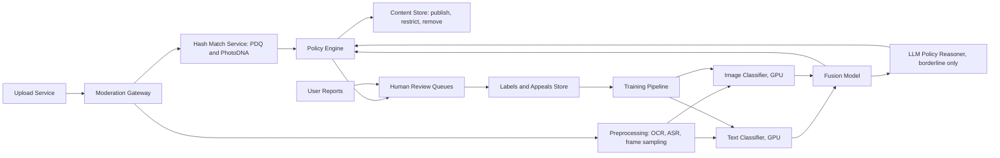

# Content Moderation

**Category:** AI/ML System Design
**Difficulty:** 🟡 Medium
**Seniority:** senior
**Companies:** Meta, YouTube, TikTok, Reddit, Discord, X, Roblox
**Tags:** multimodal, classification, human-in-the-loop, trust-and-safety, policy-enforcement, active-learning, llm
**Time:** 60 min

---

## Problem Statement

Design an automated content moderation system for a social platform that hosts text posts, comments, images, and short videos. The system must detect policy-violating content (hate speech, harassment, nudity, violence, spam, self-harm, CSAM) and take actions such as removing, age-restricting, downranking, or sending content to human reviewers.

The platform receives about **500M new pieces of content per day** (~6K/s average, ~20K/s peak): 400M text comments/posts, 90M images, and 10M short videos. There are ~5,000 human moderators. Policies change frequently and differ by country.

## Clarifying Questions

- Which policy categories matter most? *About 10 categories; CSAM, terrorism, and self-harm are highest severity with legal obligations.*
- Pre-publication or post-publication? *Pre-publication blocking for high-severity, high-confidence cases; otherwise publish and moderate within minutes.*
- What actions exist? *Remove, age-restrict, reduce distribution, warning interstitial, send to human review, account strike.*
- Latency expectations? *Text and image decisions under 500 ms pre-publication; video can be async within 5 minutes.*
- How many human reviews per day? *5,000 moderators × ~400 items/day ≈ 2M reviews/day, so automation must handle > 99.5% of content.*
- Do users report content? *Yes, ~5M user reports/day, very noisy.*
- Multiple languages? *Yes, 50+ languages; top 10 cover 85% of content.*
- Appeals? *Users can appeal removals; appeals are reviewed by humans.*

## Requirements

### Functional

- Classify content across policy categories with per-category severity and confidence.
- Support text, images, video (frames + audio transcript), and combinations (meme text on image).
- Hash-matching against known violating media (PhotoDNA/PDQ for CSAM and terrorist content via industry hash-sharing).
- Route uncertain cases to human review queues prioritized by severity and reach.
- Appeals flow and user reports intake.
- Policy configuration per region without retraining where possible.

### Non-Functional

- 20K items/s peak; text/image p99 < 500 ms pre-publication; video < 5 min.
- High-severity categories: recall > 95% with human review; precision of auto-removals > 98%.
- Auditability: each action logs model versions, scores, policy version, and reviewer.
- Reviewer wellbeing: blur graphic content, limit exposure time.
- Regulatory compliance (EU DSA transparency reports, NCMEC reporting for CSAM).

### Out of Scope

- Misinformation fact-checking pipelines.
- Live-stream moderation (mention as a follow-up).

## Problem Framing

- **ML objective:** multi-label classification: P(violates category c | content, context) for each policy category, calibrated so thresholds map to actions.
- **Business metrics:**
  - **Prevalence:** % of content views that are violating (sampled and human-labeled); the north-star metric.
  - Proactive rate: % of actioned content found before any user report.
  - Wrongful removal rate (appeal overturn rate), time-to-action, moderator throughput.
- **Model metrics:** per-category PR-AUC, recall at the auto-action precision threshold, calibration.
- **Constraints:** asymmetric harms per category, limited human capacity (2M reviews/day), adversarial users (misspellings, coded language, image text overlays), cultural and language context, and policies that change monthly.

Action policy by score and severity:

```text
FOR each category c:
    IF hash_match(c) OR score[c] ≥ auto_remove_threshold[c]   → REMOVE (+ report if legally required)
    ELSE IF score[c] ≥ review_threshold[c]                     → HUMAN REVIEW, priority = severity[c] × predicted_reach
    ELSE IF score[c] ≥ downrank_threshold[c]                   → REDUCE DISTRIBUTION
    ELSE                                                        → ALLOW
// thresholds chosen per category to hit precision target for auto-remove and to fit review capacity
```

## Data Pipeline

**Data sources**

- Content and metadata: text, images, video, author account age, history of strikes, community, audience size.
- Human review decisions (highest quality labels, ~2M/day).
- User reports (noisy, biased toward disagreements rather than violations).
- Appeal outcomes (corrections of false positives).
- Hash databases: NCMEC/PhotoDNA, GIFCT hash-sharing for terrorist content.

**Labeling**

- Policy-expert-written guidelines with examples; versioned with the policy.
- Golden sets per category labeled by expert reviewers with ≥ 3 votes; inter-annotator agreement tracked (hate speech is notoriously low, ~0.6 kappa; this bounds achievable model performance).
- **Active learning:** sample for labeling by uncertainty and by disagreement between models, plus a random sample for unbiased prevalence estimation.
- **LLM-assisted labeling:** an LLM with the written policy pre-labels new categories in days instead of weeks; humans audit.
- Label taxonomy is hierarchical (violence → graphic violence → gore) to support policy changes without relabeling everything.

**Features and preprocessing**

- Text: normalization of leetspeak and homoglyphs, language ID, transliteration.
- Images: OCR of overlaid text, perceptual hashes (PDQ), CLIP-style embeddings.
- Video: sample 1 frame/s + scene-change keyframes, ASR transcript (Whisper), audio events.
- Context: author's prior violations, account age, community norms, reply-to content (harassment depends on context).

**Storage**

- Content in blob storage (S3); embeddings and model scores in a feature table (Bigtable/Cassandra keyed by content_id).
- Review decisions and labels in PostgreSQL + data lake (Iceberg/Delta) for training.
- Vector index (FAISS/Milvus) of embeddings of known violating content for near-duplicate matching.

## Model Design

**Layered architecture (cheapest first)**

1. **Hash matching** (PDQ/PhotoDNA, MD5 for exact) against known-bad databases: exact or near-exact matches, ~1 ms, near-zero false positives.
2. **Near-duplicate embedding search:** content similar to previously removed content (re-uploads with crops/filters) via ANN on embeddings, cosine > 0.92.
3. **Per-modality classifiers:**
   - Text: multilingual transformer (XLM-R base, distilled) with a multi-label head over ~10 categories. ~10 ms on GPU.
   - Image: vision backbone (ViT/EfficientNet or CLIP image encoder) fine-tuned with multi-label heads for nudity, violence, etc.
   - OCR text from images is passed through the text classifier.
4. **Multimodal fusion model:** for memes and posts where meaning comes from text + image together, a late-fusion model takes text embedding, image embedding, OCR embedding, and context features, and outputs final category scores.
5. **LLM policy reasoner (selective):** for borderline items in nuanced categories (hate speech, harassment), a fine-tuned LLM (e.g. Llama Guard-style, 8B) is prompted with the policy text and returns a label + rationale. Run on ~1-2% of traffic only; rationales help reviewers.

**Why a shared multi-task model per modality:** one backbone with multiple heads amortizes compute across categories, and new categories can be added as heads with less data.

**Video:** the cascade runs on sampled frames and transcripts; scores are aggregated with max-pooling over time with temporal localization so reviewers jump to the flagged timestamp.

```text
FUNCTION moderate(item):
    IF hash_db.match(item.media_hashes):
        RETURN action(REMOVE, category = matched.category, source = HASH)
    SET neighbors ← ann_index.search(item.embedding, top = 5)
    IF max_similarity(neighbors, removed = TRUE) > 0.92:
        RETURN action(REMOVE_OR_REVIEW, inherit = neighbors[0].decision)
    SET text_scores ← text_model.predict(item.text + ocr(item.images) + asr(item.video))
    SET image_scores ← image_model.predict(item.images OR sampled_frames(item.video))
    SET scores ← fusion_model.predict(text_scores, image_scores, item.context_features)
    FOR c IN categories WHERE review_threshold[c] ≤ scores[c] < auto_remove_threshold[c] AND c IN NUANCED:
        SET scores[c] ← blend(scores[c], llm_reasoner.judge(item, policy[c]))
    RETURN policy_engine.decide(scores, item.region, item.predicted_reach)
```

## Training & Evaluation

**Training**

- Multi-task, multi-label BCE loss with per-category weights; focal loss for rare categories.
- Train on human-reviewed data (hard, borderline-heavy) plus random-sample labels (to calibrate for the real distribution). Mixing matters: training only on reviewed items skews the base rate.
- Adversarial augmentation: character substitutions, inserted spaces, emoji obfuscation, image crops/overlays/filters.
- Retrain per modality monthly; heads for fast-changing categories (spam, new slurs) more often.

**Offline evaluation**

- Per-category, per-language golden sets; report PR-AUC and recall at the precision required for auto-removal (e.g. 98%).
- Slice analysis for fairness: false positive rates on dialects (e.g. AAVE), reclaimed terms, LGBTQ+ content, and minority languages. Over-enforcement on these groups is a known failure mode.
- Counterfactual tests: swap identity terms ("I am a [group] person") and check score invariance.

**Online evaluation**

- **Prevalence measurement:** randomly sample ~50K viewed items/day, have them labeled, and estimate violating-view prevalence with confidence intervals.
- A/B tests on thresholds and models: measure prevalence, proactive rate, appeal overturn rate, reviewer queue size, and creator retention.
- Review queue quality: % of items sent to review that reviewers actually action (precision of the review band).

## Serving Architecture



**Paths**

1. **Synchronous (text, images):** upload service calls the gateway; hash match and classifiers run in parallel; policy engine decides before publication. Content passing pre-checks is published; borderline items can be published with reduced distribution pending review.
2. **Asynchronous (video, deep checks):** videos go via Kafka to a GPU worker pool; the item is visible only to the uploader (or with limited distribution) until the check completes within ~5 minutes.
3. **Re-scan:** when a model or policy updates, or a hash is added, recently popular content is re-scored in batch.
4. **Reactive:** user reports and virality spikes trigger re-evaluation with stricter thresholds (high reach means higher expected harm).

**Latency budget (sync, p99)**

| Step | Budget |
|---|---|
| Hash match (parallel) | 20 ms |
| OCR on images | 100 ms |
| Text + image classifiers (parallel, batched) | 80 ms |
| Fusion + policy | 20 ms |
| LLM reasoner (only ~1-2% of items) | async or +300 ms |
| **Total** | **~250 ms** typical |

**Capacity**

- Text: 400M/day ≈ 4.6K/s avg, 15K/s peak; distilled XLM-R at ~2K seq/s per A10G → ~10 GPUs with headroom.
- Images: 90M/day ≈ 1K/s avg, 3K/s peak; ViT-B at ~1K img/s per GPU → ~5 GPUs, plus OCR fleet.
- Video: 10M/day × ~30 frames sampled ≈ 300M frames/day ≈ 3.5K frames/s + ASR; ~20-30 GPUs in the async pool.
- LLM reasoner: ~2% of 500M = 10M calls/day ≈ 115/s; vLLM with an 8B model, ~8-16 GPUs.

**Human review routing:** priority score = severity × P(violation) × predicted reach; queues split by language, category, and reviewer specialization; graphic content blurred by default.

## Monitoring & Iteration

- **Prevalence and proactive rate** per category and region (weekly), plus daily automated action volume. Sudden drops in removals can mean a broken model or a new evasion technique.
- **Drift and evasion:** new slang and coded terms; monitor rising n-grams/embeddings in user-reported content that the model scores low, and send clusters to policy experts.
- **Appeal overturn rate** per category as the false positive signal; high overturn rates trigger threshold review.
- **Threshold management:** thresholds per category/region tuned to review capacity; if queues back up, raise review thresholds for low-severity categories only, never for CSAM/self-harm.
- **Policy changes:** policy text versioned; LLM reasoner can adopt a new policy immediately (prompt update) while classifiers are retrained on newly labeled data over 2-4 weeks.
- **Feedback loops:** reviewer decisions flow back daily; sample review decisions for QA (reviewer accuracy vs expert golden labels).
- **Cost:** cascade ordering (hashes → small classifiers → LLM) keeps expensive inference to a few percent of traffic.

## Trade-offs

| Decision | Option A | Option B | Choice & Why |
|---|---|---|---|
| Timing | Moderate everything pre-publication | Pre-publish for high-severity, post-publish for the rest | Hybrid: blocks worst harms without adding latency to every post |
| Model structure | One model per category | Shared multi-task backbone per modality | Multi-task: amortized compute, easier to add categories |
| LLM usage | LLM on all content | LLM only on borderline nuanced items | Selective: 500M/day through an LLM is too costly; borderline is where context reasoning pays off |
| Thresholds | Global | Per category and region | Per category: harms and legal requirements differ |
| Labels | User reports | Expert review + random sampling + appeals | Reviewed and random samples: reports are biased and noisy |
| Multimodal | Separate text and image decisions | Fusion model | Fusion: memes are often harmful only in combination |

## Follow-up Questions

1. **How do you extend this to live streaming?** Sample frames and audio every few seconds, run the same classifiers in streaming mode, and escalate to a human with the ability to cut the stream; high-reach streams get denser sampling.
2. **A new slur or coded phrase emerges. How fast can you respond?** Minutes via keyword/regex rules and the LLM reasoner prompt; days via near-duplicate expansion and labeling; weeks to fold it into retrained classifiers.
3. **How do you measure success when most violations are never reported?** Prevalence via random sampling and human labeling of viewed content, which is independent of model and reports.
4. **How do you handle different laws by country?** Global policy as baseline plus region-specific policy rules in the policy engine (geo-restricting rather than removing globally), with thresholds per region.
5. **How do you avoid over-enforcing on marginalized communities?** Fairness slices in eval, counterfactual identity-term tests, community context features, and monitoring appeal overturn rates by language and dialect.
6. **Reviewers are overwhelmed after a major news event. What do you do?** Prioritize by severity × reach, auto-action near-duplicates of already-reviewed items, temporarily reduce distribution of borderline content instead of reviewing all of it.

## Common Mistakes

- Treating moderation as a single binary "toxic" classifier instead of multi-label, multi-severity with different actions.
- Ignoring hash matching, the cheapest and most precise layer for known illegal content.
- Measuring success by number of removals instead of prevalence and appeal overturn rate.
- Training only on reported or reviewed content, which skews calibration.
- Forgetting human review capacity when setting thresholds.
- No fairness evaluation across dialects and identity terms.

## Key Takeaways

- Build a cascade: hash matching, near-duplicate search, multi-task classifiers, fusion, and a selective LLM reasoner.
- Thresholds are per category and tied to both harm severity and human review capacity.
- Prevalence from random sampling is the north-star metric; appeals measure over-enforcement.
- Humans stay in the loop for borderline and high-severity content, and their decisions feed retraining.
- Expect adversaries and policy changes: fast levers (rules, prompts, hashes) complement slower model retraining.
