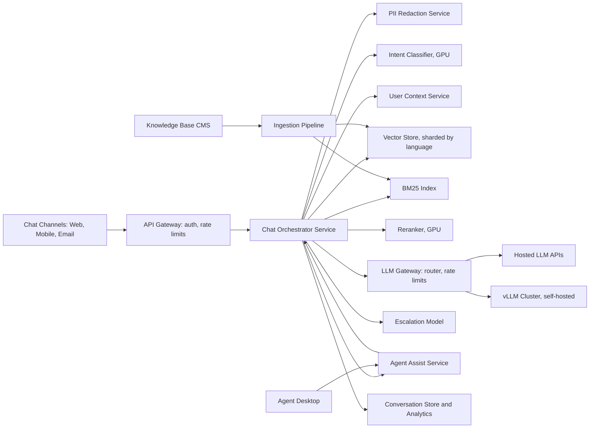

# Customer Support Chatbot

**Category:** AI/ML System Design
**Difficulty:** 🟡 Medium
**Seniority:** Mid-level
**Companies:** Intercom, Zendesk, Salesforce, Drift, Ada, LivePerson
**Tags:** nlp, rag, intent-classification, dialogue-management, llm, guardrails, knowledge-base
**Time:** 60-90 min

---

## Problem Statement

Design a customer support chatbot that handles customer inquiries across multiple channels (web chat, mobile app, email). The chatbot should answer common questions, route complex issues to human agents, and provide agents with relevant context and suggested responses.

The system serves **100K daily active users** with **500 concurrent conversations** at peak. The knowledge base contains **50K articles** covering product features, billing, troubleshooting, and policies. Support for English, Spanish, and French is required.

## Clarifying Questions

- What channels need support? *Web chat, mobile in-app, email (async).*
- What's the automation target? *Handle 60-70% of conversations without human intervention.*
- What latency for chat responses? *p95 < 3 seconds for first response.*
- How do we handle escalation? *Smooth handoff to human with full conversation context.*
- What's the knowledge base format? *Structured articles (FAQs, guides) + historical ticket resolutions.*
- Do we need personalization? *Basic user context (account status, recent orders) available.*
- Can we use hosted LLM APIs? *Yes, with enterprise agreements; some customers require self-hosted.*
- What about sensitive data (PII, payment info)? *Must be handled securely; redaction before LLM calls.*

## Requirements

### Functional

- Multi-channel chat interface with streaming responses.
- Intent classification (billing, technical, account, feature request, etc.).
- RAG-based answers from knowledge base with citations.
- Seamless escalation to human agents with context transfer.
- Agent assist: suggest responses and relevant articles for human agents.
- Support English, Spanish, French with language detection.

### Non-Functional

- 500 concurrent conversations, p95 response time < 3 s.
- Automation rate ≥ 60% (conversations resolved without human).
- Answer accuracy ≥ 85% on eval set (human-graded).
- 99.9% availability for chat service.
- PII redaction before external LLM calls.
- Rate limiting per user to prevent abuse.

### Out of Scope

- Voice support (v1 is text-only).
- Proactive outreach campaigns.
- Training a foundation model.

## Problem Framing

- **Objective:** maximize customer satisfaction while minimizing human agent workload through accurate, helpful automated responses.
- **Business metrics:** automation rate, CSAT scores, resolution time, agent productivity (tickets handled per hour).
- **Model/system metrics:**
  - Intent classification: accuracy, F1-score per intent.
  - Retrieval: Recall@k, MRR for relevant articles.
  - Generation: answer relevance, factual consistency, citation accuracy.
  - Escalation prediction: precision (don't escalate solvable issues).
- **Constraints:** latency (real-time chat), accuracy (wrong answers hurt trust), privacy (PII protection), multi-language support.

## Data Pipeline

**Data sources**

- Knowledge base articles: 50K structured articles (FAQs, how-to guides, policies).
- Historical support tickets: 2M past conversations with resolutions (gold mine for training).
- Product documentation: API docs, user guides, release notes.
- Customer context: account status, subscription tier, recent orders/interactions.

**Ingestion and preprocessing**

- Articles parsed from CMS (Confluence, Zendesk Guide, custom CMS).
- Historical tickets anonymized (PII redacted) and labeled with intents and resolutions.
- Language detection for multilingual support.
- Articles chunked for RAG: structure-aware splitting (sections, Q&A pairs).

**Embeddings and storage**

- Embedding model: multilingual model (e.g., `bge-m3` or `text-embedding-3-small`).
- Vector store: partitioned by language and content type (articles vs tickets).
- Metadata filtering: product, category, language, last_updated.
- BM25 index for exact keyword matching (product names, error codes).

```text
ON article_updated(article):
    SET chunks ← structure_aware_split(article.content, target = 400)
    FOR c IN chunks:
        SET c.header ← article.title + " > " + c.section
        SET c.vector ← embed(c.header + "\n" + c.text)
        SET c.meta ← {language: article.lang, category: article.category,
                       product: article.product, updated: article.updated_at}
    vector_store.upsert(article.id, chunks)
    bm25_index.upsert(article.id, chunks)

ON ticket_resolved(ticket):
    SET anonymized ← redact_pii(ticket.conversation)
    SET intent ← classify_intent(anonymized)
    SET resolution ← extract_resolution(anonymized)
    SET chunks ← split_conversation(anonymized)
    FOR c IN chunks:
        SET c.vector ← embed(c)
        SET c.meta ← {intent: intent, language: ticket.language,
                       resolved: true, satisfaction: ticket.csat}
    vector_store.upsert(ticket.id, chunks)
```

## Model Design

**Pipeline stages**

1. **Message preprocessing:** PII redaction, language detection, user context enrichment.
2. **Intent classification:** classify user query into intents (billing, technical, account, etc.).
3. **Hybrid retrieval:** dense vector search + BM25 on knowledge base + historical tickets.
4. **Reranking:** cross-encoder to select top 3-5 most relevant passages.
5. **Response generation:** LLM generates answer with citations, or suggests responses for agents.
6. **Escalation prediction:** decide if human intervention is needed.

**Model choices**

| Component | Option A | Option B | Choice |
|---|---|---|---|
| Intent classifier | Fine-tuned BERT | LLM zero-shot | Fine-tuned BERT: faster, more consistent |
| Embeddings | OpenAI ada-002 | Self-hosted bge-m3 | Self-hosted: cost control, data privacy |
| Reranker | Cohere Rerank | bge-reranker | bge-reranker: self-hosted, good quality |
| Generator | GPT-4o | Llama 3.1 70B | Router: simple queries to small model, complex to large |
| Escalation model | Logistic regression | LLM classifier | LR on conversation features: fast, interpretable |

```text
FUNCTION handle_message(user, message, conversation_history):
    // Preprocess
    SET clean ← redact_pii(message)
    SET lang ← detect_language(clean)
    SET context ← get_user_context(user)  // account, orders, tier

    // Intent classification
    SET intent ← intent_classifier.predict(clean, lang)

    // Retrieval
    SET query ← clean + " " + context.hints
    PARALLEL:
        SET dense ← vector_store.search(embed(query), filter = {language: lang}, top = 20)
        SET sparse ← bm25.search(query, filter = {language: lang}, top = 20)
    SET candidates ← rrf_merge(dense, sparse)[:20]
    SET relevant ← reranker.rerank(query, candidates, top = 5)

    // Escalation decision
    SET should_escalate ← escalation_model.predict({
        intent: intent,
        confidence: max(candidates.scores),
        user_tier: context.tier,
        conversation_length: len(conversation_history),
        escalation_history: user.escalation_rate
    })

    IF should_escalate:
        SET suggested ← suggest_agent_responses(relevant, intent)
        RETURN {action: "escalate", context: relevant, suggestions: suggested}

    // Generate response
    SET response ← llm.generate(build_prompt(message, relevant, context, intent))
    SET validated ← validate_citations(response, relevant)
    RETURN {action: "respond", message: validated, citations: relevant.ids}
```

**Prompt sketch**

```text
SYSTEM: You are a helpful customer support assistant for {company}.
        Answer using ONLY the provided knowledge base.
        Cite sources with [source_id].
        If you're unsure, say so and offer to connect to a human.
        Be concise and friendly.

CONTEXT:
  User: {user_tier} customer, account {account_id}
  Recent orders: {recent_orders}
  Subscription: {subscription_status}

KNOWLEDGE BASE:
  [S1] {article_title}: {chunk_text}
  [S2] ...

CONVERSATION HISTORY:
  {history}

USER MESSAGE: {message}

INTENT: {intent}
```

## Training & Evaluation

**Training data**

- Intent classifier: 500K labeled messages from historical tickets (10 intent classes).
- Reranker: (query, relevant_passage) pairs from click-through data and agent selections.
- Escalation model: features from 1M conversations with escalation labels.

**Evaluation sets**

- Intent classification: 10K held-out messages, stratified by intent and language.
- Retrieval: 2K query-gold-passage pairs from agent-resolved tickets.
- End-to-end: 500 conversation scenarios with expected resolutions.

**Offline metrics**

| Component | Metric | Target |
|---|---|---|
| Intent classification | Accuracy | ≥ 0.90 |
| Intent classification | Macro F1 | ≥ 0.85 |
| Retrieval | Recall@5 | ≥ 0.85 |
| Retrieval | MRR | ≥ 0.75 |
| Generation | Answer relevance (LLM judge) | ≥ 0.85 |
| Generation | Citation accuracy | ≥ 0.90 |
| Escalation | Precision (don't escalate solvable) | ≥ 0.80 |

**Online evaluation**

- A/B test new models on a percentage of traffic.
- Metrics: automation rate, CSAT, resolution time, escalation rate.
- Monitor for hallucinations via user feedback and agent overrides.

## Serving Architecture



**Latency budget (p95)**

| Step | Budget |
|---|---|
| Auth + context fetch | 100 ms |
| PII redaction | 50 ms |
| Intent classification | 100 ms |
| Retrieval (parallel dense + BM25) | 200 ms |
| Reranking | 100 ms |
| LLM generation (first token) | 1,500 ms |
| Total streaming response | 2,050 ms |
| **Total** | **~2 s**, headroom to 3 s |

**Scaling**

- 500 concurrent conversations × avg 2 messages/min = ~1,000 msg/s peak.
- Intent classifier: BERT-base on GPU handles ~5K req/s → 1 GPU sufficient.
- Vector store: 50K articles × 5 chunks = 250K chunks, easily fits in memory.
- LLM: route 70% to small model (GPT-4o-mini), 30% to large model.
- Self-hosted Llama 70B on vLLM for customers requiring data residency.

## Monitoring & Iteration

- **System:** latency, error rate, queue depth, GPU utilization, cache hit rate.
- **Quality:**
  - Intent accuracy via agent corrections.
  - Answer quality via thumbs up/down and CSAT.
  - Escalation rate by intent and user segment.
- **Safety:**
  - PII redaction validation (sample checks).
  - Toxic/offensive response detection.
  - Jailbreak/prompt injection monitoring.
- **Feedback loop:**
  - Agent corrections become training data.
  - Escalated conversations analyzed for improvement opportunities.
  - Low-confidence queries sent for labeling.
- **Retraining:**
  - Intent classifier: monthly with new labeled data.
  - Reranker: quarterly with new click-through data.
  - Full eval suite before any model deployment.

## Trade-offs

| Decision | Option A | Option B | Choice & Why |
|---|---|---|---|
| Intent classification | LLM zero-shot | Fine-tuned BERT | Fine-tuned: faster, more consistent, cheaper |
| Knowledge source | Articles only | Articles + tickets | Both: tickets capture real Q&A patterns |
| Escalation threshold | Fixed | Adaptive per user | Adaptive: VIP users get lower threshold |
| LLM hosting | All hosted | Hybrid (hosted + self-hosted) | Hybrid: flexibility for data residency requirements |
| Multilingual | Separate models per language | Single multilingual | Multilingual: simpler ops, cross-lingual transfer |

## Follow-up Questions

1. **How do you handle multi-turn conversations with context?** Maintain conversation state with summary of previous turns, include in retrieval query, and use conversation history in the generation prompt.
2. **A user asks about a very recent product feature not in the KB. What happens?** Retrieval returns low-confidence results, escalation model triggers, and the system flags the gap for KB update.
3. **How do you prevent the chatbot from giving incorrect billing information?** High-risk intents (billing, payments) have stricter escalation thresholds, answers require citations, and agents review sensitive responses.
4. **How would you add voice support?** Add ASR (speech-to-text) and TTS (text-to-speech) services, handle conversational fillers, and adjust for shorter, more informal voice inputs.
5. **A customer is angry and the chatbot isn't helping. How do you detect and escalate?** Sentiment analysis on messages, escalation on repeated negative sentiment, quick-escalate option for users, and agent monitoring of high-risk conversations.

## Common Mistakes

- Not redacting PII before sending to external LLMs.
- Fixed escalation thresholds that frustrate VIP users or over-escalate simple issues.
- Ignoring conversation context, treating each message independently.
- Not including historical tickets in the knowledge base (misses real customer questions).
- No guardrails against prompt injection or jailbreak attempts.
- Forgetting to handle language detection properly, leading to wrong language responses.

## Key Takeaways

- Intent classification + RAG + LLM generation is a proven pattern for support chatbots.
- Historical tickets are as valuable as official articles for the knowledge base.
- Escalation prediction is crucial: automate what you can, but know when to hand off.
- PII redaction and guardrails are non-negotiable for customer data.
- Monitor automation rate, CSAT, and escalation rate together to measure success.
- Agent assist (suggesting responses) provides value even when full automation isn't possible.
