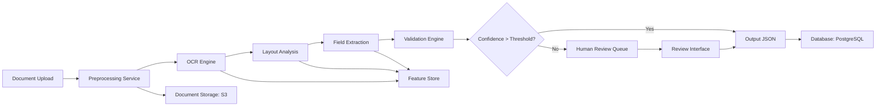
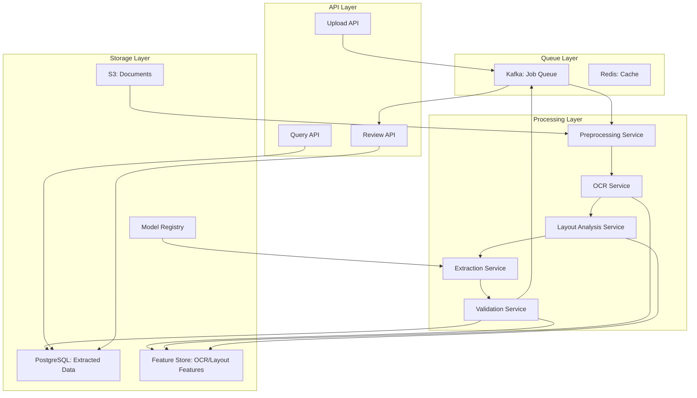

# Document OCR and Extraction

**Category:** AI/ML System Design
**Difficulty:** 🟡 Medium
**Seniority:** mid-level
**Companies:** Google, Adobe
**Tags:** OCR, NLP, document processing
**Time:** 60-90 min

---

## Problem Statement

Design a document OCR and information extraction system that can process uploaded documents (PDFs, images, scanned forms) and extract structured data. The system should handle various document types including invoices, receipts, contracts, and forms, extracting key fields like dates, amounts, names, addresses, and line items.

The platform processes approximately **100,000 documents per day** with peak loads of **500 documents per minute**. Documents range from simple single-page receipts to complex multi-page contracts with tables and signatures. The system must return extracted data within **30 seconds** for interactive use cases and support batch processing for bulk uploads.

## Clarifying Questions

- What document types and formats? *PDFs (native and scanned), images (PNG, JPEG, TIFF), possibly Word documents; focus on invoices, receipts, contracts, and forms.*
- What fields need extraction? *Structured fields: dates, amounts, vendor names, addresses, invoice numbers, line items (SKU, quantity, unit price); unstructured: contract clauses, terms.*
- What accuracy requirements? *95%+ field-level accuracy for common fields (date, amount, vendor); 80%+ for complex fields like line items or legal clauses.*
- What's the latency budget? *30 seconds for single-document interactive mode; batch jobs can take hours but should process efficiently.*
- Do we need to handle handwriting? *Yes, some forms have handwritten fields (signatures, notes, filled checkboxes).*
- Do we need to preserve layout and formatting? *Yes, for contracts and forms where position matters (checkboxes, signatures, table structure).*
- What's the volume and storage? *100K docs/day, average 2 pages/doc, 5MB per doc → ~500GB/day input; extracted data stored in database.*
- Do we need to handle multiple languages? *Start with English; mention extensibility for other languages.*

## Requirements

### Functional

- Accept document uploads via API and web interface.
- Perform OCR on scanned documents and images.
- Extract structured fields from documents based on document type.
- Detect and preserve document layout (tables, columns, checkboxes, signatures).
- Support multiple document type templates with custom field mappings.
- Return extracted data in JSON format with confidence scores.
- Provide human review interface for low-confidence extractions.
- Support batch processing for bulk uploads.

### Non-Functional

- 500 docs/min peak throughput, p95 latency < 30s for single documents.
- 99.9% availability; queue documents during outages.
- Scalable storage for documents and extracted data.
- Data privacy: encrypt documents at rest, support retention policies.
- Audit trail: track who accessed each document and extraction results.

### Out of Scope

- Document generation or creation.
- Complex legal document analysis beyond field extraction.
- Real-time video or camera feed processing.

## Problem Framing

- **ML objective:** extract structured fields from documents with confidence scores, handling both OCR and semantic understanding.
- **Pipeline stages:**

```text
Document Upload → Preprocessing → OCR → Layout Analysis → 
Field Extraction → Validation → Human Review (if needed) → Output
```

- **Business metrics:** extraction accuracy (field-level), automation rate (documents needing no human review), throughput, cost per document.
- **Model metrics:** character accuracy (CER) for OCR, field-level F1 score, confidence calibration.
- **Constraints:** variable document quality, diverse layouts, handwriting, tables, multi-page documents.

## Data Pipeline

**Data sources**

- Document uploads: files, metadata (document type, submitter, timestamp).
- Ground truth: human-verified extractions for training and evaluation.
- Templates: document type definitions with field locations and rules.

**Storage**

- **Object storage** (S3/GCS) for original documents with versioning.
- **Database** (PostgreSQL) for extracted structured data and metadata.
- **Vector store** for document embeddings and similarity search.
- **Feature store** for OCR outputs, layout features, and extraction results.

**Processing pipeline**



**Preprocessing**

- Image enhancement: deskewing, noise reduction, contrast adjustment, binarization.
- PDF parsing: extract text from native PDFs, convert scanned pages to images.
- Page segmentation: identify text regions, tables, images, signatures.
- Resolution normalization: upscale low-resolution images to standard DPI (300 DPI).

**OCR Engine**

- **Primary:** Tesseract 4+ with LSTM models for general text.
- **Handwriting:** specialized model (e.g., TrOCR, Google's handwriting OCR).
- **Tables:** Table structure recognition (TableNet, CascadeTabNet).
- **Fallback:** Commercial APIs (Google Vision, AWS Textract) for difficult cases.

**Layout Analysis**

- Detect document regions: headers, footers, tables, signatures, checkboxes.
- Identify reading order: handle multi-column layouts.
- Table detection and cell boundary recognition.
- Signature region detection for verification.

## Model Design

**OCR Models**

| Component | Model | Purpose |
|---|---|---|
| Text OCR | Tesseract LSTM | General text recognition |
| Handwriting | TrOCR / Handwriting-specific model | Filled forms, signatures |
| Table Structure | TableNet / PaddleOCR | Detect table cells and structure |
| Document Classification | CNN + Transformer | Identify document type (invoice, receipt, contract) |

**Field Extraction**

**Approach 1: Template-based**

- Define coordinate regions for each field per document template.
- Extract text from regions using OCR output.
- Apply validation rules (regex, format checks).
- **Pros:** Simple, high accuracy for known templates.
- **Cons:** Brittle, requires template maintenance, doesn't handle variations.

**Approach 2: Rule-based with NLP**

- Use keyword patterns and positional heuristics.
- Example: find "Total:" or "Amount:" and extract following number.
- **Pros:** Flexible, handles some layout variations.
- **Cons:** Limited accuracy, complex rule maintenance.

**Approach 3: ML-based extraction (chosen)**

- **Document classification:** CNN + BERT to identify document type.
- **Named Entity Recognition (NER):** BERT-based model fine-tuned on document data to extract fields (dates, amounts, names, addresses).
- **Table extraction:** specialized model for line items.
- **Spatial attention:** incorporate position information as features.

```text
FUNCTION extract_document(document):
    SET pages ← preprocess_and_ocr(document)
    SET doc_type ← classify_document(pages)
    SET layout ← analyze_layout(pages)
    
    SET fields ← {}
    FOR EACH field IN doc_type.field_schema:
        SET candidates ← ner_extract(pages, field.type, layout)
        SET best ← select_best_candidate(candidates, confidence_threshold)
        IF best.confidence < threshold:
            best ← rule_fallback(pages, field, layout)
        fields[field.name] ← {value: best.value, confidence: best.confidence}
    
    IF doc_type.has_tables:
        fields.line_items ← extract_tables(pages, layout)
    
    SET validation ← validate_fields(fields, doc_type.rules)
    RETURN {fields, validation, overall_confidence}
```

**Model training**

- **Training data:** 50K+ documents with human-verified extractions.
- **Data augmentation:** synthetic documents, rotation, noise, blur, varying DPI.
- **Transfer learning:** start with pre-trained BERT, fine-tune on document domain.
- **Multi-task learning:** predict field types, positions, and confidence jointly.

## Training & Evaluation

**Training data**

- Labeled documents from human review queue.
- Synthetic data generation using templates with variations.
- Public datasets: RVL-CDIP (document classification), PubLayNet (layout), IIIT-5K (word OCR).

**Validation strategy**

- **Temporal split:** train on older documents, validate on recent ones.
- **Document-type split:** ensure all types represented in validation.
- **Cross-validation:** k-fold for robustness estimates.

**Offline metrics**

- **OCR metrics:** Character Error Rate (CER), Word Error Rate (WER).
- **Field extraction:** Precision, Recall, F1 per field type.
- **End-to-end:** Percentage of documents with all fields correctly extracted.
- **Confidence calibration:** Expected Calibration Error (ECE).

**Online evaluation**

- Human review feedback loop: compare model predictions with verified extractions.
- A/B testing: compare new models against production on subset of traffic.
- Monitor automation rate: percentage of documents not requiring review.

## System Architecture

**Service components**



**Scaling strategy**

- **API layer:** Auto-scaling based on request rate.
- **Processing services:** Horizontal scaling with worker pools.
- **OCR service:** GPU instances for faster inference; CPU for batch.
- **Queue:** Kafka for job distribution, handles backpressure.
- **Cache:** Redis for frequently accessed documents and templates.

**Latency breakdown (p95)**

| Step | Budget |
|---|---|
| Upload and validation | 2s |
| Preprocessing | 3s |
| OCR (per page) | 5s × 2 pages = 10s |
| Layout analysis | 3s |
| Field extraction | 5s |
| Validation and output | 2s |
| **Total** | **~25s** (target < 30s) |

**Capacity planning**

- 500 docs/min peak = 8.3 docs/sec.
- Average 2 pages/doc = 16.6 pages/sec.
- OCR at 0.2 pages/sec per GPU core → ~84 GPU cores needed.
- Buffer with 100 GPU cores across multiple instances for headroom.

## Monitoring & Iteration

**Real-time monitoring**

- **Throughput:** documents processed per minute, queue depth.
- **Latency:** p50, p95, p99 per processing stage.
- **Accuracy:** field extraction accuracy from human review feedback.
- **Error rates:** OCR failures, extraction timeouts, validation errors.
- **Resource utilization:** GPU/CPU/memory usage per service.

**Model monitoring**

- **Drift detection:** distribution shift in OCR outputs and extracted fields.
- **Confidence calibration:** track if confidence scores match actual accuracy.
- **Template coverage:** percentage of documents matching known templates.

**Retraining pipeline**

- Weekly retraining with new labeled data from human review.
- Automated evaluation on holdout set.
- Champion/challenger deployment for gradual rollout.
- Rollback capability if performance degrades.

**Human review workflow**

- Priority queue: low-confidence documents first.
- Review interface: side-by-side comparison of document and extraction.
- Feedback loop: corrections used for training.
- Reviewer metrics: accuracy, throughput, agreement rate.

## Trade-offs

| Decision | Option A | Option B | Choice & Why |
|---|---|---|---|
| OCR Engine | Open-source (Tesseract) | Commercial API (Google/AWS) | Hybrid: Tesseract for cost, commercial as fallback for accuracy |
| Extraction | Template-based | ML-based NER | ML-based: handles layout variations, scalable to new document types |
| Processing | Real-time only | Async queue | Async queue: handles bursts, better resource utilization |
| Handwriting | Ignore | Specialized model | Specialized model: important for forms and signatures |
| Tables | Simple regex | Table structure recognition | Table recognition: accurate line item extraction critical |

## Follow-up Questions

1. **How do you handle new document types without templates?** Use zero-shot classification with pre-trained models, then bootstrap with few labeled examples and active learning.
2. **How do you improve OCR for low-quality scans?** Image enhancement pipeline (super-resolution, denoising), ensemble of multiple OCR models, and fallback to human review.
3. **How do you handle multi-page documents with cross-page tables?** Track page context, merge table cells across pages, use document-level understanding models.
4. **How do you ensure data privacy for sensitive documents?** Encrypt at rest, in transit; implement access controls; automatic data retention; redaction for review.
5. **How do you scale to millions of documents per day?** Distributed processing with Kubernetes, spot instances for batch jobs, regional deployment for latency.

## Common Mistakes

- Ignoring document preprocessing and assuming OCR works on raw images.
- Using only template-based extraction without ML for flexibility.
- Not handling confidence scores, leading to poor automation rate.
- Overlooking table structure, treating tables as plain text.
- Not planning for human review workflow and feedback loop.
- Ignoring document layout and reading order in multi-column layouts.

## Key Takeaways

- Document extraction requires a pipeline: preprocessing → OCR → layout analysis → field extraction.
- Combine template-based rules with ML-based NER for robustness and flexibility.
- Confidence scores and human review are critical for high accuracy.
- Layout analysis is as important as OCR for structured extraction.
- Design for async processing to handle variable document complexity and load.
- Active learning from human review continuously improves model accuracy.
