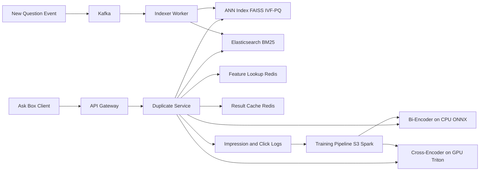

# Duplicate Question Detection

**Category:** AI/ML System Design
**Difficulty:** 🟢 Easy
**Seniority:** mid
**Companies:** Quora, Stack Overflow, Reddit, Amazon, Meta, LinkedIn
**Tags:** text-similarity, embeddings, ann-search, pairwise-classification, threshold-tuning, two-stage-retrieval
**Time:** 45 min

---

## Problem Statement

Design a system that detects when a newly asked question on a Q&A site (Quora / Stack Overflow) is a duplicate of an existing question. When a user types or submits a question, the system should surface likely duplicates ("Did you mean...?") and, for very confident matches, help moderators merge or close the new question as a duplicate.

The site has about **300M existing questions** and receives about **500K new questions per day**. Duplicates fragment answers, hurt SEO, and waste expert time, so the goal is to route askers to existing answers while never wrongly closing a genuinely new question.

## Clarifying Questions

- When does detection run? *Two places: as-you-type suggestions in the ask box (debounced), and a final check on submit.*
- What happens on a match? *Show top-5 suggestions to the asker; above a high threshold, auto-flag for moderator merge. No fully automatic closing in v1.*
- Do we have labels? *Yes: ~2M historical moderator "closed as duplicate" links plus user-accepted suggestions. The public Quora Question Pairs set (~400K pairs) is a useful sanity check.*
- Languages? *English first; Stack Overflow also has code snippets in questions.*
- Latency budget? *Suggestions < 150 ms p99 end to end; the submit-time check can take up to 500 ms.*
- What defines a duplicate? *Same intent: an answer to one fully answers the other. "How to learn Python?" vs "Best way to learn Python fast?" is a duplicate; "Python vs Java?" vs "Java vs C++?" is not.*
- Is the corpus scoped? *Search across the whole corpus but boost candidates in the same topic/tag.*

## Requirements

### Functional

- Given a question title (+ optional body/tags), return top-k candidate duplicates with a calibrated duplicate probability.
- Index new questions so they become searchable as duplicates within minutes.
- Two thresholds: "suggest" (show to user) and "flag" (send to moderator queue).
- Capture feedback: user clicks a suggestion and abandons the ask, moderator confirms/rejects merges.

### Non-Functional

- Latency: < 150 ms p99 for suggestions at ~2K QPS peak (as-you-type traffic is ~10x submits).
- Quality: flag precision >= 95%; suggest recall@5 >= 85% on labeled duplicates.
- Freshness: new questions indexed within 5 minutes.
- Cost: run on CPU for retrieval; small GPU pool for the reranker.

### Out of Scope

- Answer merging UI and moderator tooling.
- Spam/low-quality question detection.

## Problem Framing

- **ML objective:** for a query question q and a corpus C, find c in C maximizing P(duplicate | q, c). This is a **retrieve-then-classify** problem: brute-force pairwise scoring over 300M questions is impossible, so it splits into:
  1. **Candidate retrieval** (high recall): bi-encoder embeddings + ANN, plus BM25 for lexical overlap.
  2. **Pairwise classification** (high precision): cross-encoder scores (q, c) pairs for top ~50 candidates.
- **Business metrics:** % of asks deflected to an existing question, duplicate-closure rate by moderators (should drop), answer rate on new questions, moderator time per day.
- **Model metrics:** retrieval recall@50 and recall@5; pairwise PR-AUC, precision at the flag threshold, calibration (ECE).
- **Constraints:** asymmetric cost. A wrong flag annoys a user with a genuine question (and kills engagement); a missed duplicate costs only some redundancy. Thresholds are therefore set per action.

## Data Pipeline

- **Sources:**
  - Positives: moderator duplicate links (~2M), accepted suggestions (user clicked and did not post).
  - Hard negatives: candidates that were shown but explicitly dismissed; moderator-rejected merge flags; ANN neighbors with high similarity but different accepted answers.
  - Easy negatives: random pairs from the same tag (cheap, but teach little).
- **Label quality:** duplicate links are not symmetric in the raw data and are transitive (A~B, B~C implies A~C). Build duplicate clusters with union-find and generate all pairs within a cluster as positives, capped per cluster to avoid giant clusters (e.g. "How do I lose weight?") dominating.
- **Active labeling:** sample ~2K pairs/week from the uncertain band (0.4-0.7) for human raters, 3-way agreement.
- **Preprocessing:** lowercase, normalize whitespace, strip boilerplate ("Thanks in advance"), keep code tokens; title is the strongest signal, body truncated to first 256 tokens.
- **Features for the classifier (beyond the text pair):** cosine of embeddings, BM25 score, Jaccard of tags, length ratio, shared named entities/numbers (numbers matter: "Python 2" vs "Python 3"), whether the candidate has an accepted answer.
- **Storage:** questions in PostgreSQL / MySQL (source of truth); embeddings in a vector index (FAISS IVF-PQ or a managed engine like Vespa/Milvus); training pairs as Parquet on S3.

Splitting rule: split train/val/test **by duplicate cluster**, not by pair, otherwise near-identical pairs leak across splits and inflate metrics.

## Model Design

| Stage | Baseline | Better | Chosen |
|-------|----------|--------|--------|
| Retrieval | BM25 on title (Elasticsearch) | Off-the-shelf sentence embeddings (all-MiniLM, e5-base) | Fine-tuned bi-encoder (e5-base, 768d) + BM25 hybrid |
| Pairwise | Logistic regression on TF-IDF cosine, Jaccard, length features | Siamese LSTM / GBDT on similarity features | Cross-encoder (DeBERTa-v3-base or MiniLM-L12) + small GBDT on top for calibration with metadata |

**Bi-encoder (retrieval):**
- Fine-tune with contrastive loss (MultipleNegativesRanking / InfoNCE) on positive pairs with in-batch negatives plus mined hard negatives.
- Embeds questions independently, so the corpus is pre-indexed; query cost = one encoder pass (~5 ms on CPU with ONNX + int8 for MiniLM, ~10 ms for e5-base).
- Symmetric task: same encoder for query and corpus.

**Cross-encoder (pairwise classifier):**
- Input `[CLS] q [SEP] c [SEP]`, output P(duplicate). Full attention across both texts catches negation, numbers, and swapped entities ("A vs B" vs "B vs A" is a duplicate; "convert X to Y" vs "convert Y to X" is not).
- Cost: ~50 pairs per query x ~2 ms per pair batched on a T4 = ~15-25 ms.

**Why not an LLM?** A GPT-class judge is accurate but ~200-500 ms and ~100x costlier per pair; use it offline to generate training labels and audit the uncertain band, not online.

**Final score:** GBDT combines cross-encoder logit, tag Jaccard, candidate popularity, and recency, then isotonic regression calibrates to a probability so thresholds are interpretable.

```text
FUNCTION find_duplicates(question, k = 5)
    SET text ← normalize(question.title + " " + truncate(question.body, 256))
    SET q_vec ← bi_encoder.encode(text)
    SET dense ← ann_index.search(q_vec, top = 100)
    SET sparse ← bm25_index.search(question.title, top = 50)
    SET candidates ← dedupe(dense ∪ sparse)            // ~120 ids
    SET candidates ← top_by_fused_rank(candidates, 50)  // reciprocal rank fusion
    SET pairs ← [(text, c.text) FOR c IN candidates]
    SET logits ← cross_encoder.score_batch(pairs)
    FOR i, c IN candidates
        SET c.prob ← calibrator(gbdt(logits[i], tag_jaccard(question, c), c.features))
    SET ranked ← sort_desc(candidates, by = prob)
    RETURN [c FOR c IN ranked[0:k] IF c.prob >= SUGGEST_THRESHOLD]
```

## Training & Evaluation

**Offline:**
- Retrieval: recall@50 (does the true duplicate reach the reranker?) target >= 95%; recall@5 after reranking target >= 85%; MRR.
- Classifier: PR-AUC, precision@flag-threshold, recall@suggest-threshold, expected calibration error.
- Slice metrics: short titles (< 6 words), code-heavy questions, new topics, non-native English.
- Error analysis buckets: numeric/version mismatch, negation, overly generic question clusters.

**Threshold selection (on a held-out, cluster-split set):**

| Action | Threshold rule | Example value |
|--------|----------------|---------------|
| Suggest to asker | Maximize recall subject to precision >= 60% (user decides) | p >= 0.5 |
| Flag for moderator | Precision >= 95% | p >= 0.9 |
| Auto-close (future) | Precision >= 99% and candidate has accepted answer | p >= 0.98 |

**Online A/B:**
- Primary: ask-deflection rate (user clicks suggestion and does not post).
- Guardrails: new-question post rate does not drop for genuine questions (measure via moderator audit), answer rate, time-to-first-answer, complaints about wrong flags.
- Moderator flag acceptance rate as a precision proxy.

## Serving Architecture



**Online path (suggestion request):**
1. Client debounces typing (300 ms) and sends only once the title has >= 4 words.
2. Check result cache keyed on normalized title hash (popular phrasings repeat).
3. Encode query (10 ms), ANN top-100 over 300M vectors (~15 ms with IVF-PQ, nprobe tuned), BM25 top-50 in parallel (~20 ms).
4. Fuse, fetch candidate texts/features from Redis (5 ms), cross-encode 50 pairs on GPU (~25 ms), GBDT + calibration (1 ms).
5. Return top-5 above suggest threshold.

**Latency budget (p99 ~150 ms):** network 30, encode 10, retrieval 25 (parallel), feature fetch 10, rerank 30, overhead 20, slack 25.

**Index sizing:** 300M x 768 floats = ~920 GB raw; IVF-PQ with 64-byte codes = ~19 GB, fits in RAM across a few shards. Alternative: reduce to 256d via Matryoshka-trained embeddings.

**Freshness:** a new question publishes to Kafka; indexer embeds it and adds it to a small in-memory "delta" HNSW index searched alongside the main one; nightly merge rebuilds IVF-PQ.

**Batching:** cross-encoder server (Triton) uses dynamic batching across requests; as-you-type requests may skip the reranker if the bi-encoder top-1 cosine is below 0.6.

## Monitoring & Iteration

- **Quality signals:** suggestion CTR, deflection rate, moderator flag acceptance, "this is not a duplicate" clicks; alert if flag precision proxy drops below 90%.
- **Drift:** new topics/terminology (new framework releases) degrade embeddings; track ANN top-1 similarity distribution and recall on a weekly fresh labeled set.
- **Feedback loop bias:** we only get labels for shown candidates. Reserve 1-2% of traffic with randomized candidate ordering / exploration for unbiased training data.
- **Retraining:** cross-encoder weekly on new moderator labels; bi-encoder monthly (requires re-embedding 300M questions, ~a few hours on 16 GPUs, done blue/green with a new index).
- **Canonicalization:** when clusters form, point all duplicates to a canonical question (most answers/views) so suggestions converge.
- **Cost control:** cache, skip reranker for low-similarity queries, int8 quantization of both encoders.

## Trade-offs

| Decision | Option A | Option B | Choice & Why |
|----------|----------|----------|--------------|
| Retrieval | Dense only | Hybrid dense + BM25 | Hybrid: BM25 catches rare exact tokens (error codes, library names) that embeddings blur |
| Pair scoring | Bi-encoder cosine threshold | Cross-encoder rerank | Cross-encoder: +8-12 points precision on hard pairs; affordable for top-50 only |
| Online judge | Fine-tuned small model | LLM per pair | Small model online; LLM offline for labeling/audit due to 10-100x cost and latency |
| Action on match | Auto-close | Suggest + moderator flag | Suggest + flag: false closes hurt new users; auto-close only when precision proven >= 99% |
| Index type | HNSW in RAM | IVF-PQ compressed | IVF-PQ for the 300M main index (memory), HNSW for the small fresh delta (speed, easy inserts) |

## Follow-up Questions

1. **How do you handle questions that differ only by a version number?** Add explicit numeric/entity-mismatch features and hard negatives of this form; the cross-encoder learns them, and a rule can veto merges when versions conflict.
2. **How do you extend to multiple languages?** Use a multilingual encoder (e5-multilingual, LaBSE) for cross-lingual retrieval, but only suggest same-language duplicates unless translation of answers is offered.
3. **How do you avoid giant generic clusters?** Cap cluster pair sampling during training, and add a "too generic" detector that sends broad questions to topic pages rather than one canonical question.
4. **How would you evaluate the cold start without labels?** Use public Quora Question Pairs plus LLM-generated paraphrases and LLM-judged pairs, then quickly bootstrap with moderator feedback.
5. **How do you choose k and the threshold for the as-you-type UI?** Tune on online deflection vs. abandonment; fewer, more precise suggestions usually beat 10 noisy ones.

## Common Mistakes

- Running a cross-encoder or LLM over the whole corpus instead of using a retrieve-then-rerank cascade.
- Splitting train/test by pair, leaking duplicate clusters and reporting inflated accuracy.
- Using only random negatives, so the model never learns the hard "similar but different" cases.
- One global threshold for every action instead of per-action thresholds based on precision targets.
- Forgetting freshness: new questions not indexed means the most common duplicates (trending topics) are missed.
- Ignoring transitivity and asymmetry of duplicate labels.

## Key Takeaways

- Two-stage design: high-recall hybrid retrieval (bi-encoder + BM25 over ANN) then high-precision cross-encoder pairwise classification.
- Hard-negative mining and cluster-aware splits matter more than model size.
- Calibrated probabilities enable separate suggest/flag/close thresholds aligned to asymmetric costs.
- Use LLMs offline for labeling and auditing; keep the online path small, quantized, and cached.
