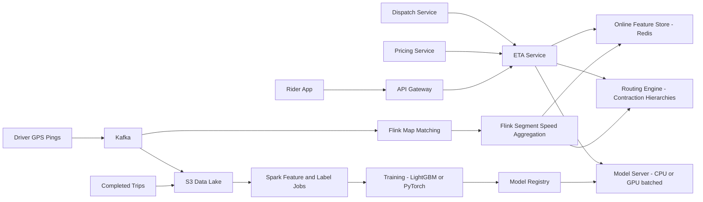

# ETA Prediction

**Category:** AI/ML System Design
**Difficulty:** 🟡 Medium
**Seniority:** senior
**Companies:** Uber, Lyft, DoorDash, Google, Grab, Instacart
**Tags:** regression, routing, geospatial, real-time-features, feature-store, time-series
**Time:** 45 min

---

## Problem Statement

Design a system that predicts the estimated time of arrival (ETA) for trips in a ride-hailing app: the time for a driver to reach the pickup point and the time from pickup to drop-off. ETAs are shown to riders before booking, used by dispatch to match drivers, and used for pricing.

Scale hint: ~30M trips/day across 500 cities, but ETA requests are far more frequent than trips (every app open, every dispatch candidate): ~500K ETA predictions/s at peak. p99 latency under 50 ms per prediction. The interviewer wants a hybrid of a routing engine and an ML correction model, real-time traffic features, and a careful evaluation story.

## Clarifying Questions

- Which ETAs: pickup, trip, or both? *Both; same system with a flag for leg type.*
- Who consumes ETAs? *Rider app (display), dispatch (matching many driver candidates), pricing.*
- Do we have a routing engine already? *Assume an in-house routing engine on an OpenStreetMap road graph with segment speeds.*
- How is accuracy judged? *Mean absolute error and the fraction of trips within a tolerance; underestimation is worse than overestimation for user trust.*
- What real-time signals exist? *GPS pings from drivers every 4 s, giving live segment speeds.*
- Should ETAs update during the trip? *Yes, re-predict every 30 s or on route deviation.*
- Multimodal (delivery with restaurant prep time)? *Out of scope; ride-hailing only.*

## Requirements

### Functional

- Predict ETA in seconds for a (origin, destination, departure time, vehicle type) request.
- Support batch requests (one origin to N driver locations) for dispatch.
- Update ETA during trips based on current position and traffic.
- Return an uncertainty range (P10-P90) for display and planning.

### Non-Functional

- p99 latency 50 ms; batch of 50 candidates under 80 ms.
- Peak throughput ~500K predictions/s globally.
- Availability 99.99% (dispatch depends on it); graceful fallback to routing-engine-only ETA.
- Real-time traffic features no more than 1-2 minutes stale.

### Out of Scope

- Route recommendation UI and turn-by-turn navigation.
- Food prep-time estimation.

## Problem Framing

- **ML task:** regression of actual travel time given route and context. Rather than predicting from scratch, predict a correction (residual) on top of the routing engine's physics-based ETA.
- **Business metrics:** rider cancellation rate after match, rider trust (complaints about late pickups), dispatch efficiency (driver idle time), pricing accuracy for upfront fares.
- **Model metrics:** MAE and MAPE (seconds and percent), P90 absolute error, percent of trips within plus or minus 2 minutes, bias (mean signed error), calibration of quantile predictions (P90 coverage close to 90%).
- **Loss choice:** asymmetric loss or quantile loss because late arrivals hurt trust more than early ones; train P50 with Huber loss plus P10/P90 quantile heads.
- **Constraints:** extremely high QPS from dispatch fan-out, so the model must be cheap (sub-millisecond per prediction on CPU or batched GPU); features must be available online with low staleness.

## Data Pipeline

- **Sources**
  - Driver GPS pings (4 s interval) via Kafka: ~5M active drivers peak, ~1.2M pings/s.
  - Completed trips: actual pickup/drop-off timestamps, route taken, map-matched path.
  - Road graph: OpenStreetMap + internal edits (turn restrictions, closures).
  - Context: weather APIs, events calendar, holidays, airport queues.
- **Map matching:** GPS pings are snapped to road segments with a Hidden Markov Model map-matcher (Flink job), producing per-segment traversal times.
- **Real-time traffic:** a Flink streaming job aggregates segment speeds over sliding 5-minute windows, writes to Redis (segment_id to speed, sample count) every 30 s.
- **Historical traffic:** per segment, per 15-minute time-of-week bucket median speed, computed daily in Spark from 8 weeks of data.
- **Labels:** actual travel time from trip logs. Clean outliers: trips with long stops, GPS gaps, driver detours (route deviation over 30%), or wrong pickup pins. Remove trips with duration under 30 s or speed over 200 km/h.
- **Features**
  - Routing engine ETA (sum of segment times on the best route) and route distance.
  - Route composition: count of turns, traffic lights, highway fraction, road class mix.
  - Time: hour of day, day of week, holiday flags (cyclic encoding).
  - Geospatial: origin/destination H3 cells (resolution 7-8) as learned embeddings, city ID.
  - Real-time: live vs historical speed ratio on route segments, live congestion index for origin/destination H3 cells.
  - Context: weather (rain, snow), nearby events, airport pickup flag.
  - Leg type: pickup vs on-trip; vehicle type.
- **Storage:** offline features in S3/Hive (Parquet), online features in Redis or a feature store (Feast / Michelangelo style) with point-in-time-correct backfills to avoid training-serving skew.

## Model Design

- **Baseline 1:** routing engine ETA with historical segment speeds (Dijkstra / Contraction Hierarchies). Explainable, but misses intersection delays, pickup friction, local behavior; typically 15-20% MAPE.
- **Baseline 2:** routing engine with real-time segment speeds. Better for congestion but noisy for sparse segments.
- **ML residual model (chosen):** predict y = actual_time - routing_eta (or log ratio) with features above.
  - Start with GBDT (LightGBM / XGBoost): strong on tabular data, fast inference (~50 us per row on CPU), easy to debug with SHAP.
  - Advance to a deep model (like Uber DeepETA): a transformer or MLP over discretized/embedded features (H3 cell embeddings, time embeddings) with linear self-attention; wins on high-cardinality geospatial features and enables multi-task heads (P10/P50/P90, pickup vs trip).
- **Why residual:** the routing engine handles graph structure and route choice; ML corrects systematic biases (intersections, pickup search time, city-specific behavior). It keeps the model small and generalizes to unseen OD pairs.
- **Fallback:** if features or model are unavailable, return the routing engine ETA times a city-level correction factor.

```text
FUNCTION predict_eta(origin, dest, t, vehicle, leg_type)
    SET route ← routing_engine.best_route(origin, dest, t)        // CH query, ~3 ms
    SET base_eta ← route.sum_segment_times(live_speeds_or_hist)
    SET rt ← redis.mget(route.segment_ids_sampled, h3(origin), h3(dest))
    SET f ← build_features(route, base_eta, rt, t, vehicle, leg_type, weather(city))
    IF model_available THEN
        SET (r10, r50, r90) ← model.predict(f)                    // residuals in seconds
        RETURN (base_eta + r10, base_eta + r50, base_eta + r90)
    ELSE
        RETURN base_eta * city_correction[city(origin)]
```

## Training & Evaluation

- **Training data:** ~30M trips/day; train on last 4-8 weeks (~1B trips) with downsampling of over-represented cities; separate pickup legs (~30M/day as well).
- **Validation:** strict time-based split (train weeks 1-6, validate week 7, test week 8) since traffic patterns are temporal; also evaluate per city, hour, distance bucket, and on special days (holidays, storms).
- **Offline metrics:** MAE, MAPE, P90 absolute error, bias, % within 2 minutes, quantile coverage; compare to routing-engine-only baseline. Target, e.g., 25-30% MAE reduction over baseline.
- **Leakage watch-outs:** do not use features computed after departure time (e.g. traffic during the trip) except in the in-trip update model where they are legitimately available; enforce point-in-time joins.
- **Training cadence:** GBDT retrained daily, deep model weekly with daily fine-tunes; city-specific calibration layers refreshed daily.
- **Online A/B:** randomized by rider (and switchback experiments by city and time for dispatch effects, since drivers are shared across arms). Metrics: post-match cancellation rate, rider-reported lateness, ETA error on completed trips, dispatch efficiency. Guardrails: latency, fallback rate.

## Serving Architecture



1. Rider app, dispatch, and pricing call the ETA service with one origin and one or many destinations.
2. ETA service queries the routing engine (graph partitioned by region, Contraction Hierarchies for ms-level shortest path, one-to-many queries for dispatch).
3. Features are fetched in a single Redis pipeline per batch; the model scores the batch.
4. Response returns P50 plus range; result cached briefly.

**Latency budget (p99, single request):**

| Step | Budget |
|---|---|
| Routing query | 10 ms |
| Feature fetch (Redis pipeline) | 5 ms |
| Model inference (batched) | 5 ms |
| Service overhead + network | 15 ms |
| Headroom | 15 ms |

**Scaling:**
- 500K predictions/s: GBDT at ~50 us/row per core means ~25 cores of pure inference; with feature assembly and routing, ~2,000 cores across regions. Deep model served on GPUs with batched Triton, or distilled to a smaller MLP for CPU.
- Routing engine sharded by geographic region (city clusters); each instance holds the city graph in memory (a large metro graph is a few GB).
- **Caching:** cache ETAs keyed by (origin H3 res 9, dest H3 res 9, 1-minute time bucket, vehicle) for 60 s; dispatch fan-out hits this cache heavily because many requests cluster in the same cells. Expect 40-60% hit rate.
- **Fallback:** circuit breaker to routing-only ETA if model server or feature store degrades.

## Monitoring & Iteration

- **Accuracy monitoring:** compute realized error for every completed trip (join prediction log with actual), dashboard MAE/bias by city/hour; alert if bias exceeds plus or minus 30 s in a city for 15 minutes.
- **Feature health:** staleness of live speeds, fraction of segments with sufficient GPS samples, null rates; a GPS pipeline outage silently degrades ETAs without this.
- **Drift:** road closures, new roads, construction, seasonal shifts. Detect via residual distribution shift per region; map edits fed back into the routing graph quickly.
- **Feedback loop pitfall:** dispatch uses ETAs to choose drivers, which changes which trips happen (selection bias). Mitigate with some exploration and by training on all assigned trips, not only selected ones.
- **Special events:** concerts, storms produce out-of-distribution traffic; real-time features plus event flags, and a manual city override for known incidents.
- **Retraining:** automated daily pipeline with validation gates (no regression in any top-50 city beyond 2%) before promotion; shadow deployment first.
- **Cost:** cache aggressively, batch dispatch queries, keep the model small enough for CPU.

## Trade-offs

| Decision | Option A | Option B | Choice & Why |
|---|---|---|---|
| Prediction target | End-to-end ETA from features | Residual over routing engine | Residual: leverages graph structure, smaller model, generalizes to new OD pairs |
| Model family | GBDT | Deep transformer/MLP with embeddings | Start GBDT; move to deep model for geospatial embeddings and multi-task heads at scale |
| Loss | MSE | Huber + quantile heads | Huber is robust to outlier trips; quantiles give uncertainty and asymmetric control |
| Traffic features | Historical only | Historical + real-time | Both: real-time for congestion, historical as prior for sparse segments |
| Experimentation | User-level A/B | Switchback by city-time | Switchback for dispatch-affecting changes due to marketplace interference |

## Follow-up Questions

1. **How do you handle segments with no recent GPS data?** Blend live and historical speeds weighted by sample count (Bayesian shrinkage toward the historical time-of-week median).
2. **How do you show a stable ETA in the app that does not jump around?** Smooth successive predictions (exponential smoothing), only update displayed ETA when the change exceeds a threshold, and favor slight overestimation.
3. **How would you extend this to food delivery?** Add a separate prep-time model per restaurant and a handoff time model, then compose legs: driver-to-restaurant, max(prep, arrival), restaurant-to-customer.
4. **How do you launch in a new city with no data?** Use routing-engine ETA with transfer from similar cities (city embedding initialized from nearest neighbors on road and demographic features), then fine-tune as trips accrue.
5. **Why not predict with the routing engine only and improve segment speeds?** Segment speeds miss non-additive effects like turn penalties, pickup friction, and parking; a learned correction captures these cheaply.

## Common Mistakes

- Using random train/test splits, leaking temporal traffic patterns.
- Training on noisy labels without filtering GPS gaps, long stops, and detours.
- Ignoring the dispatch fan-out QPS and designing a model that is too heavy.
- Optimizing only mean error, ignoring bias and tail errors that drive user complaints.
- No fallback when the real-time feature pipeline lags.
- Running user-level A/B tests on dispatch changes despite marketplace interference.

## Key Takeaways

- Combine a routing engine with an ML residual model; each does what it is good at.
- Real-time segment speeds from map-matched GPS are the key feature, with historical priors for sparsity.
- Choose losses and metrics that reflect asymmetric user cost and provide uncertainty.
- Latency and QPS drive the architecture: caching by H3 cell, batching, small models.
- Monitor realized error per city continuously and fall back gracefully.
