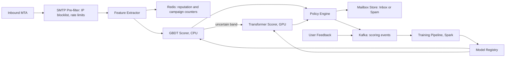

# Email Spam Classifier

**Category:** AI/ML System Design
**Difficulty:** 🟢 Easy
**Seniority:** mid
**Companies:** Google, Microsoft, Yahoo, Proofpoint, Mailchimp, Cloudflare
**Tags:** text-classification, binary-classification, feature-engineering, precision-recall, adversarial-ml, online-learning
**Time:** 45 min

---

## Problem Statement

Design a spam classifier for a large email provider. Every inbound email must be labeled as **spam** or **ham** (legitimate) before it lands in the user's inbox, and spam should be routed to the Spam folder.

The provider receives about **1 billion inbound emails per day** for 200M mailboxes. Roughly 50% of raw inbound traffic is spam, most of it from botnets. Users can click "Report spam" / "Not spam", and spammers actively adapt to whatever filter is deployed.

## Clarifying Questions

- What is the action on a spam verdict? *Move to the Spam folder (not delete), so false positives are recoverable but still costly.*
- Is this inbound only, or also outbound? *Inbound only; outbound abuse is a separate system.*
- What is the latency budget? *Under 100 ms p99 per message for the classification step; delivery is asynchronous, so we have some slack.*
- Which is worse: false positives or false negatives? *False positives (a missed invoice or job offer) are far worse; target < 0.1% FPR on ham.*
- Do we personalize per user? *Yes, lightly: a newsletter one user wants may be spam to another.*
- What signals are available? *Headers, body, URLs, attachments metadata, sender IP/domain reputation, SPF/DKIM/DMARC results, user feedback.*
- Languages? *Global; 40+ languages, English is about 45%.*

## Requirements

### Functional

- Classify every inbound email as spam or ham with a confidence score.
- Route spam to the Spam folder; very high confidence spam may be rejected at SMTP time.
- Ingest user feedback ("Report spam", "Not spam") as labels.
- Support per-user allowlists (contacts, explicit "never spam") that override the model.

### Non-Functional

- Throughput: ~1B emails/day, peaks of 3x average.
- Latency: < 100 ms p99 for scoring.
- Quality: spam recall > 99%, ham false-positive rate < 0.1%.
- Fast adaptation: new spam campaigns blocked within minutes to hours.
- Privacy: email content never leaves the processing region; no human reads email bodies without consent.

### Out of Scope

- Phishing and malware detonation sandboxes (assume a separate attachment scanner provides a signal).
- Promotions/Social tab categorization.

## Problem Framing

- **ML objective:** binary classification, P(spam | email, user). Output a calibrated score; thresholds map score to actions.
- **Business metrics:** user-reported spam in inbox per 1,000 emails, "Not spam" rescues per 1,000 spam-folder emails, user retention/complaints.
- **Model metrics:** precision/recall at the operating threshold, FPR on ham, PR-AUC (ROC-AUC is misleading because the classes are skewed per segment).
- **Constraints:**
  - Cost: 1B/day is about 11.6K emails/s average, ~35K/s at peak, so the per-email compute must be tiny. CPU-friendly models win.
  - Asymmetric cost: pick the threshold for FPR ≤ 0.1%, then maximize recall.
  - Adversarial: features must be hard to game; the model must retrain often.

Multi-tier action policy:

```text
score ≥ 0.99  AND sender reputation bad  → reject at SMTP (550)
score ≥ 0.90                              → Spam folder
0.60 ≤ score < 0.90                       → Inbox with warning banner
score < 0.60                              → Inbox
user allowlist / contact match            → Inbox (override, except malware)
```

## Data Pipeline

**Data sources**

- Email stream from the MTA (headers, body, URLs, attachment metadata).
- Authentication results: SPF, DKIM, DMARC pass/fail.
- Reputation stores: sender IP, sending domain, URL domains (age, past spam rate).
- User feedback events: report spam, not spam, move to inbox, delete without opening.
- Honeypot / spam-trap addresses: anything sent there is spam by definition.

**Labeling**

- Explicit feedback is the gold signal but sparse (~0.1% of emails) and noisy (users "report spam" on newsletters they signed up for).
- Weak labels: spam traps (high precision spam), mail from contacts with replies (high precision ham).
- A small team labels a stratified sample of ~10K emails/week from consenting users for the evaluation set.
- De-duplicate campaigns by MinHash of the body so one campaign of 10M copies does not dominate training.

**Features**

| Group | Examples |
|---|---|
| Sender | IP reputation, domain age, SPF/DKIM/DMARC, sending volume spike, first-time sender to this user |
| Content | TF-IDF / hashed n-grams, subject all-caps ratio, HTML-to-text ratio, hidden text, language |
| URLs | Count, domain age, URL shortener use, blocklist hits (Spamhaus, internal) |
| Structure | Attachment types, image-only body, header anomalies |
| User | Is sender a contact, past interactions with sender, user's spam-report rate |
| Campaign | Near-duplicate cluster size in last hour, cluster's report rate |

**Storage**

- Raw emails stay in the mail store; the training pipeline stores only extracted features + hashed tokens in a feature table (Parquet on S3/GCS, partitioned by day), retained 90 days.
- Reputation and campaign counters live in Redis (sliding windows, sub-ms reads), backed by Bigtable/Cassandra for durability.
- Kafka carries scoring events and feedback events for joins.

## Model Design

**Baseline (hours):** rules + blocklists (Spamhaus, SpamAssassin-like rules). Good for known patterns, brittle and easy to evade.

**Model 1: Naive Bayes / Logistic Regression on hashed n-grams.** Fast, classic, ~95% recall. Easily fooled by word salad and image spam.

**Model 2 (chosen core): Gradient-boosted trees (LightGBM/XGBoost)** over ~500 engineered features plus the LR text score as a feature.

- Handles heterogeneous features (reputation counts, booleans, text scores).
- ~0.2 ms CPU inference; easily handles 35K/s on a few dozen cores.
- Interpretable via feature importance and SHAP for debugging false positives.

**Model 3 (add-on): small multilingual transformer** (e.g. distilled XLM-R / DistilBERT, ~66M params) producing a content-spam probability and a 128-d embedding.

- Robust to paraphrase and obfuscation ("V1agra", Unicode homoglyphs after normalization).
- Run only on the uncertain band (scores 0.3-0.95 from GBDT, ~15% of traffic) to control GPU cost.

**Personalization:** a per-user bias layer: features such as "user opened 80% of mail from this sender" and "user reported this sender before". Cheap and avoids per-user models.

```text
FUNCTION classify(email, user):
    IF email.sender IN user.allowlist AND NOT email.has_malware:
        RETURN (HAM, 0.0)
    SET f ← extract_features(email)              // headers, URLs, content stats
    SET f.reputation ← redis.get_reputation(email.ip, email.domain, email.url_domains)
    SET f.campaign ← campaign_counter(minhash(email.body))
    SET f.user ← user_sender_stats(user, email.sender)
    SET score ← gbdt.predict(f)
    IF 0.3 ≤ score ≤ 0.95:
        SET t ← transformer.predict(normalize(email.subject + email.body[:512 tokens]))
        SET score ← blender.predict(score, t, f.reputation)
    RETURN (action_for(score, f.reputation), score)
```

## Training & Evaluation

**Training data:** last 30 days, campaign-deduplicated, class-balanced by downsampling spam to ~1:1 with importance weights so calibration can be restored.

**Validation strategy**

- **Time-based split**: train on days 1-28, validate on days 29-30. Random splits leak campaigns across sets and inflate metrics.
- Hold out by campaign cluster as well so the model is tested on unseen campaigns.
- Calibrate with isotonic regression on the validation set so thresholds stay meaningful across retrains.

**Offline metrics**

- Recall at FPR = 0.1% (primary).
- PR-AUC, per-language and per-segment (business mail, newsletters, personal).
- Slice checks: new senders, small businesses, non-English, so we don't silently penalize a segment.

**Online evaluation**

- Shadow mode first: log new model scores alongside production for 24-48 h and compare disagreements.
- A/B on 1% of mailboxes, then 10%: measure "Report spam" rate on inbox mail (missed spam) and "Not spam" rate on spam folder (false positives).
- Guardrail: any increase in "Not spam" rescues > 5% relative blocks the rollout.

## Serving Architecture



**Online path**

1. The MTA accepts the SMTP connection; the pre-filter drops ~40% of junk by IP reputation and rate limits before the body is even received (cheapest layer).
2. Feature extractor parses MIME, normalizes Unicode, extracts URLs, computes MinHash, and fetches reputation from Redis.
3. The GBDT scores all mail; ~15% in the uncertain band goes to the transformer service (Triton, dynamic batching up to 32, 10 ms max queue delay).
4. Policy engine applies thresholds, allowlists and the action table, then delivers.
5. Scoring events and feedback flow to Kafka for counters and training.

**Latency budget (p99)**

| Step | Budget |
|---|---|
| Parsing + feature extraction | 15 ms |
| Redis lookups (pipelined) | 5 ms |
| GBDT inference | 1 ms |
| Transformer (15% of mail, batched) | 40 ms |
| Policy + write | 10 ms |
| **Total** | **< 75 ms** |

**Capacity:** 35K emails/s peak; GBDT at ~5K/s/core → ~10 cores plus headroom. Transformer: 5.3K/s at peak; a T4 handles ~1K short sequences/s with batching → ~6-8 GPUs per region with redundancy.

## Monitoring & Iteration

- **Quality dashboards:** spam-folder rate, report-spam rate, not-spam rate, broken down by language, sender type, and model version. Alert on > 20% hour-over-hour change.
- **Drift:** monitor feature distributions (PSI) and score distributions; a sudden shift in the score histogram usually means a new campaign or a broken feature.
- **Fast feedback loop:** campaign counters update in seconds. If a MinHash cluster gets > 50 reports in 10 minutes, the cluster is auto-flagged and all copies (including already delivered ones) are moved to Spam.
- **Retraining:** GBDT retrained daily, transformer weekly; automated gates compare to production on a fixed golden set and the latest time slice.
- **Adversarial defense:** keep some features and thresholds secret, avoid exposing exact scores to senders, add randomness to SMTP rejections to slow probing.
- **Feedback hygiene:** discount reports from users who report everything; treat "Not spam" from many independent users as a strong ham signal.
- **Cost control:** the cascade (IP filter → GBDT → transformer) keeps expensive inference to ~15% of mail.

## Trade-offs

| Decision | Option A | Option B | Choice & Why |
|---|---|---|---|
| Core model | Transformer on all mail | GBDT + transformer for uncertain band | Cascade: 85% of mail is easy; saves ~6x GPU cost with negligible recall loss |
| Threshold | Single global threshold | Tiered actions | Tiered: banner band reduces the cost of borderline errors |
| Personalization | Per-user models | Global model + user features | Global + user features: per-user models lack data and are costly to serve |
| Retraining cadence | Weekly | Daily + real-time counters | Daily + counters: spam campaigns live hours, not weeks |
| Label source | Human labels only | Feedback + weak labels + human eval set | Mixed: human labels don't scale; feedback is noisy, so humans own evaluation |

## Follow-up Questions

1. **How do you handle image-only spam?** OCR the image (Tesseract or a vision model) on suspicious mail, plus perceptual hashing to cluster identical images across a campaign.
2. **A large retailer complains their newsletters land in spam. What do you do?** Check their authentication (DKIM/DMARC), complaint rate, and user engagement slices; offer a postmaster feedback channel, but don't hardcode exceptions that spammers can spoof.
3. **How do you detect a brand-new campaign within minutes?** Near-duplicate clustering with MinHash/LSH plus sliding-window volume and report counters; flag clusters with sudden volume from new IPs.
4. **How do you prevent feedback poisoning?** Spammers can mass-click "Not spam" from bot accounts; weight feedback by account age and reputation and cap per-account influence.
5. **Why not just use an LLM?** At 35K/s, even a small LLM costs orders of magnitude more; use LLMs offline to label hard examples or explain clusters.

## Common Mistakes

- Optimizing accuracy or ROC-AUC instead of recall at a fixed low false-positive rate.
- Random train/test splits that leak the same campaign into both sets.
- Ignoring sender reputation and authentication signals, which carry most of the signal.
- Running a heavy model on every email instead of a cascade.
- Treating user reports as clean labels without de-noising.
- Forgetting the adversarial setting and retraining only monthly.

## Key Takeaways

- Spam filtering is a cascade: cheap reputation filters, then a fast GBDT, then a heavier content model only where needed.
- The operating point is set by the false-positive budget; measure recall at that FPR.
- Real-time campaign clustering and feedback counters matter as much as the model itself.
- Use time-based, campaign-aware validation and retrain daily because the adversary adapts.
