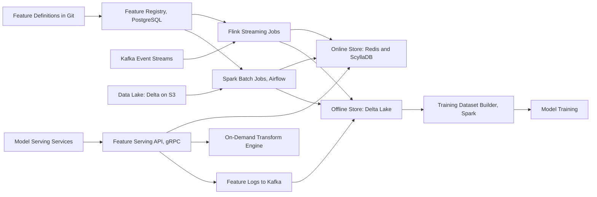

# Feature Store

**Category:** AI/ML System Design
**Difficulty:** 🟡 Medium
**Seniority:** senior
**Companies:** Uber, Airbnb, DoorDash, LinkedIn, Spotify, Databricks, Netflix
**Tags:** ml-infrastructure, online-offline-consistency, point-in-time-joins, streaming, low-latency-serving, training-serving-skew
**Time:** 60 min

---

## Problem Statement

Design a centralized feature store for a company with dozens of ML teams (ranking, fraud, ETA prediction, recommendations). Today each team writes its own pipelines to compute features for training in Spark and re-implements the same logic in Java/Go for online serving, causing training-serving skew, duplicated work, and data leakage bugs.

The feature store must let teams **define a feature once**, materialize it to an **offline store** for point-in-time-correct training datasets and to an **online store** for low-latency inference. Expect **~10,000 features** across **~50 entity types** (user, driver, merchant, item), **1B+ entities**, and **~1M feature-vector reads/s** at peak with p99 < 10 ms.

## Clarifying Questions

- Who are the users? *ML engineers and data scientists across ~40 teams; some models are batch, many are real-time.*
- Which feature freshness levels are needed? *Batch (daily), near-real-time streaming (seconds to minutes), and on-demand (computed at request time from the request payload).*
- Online read latency? *p99 < 10 ms for fetching ~100-500 features for one entity; batched lookups for ranking ~500 candidates in < 25 ms.*
- Scale of online data? *~1B users and items × ~200 features each on average for online-enabled feature groups.*
- How far back for training? *Up to 2 years of history for point-in-time joins.*
- Existing infrastructure? *Kafka, Spark, Flink, S3 data lake with Delta/Iceberg, Airflow, Kubernetes.*
- Build vs buy? *Open to Feast/Tecton/Databricks, but explain the internals as if building.*

## Requirements

### Functional

- Declarative feature definitions (entity, source, transformation, aggregation windows, TTL, owner) in a registry with versioning.
- Batch and streaming materialization into offline and online stores.
- Point-in-time-correct training dataset generation given (entity, timestamp, label) rows.
- Low-latency online retrieval API (single and batch) by feature service / model.
- On-demand features computed at request time with the same code online and offline.
- Discovery: search, lineage, ownership, statistics, and usage of features.

### Non-Functional

- Online: ~1M entity reads/s peak, p99 < 10 ms, 99.99% availability.
- Freshness: streaming features visible online within ~5 s of the event.
- Consistency: identical feature values in training and serving for the same entity and timestamp (skew < 0.1% of values).
- Offline: generate a 1B-row training set with 500 features in < 2 hours.
- Multi-tenant isolation, access control for sensitive features (PII), cost attribution per team.

### Out of Scope

- Model training orchestration and model serving themselves.
- General-purpose BI/analytics warehouse.

## Problem Framing

A feature store is ML infrastructure; its "objective" is to maximize model quality and team velocity by guaranteeing correct, consistent, fresh features.

- **Business metrics:** time from feature idea to production model (target days instead of weeks), feature reuse rate across teams, incidents caused by skew or leakage, infra cost per model.
- **System metrics:**
  - Online read latency p99 and availability.
  - Freshness lag (event time to online availability).
  - Online/offline skew rate (sampled comparison of served vs recomputed values).
  - Training dataset generation time and cost.
- **Core correctness problems to solve:**
  - **Training-serving skew:** different code paths compute features differently.
  - **Data leakage:** training rows use feature values from after the label timestamp.
  - **Staleness:** online features silently stop updating.
- **Constraints:** huge online footprint (cost of RAM), heterogeneous freshness needs, strict latency for ranking with hundreds of candidates.

## Data Pipeline

**Sources**

- Batch: data lake tables (Delta/Iceberg on S3) such as orders, trips, profiles, updated hourly/daily.
- Streaming: Kafka topics of events (clicks, trips, payments) at ~2M events/s.
- Request-time data: the inference request payload (e.g. current cart, query, device).

**Feature definition (registry entry)**

```text
FEATURE_VIEW user_order_stats:
    entity: user_id
    source: kafka://orders (stream) WITH backfill FROM s3://lake/orders (batch)
    aggregations:
        order_count      = COUNT(order_id)    OVER windows [1h, 24h, 7d, 30d]
        avg_order_value  = AVG(amount)        OVER windows [7d, 30d]
    timestamp_field: event_time
    online: TRUE, ttl: 30d
    offline: TRUE
    owner: team-eats-ranking, tags: [pii: false]
```

**Materialization**

- **Batch:** Spark jobs (orchestrated by Airflow) compute features from lake tables, write to the offline store (append with `event_timestamp`) and bulk-load the latest values to the online store.
- **Streaming:** Flink jobs compute sliding-window aggregations with event-time semantics and watermarks (handle late events up to e.g. 10 min), writing to the online store and appending to the offline log.
- **Backfill:** the same definition runs over historical batch data to produce the offline history, so a new streaming feature has 2 years of training data on day one.
- **Unified transformation:** the definition compiles to both Spark and Flink (or the same Python/SQL transformation runs in both); this is the main defense against skew.

**Storage**

| Store | Technology | Layout | Why |
|---|---|---|---|
| Offline | Delta Lake / Iceberg on S3 | Partitioned by date, sorted by entity key; columns per feature + `event_timestamp` + `created_timestamp` | Cheap, scalable, time travel, efficient point-in-time joins |
| Online | Redis Cluster for hot/small groups; Cassandra/ScyllaDB or DynamoDB for large groups | Key = `entity_type:entity_id`, value = packed feature group (protobuf), per-group TTL | Single-digit ms reads; Redis is fastest but RAM-expensive |
| Registry | PostgreSQL + Git-backed definitions | Versioned feature views, schemas, owners, lineage | Strong consistency for metadata, code review via Git |

**Online size estimate**

```text
1B entities × 200 features × ~8 bytes ≈ 1.6 TB raw values
+ keys, encoding overhead (~1.5x)       ≈ 2.4 TB
× replication factor 3                   ≈ 7.2 TB
→ Redis for all of it is costly (~$ hundreds of thousands per year in RAM);
  put hot, latency-critical groups in Redis (~10%), the rest in ScyllaDB on NVMe SSD.
```

## Model Design

Here, "model design" is the architecture of how features are defined, joined, and consumed by models.

**Approach options**

| Option | Description | Problem |
|---|---|---|
| Team-owned pipelines | Each team computes features in Spark and re-implements online | Skew, duplication, leakage |
| Warehouse-only (query at inference) | Models query the warehouse directly | Seconds of latency; not viable online |
| **Dual-store feature store (chosen)** | Single definition → offline + online materialization, registry, serving API | More infra, but solves skew and reuse |

**Point-in-time-correct training joins**

Given a label table (entity_id, label_timestamp, label), each row must get the latest feature value with `event_timestamp ≤ label_timestamp` (and within TTL), never a later value.

```text
FUNCTION get_historical_features(label_df, feature_views):
    SET result ← label_df
    FOR fv IN feature_views:
        SET feats ← offline_store.read(fv, time_range = [min(label_df.ts) - fv.ttl, max(label_df.ts)])
        // AS-OF join: for each label row, pick latest feature row at or before label time
        SET joined ← asof_join(result, feats,
                               on = fv.entity_key,
                               left_time = "label_timestamp",
                               right_time = "event_timestamp",
                               direction = BACKWARD,
                               tolerance = fv.ttl)
        SET result ← joined
    RETURN result
```

- Implemented in Spark with range-partitioning by entity key and sort-merge on timestamp; avoids a cartesian join.
- Use `created_timestamp` (when the value became available) rather than event time for batch features computed with delay, otherwise a daily job's output at 02:00 would leak into labels at 00:30.

**On-demand features**

- Functions on request data plus fetched features (e.g. `distance(user_location, restaurant_location)`, `cart_value / avg_order_value_30d`).
- Defined once as a Python/SQL UDF; executed in the serving layer online and applied in the training dataset job offline, so both paths share code.

**Feature services**

- A model declares a feature service (list of feature view + version references). The serving API fetches exactly that set, and the same spec generates training data, so the model's feature schema is pinned.

## Training & Evaluation

How the feature store supports and validates model training:

- **Dataset generation:** `get_historical_features` produces training sets written as versioned Parquet with the feature service version and data snapshot IDs recorded in the model registry (MLflow) for reproducibility.
- **Logging-based training (alternative):** log the exact online feature vectors at inference time and join with labels later. Guarantees zero skew for those features but requires waiting to accumulate data for new features; support both modes.
- **Validation of features themselves:**
  - Schema and type checks at materialization.
  - Data quality expectations (Great Expectations / Deequ): null rate, range, cardinality, distribution vs previous run; failing checks block publishing to online.
  - Leakage checks: flag features highly correlated with labels or whose `created_timestamp` lags event time.
- **Skew evaluation:** sample 0.1% of online reads, recompute the same features offline at that timestamp, and compare. Report skew rate per feature; target < 0.1% mismatched values beyond tolerance.
- **Impact evaluation:** teams A/B test models using new shared features; the registry tracks which features improved which models, informing deprecation of unused ones.

## Serving Architecture



**Online path**

1. A model service calls `GetOnlineFeatures(feature_service = "eats_ranking_v3", entities = [user_id, 500 restaurant_ids], request_context)` over gRPC.
2. The serving API resolves the feature service from a locally cached registry, groups keys by feature view and backing store, and issues parallel multi-gets (Redis `MGET` / pipelined, ScyllaDB token-aware batched reads).
3. On-demand transforms run in-process on fetched values and request data.
4. Missing or expired values (beyond TTL) are returned with null + status codes so models apply consistent defaults (the same defaults used in training).
5. A sample of responses is logged to Kafka for skew monitoring and logging-based training.

**Latency budget (p99, one user + 500 candidates)**

| Step | Budget |
|---|---|
| gRPC + registry lookup (cached) | 1 ms |
| Parallel store reads (Redis ~1-2 ms, ScyllaDB ~3-5 ms) | 8 ms |
| On-demand transforms | 3 ms |
| Serialization (protobuf, columnar response) | 2 ms |
| **Total** | **~14 ms** (single entity < 5 ms) |

**Scaling**

- Serving API is stateless on Kubernetes; ~1M entity reads/s ≈ 200-300 pods with autoscaling on CPU and p99.
- Redis Cluster sharded by key hash with replicas; ScyllaDB with RF = 3 and `LOCAL_QUORUM` or `ONE` reads depending on the feature group's consistency needs.
- Hot keys (popular items) handled with an in-process LRU cache (1-5 s TTL) in serving pods.
- Packing all features of a feature view into one value per entity reduces reads from 200 to ~5 per entity.
- Multi-region: online store replicated per region; streaming jobs write locally, batch loads replicated.

## Monitoring & Iteration

- **Freshness SLOs** per feature view: time since last successful write; alert when streaming lag > 1 min or batch job misses its schedule. Stale features are a silent model-quality killer.
- **Data quality:** distribution drift (PSI/KS) per feature vs training baseline, null and default rates, cardinality spikes; dashboards shown to feature owners and consumers.
- **Skew monitoring:** online vs offline recomputation comparisons daily per feature.
- **Online health:** p50/p99 latency per feature service, error rates, store hit rates, hot partitions.
- **Governance:** access control for PII-tagged features, lineage from source table to model, audit logs, and GDPR deletion (delete by entity across online and offline stores).
- **Cost control:** per-team cost attribution; TTLs and tiering (Redis vs SSD-backed stores); automatic deprecation proposals for features unused for 90 days; offline compaction and retention policies.
- **Iteration:** feature versioning (`v2` alongside `v1`) so changing a definition never silently changes a deployed model's inputs; migrations happen via new feature service versions.

## Trade-offs

| Decision | Option A | Option B | Choice & Why |
|---|---|---|---|
| Online store | Redis for everything | Redis for hot groups + ScyllaDB/DynamoDB for the rest | Tiered: TB-scale data in RAM is expensive; SSD-backed stores still meet ~5 ms |
| Skew prevention | Separate online/offline code | Single definition compiled to batch and streaming + logged features | Single definition: removes the main source of skew; logging covers the rest |
| Training data | Logged features only | Point-in-time joins + optional logging | Both: PIT joins enable backfilled new features; logging guarantees exact parity |
| Storage layout | One key per feature | One packed value per entity per feature view | Packed: far fewer reads and less overhead; costs partial-update complexity |
| Build vs buy | Build in-house | Feast / Tecton / Databricks Feature Store | Depends: buy for speed with < 10 teams; build when scale and customization justify a platform team |
| Streaming windows | Exact sliding windows | Tiled (pre-aggregated buckets) windows | Tiled: e.g. 1-minute tiles summed for 24 h windows bound state size and cost |

## Follow-up Questions

1. **How do you compute a 30-day sliding count per user in streaming without huge state?** Use tiled aggregation: store per-entity counts in time buckets (e.g. hourly tiles) and sum the tiles at read time or on update, evicting expired tiles; trades a bit of precision at window edges for bounded state.
2. **A data scientist reports their model works offline but degrades online. How do you debug?** Compare logged online feature vectors with offline values for the same entities and timestamps, check freshness lag, default handling for nulls, and timezone/unit differences.
3. **How do you handle GDPR deletion requests?** Delete by entity key in the online store immediately, and in the offline store via Delta/Iceberg row-level deletes plus compaction; registry lineage tells which feature views contain the entity.
4. **How do you support embeddings as features?** Store fixed-dimension vectors as packed float arrays (or int8) with model version as part of the feature version; for similarity search, publish to a vector index rather than the key-value store.
5. **How do you prevent a new batch feature from leaking future data?** Use `created_timestamp` for point-in-time joins and enforce that batch features are only visible after their job completion time in training data.

## Common Mistakes

- Joining features to labels by entity only (latest value), causing future leakage instead of an as-of join.
- Reimplementing transformations separately for online and offline paths.
- Storing everything in Redis without estimating TB-scale memory cost.
- Fetching one key per feature, resulting in hundreds of round trips per request.
- No freshness monitoring, so a stopped streaming job silently serves stale features.
- Ignoring default/null handling consistency between training and serving.

## Key Takeaways

- A feature store exists to guarantee consistency: one definition, materialized to an offline store for point-in-time training and an online store for low-latency serving.
- Point-in-time (as-of) joins with correct availability timestamps are the core of leakage-free training data.
- Tier the online store by latency needs and cost; pack features per entity to minimize reads.
- Freshness, skew, and data quality monitoring are first-class features of the platform, not afterthoughts.
