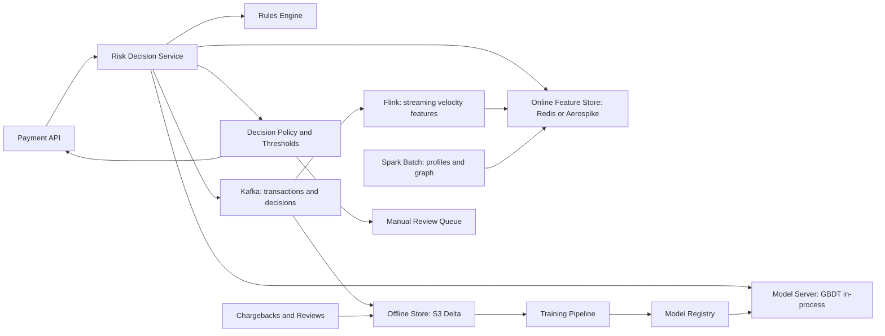

# Fraud Detection

**Category:** AI/ML System Design
**Difficulty:** 🟡 Medium
**Seniority:** senior
**Companies:** Stripe, PayPal, Visa, Amazon, Square, Revolut, Uber
**Tags:** anomaly-detection, real-time-features, imbalanced-data, gradient-boosting, graph-features, label-delay
**Time:** 60 min

---

## Problem Statement

Design a real-time fraud detection system for a payments platform. Every card transaction must be scored before authorization, and the system decides to **approve, decline, or challenge** (3-D Secure / step-up verification). The goal is to minimize fraud losses while keeping false declines of legitimate customers low.

The platform processes about **5,000 transactions/s on average and 20,000/s at peak** (~400M/day), with a fraud rate of roughly **0.1%** by count. The decision must be returned within the payment authorization latency budget.

## Clarifying Questions

- What type of fraud? *Card-not-present payment fraud (stolen cards, account takeover); merchant fraud and AML are separate.*
- What's the latency budget? *Scoring must complete in < 100 ms p99 inside a ~1 s authorization flow.*
- What actions are available? *Approve, decline, challenge with 3DS/OTP, or send to manual review (async, only for high-value orders).*
- How do we get labels? *Chargebacks (arrive 30-90 days later), customer fraud reports, manual review outcomes.*
- What does a false decline cost? *Lost revenue plus churn; industry estimates put false declines at several times fraud losses, so precision matters.*
- Do merchants have different risk appetites? *Yes, merchants can configure thresholds and rules.*
- Do we have device and network signals? *Yes: device fingerprint, IP, email, shipping address, BIN.*

## Requirements

### Functional

- Score every transaction in real time and return a decision with reason codes.
- Combine ML score with a rules engine (allow/block lists, merchant rules, regulatory rules).
- Manual review queue for high-value, medium-risk transactions.
- Ingest labels from chargebacks, disputes, and review outcomes.
- Explanations for analysts and for regulatory requests.

### Non-Functional

- 20K TPS peak, p99 < 100 ms end to end for the risk decision.
- 99.99% availability; on failure, fall back to rules and safe defaults (never block all payments).
- Real-time features updated within seconds (velocity of card/device/IP).
- Auditability: every decision reproducible (features, model version, rules fired).
- PCI-DSS compliance: card numbers tokenized, never stored in feature stores in the clear.

### Out of Scope

- Anti-money-laundering transaction monitoring.
- Merchant onboarding risk.

## Problem Framing

- **ML objective:** estimate P(fraud | transaction, context), calibrated, so that expected cost can be computed per transaction.
- **Decision rule (cost-sensitive):**

```text
expected_fraud_loss ← p_fraud × amount × (1 - recovery_rate)
expected_decline_cost ← (1 - p_fraud) × (margin × amount + churn_cost)
IF p_fraud ≥ block_threshold(merchant)                   → DECLINE
ELSE IF expected_fraud_loss > challenge_cost AND 3DS available → CHALLENGE
ELSE IF amount > 1000 AND p_fraud in review band          → APPROVE + MANUAL REVIEW
ELSE                                                       → APPROVE
```

- **Business metrics:** fraud loss in basis points of volume (target < 5 bps), false decline rate, challenge rate, approval rate, manual review volume.
- **Model metrics:** PR-AUC (ROC-AUC is near 0.99 and uninformative at 0.1% prevalence), recall at fixed false positive rate (e.g. at 0.5% decline rate), dollar-weighted recall.
- **Constraints:** tight latency, extreme class imbalance, delayed and incomplete labels, adversarial fraudsters adapting within days.

## Data Pipeline

**Data sources**

- Transaction stream (Kafka): amount, currency, merchant, MCC, card token, BIN, timestamp, channel.
- Device and session: fingerprint, IP, geolocation, user agent, typing behavior, session duration.
- Account: age, email domain/age, phone, shipping/billing addresses, past orders.
- External: BIN databases, IP reputation, consortium data, email risk APIs.
- Labels: chargebacks with fraud reason codes, issuer fraud reports (TC40/SAFE), customer reports, manual review decisions.

**Labeling challenges**

- **Label delay:** chargebacks arrive 30-90 days later; recent data looks falsely clean. Train on transactions that are at least ~60 days old for "mature" labels; use faster proxy labels (customer reports, review decisions) for recent data.
- **Selection bias:** declined transactions never get labels. Keep a small random **holdout** (~0.1-0.5% of low-risk-ish traffic approved regardless of score, under a loss budget) for unbiased estimates and counterfactual evaluation.
- Friendly fraud (customer disputes a legit purchase) is labeled separately.

**Features**

| Group | Examples | Freshness |
|---|---|---|
| Velocity | # txns per card in 1 min/1 h/24 h, # distinct cards per device in 24 h, amount sum per IP in 1 h | Real-time (seconds) |
| Behavioral | Amount vs card's 90-day mean (z-score), new merchant for card, time since last txn, unusual hour | Real-time + batch |
| Identity/link | Device seen with N accounts, email age, shipping address shared with known fraud | Near real-time |
| Geo | IP-to-billing distance, impossible travel speed, IP is proxy/VPN/Tor | Real-time |
| Merchant | Merchant fraud rate 30 d, MCC risk | Batch daily |
| Graph | Connected component size and fraud ratio in card-device-email-IP graph, label propagation score | Batch hourly |

**Storage and computation**

- Streaming aggregation in **Flink** consuming Kafka; sliding/tumbling windows keyed by card, device, IP, email; results written to an online store (**Redis** cluster or **Aerospike**) for < 5 ms reads.
- Batch features (Spark daily/hourly) for 90-day profiles and graph features, pushed into the same online store.
- Offline store (Parquet/Delta on S3) with point-in-time correct feature snapshots logged at scoring time, so training uses exactly what the model saw (no leakage).
- A feature store (Feast/Tecton) defines features once for online and offline paths to avoid training-serving skew.

## Model Design

**Layer 1: Rules engine** (Drools or in-house DSL)

- Hard blocks: sanctioned countries, card on stolen list, BIN mismatch.
- Merchant custom rules ("block if amount > $2K and new account").
- Fast to deploy (minutes) against an emerging attack; rules are backtested on historical data before going live.

**Layer 2: ML score**

| Approach | Pros | Cons |
|---|---|---|
| Logistic regression | Simple, interpretable | Misses feature interactions |
| **Gradient-boosted trees (XGBoost/LightGBM)** | Best on tabular, fast (< 2 ms), handles missing values, SHAP reason codes | Needs engineered features |
| Deep sequence model (GRU/Transformer over card's last 50 txns) | Learns behavioral patterns automatically | Heavier serving, harder to explain |
| Graph neural network | Captures fraud rings | Complex real-time serving |
| Unsupervised (isolation forest, autoencoder) | Catches novel patterns without labels | High false positive rate alone |

**Chosen:** GBDT as the primary model (~1,000 trees, depth 6-8, ~300 features), with:

- Sequence-model embeddings of the card's recent history computed asynchronously and stored as features.
- Graph risk scores computed hourly in batch (and on new edges incrementally).
- An anomaly score as an extra feature to help with novel attacks.
- Segment-specific models only where data is large and behavior differs (e.g. card-present vs online).

```text
FUNCTION score_transaction(txn):
    SET keys ← {card: txn.card_token, device: txn.device_id, ip: txn.ip, email: hash(txn.email)}
    SET online ← feature_store.get_online(keys, timeout = 15 ms)    // velocity, profiles, graph
    IF online IS TIMEOUT:
        SET online ← defaults_with_missing_flags()
    SET f ← assemble(txn, online)
    SET rule_result ← rules.evaluate(txn, f)
    IF rule_result = HARD_BLOCK:
        RETURN decision(DECLINE, reasons = rule_result.reasons)
    SET p ← calibrate(gbdt.predict(f))
    SET action ← cost_policy(p, txn.amount, txn.merchant.config)
    SET reasons ← top_shap_features(f, k = 3)
    LOG to Kafka: {txn_id, f, p, action, model_version, rules_fired}   // for audit + training
    RETURN decision(action, p, reasons)
```

## Training & Evaluation

**Training data**

- 6-12 months of transactions with matured labels (400M/day × ~300 days ≈ 120B rows; downsample negatives to ~1-5% with sample weights and keep all fraud).
- Use logged features from scoring time (point-in-time correctness) rather than recomputing.

**Validation strategy**

- **Out-of-time split:** train on months 1-9, validate on month 10, test on month 11 (with mature labels). Never random-split: the same card/fraud ring would leak across sets.
- Group by card/account to prevent entity leakage.
- Recalibrate probabilities (isotonic/Platt) after negative downsampling.

**Offline metrics**

- PR-AUC and recall at the operating decline rate (e.g. 0.3%).
- **Dollar-weighted** recall: catching a $5,000 fraud matters more than a $5 one.
- Simulated business impact: replay the test month through the full policy (rules + thresholds) and compute fraud bps, false declines, challenge rate.
- Slice metrics: new vs existing customers, country, merchant segment, card type.

**Online evaluation**

- Shadow scoring for 1-2 weeks, comparing decisions with the champion.
- Champion/challenger A/B by merchant or card hash; primary metrics need 60+ days for chargebacks, so use proxy metrics (3DS failure rate on challenged txns, early customer reports, review outcomes) for early reads.
- Holdout traffic provides unbiased fraud rate estimates.

## Serving Architecture



**Online path**

1. Payment API calls the risk service synchronously with the transaction payload.
2. Risk service fetches ~200 online features in one batched call (multi-get across keys, ~5 ms p99).
3. Rules engine evaluates (~2 ms); GBDT model loaded in-process (Treelite/ONNX, ~1-2 ms) avoids a network hop.
4. Policy maps score + amount + merchant config to an action; reason codes from precomputed TreeSHAP (~3 ms) or a cheaper path-based attribution.
5. Decision and full feature vector published to Kafka; Flink updates velocity counters, including this transaction, within ~1 s.

**Latency budget (p99)**

| Step | Budget |
|---|---|
| Network + request parsing | 10 ms |
| Online feature fetch | 15 ms |
| Rules evaluation | 5 ms |
| Model inference + SHAP | 10 ms |
| Policy + logging (async) | 5 ms |
| **Total** | **~45 ms** (target < 100 ms) |

**Capacity:** 20K TPS × ~4 key lookups = 80K reads/s from the online store, trivial for a Redis/Aerospike cluster (6-10 nodes with replicas). GBDT at ~1 ms/txn per core → ~20-40 cores at peak; deploy ~60 pods across 3 AZs for headroom.

**Resilience:** if the feature store times out, score with missing-value flags (GBDT handles missing values) and a more conservative threshold; if the risk service fails entirely, the payment API falls back to rules-only with merchant-specific defaults, never fail-closed for all traffic.

## Monitoring & Iteration

- **Real-time dashboards:** decline rate, challenge rate, score distribution, approval rate by merchant/country; alert on > 2x deviation from the same hour last week.
- **Feature health:** null rates, freshness lag of Flink features, PSI per feature vs training distribution.
- **Attack detection:** spikes in velocity features, new BIN ranges, clusters of new devices; analysts can push emergency rules within minutes.
- **Label-delay-aware monitoring:** track early proxies daily and mature fraud bps monthly; model performance by cohort once chargebacks arrive.
- **Retraining:** weekly or bi-weekly retrain on the latest mature window plus recent proxy labels; automated backtests; champion/challenger rollout.
- **Feedback loops:** the model influences its own labels (declined txns unlabeled). The holdout and challenge outcomes (3DS pass/fail) provide counterfactual signal.
- **Governance:** model cards, fairness checks (no protected attributes; check proxy effects by region), reproducible decisions for disputes and regulators.

## Trade-offs

| Decision | Option A | Option B | Choice & Why |
|---|---|---|---|
| Model family | Deep sequence model as primary | GBDT + learned embeddings as features | GBDT: best tabular accuracy, ~1 ms, SHAP reason codes; sequences added as features |
| Rules vs ML | ML only | Rules + ML | Both: rules react in minutes to new attacks and encode policy; ML generalizes |
| Feature freshness | Batch only | Streaming velocity + batch profiles | Streaming: card-testing attacks happen in minutes; velocity is the top signal |
| Threshold | Fixed probability cutoff | Cost-sensitive policy per merchant | Cost-sensitive: a $5 and $5,000 transaction should not share a cutoff |
| Labels | Wait for chargebacks only | Mature labels + proxy labels + holdout | Mixed: chargebacks are accurate but 60+ days late |
| Failure mode | Fail closed (decline) | Fail open with rules fallback | Fallback: blocking all payments is worse than a short window of higher fraud risk |

## Follow-up Questions

1. **How do you detect card testing (many small transactions with stolen cards)?** Velocity features per merchant, BIN, and IP over 1-5 minute windows, plus rules that rate-limit failed authorizations; GBDT learns the pattern once labeled.
2. **How do you handle the feedback loop where declined transactions have no labels?** A randomized exploration holdout with a loss budget, using challenge outcomes as partial labels, and inverse propensity weighting in training.
3. **How do you catch fraud rings?** Build an entity graph (card, device, email, IP, address) and compute connected-component features and label propagation; a GNN can be run in batch to score nodes.
4. **A new model has better PR-AUC but the business team says approvals dropped. Why?** The threshold wasn't recalibrated, or the improvement is on low-value transactions; always evaluate with the full policy simulation and dollar-weighted metrics.
5. **How do you ensure training-serving consistency?** Log the exact feature vector at scoring time and train on logged features; define features in a feature store shared by online and offline paths.

## Common Mistakes

- Using accuracy or ROC-AUC on a 0.1%-prevalence problem.
- Random train/test splits that leak future information and entities.
- Ignoring label delay, so recent data appears fraud-free and the model learns the wrong thing.
- Computing training features from current tables (leakage) instead of point-in-time snapshots.
- No fallback path, so a feature store outage blocks all payments.
- Optimizing only fraud catch rate and ignoring false declines and customer friction.

## Key Takeaways

- Fraud detection is a cost-sensitive decision problem: calibrated probabilities plus a policy layer with challenge as a middle option.
- Real-time velocity features from streaming aggregation are the most valuable signals.
- Rules plus GBDT is the industry workhorse; rules give speed of response, ML gives generalization.
- Handle label delay and selection bias explicitly with mature windows, proxy labels, and a randomized holdout.
- Design for graceful degradation and full auditability of every decision.
