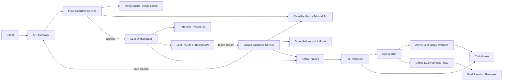

# LLM Evaluation and Guardrails

**Category:** AI/ML System Design
**Difficulty:** 🟡 Medium
**Seniority:** senior
**Companies:** OpenAI, Anthropic, Google, Microsoft, Meta, Salesforce
**Tags:** llm-evaluation, guardrails, llm-as-judge, content-moderation, prompt-injection, safety
**Time:** 45 min

---

## Problem Statement

Design the evaluation and guardrails layer for a company that ships several LLM-powered products (a customer-support chatbot, a RAG knowledge assistant, and a code assistant). The platform must (a) evaluate model/prompt changes offline before they ship and continuously in production, and (b) enforce runtime guardrails on every request: block unsafe inputs, detect prompt injection and PII leakage, and catch hallucinated or policy-violating outputs.

The interviewer is looking for a design that treats evaluation as a first-class CI/CD gate, uses a layered guardrail pipeline with a tight latency budget, and closes the loop between production failures and the eval suite. Scale hint: ~50M LLM requests/day across products, p95 end-to-end latency target of 2.5 s for chat.

## Clarifying Questions

- Which LLMs are in use? *Mix of a hosted frontier API (GPT-4o / Claude class) and self-hosted Llama 3 70B on vLLM.*
- Is streaming output required? *Yes for chat; guardrails must work with token streaming.*
- What latency can guardrails add? *At most ~150 ms on input and ~200 ms on output at p95.*
- What harm categories matter? *Hate, self-harm, sexual, violence, PII leakage, prompt injection/jailbreak, off-topic, ungrounded claims in RAG.*
- Who defines policy? *A Trust & Safety team; policies differ per product and per tenant.*
- Is there human labeling capacity? *Yes, ~20 annotators plus an internal red team.*
- What is the release cadence? *Prompt changes daily, model swaps monthly.*
- Data retention constraints? *Logs retained 30 days, PII must be redacted before storage.*

## Requirements

### Functional

- Offline eval harness: run a candidate (model + prompt + retrieval config) against versioned eval sets and produce a scorecard.
- Release gating: block deployment if quality or safety metrics regress beyond thresholds.
- Runtime input guardrails: moderation, prompt-injection detection, PII detection/redaction, topic restriction.
- Runtime output guardrails: moderation, PII leakage, groundedness/hallucination check for RAG, format/schema validation.
- Configurable per-product, per-tenant policies (block, redact, rewrite, warn, log-only).
- Online evaluation: sampled LLM-as-judge scoring of production traffic, user feedback capture, dashboards.
- Red-team and incident workflow: failures become new eval cases.

### Non-Functional

- Guardrail overhead: input p95 under 150 ms, output p95 under 200 ms (streaming-compatible).
- Availability 99.95%; fail-closed for high-severity categories, fail-open for low-severity ones.
- Throughput ~600 QPS average, ~2,000 QPS peak.
- Eval runs reproducible: pinned model versions, seeds, temperature 0, versioned datasets.
- Cost: guardrails under 10% of total LLM spend.

### Out of Scope

- Training the base LLM itself.
- Building the product UIs.

## Problem Framing

- **Two problems, one platform.** Evaluation answers "is version B better and safe enough to ship?"; guardrails answer "is this specific request/response acceptable right now?". They share classifiers, judges, and datasets.
- **Business metrics:** task success / resolution rate, CSAT, escalation-to-human rate, safety incident count, regulatory complaints.
- **Model metrics:**
  - Quality: answer correctness, faithfulness/groundedness, relevance, instruction following, format validity.
  - Safety: attack success rate (ASR) on jailbreak sets, harmful-output rate, PII leakage rate.
  - Guardrail classifiers: precision/recall per category, false-positive rate on benign traffic (over-refusal).
- **Key tension:** recall on harmful content vs over-blocking. A 1% false-positive rate at 50M req/day is 500K wrongly blocked users daily, so thresholds are tuned per category with severity weighting.
- **Constraints:** latency (guardrails run inline), cost (judge calls to a frontier LLM are expensive), privacy (logs contain user data, redact before persistence).

## Data Pipeline

- **Sources**
  - Production traces: prompt, retrieved context, response, tool calls, latency, model version (OpenTelemetry spans to Kafka).
  - User feedback: thumbs up/down, regenerate, escalation events.
  - Public safety datasets: ToxiGen, HarmBench, JailbreakBench, AdvBench, TruthfulQA.
  - Red-team findings and incident reports.
  - Synthetic data: LLM-generated adversarial prompts and paraphrases of known attacks.
- **Eval set curation**
  - Golden sets per product: 500-2,000 examples with reference answers or rubrics, stratified by intent and difficulty.
  - Safety sets: ~10K adversarial prompts across categories, plus a ~10K benign "should not refuse" set to measure over-refusal.
  - Regression set: every production incident is converted into a test case (de-duplicated by embedding similarity).
  - Datasets versioned in S3 + a metadata registry (e.g. DVC or a Postgres catalog) with immutable IDs.
- **Labeling**
  - Annotators label sampled traces with rubrics (1-5 correctness, faithfulness yes/no, policy category).
  - Inter-annotator agreement tracked (Cohen's kappa > 0.7 required for a rubric to be used for gating).
  - Human labels calibrate LLM judges.
- **Storage**
  - Raw traces: Kafka to S3 (Parquet) after PII redaction (Presidio + regex), 30-day TTL.
  - Queryable analytics: ClickHouse for dashboards and slicing by product/model/tenant.
  - Eval results: Postgres (run metadata) + S3 (per-example outputs).

## Model Design

### Guardrail components (cheap to expensive)

| Layer | Technique | Latency | Purpose |
|---|---|---|---|
| Rules | Regex, blocklists, allowlists, length limits | under 1 ms | Secrets, obvious PII, banned terms |
| PII | Presidio / fine-tuned NER (DeBERTa-small) | ~10 ms | Detect and redact emails, SSNs, cards |
| Moderation | Fine-tuned DeBERTa-v3 multi-label classifier, or Llama Guard 3 1B | 15-40 ms | Harm categories |
| Injection | Classifier trained on injection corpora (e.g. Prompt Guard style) + heuristics on retrieved docs | ~20 ms | Jailbreak and indirect injection |
| Groundedness | NLI model (DeBERTa-MNLI) sentence vs retrieved chunks | 50-120 ms | Hallucination in RAG |
| LLM judge | Llama Guard 3 8B or frontier LLM with rubric | 300-1500 ms | Ambiguous cases, offline eval only or async |

- **Baseline:** call a hosted moderation API on input and output. Simple, but no injection or groundedness coverage, adds network latency, no per-tenant policy.
- **Chosen:** a cascade. Rules and small encoder classifiers run on every request on GPU (T4/L4) or CPU via ONNX Runtime; escalate to Llama Guard 8B only when the small classifier score is in an uncertain band (e.g. 0.3-0.7), which is ~3-5% of traffic.
- **Structural defenses** complement classifiers: system prompt isolation, delimiting retrieved content as untrusted, tool-call allowlists and argument validation, least-privilege tool credentials.

### Evaluators

- **Reference-based:** exact match, F1, BLEU/ROUGE only for narrow tasks; code tasks use unit-test pass@k.
- **LLM-as-judge:** pairwise (A vs B) for preference, pointwise rubric scoring for correctness and faithfulness. Use a judge stronger than or different from the candidate model to reduce self-preference bias; randomize order in pairwise to counter position bias; require chain-of-thought then a final structured score.
- **RAG-specific:** context precision/recall, faithfulness, answer relevance (RAGAS-style metrics).
- **Judge calibration:** measure judge-human agreement on 500 labeled examples; only use judges with agreement above ~80%.

```text
FUNCTION run_input_guardrails(request, policy)
    SET text ← request.user_message
    IF rules.match_block(text, policy) THEN RETURN BLOCK("rule")
    SET text ← pii.redact(text, policy.pii_mode)
    SET scores ← PARALLEL(moderation.score(text), injection.score(text))
    FOR category IN policy.categories
        SET s ← scores[category]
        IF s ≥ policy.block_threshold[category] THEN RETURN BLOCK(category)
        IF s ≥ policy.review_threshold[category] THEN
            SET verdict ← llama_guard.classify(text, category)   // escalation, ~4% of traffic
            IF verdict = UNSAFE THEN RETURN BLOCK(category)
    RETURN ALLOW(text)
```

## Training & Evaluation

- **Guardrail classifier training**
  - Fine-tune DeBERTa-v3-base on internal labels + public datasets; multi-label sigmoid head per category.
  - Hard-negative mining: benign prompts that mention sensitive topics (medical, security research) to reduce over-refusal.
  - Calibrate with temperature scaling so thresholds are meaningful; pick thresholds per category on a PR curve (e.g. recall at least 95% for self-harm, precision at least 90% for off-topic).
  - Distill into a smaller model for latency if needed.
- **Offline eval harness (CI gate)**
  - Triggered on any change to prompt, model, retrieval config, or guardrail policy.
  - Runs golden sets, safety sets, over-refusal set, regression set in parallel on a Ray cluster; ~15K examples in ~20 min.
  - Scorecard compares against the production baseline with confidence intervals (bootstrap); gates on: no significant drop in correctness, faithfulness at least 0.9, ASR not increased, over-refusal under 2%.
  - Results stored per example so reviewers can diff failing cases.
- **Online evaluation**
  - Shadow mode: new guardrail model scores live traffic without acting; compare block rates and disagreements.
  - A/B tests on business metrics (resolution rate, CSAT, escalation), with guardrail block rate as a guardrail metric.
  - Sampled LLM-as-judge: 1-2% of production traffic scored asynchronously for faithfulness and helpfulness; trends on dashboards.
- **Human eval:** weekly sample of 500 traces per product; red team runs monthly campaigns and before major model swaps.

## Serving Architecture



1. Gateway authenticates, attaches tenant/product ID, and looks up the policy (cached in Redis, refreshed on change).
2. Input guardrails run rules, PII redaction, moderation, and injection classifiers in parallel on a Triton Inference Server pool (dynamic batching, max batch 32, 5 ms queue delay).
3. Allowed requests go to the orchestrator, which retrieves context (retrieved chunks also scanned for indirect injection) and calls the LLM.
4. Output guardrails consume the token stream in windows (e.g. every sentence or 50 tokens) and run moderation and PII checks incrementally; the client receives text only after each window passes, adding ~1 window of lag rather than full-response latency.
5. Groundedness NLI runs per sentence against retrieved chunks; on failure, the sentence is replaced with a fallback or the response gets a citation warning, depending on policy.
6. All traces go to Kafka, are redacted, then land in S3 and ClickHouse for async judging and analytics.

**Latency budget (p95, chat):**

| Step | Budget |
|---|---|
| Policy lookup (Redis) | 2 ms |
| Input rules + PII | 15 ms |
| Moderation + injection (parallel, batched) | 40 ms |
| Escalation to Llama Guard 8B (~4% of requests) | 250 ms only on that slice |
| Output window check per 50 tokens | 30-60 ms |
| Groundedness NLI per sentence | 50-120 ms, overlapped with generation |

**Capacity:** 2,000 peak QPS x 2 checks (input + output windows ~6 per response) ≈ 14K classifier calls/s. A DeBERTa-base on L4 with batching handles ~1,500 short sequences/s, so ~10-12 GPUs plus headroom across 2 regions.

## Monitoring & Iteration

- **Guardrail health:** block rate per category/product/tenant, escalation rate, latency p50/p95/p99, fail-open counts. Alert on block-rate shifts over 3 sigma (either an attack wave or a broken classifier).
- **Quality drift:** daily sampled judge scores (faithfulness, helpfulness), user thumbs-down rate, regenerate rate; slice by topic cluster to localize regressions.
- **Model drift:** embedding-based input distribution monitoring (new topic clusters, new languages); hosted model version changes detected by re-running a canary eval set nightly.
- **Feedback loop:** thumbs-down + blocked + escalated traces go to a labeling queue; confirmed failures added to the regression set; classifiers retrained monthly or on-demand after incidents.
- **Adversarial monitoring:** cluster blocked prompts to discover new jailbreak templates; red team converts them into eval cases.
- **Cost control:** cascade keeps expensive judges under 5% of traffic; async judging on a 1-2% sample; cache moderation results for repeated prompts (hash of normalized text); use batch APIs for offline eval at ~50% discount.
- **Judge drift:** re-validate LLM judges against human labels quarterly and whenever the judge model version changes.

## Trade-offs

| Decision | Option A | Option B | Choice & Why |
|---|---|---|---|
| Moderation model | Hosted moderation API | Self-hosted fine-tuned classifiers | Self-hosted for latency, per-tenant thresholds, and injection coverage; hosted API as a fallback |
| Output checking with streaming | Check full response before sending | Check in sentence/token windows | Windows: keeps time-to-first-token low; small risk of partial harmful text mitigated by small window size |
| Failure mode | Fail-open | Fail-closed | Per severity: fail-closed for self-harm/CSAM/PII, fail-open with logging for off-topic |
| Evaluator | Human-only | LLM-as-judge | LLM judge for scale, calibrated against humans; humans for gating rubrics and audits |
| Guardrail invocation | Every check on every request | Cascade with escalation | Cascade: ~95% of traffic handled by cheap models, cost and latency bounded |

## Follow-up Questions

1. **How do you defend against indirect prompt injection in retrieved documents or tool outputs?** Treat all retrieved content as untrusted data: delimit it, scan it with the injection classifier at ingestion and retrieval, restrict tool permissions, and require user confirmation for side-effecting actions.
2. **How do you know your LLM judge is trustworthy?** Measure agreement against human labels on a held-out set, test for position and verbosity bias with swapped and padded pairs, and re-validate on judge model upgrades.
3. **How do you handle multilingual traffic?** Use a multilingual encoder (XLM-R / mDeBERTa) for classifiers, build per-language eval slices, and monitor per-language block rates, since recall usually drops in low-resource languages.
4. **The hosted model provider silently updates the model. What happens?** A nightly canary eval detects score shifts; pin model snapshot versions where possible and gate migrations through the same CI harness.
5. **How do you reduce over-refusal complaints?** Track the benign "should answer" set as a first-class metric, mine false positives from appeals, add hard negatives to training, and raise thresholds for low-severity categories.

## Common Mistakes

- Treating evaluation as a one-off benchmark instead of a versioned, CI-gated, continuously updated suite.
- Measuring only harmful-content recall and ignoring false positives and over-refusal on benign traffic.
- Using the same model as candidate and judge, or not randomizing pairwise order, which introduces self-preference and position bias.
- Running a large LLM guardrail on every request, blowing the latency and cost budget.
- Buffering the entire streamed response before checking, which destroys time-to-first-token.
- Logging raw prompts with PII into analytics stores.

## Key Takeaways

- Separate offline evaluation (release gating) from runtime guardrails, but share datasets, classifiers, and policies between them.
- Use a cost/latency cascade: rules, then small encoders, then LLM judges only for uncertain cases.
- Calibrate LLM-as-judge against human labels before trusting it for decisions.
- Every production failure should become a regression test; the eval set is a living asset.
- Tune thresholds per category by severity, and monitor both block rate and over-refusal.
