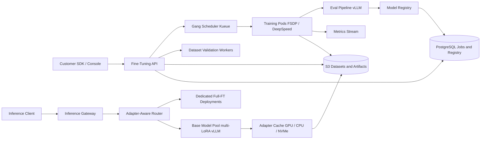

# LLM Fine-Tuning Platform

**Category:** AI/ML System Design
**Difficulty:** 🔴 Hard
**Seniority:** staff
**Companies:** OpenAI, Anthropic, Google, Databricks, Together AI, Anyscale, Amazon
**Tags:** fine-tuning, lora, distributed-training, gpu-scheduling, model-registry, mlops
**Time:** 60 min

---

## Problem Statement

Design a self-serve LLM fine-tuning platform (think OpenAI Fine-Tuning API, Databricks Mosaic AI Training, or Together AI Fine-Tuning). Customers upload instruction or preference datasets, pick a base model (7B to 70B open-weight models), choose a method (LoRA, QLoRA, or full fine-tuning), and get back a tuned model they can call through an inference endpoint. The platform must manage datasets, schedule distributed training on a shared GPU fleet, gate releases on evaluation, version artifacts in a model registry, and serve thousands of tuned variants cheaply.

Scale hint: ~5,000 tenants, ~2,000 fine-tuning jobs/day (90% LoRA on 7B-13B, 10% full FT up to 70B), a fleet of ~4,000 H100 GPUs shared with other workloads, and ~50,000 active adapters to serve. The interviewer wants the training control plane, the distributed training strategy, eval gates, and multi-adapter serving; generic LLM inference internals (paged attention, continuous batching) can be assumed to exist.

## Clarifying Questions

- Which training methods must we support? *SFT with LoRA/QLoRA and full FT; DPO as a stretch. No pretraining.*
- Which base models? *Curated catalog of open-weight models (Llama 3.1 8B/70B, Mistral 7B, Qwen 2.5) plus customer-uploaded weights for enterprise.*
- Dataset size range? *1K to 1M examples, typically under 100M tokens per job.*
- Do customers bring their own eval sets and metrics? *Yes, optional; we also run platform safety and regression evals.*
- Isolation requirements? *Enterprise tenants need data never co-located with other tenants on the same node, and no data retention after deletion.*
- Expected job latency? *LoRA on 8B with 10M tokens should finish in under 1 hour; full FT of 70B can take a day.*
- Serving model? *Shared multi-tenant serving for adapters; dedicated deployments for fully fine-tuned models.*

## Requirements

### Functional

- Upload, validate, version, and delete datasets (JSONL chat format, preference pairs).
- Create jobs with base model, method, hyperparameters (sensible defaults), and optional eval set.
- Stream job status, loss curves, and checkpoints; support cancel and resume.
- Run automatic evaluation gates (customer eval, safety, base-capability regression) before a model is deployable.
- Register artifacts (adapter or full weights) with lineage: dataset version, base model, config, code version.
- Deploy tuned models to an inference endpoint; LoRA adapters served on shared base-model pools.

### Non-Functional

- GPU utilization above 80% across the training fleet; fair share across tenants.
- Job success rate above 98%; preemption-tolerant via checkpointing.
- Adapter cold-load under 2 s; p95 TTFT overhead from adapters under 50 ms vs base model.
- Strict tenant isolation, encryption at rest, audit logs, and verifiable deletion.
- Cost transparency: per-token training price and per-token serving price.

### Out of Scope

- Pretraining from scratch and RLHF reward-model training pipelines.
- Low-level inference engine design (covered by LLM Inference Serving Platform).

## Problem Framing

- **Business objective:** customers get a model that beats prompting the base model on their task, at a predictable cost. Platform metrics: job success rate, time-to-model, GPU utilization, revenue per GPU-hour, and the share of tuned models that pass eval gates and get deployed.
- **Model metric:** the customer's task metric on a held-out set (exact match, ROUGE, LLM-judge win rate vs base) plus no regression on general capability (MMLU subset, IFEval) and safety refusal benchmarks.
- **Core tension:** fine-tuning can be cheap (LoRA, hundreds of MB of GPU memory for the adapter) or expensive (full FT of 70B needs ~1.1 TB of memory for weights, grads, and Adam states), and the platform must route each job to the cheapest method that meets quality.
- **Constraints:** shared GPU fleet with preemption; tenant data privacy; serving 50K adapters without 50K GPU deployments.

Memory math that drives design choices (mixed precision with Adam):

| Setup | Per-parameter bytes | 8B model | 70B model |
|---|---|---|---|
| Full FT (bf16 weights + grads, fp32 master + Adam m, v) | ~16 B | ~128 GB | ~1.12 TB |
| LoRA (frozen bf16 base, rank 16 adapters) | ~2 B + tiny | ~16 GB + activations | ~140 GB + activations |
| QLoRA (4-bit NF4 base) | ~0.5 B + tiny | ~5 GB + activations | ~35-40 GB + activations |

So LoRA 8B fits on one H100 80GB, QLoRA 70B fits on one H100 (slowly) or 2 GPUs comfortably, and full FT 70B needs FSDP/ZeRO-3 sharding across at least 16-32 H100s.

## Data Pipeline

1. **Upload:** client gets a pre-signed S3 URL; files land in a tenant-scoped bucket prefix encrypted with a per-tenant KMS key.
2. **Validation job (CPU):** schema check (messages with roles, preference pairs with chosen/rejected), tokenizer-aware length stats, truncation warnings over max context, duplicate detection (MinHash), PII and toxicity scan, and a sample preview. Bad rows are reported, not silently dropped.
3. **Tokenization and packing:** tokenize once per (dataset version, tokenizer) and cache as Arrow/Parquet shards; pack multiple short examples into fixed 4K/8K sequences with attention masks that prevent cross-example attention, raising token efficiency from ~40% to ~95%.
4. **Loss masking:** compute loss only on assistant tokens by default; store the mask alongside token IDs.
5. **Splits:** if no validation set is provided, hold out 5% (min 100, max 5,000 examples) deterministically by hash.
6. **Versioning:** datasets are immutable; each version has a content hash. Jobs reference the hash so lineage is reproducible.
7. **Deletion:** delete removes raw files, tokenized caches, and (by policy) derived checkpoints; crypto-shredding of the tenant key handles backups.

Storage: metadata in PostgreSQL (datasets, versions, jobs, models), blobs in S3, tokenized shards streamed to training nodes from S3 with a local NVMe cache.

```text
datasets(dataset_id, tenant_id, name, created_at)
dataset_versions(version_id, dataset_id, content_hash, rows, tokens, format, status, s3_uri)
jobs(job_id, tenant_id, base_model_id, method, hparams_json, dataset_version_id,
     eval_version_id, status, priority, gpu_type, gpu_count, cost_estimate, created_at)
checkpoints(job_id, step, s3_uri, train_loss, val_loss, created_at)
models(model_id, tenant_id, job_id, kind[adapter|full], base_model_id,
       artifact_uri, eval_report_uri, stage[candidate|approved|deployed|archived])
```

## Model Design

Candidate approaches the platform offers and how to pick among them:

| Method | Quality | Cost | Serving | When |
|---|---|---|---|---|
| Prompting / few-shot | Baseline | None | Base model | Always measured as the bar to beat |
| LoRA (rank 8-64, attn + MLP) | Close to full FT on most SFT tasks | 1 GPU for 7-13B | Shared base + adapter | Default choice |
| QLoRA (NF4 base + LoRA) | Slightly below LoRA | Cheapest memory, ~30% slower | Merge to bf16 or serve with LoRA on bf16 base | Large base on few GPUs |
| Full FT | Best for large domain shift | 10-50x LoRA | Dedicated deployment | Enterprise, big datasets |
| DPO on top of SFT | Better preference alignment | ~2x SFT (reference model) | Same as SFT output | Preference data available |

**Default policy:** LoRA rank 16, alpha 32, dropout 0.05, targets q/k/v/o and gate/up/down projections, learning rate 1e-4 to 2e-4 with cosine decay and 3% warmup, 3 epochs, effective batch ~64 sequences. Full FT uses LR ~1e-5. An auto-config service picks batch size and gradient accumulation from dataset tokens and GPU memory.

**Distributed training strategy:**

- **LoRA 7-13B:** single GPU or DDP across 8 GPUs on one node; base weights frozen so only adapter grads are all-reduced (MBs, not GBs).
- **LoRA/QLoRA 70B:** FSDP sharding of the frozen base across 8 GPUs in one node (NVLink), adapters replicated.
- **Full FT 70B:** FSDP FULL_SHARD or DeepSpeed ZeRO-3 across 4-8 nodes (32-64 H100s) with InfiniBand 400 Gb/s per GPU; activation checkpointing; bf16; optionally tensor parallel 8 within node plus FSDP across nodes for long context.
- **Throughput:** target ~40-50% MFU. LoRA 8B on one H100 processes roughly 3-5K tokens/s, so 10M tokens x 3 epochs is ~2 hours on 1 GPU or ~15-20 minutes on 8 GPUs.

**Multi-tenant packing of LoRA jobs:** small LoRA jobs on the same base model can be co-trained in one process with per-sample adapter routing (multi-LoRA training) to share the frozen base forward pass. It raises utilization for tiny jobs but complicates isolation, so it is only used for standard-tier tenants.

## Training & Evaluation

**Control plane workflow:**

```text
FUNCTION submit_job(req):
    VALIDATE dataset_version status = READY AND tenant quota available
    SET plan ← auto_config(req.base_model, req.method, dataset.tokens)
        // picks gpu_type, gpu_count, parallelism, batch size, est. hours, est. cost
    INSERT job(status = QUEUED, priority = tenant_tier_priority(req.tenant))
    ENQUEUE scheduler_queue(job, plan)
    RETURN job_id, plan.cost_estimate

FUNCTION scheduler_loop():
    FOR job IN queue ORDER BY (priority, fair_share_deficit(tenant), age):
        SET slot ← find_gang(job.plan.gpu_count, topology = SAME_NODE_IF <= 8 ELSE SAME_IB_RACK)
        IF slot IS NULL AND job.priority = HIGH:
            SET slot ← preempt_lower_priority(job.plan)   // victims checkpoint first
        IF slot IS NOT NULL:
            LAUNCH training_pods(job, slot)                // all-or-nothing gang scheduling

FUNCTION training_worker(job):
    RESUME from latest checkpoint IF exists
    FOR step IN steps:
        RUN forward / backward / optimizer
        IF step MOD log_every = 0: EMIT metrics to job stream
        IF step MOD ckpt_every = 0 OR SIGTERM received:
            SAVE sharded checkpoint to S3 asynchronously
    SAVE final adapter or full weights
    TRIGGER eval_pipeline(job)
```

Scheduling runs on Kubernetes with a gang scheduler (Kueue or Volcano) or Slurm; jobs need all GPUs at once, and multi-node jobs must be topology-aware. Checkpoints every ~15-30 minutes bound lost work on preemption or node failure (at 4,000 GPUs, expect several GPU/node failures per day). LoRA checkpoints are tiny (~50-200 MB); full 70B checkpoints with optimizer state are ~1 TB and use sharded async writes (torch.distributed.checkpoint).

**Eval gates (run on a separate inference pool with vLLM):**

1. **Training health:** loss decreased, no NaNs, val loss not diverging from train loss (overfitting alarm).
2. **Customer task eval:** customer metric on their eval set; tuned vs base model, reported with confidence intervals.
3. **LLM-as-judge win rate:** pairwise tuned vs base on a sample of held-out prompts, with position swapping to reduce bias.
4. **Capability regression:** small MMLU/GSM8K/IFEval subsets; flag drops greater than ~3 points (catastrophic forgetting).
5. **Safety:** red-team prompt suite and refusal rate; fine-tuning can strip safety training even with benign-looking data, so a significant drop blocks deployment for hosted models (hard gate) and requires review.

A model moves `candidate → approved` only if all hard gates pass; customer-metric gates are configurable thresholds. Eval reports are stored with the model in the registry.

**Online validation:** customers can deploy with traffic splitting (e.g. 10% to the new adapter) and compare thumbs-up rate, task success, and latency before promoting.

## Serving Architecture



**Online inference path:**

1. Request arrives with `model = ft:llama-3.1-8b:tenant:abc123`; the gateway authenticates and resolves the model in the registry (cached in Redis) to base model + adapter URI.
2. The adapter-aware router picks a replica of the base model pool that already has the adapter loaded (consistent hashing on adapter ID with bounded load), falling back to the least-loaded replica.
3. The replica runs multi-LoRA batching (vLLM multi-LoRA / S-LoRA / Punica SGMV kernels): requests for different adapters share one batch over the frozen base weights; only the low-rank matmuls differ per request.
4. Adapter cache hierarchy: GPU slots (e.g. 32-128 adapters per replica) → host RAM (thousands) → local NVMe → S3. A rank-16 adapter for 8B is ~40-80 MB, so loading from host RAM takes tens of ms and from S3 ~1-2 s.
5. Fully fine-tuned models get dedicated deployments with autoscaling and scale-to-zero for idle models (cold start of tens of seconds to minutes, accepted for that tier).

**Latency budget (8B adapter, warm):** gateway + auth 10 ms, routing 2 ms, queueing ~20 ms, adapter overhead in prefill ~10-20% vs base, TTFT p95 ~250 ms. Cold adapter adds 1-2 s on first call, so the router pre-warms adapters with recent traffic.

**Cost lever:** 50,000 adapters over ~40 base-model replicas instead of 50,000 deployments; most adapters receive under 1 request/min, so sharing is the only viable economics.

## Monitoring & Iteration

- **Training fleet:** GPU utilization, MFU per job, queue wait time by tier, preemption rate, checkpoint duration, NCCL errors, failed-node rate; auto-cordon nodes with ECC or Xid errors.
- **Job quality:** fraction of jobs passing gates, common failure reasons (bad format, overfitting, safety regression), surfaced to users as actionable hints.
- **Serving:** per-adapter QPS, adapter cache hit rate, cold-load latency, TTFT/TPOT by base model; rebalance adapter placement on hot adapters.
- **Drift and iteration:** customers retrain with new data; registry lineage enables diff of eval reports between versions; base model upgrades require re-tuning (adapters are not portable), so offer one-click retrain on the new base.
- **Guardrails:** dataset content scanning at upload, safety eval gate, and runtime moderation on hosted endpoints; abuse detection for tenants attempting to fine-tune away safety.
- **Cost control:** quota per tenant, cost estimate before launch, spot/preemptible capacity for standard tier, early stopping on plateaued val loss, auto-archive adapters unused for 90 days.

## Trade-offs

| Decision | Option A | Option B | Choice & Why |
|---|---|---|---|
| Default method | Full fine-tuning | LoRA | LoRA: 10-50x cheaper, near-equal quality for most SFT, and enables shared serving |
| Sharding framework | DeepSpeed ZeRO-3 | PyTorch FSDP | FSDP as default for native PyTorch integration; ZeRO-3 with CPU offload for memory-constrained jobs |
| Serving tuned models | Merge adapter into base, dedicated deployment | Multi-LoRA on shared base | Multi-LoRA for the long tail; merge and dedicate only for very high-traffic models |
| Scheduling | FIFO per GPU pool | Priority + fair share + preemption with gang scheduling | Fair share with checkpoint-based preemption keeps utilization high and protects SLAs |
| Small-job isolation | One job per GPU | Co-train multiple LoRA jobs on one base | Separate by default; co-training only for standard tier to boost utilization |
| Eval gates | Advisory only | Hard gates on safety and regressions | Hard safety gate for hosted models; task metrics advisory with customer thresholds |

## Follow-up Questions

1. **How do you handle a node failure mid-way through a 64-GPU full FT job?** Detect via NCCL timeout and health checks, tear down the gang, cordon the bad node, and restart from the last sharded checkpoint on a fresh slot; elastic training (torchrun elastic) can avoid full restart for DDP-style jobs.
2. **A customer's tuned model refuses less on harmful prompts. What do you do?** The safety gate blocks deployment; report the categories that regressed and suggest mixing safety data into the training set or lowering LR/epochs.
3. **How would you support DPO?** Add preference-pair dataset format, keep a frozen reference model (or precompute reference log-probs offline to save memory), and evaluate with judge win rate against the SFT model.
4. **How do you prevent data leakage between tenants in multi-LoRA serving?** Adapters are tenant-scoped in the registry with authz on every request; KV/prefix caches are keyed by adapter and tenant so prompts never share cached state across tenants.
5. **How do you choose LoRA rank automatically?** Start at 16; run small hyperparameter sweeps on a data subset for large jobs, or raise rank when val loss plateaus high on big, domain-shifted datasets.
6. **What changes when the base model is upgraded?** Adapters are tied to exact base weights; keep old base pools alive for pinned versions, notify customers, and offer automatic retrain plus side-by-side eval.

## Common Mistakes

- Treating fine-tuning as a single script rather than a multi-tenant platform with scheduling, quotas, and lineage.
- Ignoring memory math and proposing full FT of 70B on one node, or not knowing why Adam states dominate memory.
- Deploying one GPU per tuned model, which makes the long tail of adapters economically impossible.
- No evaluation gate, especially for safety regression, which fine-tuning commonly causes.
- Forgetting checkpointing and preemption, so a single GPU failure wastes a day of 64-GPU compute.
- Not packing sequences or masking prompt tokens, wasting compute and hurting quality.

## Key Takeaways

- Route jobs to the cheapest method that meets quality: LoRA by default, QLoRA for memory, full FT for large domain shifts.
- Training is a gang-scheduled, topology-aware, checkpointed batch workload; utilization and fault tolerance are the core control-plane problems.
- Eval gates (task, capability regression, safety) plus registry lineage make tuned models trustworthy and reproducible.
- Multi-LoRA serving with a tiered adapter cache turns 50K tuned models into a few dozen shared base-model replicas.
