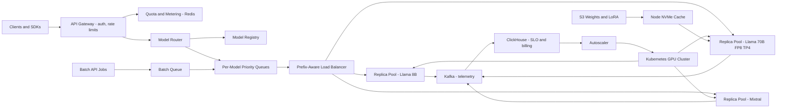

# LLM Inference Serving Platform

**Category:** AI/ML System Design
**Difficulty:** 🔴 Hard
**Seniority:** staff
**Companies:** OpenAI, Anthropic, Google, Meta, Microsoft, NVIDIA, Databricks, Together AI
**Tags:** llm-serving, continuous-batching, kv-cache, gpu-scheduling, quantization, autoscaling, multi-tenancy
**Time:** 60 min

---

## Problem Statement

Design a multi-tenant platform that serves large language models to internal product teams and external API customers. The platform hosts several open-weight models (e.g. Llama 3.1 8B and 70B, Mixtral 8x7B, plus fine-tuned LoRA variants), exposes an OpenAI-compatible streaming API, and must meet latency SLOs while maximizing GPU utilization, because GPUs are the dominant cost.

Scale hint: ~20K requests/s at peak across models, average prompt 1,500 tokens and output 300 tokens, a fleet of ~2,000 H100 GPUs across 3 regions, SLOs of p95 time-to-first-token (TTFT) under 500 ms and p95 inter-token latency (ITL) under 50 ms for interactive traffic. A staff answer covers the inference engine internals (prefill vs decode, KV cache, continuous batching), parallelism and quantization choices, routing and scheduling, multi-tenancy and fairness, autoscaling, and model rollout.

## Clarifying Questions

- Interactive only or also batch/offline jobs? *Both: interactive chat/API with SLOs, and batch jobs (evals, summarization backfills) that can tolerate hours.*
- Do customers bring fine-tuned models? *Yes, thousands of LoRA adapters on shared base models; a few full fine-tunes for large customers.*
- Context lengths? *Up to 128K tokens supported, but 95% of requests are under 8K.*
- Do we train models? *No, assume weights are produced elsewhere; we own serving.*
- Hardware constraints? *Mostly H100 80GB in 8-GPU nodes with NVLink; some L4/A10 pools for small models.*
- Rate limits and billing? *Per-tenant tokens-per-minute quotas, billing per input/output token.*
- Structured output / tool calling? *Yes, JSON-schema constrained decoding is required.*

## Requirements

### Functional

- OpenAI-compatible endpoints for chat/completions with token streaming (SSE), embeddings optional.
- Host multiple base models, quantized variants, and many LoRA adapters; route by model name.
- Per-tenant authentication, quotas (RPM/TPM), priority tiers, usage metering.
- Batch API for asynchronous jobs at a discount.
- Constrained decoding (JSON schema / grammar), stop sequences, sampling parameters.
- Zero-downtime model rollout and rollback.

### Non-Functional

- Interactive SLOs: p95 TTFT under 500 ms (for prompts under 4K tokens), p95 ITL under 50 ms.
- Availability 99.9% per model per region; regional failover.
- GPU utilization: target over 60% of decode memory bandwidth during peak.
- Tenant isolation: one tenant's burst must not violate another's SLOs.
- No logging of prompt content unless the tenant opts in.

### Out of Scope

- Model training and fine-tuning pipelines.
- Application-level RAG and safety guardrails (consumers of the platform).

## Problem Framing

- **Objective:** maximize goodput, defined as tokens/s per GPU that meet the latency SLO, subject to quality (no meaningful accuracy loss from optimizations) and fairness constraints.
- **Business metrics:** cost per 1M tokens, SLO attainment percentage, revenue per GPU-hour, customer churn due to latency/errors.
- **System/model metrics:** TTFT, ITL (time per output token), end-to-end latency, throughput (tokens/s), KV cache utilization, batch size, queue time, preemption rate, quality deltas on eval suites for quantized models.
- **Key physics**
  - Prefill (processing the prompt) is compute bound; it determines TTFT.
  - Decode (one token at a time) is memory-bandwidth bound: each step reads all weights, so batching many sequences amortizes weight reads.
  - KV cache memory per token for Llama 3.1 70B = 80 layers x 8 KV heads x 128 dim x 2 (K and V) x 2 bytes ≈ 320 KB. An 8K-token sequence needs ~2.6 GB; KV memory, not compute, usually caps batch size.
- **Constraints:** GPU scarcity and cost (~$2-4 per H100-hour), heterogeneous request lengths, bursty traffic, and the latency-throughput trade-off of batch size.

## Data Pipeline

For a serving platform, the "data" is model artifacts, request telemetry, and eval sets rather than training examples.

- **Model artifacts**
  - Weights in safetensors stored in S3 with checksums; a model registry (Postgres) tracks model ID, version, quantization, parallelism config, required GPU type, and eval results.
  - Pre-sharded weights per tensor-parallel layout to speed load; cached on node-local NVMe. Loading 70B FP8 (~70 GB) from NVMe takes ~30-60 s versus several minutes from S3.
  - LoRA adapters (10-200 MB each) in S3, loaded on demand into GPU memory with an LRU cache.
- **Request telemetry**
  - Per-request metadata (tenant, model, prompt tokens, output tokens, TTFT, ITL, queue time, cache hit, GPU node) emitted to Kafka, aggregated in ClickHouse for SLO dashboards and billing; prompt content excluded by default.
  - Usage metering events are idempotent (request ID) and reconciled into the billing system hourly.
- **Workload traces:** anonymized length distributions and arrival patterns used to replay load tests and tune schedulers.
- **Eval sets:** standard benchmarks (MMLU, GSM8K, HumanEval, MT-Bench) plus tenant-provided regression prompts, used to validate quantized or optimized model builds before rollout.

## Model Design

### Inference engine

- **Baseline:** naive HuggingFace generate with static batching. Requests wait for the batch to fill and the slowest sequence; GPU utilization often under 20%.
- **Chosen:** vLLM, TensorRT-LLM, or SGLang class engines with:
  - **Continuous (in-flight) batching:** the scheduler adds and removes sequences at every decode step, so short requests do not wait for long ones.
  - **PagedAttention:** KV cache stored in fixed-size blocks (e.g. 16 tokens) with a block table per sequence, eliminating fragmentation and enabling near-full KV memory use.
  - **Prefix caching:** shared prefixes (system prompts, few-shot examples, multi-turn history) reuse cached KV blocks via hashing; big TTFT savings for chat.
  - **Chunked prefill:** split long prompts into chunks (e.g. 512-2K tokens) interleaved with decode steps so a 100K-token prompt does not stall ITL for everyone else.
  - **Speculative decoding:** a small draft model (or Medusa/EAGLE heads) proposes several tokens verified in one forward pass; 1.5-2.5x lower ITL at low batch sizes.
  - **Constrained decoding:** grammar/JSON-schema masks on logits (e.g. XGrammar / Outlines), compiled per schema and cached.

### Parallelism and placement

| Model | Precision | Weights | Layout | Notes |
|---|---|---|---|---|
| Llama 3.1 8B | BF16 | 16 GB | 1x H100 (or 1x L4 with FP8/INT4) | Data parallel replicas |
| Llama 3.1 70B | FP8 | ~70 GB | TP=4 on H100 | Leaves ~250 GB for KV cache across 4 GPUs |
| Llama 3.1 70B | BF16 | 140 GB | TP=8 | Higher quality reference, lower throughput per GPU |
| Mixtral 8x7B | FP8 | ~47 GB | TP=2 or expert parallel | Only 2 experts active per token |
| Llama 3.1 405B | FP8 | ~405 GB | TP=8 on one node | Pipeline parallel across nodes if BF16 |

- Tensor parallelism stays within an NVLink node (all-reduce per layer is latency sensitive); pipeline parallelism across nodes only when needed.
- **Quantization:** FP8 (H100 native) for weights and activations gives ~2x throughput over BF16 with typically under 1% benchmark drop; INT4 AWQ/GPTQ for small GPUs; FP8 KV cache doubles the number of sequences in memory.
- **Disaggregated prefill/decode (advanced):** separate prefill pools (compute heavy) and decode pools (bandwidth heavy), transferring KV cache over NVLink/InfiniBand; improves both TTFT and ITL tail at large scale (DistServe / Mooncake style).
- **Multi-LoRA:** batch requests for different adapters on the same base model using S-LoRA/Punica kernels; adapters paged in and out of GPU memory.

```text
FUNCTION scheduler_step(engine)
    // runs every decode iteration on each model replica
    SET running ← engine.running_sequences
    SET free_blocks ← engine.kv.free_blocks()
    // 1. decode tokens for all running sequences first (protects ITL)
    SET budget ← MAX_TOKENS_PER_STEP - LEN(running)
    // 2. admit waiting requests by priority, then arrival time
    FOR req IN engine.waiting.sorted_by(priority, arrival)
        SET cached ← engine.prefix_cache.match(req.prompt_tokens)
        SET need ← blocks_for(req.prompt_len - cached.len)
        IF need > free_blocks OR budget ≤ 0 THEN BREAK
        SET chunk ← MIN(req.remaining_prefill, budget, PREFILL_CHUNK)
        engine.schedule_prefill(req, chunk, reuse=cached)
        SET budget ← budget - chunk
        SET free_blocks ← free_blocks - need
    // 3. if KV memory is exhausted, preempt lowest-priority sequences
    WHILE engine.kv.free_blocks() < RESERVE
        SET victim ← lowest_priority(running)
        engine.preempt(victim, mode=SWAP_TO_CPU_OR_RECOMPUTE)
    engine.forward_batch()
```

## Training & Evaluation

No model training here; evaluation means validating quality and performance of each servable build.

- **Quality validation:** every new build (quantization, engine version, kernel change, speculative decoding config) runs the eval suite against the BF16 reference; gates such as MMLU within 0.5 points, GSM8K within 1 point, and token-level KL divergence on 1K reference prompts under a threshold. Greedy-output diff rates are tracked to catch numerical bugs.
- **Performance benchmarking:** replay production traces at increasing QPS to find the max load that still meets SLO (the goodput knee); record TTFT/ITL percentiles, tokens/s/GPU, and KV utilization per configuration. Choose TP degree, max batch tokens, and chunk size from these curves.
- **Capacity example (70B FP8, TP=4, H100):** decode at batch 64 gives roughly 25-35 ms ITL and ~2,000-2,500 output tokens/s per replica. At peak, if 70B serves 2K req/s x 300 output tokens = 600K output tokens/s, that needs ~270 replicas or ~1,100 GPUs (over half the fleet) before prefix caching and speculative decoding, while the 8B model serves the other ~18K req/s on far fewer GPUs. This is why routing small-enough tasks to 8B models and maximizing cache hits matter for cost.
- **Online validation:** canary new builds at 1-5% of traffic per model, compare TTFT/ITL, error rates, and sampled output quality (LLM-judge pairwise on a sample of opted-in traffic) before ramping.
- **Chaos and load testing:** GPU node failures, NCCL hangs, and region failover drills quarterly.

## Serving Architecture



1. Gateway authenticates, checks tenant token quotas (token-bucket in Redis, estimated from prompt length + max_tokens and reconciled after completion), and tags priority tier.
2. Router resolves the model (base + adapter) from the registry and enqueues into a per-model priority queue.
3. Load balancer picks a replica using prefix-cache affinity (consistent hashing on prompt prefix hash, e.g. tenant system prompt) combined with least-outstanding-tokens, so requests land where their KV prefix is cached without hotspotting.
4. Replica engines run continuous batching; tokens stream back via SSE through the gateway.
5. Telemetry feeds SLO dashboards, billing, and the autoscaler.

**Latency budget (interactive, 1.5K prompt, p95):**

| Step | Budget |
|---|---|
| Gateway auth + quota | 10 ms |
| Routing + queueing | 50-150 ms (load dependent) |
| Prefill 1.5K tokens on 70B TP4 | ~120-200 ms (less with prefix cache hit) |
| First token network | 20 ms |
| TTFT total | under 500 ms |
| Each subsequent token | 25-45 ms |

**Scheduling and multi-tenancy**
- Priority tiers: interactive paid > interactive free > batch. Batch jobs fill idle capacity (troughs, overnight) and are preempted first.
- Weighted fair queuing across tenants within a tier so a single tenant's burst cannot starve others; per-tenant max concurrent sequences.
- Admission control: if predicted queue time exceeds the SLO, return 429 with retry-after instead of accepting work that will miss the SLO.

**Autoscaling**
- Scale on queue depth, KV cache utilization, and TTFT p95 rather than CPU/GPU utilization (GPU utilization is near 100% even when overloaded).
- Cold start of a 70B replica is minutes (node provision + weight load), so keep warm buffer capacity (~10-15%) and use predictive scaling from daily traffic patterns; shift GPUs between models based on demand since weights load in under a minute from NVMe.
- Spot/preemptible GPUs for batch pools only.

**Reliability**
- Health checks detect stuck NCCL collectives and GPU Xid errors; drain and replace nodes automatically.
- In-flight streaming requests on a failed replica are retried on another replica (client sees a reconnect or, if tokens were already streamed, an error with partial output).
- Regional failover via global load balancing with capacity reservations.

## Monitoring & Iteration

- **SLO metrics:** TTFT, ITL, end-to-end latency percentiles per model, tier, and tenant; SLO attainment; queue time; 429 rate.
- **Engine metrics:** batch size, KV cache utilization, prefix cache hit rate, preemption/swap counts, speculative acceptance rate, tokens/s/GPU.
- **Fleet:** GPU memory, temperature, Xid errors, NVLink errors, node failure rate.
- **Quality drift:** nightly golden-prompt runs per deployed build to catch silent numerical regressions after driver/kernel upgrades.
- **Cost control:** cost per 1M tokens by model and tenant; route to the smallest model meeting quality (model cascades offered to tenants); FP8 everywhere it passes evals; maximize prefix caching; consolidate low-traffic models with multi-LoRA instead of dedicated replicas; batch API at ~50% price to fill troughs.
- **Iteration:** adopt engine upgrades (new kernels, FlashAttention versions, disaggregated serving) only through the benchmark + eval gate and canary.

## Trade-offs

| Decision | Option A | Option B | Choice & Why |
|---|---|---|---|
| Batching | Static batching | Continuous batching with paged KV | Continuous: 5-20x throughput, no head-of-line blocking |
| Precision | BF16 | FP8 weights + FP8 KV | FP8: ~2x throughput, more KV capacity, under 1% quality loss after validation |
| 70B layout | TP=8 | TP=4 | TP=4: more replicas per node and better throughput per GPU; TP=8 for lowest latency or long context |
| Prefill vs decode | Colocated with chunked prefill | Disaggregated pools | Start colocated with chunked prefill; disaggregate at large scale when tail ITL suffers |
| Load balancing | Round robin | Prefix-affinity + least outstanding tokens | Affinity: higher prefix cache hits, lower TTFT; load term prevents hotspots |
| Autoscaling signal | GPU utilization | Queue depth, KV usage, TTFT | Queue/KV/TTFT: GPU utilization saturates and hides overload |

## Follow-up Questions

1. **How do you serve 128K-context requests without hurting everyone else?** Route them to a dedicated long-context pool (higher TP, more KV memory), use chunked prefill, and cap concurrent long requests per replica.
2. **How do you support thousands of LoRA adapters?** Share the base model, batch heterogeneous adapters with S-LoRA/Punica kernels, keep hot adapters in GPU memory with LRU, and load cold ones from host memory in milliseconds.
3. **How do you bill accurately with streaming and cancellations?** Count tokens at the engine, emit idempotent usage events at completion or disconnect, and reconcile with gateway estimates.
4. **When does speculative decoding hurt?** At high batch sizes the GPU becomes compute bound and verification overhead outweighs gains; enable it adaptively at low load or for latency-sensitive tiers.
5. **How would you reduce TTFT for multi-turn chat?** Prefix caching with session affinity, plus tiered KV storage (GPU, host DRAM, SSD) so earlier turns' KV can be restored instead of recomputed.

## Common Mistakes

- Ignoring the prefill/decode distinction and treating LLM inference like a stateless classifier.
- Forgetting KV cache memory math, which usually limits batch size and concurrency.
- Autoscaling on GPU utilization and not accounting for multi-minute model cold starts.
- Applying quantization or kernel changes without a quality evaluation gate.
- No tenant fairness or admission control, so one bursty customer breaks everyone's SLO.
- Spanning tensor parallelism across nodes over slow interconnect.

## Key Takeaways

- Decode is memory-bandwidth bound; batching plus paged KV cache is the core throughput lever.
- Optimize goodput (SLO-meeting tokens per GPU), not raw throughput.
- Prefix caching, chunked prefill, FP8, and speculative decoding each target a specific bottleneck.
- Routing, priority scheduling, and admission control deliver multi-tenant isolation.
- Every engine or quantization change goes through benchmark replay, eval gates, and canaries.
