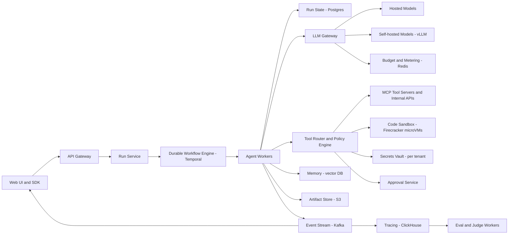

# Multi-Agent AI Platform

**Category:** AI/ML System Design
**Difficulty:** 🔴 Hard
**Seniority:** staff
**Companies:** OpenAI, Anthropic, Microsoft, Google, Salesforce, ServiceNow, Cognition
**Tags:** llm-agents, orchestration, tool-calling, durable-execution, agent-memory, sandboxing, agent-evaluation
**Time:** 60 min

---

## Problem Statement

Design a platform on which teams build, run, and monitor multi-agent LLM applications: an orchestrator agent decomposes a task and delegates to specialist agents (researcher, coder, data analyst, reviewer) that call tools such as web search, code execution, internal APIs, and databases. Example workloads: "investigate this customer escalation and draft a fix", "produce a weekly competitive analysis report", or "triage and resolve IT tickets".

Scale hint: 2,000 enterprise tenants, ~200K agent runs/day, a run averages 25 LLM calls and 15 tool calls with durations from 30 seconds to 2 hours, peaking at ~10K concurrent runs. A staff-level answer covers orchestration topology, durable execution, tool and permission model, memory and context management, sandboxing and security (prompt injection), cost and latency control, and how to evaluate non-deterministic multi-step behavior.

## Clarifying Questions

- Who defines agents? *Tenant developers via a declarative spec (role, model, tools, policies) and an SDK; plus a few prebuilt agents.*
- Which LLMs? *Pluggable: hosted frontier models and self-hosted open models via an internal inference gateway.*
- Can agents take side-effecting actions? *Yes (create tickets, open PRs, send emails), with policy-based human approval for risky actions.*
- How long can runs last? *Up to a few hours; must survive process crashes and deploys.*
- Interactive or background? *Both: chat-style interactive runs with streaming updates, and scheduled/background runs.*
- Data isolation requirements? *Strict per-tenant isolation; SOC 2; some tenants require data residency.*
- Budget control? *Per-run and per-tenant token and dollar budgets.*
- How is success measured? *Task completion rate judged by users or evaluators, plus cost and time per task.*

## Requirements

### Functional

- Define agents (system prompt, model, tools, memory, guardrails) and multi-agent workflows (supervisor-worker, sequential pipeline, graph).
- Execute runs: planning, delegation, tool calls, message passing between agents, final output.
- Tool registry with typed schemas (JSON Schema / MCP servers), per-tenant credentials, and permission scopes.
- Sandboxed code execution and browsing.
- Memory: per-run scratchpad, shared artifacts, long-term tenant knowledge (RAG).
- Human-in-the-loop approvals, pause/resume, cancellation.
- Full tracing of every step; replay and evaluation tooling.

### Non-Functional

- Durable: runs resume after worker crashes with no duplicated side effects.
- Interactive step latency: first streamed token within 1.5 s; orchestration overhead under 100 ms per step.
- 10K concurrent runs, ~60 LLM calls/s average and ~300/s peak, ~40 tool calls/s average.
- Tenant isolation for data, credentials, and compute; sandbox escape must not be possible.
- Cost guardrails enforced in real time.

### Out of Scope

- Training foundation models.
- Building the LLM inference engine (consumed through a gateway).

## Problem Framing

- **Objective:** maximize task success rate per unit cost and time, safely. Success is task-specific (ticket resolved, tests pass, report accepted).
- **Business metrics:** task completion rate, human intervention rate, time saved per task, cost per successful task, tenant retention.
- **Model/agent metrics:** step-level tool-call accuracy (valid tool, valid arguments), plan quality, trajectory length, loop/stall rate, hallucinated-tool rate, judge-scored final output quality, safety violations.
- **When multi-agent is worth it:** parallelizable research, distinct tool sets/permissions per role, and context isolation (each sub-agent gets a focused context). Costs: more tokens (often 3-10x a single agent), coordination errors, harder debugging. The platform should make single-agent the default and multi-agent an explicit choice.
- **Constraints:** LLM non-determinism, context window limits, long-running state, prompt injection from tool outputs, per-tenant budgets, and latency for interactive use.

## Data Pipeline

- **Run traces:** every step (LLM call with prompt hash, model, tokens, latency; tool call with args and result summary; agent messages) recorded as OpenTelemetry spans, persisted to an event store (Postgres for run state, ClickHouse for analytics, S3 for full payloads with tenant-scoped encryption keys).
- **Knowledge ingestion (RAG memory):** tenant documents (Confluence, Google Drive, Slack, code repos) ingested via connectors, chunked (~500-800 tokens with overlap, structure-aware for code and markdown), embedded (e.g. text-embedding-3-large or bge-large), stored in a vector DB (pgvector for small tenants, a dedicated Qdrant/Turbopuffer namespace for large ones) with ACL metadata so retrieval respects source permissions.
- **Episodic memory:** summaries of past runs and user feedback ("prefers concise reports", "repo uses pnpm") extracted by an LLM after each run, stored per tenant/user with embeddings for retrieval.
- **Eval datasets:** curated tasks with checkers per agent type (e.g. coding tasks with unit tests in SWE-bench style, research tasks with rubrics, ticket tasks with expected resolutions); production failures converted into new eval cases.
- **Feedback:** user ratings, approval/rejection of actions, edits to final outputs, used for evaluation and prompt/routing improvements.
- **Privacy:** tenant data never leaves tenant-scoped storage; traces redacted for PII before shared analytics; retention configurable (default 30 days).

## Model Design

### Orchestration topologies

| Pattern | Description | Best for |
|---|---|---|
| Single agent + tools | One ReAct-style loop | Default, most tasks |
| Supervisor-worker | Orchestrator plans, spawns sub-agents with focused instructions, aggregates | Research, parallel subtasks |
| Sequential pipeline | Fixed stages (draft, review, revise) | Content generation, predictable workflows |
| Graph / state machine | Developer-defined nodes and edges with LLM decisions at branches | Business processes needing control and auditability |

- **Baseline:** a single long ReAct loop with all tools in one prompt. Simple, but context bloats, tool selection degrades with 50+ tools, and no parallelism.
- **Chosen:** a graph-based runtime (LangGraph / Temporal-style) where each agent is a node with its own model, tools, and context, and the supervisor communicates with workers via structured messages (task spec, constraints, budget, expected output schema). Developers can use the dynamic supervisor pattern or fixed graphs.

### Model selection per role

- Planner/supervisor: strongest reasoning model (frontier class) since planning errors compound.
- Workers: cheaper/faster models for well-scoped tasks (summarization, extraction, simple tool use); escalate to stronger models on failure.
- Reviewer/critic: a different model family than the worker to reduce correlated errors.
- Router: small classifier or small LLM picks the agent/model per subtask.

### Tools

- Tools defined with JSON Schema (or exposed via MCP servers); the platform validates arguments before execution and returns structured errors the agent can recover from.
- Tool retrieval: with hundreds of tools, embed tool descriptions and retrieve the top ~10 relevant tools per step instead of listing all.
- Each tool has a risk level (read-only, write, external-communication, destructive) driving approval policy.

### Context and memory management

- Each agent gets a context assembled from: role prompt, task spec, retrieved memory, relevant artifacts (by reference, not full content), and recent steps.
- Long trajectories are compacted: older steps summarized; large tool outputs stored as artifacts in S3 and referenced with a short summary.
- Prompt caching of stable prefixes (system prompt, tool schemas) to cut cost and latency.

```text
FUNCTION run_agent_step(run_id, agent)
    SET state ← state_store.load(run_id)                        // durable checkpoint
    IF budget.exceeded(state) THEN RETURN finish(state, "budget_exhausted")
    SET ctx ← assemble_context(agent, state, memory.retrieve(state.task, k=8),
                               tools.retrieve(state.task, k=10))
    SET reply ← llm_gateway.call(agent.model, ctx, tools=ctx.tools)
    state.record(reply)
    IF reply.is_tool_call THEN
        SET call ← validate_schema(reply.tool_call)
        IF policy.requires_approval(call, state.tenant) THEN
            RETURN pause_for_human(run_id, call)
        SET result ← execute_idempotent(call, key=hash(run_id, state.step))   // exactly-once effects
        state.append(summarize_if_large(sanitize_untrusted(result)))
    ELSE IF reply.delegates THEN
        FOR sub IN reply.subtasks PARALLEL
            spawn_child_run(run_id, sub.agent, sub.spec, sub.budget)
    ELSE IF reply.is_final THEN
        RETURN finish(state, reply.output)
    IF detect_loop(state) THEN state.inject_reflection("You are repeating actions; change approach.")
    state_store.checkpoint(run_id, state)
    RETURN CONTINUE
```

## Training & Evaluation

Most improvement comes from prompts, tool design, routing, and evaluation rather than training; fine-tuning is reserved for high-volume narrow roles.

- **Offline evaluation harness**
  - Task suites per agent type with deterministic checkers where possible (tests pass, SQL result matches, ticket fields correct) and rubric-based LLM-as-judge where not.
  - Run each task N times (e.g. 5) because agents are stochastic; report pass@1 and pass^k (all k succeed) for reliability, plus cost, tokens, steps, and wall time.
  - Trajectory metrics: tool-call validity rate, redundant steps, loops, recovery from tool errors.
  - Sandboxed replica environments (mock APIs, seeded databases, ephemeral repos) so side-effecting tasks are safely reproducible.
- **Component evals:** router accuracy, tool retrieval recall@10, memory retrieval relevance, sub-agent output schema adherence.
- **Regression gating:** any change to prompts, models, tools, or orchestration logic runs the suite in CI; block if success drops beyond confidence intervals or cost increases over 15% without quality gain.
- **Safety evals:** prompt-injection suites (malicious instructions in web pages, documents, tool outputs), data exfiltration attempts, permission escalation tests; target zero unauthorized side effects.
- **Online evaluation:** A/B tests by tenant opt-in or by run on success rate, human intervention rate, user rating, cost per successful task; sampled LLM-judge scoring of production traces; human review of failed runs weekly.
- **Fine-tuning:** for high-volume roles (e.g. ticket classifier, extraction worker), distill from frontier-model trajectories into a smaller model using successful runs, cutting cost 5-10x.

## Serving Architecture



1. A run is created via API; the Run Service starts a durable workflow (Temporal) keyed by run ID.
2. Agent workers execute steps as workflow activities; state is checkpointed after each step so a crashed worker's run resumes elsewhere from the last checkpoint.
3. LLM calls go through the LLM gateway, which handles provider routing, retries with fallback models, prompt caching, rate limits, and real-time token budget enforcement.
4. Tool calls go through the tool router, which validates schemas, checks the policy engine (tenant scopes, risk level), injects short-lived credentials from Vault, and executes with idempotency keys. Risky actions pause the workflow until approval.
5. Code execution runs in Firecracker microVMs (or gVisor) with no default network, CPU/memory/time limits, and an ephemeral filesystem; a warm pool keeps startup under 300 ms.
6. Step events stream to the UI over WebSocket/SSE and to tracing for observability and evaluation.

**Latency budget (one interactive step, p95):**

| Step | Budget |
|---|---|
| Load state + assemble context | 40 ms |
| Memory/tool retrieval | 60 ms |
| LLM first token (gateway + model) | 800-1,200 ms |
| Tool execution | 100 ms to minutes (tool dependent) |
| Checkpoint + event publish | 20 ms |

Parallel sub-agents shorten wall time: a research task fanning out to 5 workers finishes in roughly the time of the slowest worker plus aggregation.

**Capacity:** 200K runs/day x 25 LLM calls = 5M LLM calls/day (~60/s average, ~300/s peak). At ~6K input + 500 output tokens per call, that is ~30B input tokens/day; with 70% prompt-cache hits on stable prefixes, effective input cost drops by ~half. Workers are I/O bound (waiting on LLMs and tools), so an async runtime handles ~500 concurrent steps per pod; 10K concurrent runs need ~30-50 pods plus headroom.

**Reliability**
- Exactly-once side effects: idempotency keys derived from (run ID, step number); tools that cannot be idempotent are wrapped with a check-then-act against an outbox.
- LLM provider outages: gateway falls back to an equivalent model; retries use exponential backoff with jitter.
- Stuck runs: per-step timeouts, maximum step counts (e.g. 100), and a watchdog that escalates to humans.

**Security**
- Treat all tool outputs, web pages, and documents as untrusted: wrap them in delimiters, scan with an injection classifier, and never let them change the agent's permissions.
- Least privilege: each agent gets only the tools and scopes its role needs; credentials are short-lived and never placed in the prompt.
- Data-flow rule: an agent that has read untrusted external content cannot call external-communication tools without approval (a simple "lethal trifecta" defense against exfiltration).
- Per-tenant encryption keys and namespace isolation in vector DB, artifact store, and logs.

## Monitoring & Iteration

- **Run health:** success rate, failure taxonomy (tool error, loop, budget exhausted, timeout, refused, policy block), steps per run, wall time, human intervention rate, per agent template and tenant.
- **Cost:** tokens and dollars per run and per successful task, cache hit rate, model mix; alert on runaway runs (sudden token spikes).
- **Quality drift:** sampled LLM-judge scores and user ratings over time; nightly eval suite against current production config to catch provider model updates.
- **Safety monitoring:** injection classifier hits, blocked tool calls, approval rejections, anomalous data access patterns; incidents feed the red-team suite.
- **Feedback loop:** failed or low-rated runs are clustered (embedding the failure trace summary) to find systemic issues, such as a confusing tool description, then fixed and added to eval sets.
- **Cost control levers:** model routing (small models for simple steps, escalate on failure), context compaction, prompt caching, tool retrieval to shrink prompts, early termination when the judge deems the result sufficient, per-tenant budgets.

## Trade-offs

| Decision | Option A | Option B | Choice & Why |
|---|---|---|---|
| Topology | Single agent | Multi-agent supervisor-worker | Single by default; multi-agent for parallelizable or permission-separated tasks, since it costs 3-10x tokens |
| Execution engine | In-memory loop in a service | Durable workflow engine (Temporal) | Durable: hours-long runs survive crashes and deploys; pause/resume for approvals |
| Control flow | Fully LLM-driven planning | Developer-defined graph with LLM branches | Offer both; graphs for regulated workflows needing predictability and audit |
| Tool exposure | All tools in prompt | Retrieved top-K tools | Retrieval: better selection accuracy and smaller prompts beyond ~20 tools |
| Code execution | Containers | Firecracker microVMs | MicroVMs: stronger isolation for untrusted LLM-generated code, fast enough with warm pools |
| Evaluation | Single-run pass rate | Multi-run pass@1 and pass^k | Multi-run: agents are stochastic; reliability matters for production |

## Follow-up Questions

1. **How do sub-agents share information without blowing up context?** Through a shared artifact store and structured messages: workers return concise summaries plus artifact references; the supervisor fetches details only when needed.
2. **How do you stop infinite loops and runaway cost?** Hard limits on steps, tokens, and wall time per run, loop detection on repeated (tool, args) pairs, and budget checks in the gateway before each LLM call.
3. **How do you guarantee an email is sent only once if a worker crashes mid-step?** Idempotency key per step stored with the tool call; the tool router records intent and completion in an outbox, and on replay sees the completed record and returns the cached result.
4. **How do you evaluate an agent whose correct answer is open-ended?** Rubric-based LLM judges calibrated against human ratings, pairwise comparisons against a baseline config, and checking intermediate milestones (did it find the key document?).
5. **How do you handle a provider silently changing model behavior?** Pin model versions where available, run nightly canary evals, and route through the gateway so switching or rolling back models is a config change.
6. **How would you let agents learn from experience?** Store distilled lessons from successful and failed runs as episodic memory, retrieve them for similar tasks, and periodically fine-tune narrow worker models on successful trajectories.

## Common Mistakes

- Defaulting to many agents when a single agent with good tools would be cheaper and more reliable.
- Running long agent loops in stateless request handlers with no checkpointing or idempotency.
- Putting credentials or broad permissions in the agent's context; trusting tool outputs as instructions.
- Evaluating with a handful of single runs instead of repeated runs with deterministic checkers.
- Ignoring cost: unbounded context growth, no prompt caching, frontier models for every trivial step.
- No observability into trajectories, making failures impossible to debug.

## Key Takeaways

- An agent platform is a distributed systems problem (durable execution, idempotency, isolation) wrapped around LLM calls.
- Choose topology deliberately; multi-agent buys parallelism and context isolation at a real token cost.
- Tools need schemas, risk levels, policy enforcement, and sandboxing; untrusted content must never escalate permissions.
- Context management (retrieval, compaction, artifacts, caching) drives both quality and cost.
- Evaluate stochastically with task suites, trajectory metrics, and safety tests, gated in CI.
