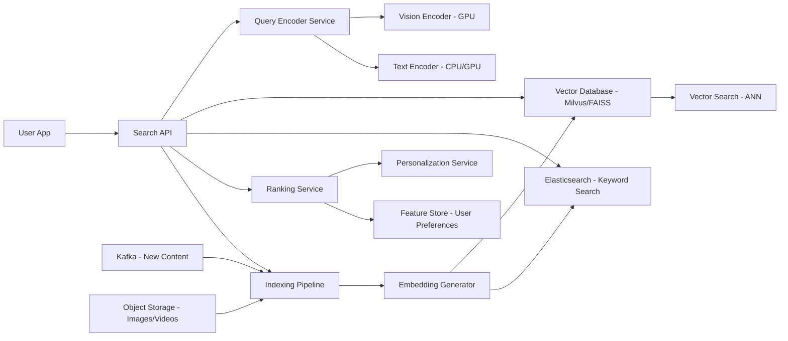

# Multimodal Search

**Category:** AI/ML System Design
**Difficulty:** 🔴 Hard
**Seniority:** Senior
**Companies:** Google, Pinterest
**Tags:** multimodal-embeddings, vector-search, ranking
**Time:** 90-120 min

---

## Problem Statement

Design a multimodal search system that allows users to search across images, videos, and text using any combination of modalities. Users can search for images using text queries ("sunset beach"), search for text using image queries (upload a photo to find similar content), or use mixed queries (text + image filters). The system must understand semantic similarity across modalities, rank results by relevance, and scale to billions of items.

Scale hint: 5B indexed items (images, videos, text documents), 100M daily queries, p99 latency under 200 ms, 50K queries per second (QPS) at peak. The system must handle real-time indexing of new content, support multiple languages, and provide personalized ranking. At senior level, you're expected to address multimodal embedding architecture, vector database scaling, hybrid search (semantic + keyword), ranking pipelines, and personalization.

## Clarifying Questions

- What modalities are supported? *Images, videos (keyframes), text (captions, descriptions, documents).*
- What's the query mix? *70% text-only, 20% image-only, 10% mixed (text + image).*
- What's the item distribution? *3B images, 1B videos (10 keyframes each = 10B frames), 1B text documents.*
- Latency requirements? *p99 under 200 ms for end-to-end search.*
- Freshness requirements? *New content indexed within minutes to hours.*
- Personalization? *Yes, rank based on user history and preferences.*
- What's the ranking objective? *Relevance (clicks, engagement), diversity, freshness.*
- Do we have existing search infrastructure? *Yes, can leverage existing text search (Elasticsearch) and image storage.*

## Requirements

### Functional

- Index multimodal content: extract embeddings for images, video keyframes, and text.
- Support query types: text-to-image, image-to-image, text-to-text, image-to-text, mixed queries.
- Retrieve top-K relevant items across modalities using semantic similarity.
- Re-rank results using hybrid signals (semantic similarity, keyword match, metadata, personalization).
- Handle real-time indexing of new content.
- Support filters (category, date, source, language) and pagination.

### Non-Functional

- p99 latency < 200 ms for search (embedding + retrieval + ranking).
- Throughput: 50K QPS at peak.
- Index size: ~5B items × embedding dimension (e.g., 768D) = ~15-20 TB.
- Update latency: new content searchable within 5 minutes.
- 99.9% availability; fallback to keyword search on failure.

### Out of Scope

- Content ingestion pipelines (assume items are available in storage).
- User interface design (focus on backend).
- Content moderation and safety filtering.

## Problem Framing

- **ML task:** learn a shared embedding space where semantically similar items across modalities are close (e.g., "dog" text ≈ dog image ≈ dog video frame).
- **Business metrics:** search engagement (CTR, dwell time), query success rate, user satisfaction, diversity of results.
- **Model metrics:** retrieval recall@K, ranking NDCG, cross-modal retrieval accuracy, embedding quality (intra-modal and cross-modal).
- **Key challenges:** scaling vector search to billions of embeddings, handling multiple modalities with different characteristics, real-time indexing, hybrid search (semantic + keyword), personalization, and cost control.
- **Why hard:** unlike unimodal search, multimodal requires aligning different modalities in a shared space. Vector databases at this scale require careful sharding, quantization, and approximation. Ranking must balance semantic similarity with traditional signals.

## Data Pipeline

- **Content ingestion:**
  - Images: extract from storage, preprocess (resize, normalize), encode with vision encoder (CLIP, SigLIP, or custom).
  - Videos: extract keyframes (1-5 per second), encode each frame, aggregate (mean pooling or attention).
  - Text: tokenize, encode with text encoder (same as CLIP text tower or separate), support multiple languages.
  - Metadata: extract category, tags, timestamp, source, language, engagement signals.
- **Embedding generation:**
  - Use contrastive learning model (CLIP-style) trained on (image, text) pairs to align modalities.
  - For video, use spatial-temporal encoder or frame-level aggregation.
  - Embedding dimension: 512-768 floats; optionally quantize to 8-bit for storage.
- **Indexing pipeline:**
  - Batch processing: encode items in batches, write to vector database (e.g., Milvus, Weaviate, or custom FAISS).
  - Real-time: stream new items through Kafka, encode on-the-fly, upsert to vector DB.
  - Inverted index: maintain keyword index (Elasticsearch) for hybrid search.
- **User feedback:**
  - Collect clicks, dwell time, skips, explicit ratings.
  - Use for re-ranking model training and embedding fine-tuning.

## Model Design

- **Base model: CLIP (Contrastive Language-Image Pre-training)**
  - Vision encoder: Vision Transformer (ViT) or ResNet.
  - Text encoder: Transformer.
  - Trained on 400M (image, text) pairs to align modalities.
  - Outputs 512D embeddings; cosine similarity measures cross-modal similarity.

- **Enhancements:**
  - **Fine-tuning on domain data:** train on platform-specific (image, caption) pairs to improve relevance.
  - **Video extension:** add temporal encoder (VideoMAE, ViViT) or aggregate frame embeddings with attention.
  - **Multilingual text:** use multilingual text encoder (mCLIP, LaBSE) or translate to English.
  - **Metadata fusion:** concatenate metadata embeddings (category, tags) with content embeddings.

- **Embedding architecture:**
  - **Option 1: Single shared space** - All modalities in one embedding space. Simple, but may not capture modality-specific nuances.
  - **Option 2: Modality-specific encoders + projection** - Separate encoders per modality, project to shared space. More flexible, better for heterogeneous data.
  - **Choice:** Option 2 with CLIP-style contrastive loss.

- **Training:**
  - Contrastive loss: maximize similarity for positive pairs, minimize for negatives.
  - Hard negative mining: include difficult negatives (similar but incorrect).
  - Temperature scaling for softmax.
  - Batch size: large (10K+) for diverse negatives.

- **Query encoding:**
  - Text query: encode with text encoder.
  - Image query: encode with vision encoder.
  - Mixed query: encode text and image separately, fuse (weighted average or concatenation).
  - Filters: applied post-retrieval or integrated into query (filter embeddings).

```text
FUNCTION search(query, filters, top_k=100)
    SET query_embedding ← encode_query(query)
    SET candidates ← vector_search(query_embedding, top_k=1000, filters)
    SET reranked ← rerank(candidates, query_embedding, user_context, filters)
    RETURN reranked[:top_k]

FUNCTION encode_query(query)
    IF query.type = "text" THEN
        RETURN text_encoder(query.text)
    ELSE IF query.type = "image" THEN
        RETURN vision_encoder(query.image)
    ELSE IF query.type = "mixed" THEN
        SET text_emb ← text_encoder(query.text)
        SET image_emb ← vision_encoder(query.image)
        RETURN 0.6 * text_emb + 0.4 * image_emb    // learned weights
    END IF

FUNCTION rerank(candidates, query_emb, user_context, filters)
    // Hybrid scoring: semantic + keyword + personalization
    FOR item IN candidates
        SET semantic_score ← cosine(query_emb, item.embedding)
        SET keyword_score ← keyword_match(query.text, item.text)    // from Elasticsearch
        SET personalization_score ← user_context.preference_score(item.category)
        SET freshness_score ← decay(item.timestamp, half_life=7_days)
        SET item.final_score ←
            w1 * semantic_score +
            w2 * keyword_score +
            w3 * personalization_score +
            w4 * freshness_score
    END FOR
    RETURN sort_by(candidates, final_score, descending=True)
```

## Training & Evaluation

- **Offline evaluation:**
  - Retrieval metrics: recall@K, precision@K, MRR for cross-modal queries.
  - Ranking metrics: NDCG, MAP for re-ranked results.
  - A/B test: compare CLIP vs fine-tuned model on held-out query logs.
- **Dataset:**
  - Human-labeled relevance judgments for sample queries.
  - Synthetic pairs: (image, caption) from platform data.
  - Cross-modal pairs: (image, related text), (text, related images).
- **Online evaluation:**
  - A/B test new embedding models and ranking weights.
  - Metrics: CTR, dwell time, query success rate, zero-result rate.
  - Monitor for bias and diversity (category distribution, popularity bias).
- **Fine-tuning:**
  - Continual fine-tuning on new (image, text) pairs.
  - Domain adaptation for specific categories (fashion, food, travel).
  - Personalization: learn user-specific embedding adapters.

## Serving Architecture



1. Search request arrives at API; query encoded by Query Encoder (vision or text).
2. Vector search retrieves top-K candidates using approximate nearest neighbor (ANN).
3. Parallel keyword search in Elasticsearch for exact matches.
4. Ranking Service merges results, applies personalization and freshness, re-ranks.
5. Results returned to user; engagement logged for feedback.

**Vector database design:**
- **Sharding:** shard by embedding space (e.g., IVF-FAISS with 10K clusters) or by category.
- **Quantization:** product quantization (PQ) to compress embeddings (8-bit per sub-vector).
- **Index type:** HNSW (Hierarchical Navigable Small World) for fast ANN search.
- **Storage:** 5B embeddings × 768D × 4 bytes = ~15 TB raw; with PQ compression ~4 TB.
- **Replication:** 3 replicas for availability; read from local replica for low latency.

**Real-time indexing:**
- New content published to Kafka.
- Embedding Generator consumes batches, encodes items.
- Vector DB upserts new embeddings (HNSW supports incremental updates).
- Elasticsearch updated for keyword search.
- Indexing latency: < 5 minutes end-to-end.

**Latency budget (p99, search):**

| Step | Budget |
|---|---|
| Query encoding | 20 ms (text) / 50 ms (image) |
| Vector search (ANN) | 80 ms |
| Keyword search | 30 ms |
| Ranking & merging | 30 ms |
| API overhead | 10 ms |
| Total | 170 ms |

**Capacity planning:**
- 50K QPS × 80 ms vector search = 4M queries/second equivalent.
- HNSW can handle ~10K QPS per shard; need ~5-10 shards globally.
- GPU encoding: 1 GPU can encode ~1000 images/sec; need ~50 GPUs for peak image query load.
- CPU text encoding: 1 core can encode ~500 queries/sec; need ~100 cores.

**Fallback:**
- If vector DB unavailable, use keyword search only.
- If encoder unavailable, use cached embeddings for frequent queries.
- If ranking unavailable, return vector search results with simple scoring.

## Monitoring & Iteration

- **Search quality:** zero-result rate, CTR, dwell time, skip rate, query reformulation rate.
- **Latency:** p50, p95, p99 per component (encoding, vector search, ranking).
- **Index health:** embedding distribution drift, index size, update lag.
- **Model metrics:** retrieval recall@K on eval set, embedding similarity calibration.
- **User feedback:** explicit ratings, implicit signals (clicks, saves, shares).
- **Bias monitoring:** category distribution of results, popularity bias, demographic fairness.
- **Cost tracking:** GPU/CPU utilization, storage cost, query cost.
- **Iteration loop:**
  - Weekly analysis of failure cases (low CTR queries).
  - Retrain embeddings on new data monthly.
  - A/B test ranking weights and features.
  - Fine-tune on high-value categories.

## Trade-offs

| Decision | Option A | Option B | Choice & Why |
|---|---|---|---|
| Embedding space | Single shared space | Modality-specific + projection | Projection: better for heterogeneous data, more flexible |
| Vector search | Exact (brute-force) | Approximate (HNSW) | Approximate: necessary for billions of items; trade small accuracy for speed |
| Quantization | Full precision (float32) | Product quantization (8-bit) | PQ: 4x storage reduction, acceptable accuracy loss |
| Indexing | Batch only | Batch + real-time | Hybrid: batch for efficiency, real-time for freshness |
| Ranking | Semantic only | Hybrid (semantic + keyword) | Hybrid: captures exact matches and semantic similarity |

## Follow-up Questions

1. **How do you handle video search efficiently?** Extract keyframes (1-5 per second), encode each frame, aggregate with attention or mean pooling. Index frame-level embeddings; at query time, search across frames and deduplicate by video.
2. **How do you handle multilingual queries?** Use multilingual text encoder (mCLIP) or translate queries to English before encoding. Index content in original language; cross-lingual alignment via multilingual embeddings.
3. **How do you personalize results?** Learn user preference embeddings from engagement history; adjust ranking score based on user-item affinity. Can use lightweight user towers or cache user preferences.
4. **What if a user uploads a low-quality image?** Apply image enhancement (super-resolution, denoising) before encoding. Use multiple crops/patches to capture details. Fallback to keyword search if image quality is too low.
5. **How do you handle category-specific searches (e.g., fashion vs food)?** Train category-specific embedding adapters or fine-tune separate models per category. Use category as a filter and adjust ranking weights per category.
6. **How would you add audio search (e.g., search by humming a tune)?** Add audio encoder (Audio spectrogram transformer) to the multimodal space. Align audio embeddings with text/image using contrastive learning on (audio, text) pairs.

## Common Mistakes

- Using brute-force vector search at billion scale; must use ANN.
- Ignoring keyword search; semantic alone misses exact matches.
- Not handling real-time indexing; stale content hurts user experience.
- Single embedding space for all modalities; modality-specific nuances lost.
- No fallback mechanism; vector DB outage breaks search entirely.
- Ignoring personalization; generic results don't engage users.
- Not monitoring bias; popularity bias dominates results.

## Key Takeaways

- Multimodal search requires aligning different modalities in a shared embedding space via contrastive learning.
- Vector databases at billion scale need sharding, quantization, and ANN (HNSW).
- Hybrid search (semantic + keyword) captures both similarity and exact matches.
- Real-time indexing is critical for content freshness; stream processing + incremental updates.
- Ranking must balance semantic similarity, keyword match, personalization, and freshness.
- Monitor for bias and diversity; popularity bias can degrade long-term engagement.
- Fallback mechanisms ensure availability when components fail.
