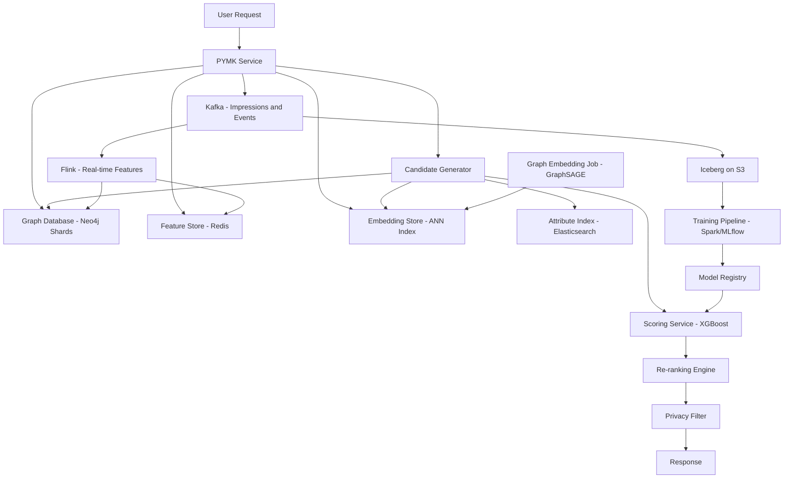

# People You May Know

**Category:** AI/ML System Design
**Difficulty:** 🔴 Hard
**Seniority:** Senior
**Companies:** LinkedIn, Facebook, Twitter/X, Instagram
**Tags:** graph-ml, recommendations, privacy, scalability, real-time, cold-start
**Time:** 90-120 min

---

## Problem Statement

Design the "People You May Know" (PYMK) recommendation system for a professional social network like LinkedIn. The system should suggest relevant connections for users based on their professional network, interests, and activity patterns.

Scale: 1B users, 500M connections, ~50M new connections/week, ~100M PYMK requests/day (~1.2K QPS average, ~5K peak). The system must return 10-20 personalized suggestions per request within 200ms p99 latency.

Key challenges: graph scale (1B nodes, 500M edges), real-time updates (new connections affect recommendations immediately), privacy constraints (can't expose sensitive graph data), cold start for new users, and balancing relevance with diversity.

## Clarifying Questions

- What defines a "good" recommendation? *Users who are likely to connect based on shared context (company, school, industry, mutual connections, interests).*
- What signals are available? *Graph structure (connections, follows), profile data (company, school, skills, location), activity (likes, comments, posts), interactions (profile views, messages).*
- How fresh must recommendations be? *New connections should affect recommendations within minutes; user profile updates within hours.*
- Privacy constraints? *Can't expose who viewed whose profile; can't reveal sensitive graph distances; must comply with GDPR/privacy regulations.*
- What about new users with minimal connections? *Yes, ~5% of users have <5 connections; need cold-start strategy.*
- Latency budget? *200ms p99 for the entire recommendation pipeline.*
- Existing system? *Assume replacing a simple mutual-count based system.*

## Requirements

### Functional

- Return 10-20 personalized connection suggestions per request.
- Balance multiple relevance signals: mutual connections, shared attributes, interaction history.
- Respect user preferences: blocked users, "not interested" feedback, hidden suggestions.
- Support real-time updates from new connections and profile changes.
- Provide explanations for recommendations ("3 mutual connections", "both work at Google").

### Non-Functional

- p99 latency 200ms; ~5K QPS peak.
- 99.99% availability; degrade gracefully on failure.
- New connections reflected in recommendations within 5 minutes.
- Privacy-preserving: no exposure of sensitive graph information.
- Support 1B+ users with 500M+ edges.

### Out of Scope

- Friend suggestions for personal social networks (different privacy model).
- Content recommendations (posts, jobs, groups).
- Messaging and connection request handling.

## Problem Framing

- **Objective:** maximize connection acceptance rate while ensuring relevance and diversity.
- **Relevance score:** combination of graph features (mutual connections, graph distance), attribute similarity (company, school, industry, skills), and interaction signals (profile views, engagement).
- **Business metrics:** connection acceptance rate, PYMK engagement (clicks, sends), network growth rate, user retention.
- **Model metrics:** precision@K, recall@K, NDCG, calibration of acceptance probability.
- **Constraints:** graph scale (1B nodes), real-time graph updates, privacy (can't expose full graph), cold start, position bias in UI.

## Data Pipeline

**Data sources**

- **Graph:** connections (undirected edges), follows (directed edges), group memberships.
- **Profile:** company, school, industry, skills, location, tenure.
- **Activity:** posts, likes, comments, shares, profile views.
- **Interactions:** messages, connection requests (sent/received), "not interested" feedback.
- **Engagement:** clicks on PYMK suggestions, sends from PYMK.

**Label construction**

- **Positive label:** user sends connection request to suggested person and it's accepted.
- **Negative label:** user sees suggestion but doesn't interact, or clicks "not interested".
- **Label delay:** connection acceptance can take days; use early signals (click, send request) as proxy labels.
- **Selection bias:** only shown suggestions get labels; use exploration traffic for unbiased evaluation.

**Features**

| Category | Examples | Freshness |
|---|---|---|
| Graph | Mutual connections count, Jaccard similarity of neighborhoods, graph distance (2-hop, 3-hop), common groups | Real-time |
| Attribute | Same company, same school, same industry, same location, skill overlap | Daily |
| Interaction | Profile views (bidirectional), message history, comment interactions, likes on same posts | Real-time |
| Temporal | Time since last interaction, recency of mutual connection formation, tenure at company | Real-time |
| Popularity | Connection count, profile views, activity level | Daily |
| Context | User's recent activity, recent connections, search history | Real-time |

**Storage**

- **Graph database:** Neo4j or custom graph store for adjacency lists (sharded by user ID).
- **Feature store:** Redis/Aerospike for user profile and interaction features.
- **Embedding store:** Distributed key-value store for node embeddings (billions of embeddings).
- **Offline:** S3/Iceberg for training data and historical snapshots.

## Model Design

### Multi-stage approach

| Stage | Input | Output | Method | Budget |
|---|---|---|---|---|
| Candidate generation | 1B users | ~1000 | Graph traversal (2-hop, random walk), attribute-based retrieval | 80ms |
| Scoring | ~1000 | ~100 | Feature-based ML model (GBDT or DNN) | 80ms |
| Re-ranking | ~100 | 10-20 | Diversity, privacy filters, business rules | 20ms |

### Candidate generation

**Graph-based retrieval**

- **2-hop neighbors:** users at distance 2 in the graph (friends of friends).
- **Random walk with restart:** explore graph neighborhood, collect frequently visited nodes.
- **Common attributes:** users sharing company, school, industry, or location.
- **Graph embeddings:** pre-computed node embeddings (Node2Vec, GraphSAGE) for ANN search.

**Implementation**

```text
FUNCTION generate_candidates(user_id):
    SET candidates ← EMPTY_SET

    // 2-hop neighbors (friends of friends)
    SET friends ← graph.get_neighbors(user_id)
    FOR f IN friends:
        SET fof ← graph.get_neighbors(f)
        candidates ← candidates ∪ fof

    // Attribute-based candidates
    SET profile ← feature_store.get_profile(user_id)
    SET candidates ← candidates ∪
        attribute_index.query(company=profile.company, limit=200)
    SET candidates ← candidates ∪
        attribute_index.query(school=profile.school, limit=200)

    // ANN search on embeddings
    SET u_emb ← embedding_store.get(user_id)
    SET candidates ← candidates ∪
        ann_search(u_emb, k=300)

    // Remove self, existing connections, blocked users
    SET candidates ← filter(candidates,
        NOT is_self AND
        NOT is_connected(user_id, candidate) AND
        NOT is_blocked(user_id, candidate))

    RETURN dedupe(candidates)[0:1000]
```

**Optimizations**

- Pre-compute 2-hop neighborhoods for high-degree nodes (celebrities, companies).
- Cache attribute-based candidate lists for common companies/schools.
- Use inverted indices for attribute lookups.
- Bloom filters for fast "already connected" checks.

### Scoring model

**Model options**

| Approach | Pros | Cons |
|---|---|---|
| Hand-crafted score | Simple, interpretable | Limited, hard to tune |
| **Gradient-boosted trees (XGBoost)** | Best tabular performance, handles missing values | Less interpretable than linear |
| Logistic regression | Interpretable, fast | Limited feature interactions |
| Graph neural network | Captures graph structure | Complex serving, latency |

**Chosen:** Gradient-boosted trees with:

- ~300 features (graph, attribute, interaction, temporal).
- Segment-specific models for different user types (new users, power users).
- SHAP values for explanations.

**Feature engineering**

- **Graph features:** mutual count, Jaccard similarity, Adamic-Adar index, common groups.
- **Attribute features:** same company (binary + tenure overlap), same school (binary + graduation year proximity), skill overlap (Jaccard), location proximity.
- **Interaction features:** profile view count (bidirectional), message count, comment co-occurrence.
- **Temporal features:** recency of mutual connection formation, time since last interaction.
- **Popularity features:** candidate's connection count (normalized), activity level.

```text
FUNCTION score_candidates(user_id, candidates):
    SET u_features ← feature_store.get_user(user_id)
    SET scores ← []
    FOR c IN candidates:
        SET c_features ← feature_store.get_user(c)
        SET features ← assemble(
            u_features,
            c_features,
            graph_features(user_id, c),
            interaction_features(user_id, c),
            temporal_features(user_id, c)
        )
        SET p_accept ← gbdt.predict(features)
        SET p_accept ← calibrate(p_accept)
        SET explanation ← shap.top_features(features, k=3)
        scores.append({candidate: c, score: p_accept, explanation})
    RETURN sort_by_score(scores)[0:100]
```

### Re-ranking

- **Diversity:** ensure mix of companies, schools, industries (max 2 from same company).
- **Privacy filters:** don't show users who have blocked viewing, don't reveal sensitive graph distances.
- **Business rules:** boost recruiters for job seekers, boost alumni for university pages.
- **Explanation generation:** "3 mutual connections", "both at Google", "Stanford alumni".

### Cold start

**New users (minimal connections)**

- Rely on profile attributes: suggest people from same company, school, location.
- Use onboarding data: ask user to add company, school, interests during signup.
- Leverage email contacts (with permission) to find existing members.
- Suggest popular users in their industry/region.

**New members (recently joined)**

- Content-based embeddings from profile (skills, interests) place them in embedding space.
- Attribute-based retrieval (same company/school) works immediately.
- Boost new members in recommendations for users with similar attributes.

## Training & Evaluation

**Training data**

- 6-12 months of PYMK impressions with labels (accept, ignore, not interested).
- Positive labels: accepted connection requests.
- Negative labels: shown but no action, or "not interested".
- Sample negatives (shown but ignored) with appropriate weights.

**Validation strategy**

- **Time-based split:** train on months 1-9, validate on month 10, test on month 11.
- Group by user to prevent user leakage.
- Account for selection bias with inverse propensity scoring.

**Offline metrics**

- Precision@K, recall@K for K=10, 20.
- NDCG for ranking quality.
- Calibration: predicted vs observed acceptance rate.
- Coverage: percentage of users with at least one acceptable suggestion.

**Online evaluation**

- A/B test with user-level randomization.
- Primary metrics: connection acceptance rate, PYMK engagement (clicks, sends).
- Secondary metrics: network growth rate, user retention.
- Holdout group with random suggestions for unbiased evaluation.

**Exploration**

- Epsilon-greedy: 5-10% random suggestions for exploration.
- Thompson sampling for bandit-style exploration.
- Logged propensities for counterfactual evaluation.

## System Architecture



**Request flow**

1. PYMK service fetches user features from feature store.
2. Candidate generator runs in parallel:
   - Graph traversal for 2-hop neighbors.
   - Attribute index queries for same company/school.
   - ANN search on embeddings.
3. Merge candidates, filter out existing connections and blocked users.
4. Scoring service computes features and scores candidates with GBDT.
5. Re-ranking applies diversity, privacy filters, and business rules.
6. Return top 10-20 suggestions with explanations.

**Latency budget (p99 200ms)**

| Step | Budget |
|---|---|
| Feature fetch | 20ms |
| Candidate generation (parallel) | 80ms |
| Filtering | 10ms |
| Scoring (1000 candidates) | 60ms |
| Re-ranking + privacy | 20ms |
| Network + headroom | 10ms |

**Graph storage**

- Adjacency lists sharded by user ID across 100+ nodes.
- Each shard stores outgoing edges for a range of user IDs.
- For 1B users with avg 500 connections: ~500B edges → ~2TB (compressed).
- In-memory cache for hot users (high-degree nodes, recently active).

**Privacy considerations**

- Don't expose exact mutual connection count if < 3 (show "mutual connections" instead).
- Don't reveal who viewed whose profile in explanations.
- Anonymize graph distances in explanations.
- Comply with GDPR: right to be forgotten, data minimization.

## Monitoring & Iteration

**System monitoring**

- Latency per stage, candidate counts per source, timeout rates.
- Graph database query latency, cache hit rates.
- Feature store staleness, embedding index freshness.

**Model health**

- Calibration: predicted vs observed acceptance rate in real time.
- Feature distribution shift (PSI), missing feature rates.
- Online/offline feature skew comparison.
- Prediction distribution monitoring.

**Graph health**

- Graph size (nodes, edges), degree distribution.
- Connected components, graph diameter.
- New edge rate, graph update latency.

**Privacy monitoring**

- Audit log of graph queries.
- Check for potential privacy leaks in explanations.
- Monitor blocked user exposure.

**Ecosystem metrics**

- Coverage: % of users with acceptable suggestions.
- Diversity: company/school/industry distribution in suggestions.
- Cold-start performance: new user acceptance rate.

**Retraining and rollout**

- Weekly retrain on latest data.
- Automated validation (precision@K not worse than production).
- Shadow scoring before canary.
- Canary at 1%, gradual ramp.

**Graph updates**

- Real-time edge updates via Kafka → Flink → graph database.
- Batch re-computation of graph embeddings weekly.
- Incremental embedding updates for high-degree nodes.

## Trade-offs

| Decision | Option A | Option B | Choice & Why |
|---|---|---|---|
| Candidate source | Graph-only (2-hop) | Graph + attributes + embeddings | Hybrid: graph alone misses cold-start; attributes add coverage |
| Scoring model | Hand-crafted score | GBDT with 300 features | GBDT: better accuracy, handles complex feature interactions |
| Graph traversal | Real-time query | Pre-computed 2-hop | Real-time: ensures freshness; pre-compute for high-degree nodes |
| Embeddings | None | GraphSAGE node embeddings | Embeddings: capture structural similarity, enable ANN search |
| Privacy | Show exact mutual count | Bucket mutual counts | Bucket: prevents reverse-engineering of private connections |
| Exploration | None | 5% epsilon-greedy | Exploration: unbiased data, cold-start discovery |

## Follow-up Questions

1. **How do you handle high-degree nodes (celebrities, companies)?** Pre-compute their neighborhoods, cap their candidate contribution, use attribute-based retrieval instead of graph traversal.
2. **How do you ensure recommendations don't expose sensitive information?** Bucket mutual counts, don't show profile viewers, anonymize graph distances, audit explanations regularly.
3. **How do you handle real-time graph updates?** Stream edge updates via Kafka, update adjacency lists in graph database within seconds, invalidate affected caches.
4. **What if a user has no connections (completely new)?** Use profile attributes (company, school, location), suggest popular users in their industry, leverage email contacts with permission.
5. **How do you balance relevance with diversity?** Re-ranking with company/school caps, ensure mix of industries, use MMR on embeddings for diversity.
6. **How do you handle GDPR deletion requests?** Delete user from graph database, feature stores, and logs; retrain embeddings; handle embedding IDs for deleted users.
7. **How do you measure if recommendations are actually useful?** Track connection acceptance rate, post-connection engagement (messages, interactions), long-term network value.

## Common Mistakes

- Relying only on mutual connections (fails for cold start).
- Exposing sensitive graph information in explanations.
- Not handling high-degree nodes (performance bottleneck).
- Ignoring privacy constraints (regulatory risk).
- Random train/test splits causing user leakage.
- Not accounting for selection bias in training data.
- Underestimating graph traversal latency at scale.

## Key Takeaways

- PYMK requires hybrid retrieval: graph-based for relevance, attribute-based for coverage, embeddings for structural similarity.
- Privacy is a first-class concern: bucket counts, anonymize explanations, audit regularly.
- Real-time graph updates are essential for freshness; streaming architecture handles edge updates.
- Cold start requires attribute-based fallbacks and onboarding data collection.
- Multi-stage approach (generation → scoring → re-ranking) balances relevance, diversity, and privacy.
- Evaluate with time-based splits, exploration for unbiased data, and long-term network value metrics.
