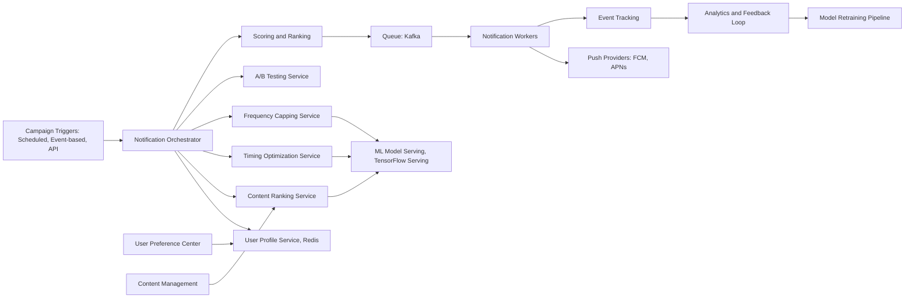

# Personalized Push Notifications

**Category:** AI/ML System Design
**Difficulty:** 🟡 Medium
**Seniority:** Mid-level
**Companies:** Braze, Airship, OneSignal, Leanplum, Iterable
**Tags:** recommendation, scheduling, ab-testing, user-segmentation, timing-optimization, ml-ranking
**Time:** 60-90 min

---

## Problem Statement

Design a personalized push notification system that delivers the right message to the right user at the right time. The system serves a mobile app with **10M monthly active users** across e-commerce, content, and engagement use cases.

The system must handle **100M push notifications/day** with intelligent personalization of content, timing, and frequency. Key requirements include A/B testing capabilities, user preference management, and compliance with opt-out regulations.

## Clarifying Questions

- What types of notifications? *Promotional, transactional, content updates, re-engagement.*
- What's the target engagement rate? *Current baseline 8% open rate; target 12%.*
- What's the allowable frequency? *Max 3-5 notifications/day per user, configurable.*
- Do we need real-time personalization? *Yes, timing should adapt to user's local time and activity patterns.*
- What data is available? *User profile, app activity, purchase history, notification history, preferences.*
- What's the latency requirement? *Generate and schedule within 1 second of trigger.*
- Do we need multi-language support? *Yes, notifications in 20+ languages.*
- Any compliance requirements? *GDPR, opt-in consent, quiet hours.*

## Requirements

### Functional

- Personalized content selection based on user interests and behavior.
- Optimal send time prediction per user (time-of-day, day-of-week).
- Frequency capping and quiet hours enforcement.
- A/B testing framework for content, timing, and frequency.
- User preference center (opt-in/out, category preferences, quiet hours).
- Multi-language support with localized content.
- Campaign management for targeted blasts.

### Non-Functional

- 100M notifications/day throughput.
- p99 latency < 1 s for notification generation.
- Open rate improvement ≥ 50% over baseline (8% → 12%).
- 99.9% availability for scheduling and delivery.
- Support 10M+ user profiles with real-time updates.
- Compliance with opt-out regulations (unsub within 24 hours).

### Out of Scope

- In-app messaging (only push notifications).
- Email or SMS channels.
- Deep linking to specific app screens (assumed handled by app).

## Problem Framing

- **Objective:** maximize user engagement while minimizing annoyance and opt-outs through intelligent personalization.
- **Business metrics:** open rate, click-through rate, conversion rate, opt-out rate, retention.
- **Model/system metrics:**
  - Content ranking: precision@k, NDCG for recommended items.
  - Timing prediction: accuracy of optimal send time windows.
  - Frequency optimization: balance between engagement and opt-out.
  - A/B testing: statistical significance, experiment duration.
- **Constraints:** scale (100M/day), latency (real-time), compliance (opt-out), user experience (don't spam).

## Data Pipeline

**Data sources**

- User profile: demographics, location, language, device type, preferences.
- Behavioral data: app sessions, page views, feature usage, purchase history.
- Notification history: sent notifications, open/click events, opt-outs.
- Content catalog: products, articles, offers, campaigns with metadata.
- External signals: time of day, day of week, holidays, weather (optional).

**Feature engineering**

- User features: engagement score, activity patterns, preferred categories, purchase propensity.
- Content features: category, popularity, freshness, relevance score.
- Context features: time since last notification, time since last app open, current activity state.
- Interaction features: historical CTR per category, time-of-day responsiveness.

**Storage**

- User profiles in Redis (hot data) + PostgreSQL (persistent).
- Notification history in ClickHouse or BigQuery for analytics.
- Content catalog in PostgreSQL with Redis cache.
- A/B experiment configurations in PostgreSQL.

```text
ON user_activity_updated(user, event):
    UPDATE user_profile SET
        last_active = NOW(),
        session_count = session_count + 1,
        features = recompute_features(user)
    CACHE user_profile in Redis

ON notification_delivered(user, notification):
    RECORD event in ClickHouse
    UPDATE user_profile SET
        last_notification = NOW(),
        notification_count = notification_count + 1
    IF notification.opened:
        UPDATE user_profile SET
            open_count = open_count + 1,
            last_open = NOW()
```

## Model Design

**ML components**

1. **Content ranking model:** Recommends best content for each user from available candidates.
2. **Timing optimization model:** Predicts optimal send time for each user.
3. **Frequency optimization model:** Determines if user should receive a notification now.
4. **Propensity model:** Predicts likelihood of open/click for each (user, content, time) combination.

**Model choices**

| Component | Option A | Option B | Choice |
|---|---|---|---|
| Content ranking | Collaborative filtering | Wide & Deep learning | Wide & Deep: combines collaborative + content features |
| Timing optimization | Rule-based (user's active hours) | LSTM on activity patterns | LSTM: learns personalized patterns |
| Frequency capping | Fixed limits | Reinforcement learning | Fixed with dynamic adjustment: simpler, interpretable |
| Propensity scoring | Logistic regression | Gradient boosted trees | XGBoost: handles non-linearities well |

**Content ranking architecture**

```text
FUNCTION rank_content(user, available_content, context):
    // Candidate generation
    SET candidates ← []
    FOR content IN available_content:
        IF matches_user_preferences(user, content):
            APPEND content TO candidates

    // Feature extraction
    FOR c IN candidates:
        SET features ← {
            user_features: get_user_features(user),
            content_features: get_content_features(c),
            interaction_features: get_interaction_features(user, c),
            context_features: context
        }

    // Scoring
    SET scores ← xgboost_model.predict(features)

    // Diversity adjustment
    SET ranked ← diversify(candidates, scores, user.history)

    RETURN ranked[:10]  // top 10 candidates
```

**Timing optimization**

```text
FUNCTION predict_optimal_time(user):
    SET activity_pattern ← get_user_activity_windows(user)  // last 30 days
    SET features ← {
        hour_of_day: activity_pattern.hourly_distribution,
        day_of_week: activity_pattern.daily_distribution,
        last_open_time: user.last_open,
        timezone: user.timezone
    }
    SET optimal_hours ← lstm_model.predict(features)  // returns probability distribution
    RETURN top_k_hours(optimal_hours, k = 3)
```

**Combined scoring**

```text
FUNCTION score_notification(user, content, time):
    SET content_score ← content_ranking.score(user, content)
    SET timing_score ← timing_model.score(user, time)
    SET propensity_score ← propensity_model.predict({
        user: user,
        content: content,
        time: time,
        recent_notifications: user.recent_notifications
    })
    SET frequency_penalty ← calculate_frequency_penalty(user)
    RETURN (
        0.4 * content_score +
        0.3 * timing_score +
        0.2 * propensity_score -
        0.1 * frequency_penalty
    )
```

## Training & Evaluation

**Training data**

- Content ranking: past notification impressions with open/click labels (positive/negative).
- Timing optimization: user activity logs with notification timestamps and outcomes.
- Propensity model: (user, content, time, outcome) tuples from historical data.

**Evaluation**

- **Offline metrics:**
  - Content ranking: AUC, precision@k, NDCG@k.
  - Timing: accuracy of predicted optimal windows vs actual best windows.
  - Propensity: AUC, log loss on held-out data.

- **Online metrics:**
  - Open rate, click-through rate, conversion rate.
  - Opt-out rate, unsubscription rate.
  - User engagement (DAU/MAU, session length).

**A/B testing framework**

- Experiment configuration: define variants (control vs treatment).
- Traffic allocation: hash-based user assignment to ensure consistency.
- Statistical significance: sequential testing or fixed-horizon tests.
- Guardrail metrics: monitor opt-out rate; stop if negative impact.

## Serving Architecture



**Latency budget (p99)**

| Step | Budget |
|---|---|
| Fetch user profile | 50 ms |
| Content candidate generation | 100 ms |
| ML model scoring | 200 ms |
| Timing and frequency check | 50 ms |
| A/B experiment assignment | 20 ms |
| Queue and schedule | 30 ms |
| **Total** | **~450 ms**, headroom to 1 s |

**Scaling**

- 100M notifications/day ≈ 1,160 notifications/second average, 5K peak.
- Content ranking: XGBoost on CPU handles ~10K predictions/s → 1-2 instances.
- Timing model: LSTM inference on GPU or optimized CPU → 1 GPU instance.
- Notification workers: horizontally scalable based on queue depth.
- Push providers: FCM/APNs have rate limits; implement batching and backoff.

## Monitoring & Iteration

- **System metrics:**
  - Throughput (notifications/second), queue depth, error rate.
  - Latency percentiles for each service.
  - Push provider success rates, retry rates.

- **Business metrics:**
  - Open rate, CTR, conversion rate by campaign and segment.
  - Opt-out rate, unsubscription rate (monitor closely).
  - User engagement trends.

- **ML monitoring:**
  - Feature distribution drift (user behavior changes).
  - Prediction distribution drift (model degradation).
  - A/B test results and statistical significance.

- **Feedback loop:**
  - Daily retraining of propensity model on new data.
  - Weekly retraining of content ranking model.
  - Monthly review of timing model performance.
  - Quarterly A/B test of major model changes.

## Trade-offs

| Decision | Option A | Option B | Choice & Why |
|---|---|---|---|
| Content ranking | Collaborative filtering | Wide & Deep | Wide & Deep: handles cold start better with content features |
| Timing | Fixed hours per user | Learned patterns | Learned: adapts to changing behavior |
| Frequency | Global cap | Per-user adaptive | Per-user: power users can handle more, casual users fewer |
| ML serving | Real-time inference | Pre-computed batches | Real-time: enables event-driven triggers |
| A/B testing | Client-side | Server-side | Server-side: consistent, no app updates needed |

## Follow-up Questions

1. **How do you handle cold-start users with no history?** Use demographic features, onboarding survey responses, and default to popular content. Gradually personalize as data accumulates.
2. **A user opts out of all notifications. How do you handle re-engagement?** Respect the opt-out permanently. For re-engagement, use in-app messages or email (if permitted), not push.
3. **How do you handle time zones and travel?** Use device timezone with fallback to profile timezone. Detect travel via location changes and adjust timing accordingly.
4. **What if a campaign needs to go out immediately (breaking news)?** Bypass personalization for urgent campaigns, but still respect frequency caps and quiet hours.
5. **How do you prevent notification fatigue?** Implement frequency capping, quiet hours, and a "cooldown" period after opt-out. Monitor opt-out rate per user segment.
6. **How would you add deep learning for content ranking?** Use transformer-based models for content understanding, user embeddings for collaborative filtering, and combine with wide features.

## Common Mistakes

- Ignoring frequency capping and spamming users.
- Not respecting quiet hours, leading to user annoyance.
- Cold-start problem: new users get irrelevant or no notifications.
- Not monitoring opt-out rate as a key metric.
- A/B testing without statistical significance or proper guardrails.
- Forgetting to handle time zones correctly for global users.
- Not accounting for device push token invalidation/uninstallation.

## Key Takeaways

- Personalization requires balancing content, timing, and frequency optimization.
- Multi-stage ML pipeline (ranking → timing → propensity) provides flexibility.
- A/B testing is essential for measuring impact and avoiding negative changes.
- Monitor opt-out rate as closely as engagement metrics.
- Cold-start users need special handling with demographic and popular content.
- Real-time ML serving enables event-driven, personalized notifications.
- Compliance (opt-out, quiet hours) is not optional—it's a requirement.
