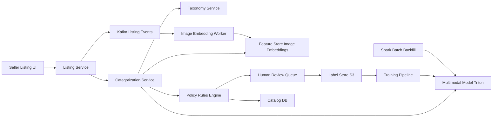

# Product Categorization

**Category:** AI/ML System Design
**Difficulty:** 🟢 Easy
**Seniority:** mid
**Companies:** Amazon, Walmart, eBay, Shopify, Etsy, Instacart, Flipkart
**Tags:** hierarchical-classification, multimodal, taxonomy, active-learning, class-imbalance, label-noise
**Time:** 45 min

---

## Problem Statement

Design a system that automatically assigns every product listed in an e-commerce catalog to the correct node of a product taxonomy (e.g. `Electronics > Audio > Headphones > Over-Ear`) using its title, description, attributes, and images.

The marketplace has **500M listings**, receives **5M new or updated listings per day** from millions of third-party sellers, and maintains a taxonomy of about **10K leaf categories** across 5-6 levels. Category drives search filters, browse navigation, ads targeting, fees, and compliance rules (e.g. restricted items), so mistakes are visible and sometimes costly.

## Clarifying Questions

- Is seller-provided category available? *Yes, sellers pick one, but it is wrong ~20-30% of the time (often too generic or chosen for lower fees).*
- Single or multi-label? *Single leaf per product (multi-label is a follow-up).*
- Latency? *Two modes: a real-time suggestion during listing creation (< 200 ms), and batch re-categorization of the catalog.*
- How much labeled data? *~20M products with human-verified categories, extremely long-tailed: top 500 leaves cover 70% of items, many leaves have < 100 examples.*
- Does the taxonomy change? *Yes, merchandising adds/splits/merges ~100 nodes per quarter.*
- Languages and modalities? *Mostly English with 10 other languages; ~95% of listings have at least one image.*
- What if the model is unsure? *Fall back to a coarser level or send to a human review queue (budget ~50K reviews/day).*

## Requirements

### Functional

- Predict a leaf category with confidence for every new/updated listing; return top-3 suggestions in the listing UI.
- Back off to a higher taxonomy level when leaf confidence is low.
- Route low-confidence or high-risk items (restricted categories) to human review.
- Re-categorize the existing catalog when the taxonomy or model changes.

### Non-Functional

- Throughput: 5M/day (~60/s average, ~500/s peak during bulk seller uploads); batch backfill of 500M in < 24 h.
- Latency: < 200 ms p99 for the listing-flow suggestion.
- Quality: >= 92% leaf accuracy on auto-applied predictions; >= 99% precision on restricted categories.
- Cost: backfill must be affordable (CPU or cheap GPU inference).

### Out of Scope

- Attribute extraction (brand, color, size) — related but separate model.
- Taxonomy design itself.

## Problem Framing

- **ML objective:** hierarchical multi-class classification: P(leaf | title, description, attributes, image, seller). Output must be consistent with the tree (a predicted leaf implies its ancestors).
- **Business metrics:** search conversion and browse CTR (better filters), % of listings needing human review, seller listing completion time, compliance incidents.
- **Model metrics:** leaf top-1 and top-3 accuracy, **hierarchical F1** (partial credit for correct ancestors), macro-F1 over leaves (tail quality), coverage at target precision.
- **Error costs are not uniform:** `Headphones > Over-Ear` vs `On-Ear` is a minor error; `Headphones` vs `Firearms accessories` is serious. Weight evaluation by tree distance, and set stricter thresholds on sensitive subtrees.
- **Constraints:** cheap per-item inference (500M backfill), robustness to adversarial/spammy titles (keyword stuffing), long tail.

## Data Pipeline

- **Sources:**
  - Human-verified labels (~20M) from catalog QA teams.
  - Weak labels: seller-chosen category (noisy), category of the product page where buyers purchased after a search query, matching against a canonical product catalog (UPC/GTIN lookup gives a near-certain label when available).
  - Images from the listing CDN; text fields from the catalog DB.
- **Label cleaning:** train an initial model, flag examples where the model confidently disagrees with the label (confident learning / cleanlab) and send a sample for relabeling. Seller labels get lower sample weight than human labels.
- **Text features:** title (strongest signal), first 200 tokens of description, structured attributes serialized as `key: value` text, seller's historical category distribution, price (helps distinguish a phone case from a phone).
- **Image features:** precomputed embeddings from a CLIP / SigLIP image encoder stored per image.
- **Taxonomy handling:** store taxonomy as a versioned tree (id, parent, path, active flag). Map old labels to new nodes via a migration table when nodes split/merge; ambiguous splits require relabeling.
- **Class imbalance:** temperature-based sampling (sample class c proportional to n_c^0.5) so tail classes are seen often enough without overfitting.
- **Storage:** listings in the catalog DB (DynamoDB/MySQL), training snapshots as Parquet on S3, image embeddings in a feature store keyed by image hash.

## Model Design

**Progression:**

| Approach | Pros | Cons |
|----------|------|------|
| Rules / keyword lookup | Instant, explainable | Brittle, no tail coverage |
| TF-IDF + linear (fastText) flat over 10K leaves | Very cheap, strong baseline (~85% leaf acc) | Ignores images and hierarchy |
| Fine-tuned text transformer (DistilBERT / mDeBERTa) | +4-6 points, multilingual | Text-only; costlier |
| Multimodal: text encoder + image embedding fusion, hierarchical head | Best accuracy (~92-94%), handles vague titles ("Brand X Model 2024") | Higher serving cost |
| LLM zero-shot with taxonomy in prompt | No training, handles new nodes | 10K labels do not fit well in a prompt; costly at 5M/day |

**Chosen architecture:**
- Text tower: multilingual DistilBERT-size encoder over `title [SEP] attributes [SEP] description`.
- Image tower: frozen SigLIP embedding (precomputed), mean-pooled over up to 3 images.
- Fusion: concatenate + MLP (gated fusion handles missing images).
- **Hierarchical heads:** one softmax per level (L1 ~30 classes, L2 ~300, ..., leaf 10K), trained jointly with summed losses; at inference combine as P(leaf) = product of conditional probabilities along the path, or use the leaf head and derive ancestor probabilities by summing child probabilities. Summing guarantees consistency and gives a natural back-off.
- **Label smoothing over siblings** (not uniform) so the model is penalized less for near-miss siblings.

**Back-off decision:**

```text
FUNCTION categorize(listing)
    SET p_leaf ← model.predict(listing)                 // distribution over 10K leaves
    SET node ← argmax(p_leaf)
    SET conf ← p_leaf[node]
    WHILE conf < threshold_for(node) AND node.parent IS NOT ROOT
        SET node ← node.parent
        SET conf ← SUM(p_leaf[l] FOR l IN leaves_under(node))
    IF node.is_sensitive AND conf < 0.99
        RETURN { node, conf, action: "HUMAN_REVIEW" }
    IF node IS NOT a leaf
        RETURN { node, conf, action: "AUTO_APPLY_PARTIAL_AND_QUEUE" }
    RETURN { node, conf, action: "AUTO_APPLY" }
```

**Active learning loop:** the 50K/day human review budget is spent where it helps most:
- Uncertainty sampling: low margin between top-2 leaves.
- Tail boosting: prioritize leaves with < 500 labels.
- Disagreement: model vs seller label vs GTIN match.
- Diversity: cluster candidates by embedding and sample across clusters to avoid labeling 1,000 near-identical phone cases.
Reviewed items flow back as high-weight labels in the next training run.

**New taxonomy nodes:** bootstrap with an LLM labeling pass (give the LLM the parent's ~20 children and descriptions, not all 10K leaves), then human verification of a few hundred examples.

## Training & Evaluation

- **Split:** time-based holdout (last 2 weeks of listings) plus stratified by leaf so tail classes appear in test; dedupe near-identical listings across splits (sellers post the same item many times).
- **Offline metrics:** leaf top-1/top-3 accuracy, hierarchical F1, macro-F1, accuracy per L1 subtree, coverage at 92% precision (fraction auto-applied), precision on sensitive categories.
- **Calibration:** temperature scaling per L1 subtree so thresholds are meaningful.
- **Human audit:** weekly random sample of 2K auto-applied items to estimate true production precision (labels from the model itself cannot be trusted).
- **Online A/B (by seller or category cohort):**
  - Search conversion and null-result rate for affected categories.
  - Seller acceptance rate of suggested category in the listing flow.
  - Human review volume and compliance escalations (guardrails).

## Serving Architecture



**Real-time path (listing creation, < 200 ms):**
1. Seller enters title and uploads image. Image embedding is computed asynchronously on upload (~20 ms on GPU) and cached by image hash.
2. Categorization Service tokenizes text, fetches image embedding (or uses a text-only path if not ready yet), calls the model (~15 ms on GPU batch / ~40 ms on CPU int8).
3. Taxonomy Service provides thresholds and sensitive flags per node; rules engine applies back-off and routing.
4. Top-3 suggestions shown to the seller; the final choice is logged as a feedback signal.

**Batch path:** Spark job over 500M listings with a GPU inference UDF. At ~5K items/s per T4 with batching, 500M items take ~28 GPU-hours, i.e. ~2 h on 16 GPUs. Only items whose prediction changes and crosses thresholds get updated, to avoid churning search indexes.

**Hard overrides:** GTIN matches to a curated catalog and explicit policy rules (e.g. keywords for weapons) take precedence over the model.

## Monitoring & Iteration

- **Prediction distribution drift:** per-leaf predicted volume vs historical; sudden spikes often mean a seller spam campaign or a taxonomy migration bug.
- **Confidence drift:** falling average confidence or rising back-off rate indicates new product types (e.g. a new gadget category).
- **Feedback signals:** seller overrides of suggestions, buyer "wrong category" reports, search refinements.
- **Retraining:** weekly incremental fine-tune with new human labels; full retrain on taxonomy version change with label migration.
- **Adversarial behavior:** sellers stuff titles with keywords to appear in popular categories; image signals and seller-history features make this harder; monitor title length and keyword density.
- **Cost:** precompute image embeddings once per image; skip re-inference when the listing text/image hash has not changed.

## Trade-offs

| Decision | Option A | Option B | Choice & Why |
|----------|----------|----------|--------------|
| Output structure | Flat 10K-way softmax | Hierarchical heads / tree-consistent | Hierarchical-consistent: enables back-off and partial credit, small extra cost |
| Modalities | Text only | Text + image | Multimodal: images fix vague titles; precomputed embeddings keep cost low |
| Labels | Human-only (20M) | Plus weak seller/GTIN labels | Both with sample weights: weak labels give tail coverage, cleaning limits noise |
| Low confidence | Force a leaf | Back off to parent + review | Back off: a correct coarse category beats a wrong leaf for search and compliance |
| LLM usage | Online classifier | Offline labeling for new nodes | Offline: 5M/day and 10K classes make online LLM costly and inconsistent |

## Follow-up Questions

1. **How do you handle a taxonomy split (one node into three)?** Map old labels to the parent, relabel a seed set with LLM + humans, add the new heads, retrain, and re-run batch inference only on items under the affected node.
2. **What about products that legitimately belong to multiple categories?** Switch to multi-label sigmoid heads with a primary category for fees/compliance and secondary categories for browse.
3. **How do you improve tail classes with < 50 examples?** Sibling-aware label smoothing, few-shot via nearest-neighbor over embeddings of labeled items, and active learning that prioritizes the tail.
4. **How do you know production precision if you cannot label everything?** Stratified random audits of auto-applied predictions, weighted by traffic, with confidence intervals per subtree.
5. **How would you use the seller's chosen category?** As an input feature (with dropout so the model does not over-trust it) and as a disagreement signal for review sampling.

## Common Mistakes

- Treating it as a flat classifier and ignoring the taxonomy structure and partial credit.
- Reporting only micro accuracy, hiding terrible tail-class performance.
- Trusting seller labels as ground truth without noise handling.
- Not planning for taxonomy changes and label migration.
- Spending the human review budget randomly instead of with active learning.
- Re-running the full catalog daily and churning search indexes for unchanged predictions.

## Key Takeaways

- Hierarchical, tree-consistent predictions enable confidence-based back-off and cost-aware evaluation.
- Multimodal fusion (text encoder + precomputed image embeddings) gives the best accuracy at low marginal cost.
- Noisy weak labels plus cleaning and active learning are the main lever on the long tail.
- Per-subtree thresholds and human review protect high-risk categories.
