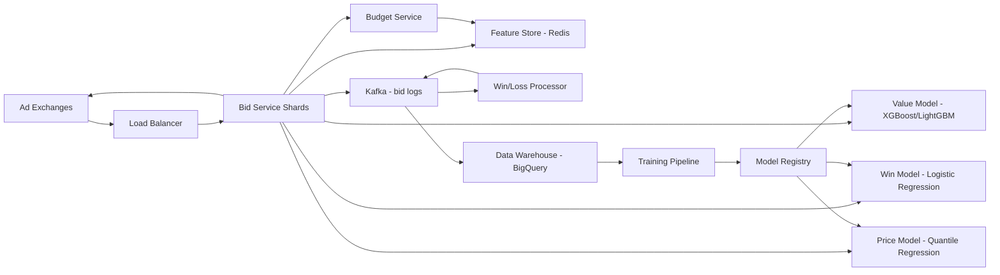

# Real-time Bidding

**Category:** AI/ML System Design
**Difficulty:** 🔴 Hard
**Seniority:** Senior
**Companies:** Google, Meta
**Tags:** ad-tech, ml, latency
**Time:** 90-120 min

---

## Problem Statement

Design a real-time bidding (RTB) system for programmatic advertising that participates in ad exchanges to bid on ad impressions within strict time constraints (typically 50-100 ms per bid request). The system must predict the value of each impression, determine optimal bid prices, and manage advertiser budgets while maximizing ROI for advertisers and revenue for the platform.

Scale hint: 10M bid requests/second at peak, each requiring ML inference, feature lookup, and bid calculation within 50-100 ms SLA. The system handles thousands of advertisers with varying budgets, campaign goals, and targeting criteria. At senior level, you're expected to address ultra-low latency inference, budget pacing, auction dynamics, and how to handle cold-start advertisers and shifting market conditions.

## Clarifying Questions

- What auction types are we participating in? *First-price and second-price auctions across multiple exchanges.*
- What are the advertiser objectives? *CPA, CPC, CPM, ROAS targets; focus on CPA/CPC as primary.*
- What's the bid request latency SLA? *50-100 ms end-to-end, with penalties for timeouts.*
- How many advertisers and campaigns? *~10K advertisers, ~100K active campaigns.*
- What's the data freshness requirement? *Real-time features updated within seconds; model updates daily to hourly.*
- Budget constraints? *Daily and lifetime budgets per campaign; must not overspend.*
- What features are available in bid requests? *User demographics, contextual signals, site/app info, device, time, sometimes user IDs.*
- Do we have historical data? *Yes, past impressions, bids, wins, clicks, conversions.*

## Requirements

### Functional

- Receive bid requests from ad exchanges, predict impression value, and submit bids within SLA.
- Support multiple bid strategies (maximize conversions, maximize clicks, target CPA, target ROAS).
- Enforce advertiser budgets (daily, lifetime, pacing).
- Track wins, losses, impressions, clicks, and conversions for learning.
- Handle multiple ad formats (display, video, native) and inventory types.

### Non-Functional

- p99 latency under 100 ms per bid request (network + processing).
- Throughput: 10M bid requests/second at peak.
- 99.99% availability; timeouts result in no bid (revenue loss).
- Model inference under 10 ms per request.
- Budget enforcement accuracy: no more than 0.1% overspend.

### Out of Scope

- Ad creative generation and rendering.
- Ad exchange integration protocols (OpenRTB details).
- Advertiser UI and campaign management.

## Problem Framing

- **ML task:** regression (predict expected value: pCTR × bid for CPC, pCVR × conversion value for CPA) and classification (win probability modeling).
- **Business metrics:** revenue (total spend), advertiser ROI (conversions per dollar), win rate, budget utilization, profit margin.
- **Model metrics:** bid accuracy (predicted vs actual value), win prediction AUC, calibration of value predictions, budget pacing error.
- **Key challenges:** extreme latency (50-100 ms total), high throughput (10M QPS), sparse features (user IDs, publisher IDs), cold-start for new advertisers/campaigns, budget pacing across millions of impressions, auction dynamics (competition affects win rates), and handling missing/noisy bid request data.
- **Why hard:** unlike pCTR prediction where you control the serving context, RTB competes in open markets where your bid strategy directly affects win rates and costs. Over-bidding wastes budget; under-bidding loses inventory.

## Data Pipeline

- **Bid request stream:** OpenRTB bid requests from exchanges via Kafka, enriched with real-time features (user segments, recent activity, campaign status).
- **Win/loss notifications:** exchange callbacks indicating whether bids won, at what price (clearing price).
- **Impression and conversion tracking:** pixel/beacon for impressions, post-view/click conversion attribution (typically 1-30 day windows).
- **Feature engineering:**
  - Real-time: user segment (from DMP), recent bid history (last 100 bids per campaign), remaining budget, pacing status, time-of-day patterns.
  - Static: campaign targeting criteria, creative attributes, historical performance (CTR, CVR by segment).
  - Bid request: publisher domain, app category, ad slot size, device, OS, geo, user demographics (when available).
  - Derived: win rate by (campaign, publisher, device), historical clearing prices, competition intensity.
- **Training data:** joined bid requests with outcomes (win/loss, price, click, conversion). Labels: win (binary), clearing price (regression), click (binary), conversion (binary).
- **Storage:** online feature store (Redis Cluster for real-time features, Aerospike for user/campaign state), offline data warehouse (BigQuery/Snowflake) for training, model registry (MLflow) for versioning.

## Model Design

- **Model 1: Value prediction model**
  - Predicts expected value: for CPC campaigns, pCTR × max_bid; for CPA campaigns, pCTR × pCVR × target_value.
  - Architecture: gradient-boosted trees (XGBoost/LightGBM) or deep sparse model (DLRM) for fast inference.
  - Features: bid request features, campaign features, user segments, historical performance.
  - Output: calibrated probability for click/conversion.

- **Model 2: Win probability model**
  - Predicts probability of winning at a given bid price.
  - Architecture: logistic regression or GBDT with bid price as a feature.
  - Features: bid price, predicted value, competition features (publisher, time), historical win rates.
  - Used for bid shading: adjust bid to optimize expected value = win_prob × value - cost.

- **Model 3: Clearing price prediction**
  - Predicts expected second-price (market price) to inform bid shading.
  - Architecture: quantile regression (predict 50th, 75th, 90th percentiles).
  - Features: publisher, device, time, historical clearing prices.

- **Bid strategy:**
  - For second-price auctions: bid = predicted value (truthful bidding) or shade based on win/clearing price models.
  - For first-price auctions: bid = predicted value × shading_factor, where shading_factor < 1 based on win probability model.
  - Budget pacing: adjust bids dynamically based on remaining budget and time (e.g., if behind pace, increase bids slightly; if ahead, decrease).

- **Cold start:** new campaigns use category/vertical averages, gradually learn from early wins/losses. Exploration: epsilon-greedy or Thompson sampling to try higher bids and learn win curves.

```text
FUNCTION process_bid_request(request)
    SET campaign ← match_campaigns(request.targeting, request.inventory)
    IF campaign.remaining_budget = 0 THEN RETURN no_bid
    SET features ← extract_features(request, campaign)
    SET value ← value_model.predict(features)                    // pCTR × bid or pCTR × pCVR × value
    SET win_prob ← win_model.predict(features, bid=value)
    SET clearing_price ← price_model.predict_percentile(features, p=50)
    SET adjusted_bid ← compute_bid(value, win_prob, clearing_price,
                                    campaign.pacing_factor, auction_type)
    IF adjusted_bid < campaign.min_bid OR adjusted_bid > campaign.max_bid THEN
        RETURN no_bid
    SET bid_response ← build_bid(adjusted_bid, campaign.creative_id)
    log_bid_request(request, campaign, features, adjusted_bid, model_version)
    RETURN bid_response

FUNCTION compute_bid(value, win_prob, clearing_price, pacing_factor, auction_type)
    IF auction_type = "second_price" THEN
        // Truthful bidding with optional shading
        RETURN value × pacing_factor
    ELSE
        // First-price: shade based on competition
        SET shade ← MIN(1.0, clearing_price / value) × 0.95    // conservative
        RETURN value × shade × pacing_factor
```

## Training & Evaluation

- **Training cadence:** value models retrained daily on last 30-60 days; win/price models retrained every 6-12 hours to capture market dynamics.
- **Online learning:** lightweight online updates (FTRL-Proximal) for win rate and clearing price models to adapt to hourly patterns.
- **Validation:** time-based split (train on days T-30 to T-2, validate on T-1, test on T). Prevent leakage from future bid outcomes.
- **Metrics:**
  - Value model: log loss, AUC, calibration error, MAE vs actual value.
  - Win model: AUC, log loss, calibration of win probabilities.
  - Price model: quantile loss, MAE at different percentiles.
  - Business simulation: replay historical bid requests with new models, simulate auction outcomes, measure revenue, ROI, win rate.
- **A/B testing:** campaign-level split (not user-level, since bids compete in open auctions). Compare new vs old bid strategy on revenue, advertiser ROI, win rate, budget utilization. Run for 1-2 weeks to capture weekly patterns.
- **Budget pacing evaluation:** measure actual spend vs planned spend by time bucket; target within ±5% of ideal pacing curve.

## Serving Architecture



1. Bid requests arrive from exchanges via load balancer, routed to bid service shards by campaign ID for state locality.
2. Bid service fetches real-time features from Redis (campaign state, user segments, recent bids) in parallel across all models.
3. Models run inference: value model (5 ms), win model (2 ms), price model (2 ms).
4. Budget service checks remaining budget and computes pacing factor.
5. Bid response assembled and sent back to exchange within SLA.
6. Bid requests logged to Kafka; win/loss notifications processed and joined; outcomes written to data warehouse.
7. Training pipeline retrains models and publishes to model registry; bid services pull new models.

**Latency budget (p99, per bid request):**

| Step | Budget |
|---|---|
| Network (request + response) | 20 ms |
| Parse bid request | 5 ms |
| Feature lookup (Redis) | 15 ms |
| Model inference (all models) | 10 ms |
| Bid calculation + response building | 5 ms |
| Network to exchange | 15 ms |
| Headroom | 10 ms |

**Capacity planning:** 10M QPS × 10 ms inference = 100M model inferences/second equivalent. With optimized XGBoost/LightGBM (~1M predictions/sec per core), need ~100 cores for inference. Add feature lookup, budget checks, and network overhead; deploy ~200-300 bid service instances globally with horizontal sharding by campaign ID.

**Model serving:** use ONNX runtime or Treelite for ultra-fast tree model inference; batch inference not possible (single request latency critical). Models loaded in memory; hot-swapping via model registry.

**Budget service:** distributed counter with atomic increments; use Redis with cluster sharding by campaign ID. Check budget before bidding; if budget exhausted, return no-bid immediately.

**Fallback:** if models unavailable, use heuristic bidding (e.g., bid = campaign avg CPM × pacing_factor). If feature store unavailable, use cached features or defaults.

## Monitoring & Iteration

- **SLA monitoring:** p99 latency per exchange, timeout rate, error rate. Alert if latency > 80 ms or timeout rate > 1%.
- **Business metrics:** total revenue, win rate by exchange/campaign, advertiser ROI, budget utilization, profit margin.
- **Model metrics:** prediction distribution drift, calibration error (predicted vs actual win rate, value), feature importance drift.
- **Budget health:** campaigns overspending/underspending, pacing deviation, budget exhaustion rate.
- **Market dynamics:** clearing price distribution by publisher/time, competition intensity (win rate trends).
- **Data quality:** missing feature rates, bid request parsing errors, win/loss notification delays.
- **Feedback loops:** high bids can win more but waste budget; low bids save budget but lose inventory. Continuously tune shading factors via reinforcement learning or bandit algorithms.
- **Cost optimization:** feature pruning (remove low-importance features), model compression (quantization, smaller trees), caching of static features.

## Trade-offs

| Decision | Option A | Option B | Choice & Why |
|---|---|---|---|
| Model type | Deep neural network | GBDT (XGBoost/LightGBM) | GBDT: faster inference, better with sparse features, easier to deploy |
| Bid strategy | Truthful bidding | Bid shading with win model | Shading: optimizes for profit in first-price auctions; truthful in second-price |
| Budget pacing | Fixed daily pacing | Dynamic pacing based on opportunity | Dynamic: adjusts for inventory quality variation throughout day |
| Training cadence | Daily | Daily + hourly online updates | Hybrid: captures daily trends + adapts to hourly patterns |
| Feature freshness | Batch updated hourly | Real-time streaming | Real-time: critical for budget state and recent win rates |

## Follow-up Questions

1. **How do you handle first-price vs second-price auctions differently?** Second-price: bid your true value (or slight shade). First-price: must shade based on predicted competition to avoid overpaying; use win probability and clearing price models.
2. **How do you prevent budget overspend during spikes?** Pre-flight budget check with distributed atomic counters; if remaining budget < bid, return no-bid. Implement rate limiting per campaign. Use conservative pacing (spend slightly slower than ideal).
3. **How do you cold-start a new campaign with no history?** Use vertical/category averages as priors, apply exploration (higher bids initially) to collect data, gradually transition to learned models. Use hierarchical Bayesian pooling across similar campaigns.
4. **What if a model predicts high value but win rate is low?** Indicates overvaluation or competition. Investigate feature drift, recalibrate value model, or increase bid shading. May need to lower predicted value or improve win model.
5. **How do you handle bid request timeouts?** Timeouts result in no bid (revenue loss). Set aggressive internal timeouts (e.g., 70 ms) to allow network margin. Circuit breaker: if latency degrades, temporarily shed traffic to lower-priority exchanges.
6. **How would you add conversion optimization (CPA bidding)?** Add pCVR model predicting conversion probability; bid = pCTR × pCVR × target_CPA. Use delayed feedback (conversions arrive days later) with importance weighting or separate delay model.

## Common Mistakes

- Ignoring auction type differences (first vs second price) and bidding strategy.
- Not modeling win probability, leading to overbidding and budget waste.
- Forgetting budget pacing, causing campaigns to exhaust early or underspend.
- Using complex deep models that can't meet 10 ms inference latency.
- Not handling cold-start campaigns, leading to poor initial performance.
- Ignoring market dynamics (competition, clearing prices) in bid decisions.
- Insufficient monitoring of budget health and pacing accuracy.

## Key Takeaways

- RTB is an ultra-low latency ML system where 10 ms inference matters; choose models for speed.
- Bid strategy must account for auction dynamics (win probability, clearing prices, competition).
- Budget pacing is as critical as value prediction; overspend hurts advertisers, underspend loses revenue.
- Cold-start campaigns need priors and exploration to learn quickly.
- Monitor business metrics (revenue, ROI, win rate) alongside model metrics.
- Simulate auction outcomes offline before deploying new bid strategies.
