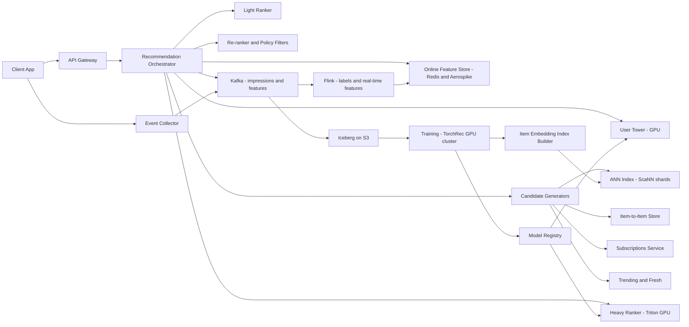

# Recommendation System

**Category:** AI/ML System Design
**Difficulty:** 🔴 Hard
**Seniority:** staff
**Companies:** Netflix, YouTube, TikTok, Meta, Amazon, Spotify, Pinterest
**Tags:** candidate-generation, two-tower, ranking, feature-store, multi-objective, cold-start, exploration
**Time:** 60 min

---

## Problem Statement

Design the recommendation system that powers a personalized home feed for a large video platform (think YouTube home or TikTok For You). When a user opens the app, the system must select and order ~50 items from a corpus of hundreds of millions of videos, optimizing long-term user satisfaction rather than raw clicks.

Scale hint: 500M daily active users, ~10B feed requests/day (~115K QPS average, ~300K peak), a corpus of 800M videos with ~5M new uploads/day, and a p99 latency budget of 200 ms. At staff level the interviewer expects a multi-stage funnel, a clear objective design, feature and training infrastructure, freshness, exploration, and an evaluation strategy that avoids feedback-loop traps.

## Clarifying Questions

- What is the primary business goal? *Long-term engagement and satisfaction (daily retention, watch time with quality), not CTR alone.*
- What feedback signals exist? *Impressions, clicks, watch time and completion, likes, shares, comments, follows, skips, "not interested", surveys.*
- How fresh must recommendations be? *New uploads should be recommendable within minutes; user interests should update within the session.*
- Are there content constraints? *Integrity filters (policy violations, borderline content demotion), creator diversity, and regional licensing.*
- Logged-out or new users? *Yes, ~10% of requests are cold-start users.*
- Is there an existing system? *Assume a heuristic popularity + collaborative filtering system we are replacing.*
- Latency and compute constraints? *p99 200 ms server side; ranking budget allows scoring ~1-2K candidates with a heavy model.*

## Requirements

### Functional

- Return a ranked list of ~50 items per request, personalized to user and context.
- Mix multiple sources: subscriptions, interest-based, trending, fresh, and exploration.
- Respect filters: already-watched, blocked creators, policy, region availability.
- Update in near real time from in-session behavior.
- Support explicit negative feedback ("not interested").

### Non-Functional

- p99 latency 200 ms; ~300K QPS peak.
- Availability 99.99%; degrade to cached or popularity-based feeds on failure.
- New item eligible within 15 minutes of upload; user features updated within 1 minute.
- Training pipeline processes ~100B impression events/day.

### Out of Scope

- Ads insertion (separate auction blended later).
- Search and notification recommendations.

## Problem Framing

- **Objective:** maximize long-term satisfaction. Proxy with a weighted multi-objective score: value = w1 P(click) x E(watch_time | click) + w2 P(like) + w3 P(share) + w4 P(follow) - w5 P(not interested) - w6 P(skip quickly).
- **Why not CTR alone:** optimizing clicks rewards clickbait; watch time alone rewards long videos and binge loops. Weights are tuned with online experiments against retention and survey-based satisfaction.
- **Business metrics (north star):** DAU / 7-day retention, total satisfied watch time, survey satisfaction score; guardrails on creator diversity and integrity exposure.
- **Model metrics:** retrieval recall@K against future engagements; ranking AUC / normalized cross-entropy per head, calibration, NDCG on watch-time weighted labels.
- **Constraints:** 200 ms budget forces a funnel: cheap retrieval over 800M items, then progressively heavier models on fewer candidates. Feedback loops and position bias distort labels. Privacy: data minimization and regional rules (GDPR deletion).

## Data Pipeline

- **Event logging**
  - Client and server log impressions (with position, surface, model version, request ID), and engagement events, to Kafka (~1.5M events/s peak).
  - Server logs the exact features used at serve time ("feature logging") to eliminate training-serving skew.
- **Label construction:** join impressions with engagements by request ID within an attribution window (e.g. 1 hour for watch, 24 hours for follow) in Flink; produce per-impression labels for each head.
- **Features**
  - User: long-term interest embeddings, topic/creator affinities, demographics (coarse), device, language, activity level.
  - User sequence: last 100-500 interactions (item IDs, action types, timestamps) for sequence models.
  - Item: content embeddings (video frames, audio, title text via multimodal encoder), creator ID, age, duration, language, quality/integrity scores.
  - Item stats: real-time counters (CTR, completion rate over 1 h/24 h/7 d windows) by Flink into the feature store.
  - Cross: user-creator affinity, user-topic engagement rate, past interactions with similar items.
  - Context: time, network, surface, session depth.
- **Storage**
  - Online feature store: Redis / Aerospike for hot user features (~500M users x ~5 KB ≈ 2.5 TB, sharded), item features in a replicated in-memory store.
  - Offline: S3/Iceberg tables of logged features and labels, daily partitions; Spark for backfills.
  - Embedding tables for IDs: billions of rows; sharded across parameter servers or TorchRec embedding sharding.
- **Sampling:** impressions are massive; downsample negatives (e.g. 10%) and re-weight to keep calibration.

## Model Design

### Multi-stage funnel

| Stage | Input | Output | Model | Budget |
|---|---|---|---|---|
| Candidate generation | 800M | ~10K | Multiple retrievers (two-tower ANN, item-to-item, graph, subscriptions, trending) | 30 ms |
| Pre-ranking (light ranker) | ~10K | ~1K | Small two-tower or distilled MLP | 20 ms |
| Ranking | ~1K | ~200 | Large multi-task DNN | 60 ms |
| Re-ranking | ~200 | ~50 | Business logic, diversity, MMR, integrity, freshness boosts | 10 ms |

### Candidate generation

- **Baseline:** item-item collaborative filtering (co-watch) and popularity per region.
- **Two-tower retrieval (main):** user tower (user features + sequence pooled via attention) and item tower (content + ID embeddings) produce 128-d embeddings; trained with sampled softmax over in-batch negatives with logQ correction for popularity bias. Item embeddings indexed in ScaNN/FAISS (800M x 128-d, int8 quantized ≈ 100 GB, sharded); user embedding computed at request time.
- **Other sources:** subscriptions (recent uploads from followed creators), item-to-item from recent watches (seed-based ANN), graph-based (PinSage-style GNN embeddings), fresh-content retriever (content-only embeddings so new items have vectors immediately), and an exploration source.
- Merge with per-source quotas, dedupe, apply filters (watched bloom filter, region, policy).

### Ranking

- **Baseline:** GBDT on hand-crafted features predicting P(click).
- **Chosen:** multi-task DNN with shared bottom and task-specific towers using MMoE or PLE to reduce negative transfer between heads (click, watch time, like, share, follow, skip, not-interested).
  - Feature interaction: DCN-v2 cross layers over dense + embedding features.
  - User history: target attention (DIN-style) or a transformer over the last N interactions relative to the candidate.
  - Watch time head: weighted logistic regression or regression on log watch time.
  - Position bias: a shallow tower taking position and surface during training, dropped (set to fixed) at serve time.
- **Final score:** weighted combination of head outputs; weights tuned via online experiments or Bayesian optimization against long-term metrics.

### Re-ranking

- Diversity via MMR or determinantal point processes on item embeddings; caps per creator (e.g. max 2 per creator in top 20).
- Freshness boosts, integrity demotions, and slots for exploration.

```text
FUNCTION recommend(user_id, context)
    SET u ← feature_store.get_user(user_id)                 // includes recent session events
    SET u_emb ← user_tower.embed(u, context)
    SET cands ← PARALLEL(
        ann_index.search(u_emb, k=4000),
        item2item.expand(u.recent_items, k=2000),
        subscriptions.recent(user_id, k=1000),
        trending.by_region(context.region, k=500),
        fresh.search(u_emb, k=1000),
        explore.sample(u, k=200))
    SET cands ← filter(dedupe(cands), watched_bloom(user_id), policy, region)
    SET cands ← light_ranker.top_k(u, cands, 1000)
    SET heads ← ranker.predict(u, cands, context)           // batched on GPU
    FOR c IN cands
        SET c.score ← SUM(weights[h] * heads[c][h] FOR h IN heads)
    SET feed ← rerank_diversity(cands, creator_cap=2, lambda=0.3)
    log_impressions(user_id, feed, features_used, model_versions)
    RETURN feed[0:50]
```

### Cold start

- **New users:** onboarding topic picks, contextual features (region, device, language), popularity per cohort, and heavier exploration; the user tower handles missing history with default embeddings.
- **New items:** content-based embeddings from a multimodal encoder place items in the retrieval space immediately; a fresh-content quota and bandit-style boosted impressions gather early signal.

## Training & Evaluation

- **Training infrastructure:** TorchRec or TensorFlow with embedding tables sharded across GPUs (model parallel for embeddings, data parallel for dense layers); ~100B examples/day after sampling down to ~10B.
- **Cadence:** ranking model trained continuously (incremental updates every few hours from the latest data, full retrain weekly); retrieval towers retrained daily and item index refreshed every 15-30 minutes for new items.
- **Offline metrics**
  - Retrieval: recall@K of next-day engaged items, per source; coverage of corpus.
  - Ranking: AUC and normalized cross-entropy per head, calibration (predicted/observed ratio near 1.0), NDCG on watch-time-weighted relevance.
  - Slice analysis: new users, new items, regions, creator size.
- **Validation:** time-based split (train on days 1-N, evaluate on day N+1) to mimic production; never random splits.
- **Counterfactual evaluation:** offline metrics on logged data are biased by the current policy; use inverse propensity scoring with logged propensities from the exploration traffic for policy evaluation.
- **Online A/B:** user-level randomization, 1-2 weeks minimum to capture novelty effects, and long-term holdouts (1% of users kept on an old model for months) to measure retention effects. Primary: satisfied watch time, DAU retention; guardrails: latency, diversity, integrity exposure, creator-side metrics.
- **Interleaving** for faster ranking comparisons with smaller traffic.

## Serving Architecture



1. Orchestrator fetches user features (including session events updated by Flink within ~1 minute).
2. User tower computes the query embedding; candidate generators run in parallel with a hard timeout (drop slow sources).
3. Light ranker prunes to ~1K; heavy ranker scores on GPU with batched inference (1K candidates per request as a single batch).
4. Re-ranker applies diversity, integrity, and business rules; impressions and served features are logged.

**Latency budget (p99 200 ms):**

| Step | Budget |
|---|---|
| Feature fetch | 15 ms |
| User tower + candidate generation (parallel) | 35 ms |
| Filtering + light ranker | 25 ms |
| Heavy ranker (1K candidates) | 60 ms |
| Re-rank + hydration | 20 ms |
| Network and headroom | 45 ms |

**Compute sizing:** 300K QPS x 1K candidates = 300M candidate scorings/s for the heavy ranker. With a ~20 MFLOP model that's ~6 PFLOP/s; at ~30% utilization of an A100's ~300 TFLOPS (FP16), ~65+ GPUs minimum, realistically several hundred across regions for headroom and tail latency. This is why the light ranker and candidate count are key cost knobs.

**Caching and degradation:** precompute a fallback feed per user (offline batch, refreshed hourly) in a KV store; on ranker failure serve it; on total failure serve regional popularity. Prefetch the next page while the user scrolls.

## Monitoring & Iteration

- **System:** latency per stage, candidate counts per source, timeout rates, GPU utilization, feature store hit rate and staleness.
- **Model health:** calibration per head in real time (predicted vs observed CTR), prediction distribution shift, NaN/default feature rates; alert on online/offline feature skew by comparing logged features to recomputed ones.
- **Ecosystem:** corpus coverage, creator exposure concentration (Gini), share of fresh content, topic diversity per user; these degrade silently under pure engagement optimization.
- **Feedback loops:** the model trains on data it generated. Mitigate with ~1-5% exploration traffic (epsilon-greedy or Thompson sampling in a dedicated slot), logged propensities, and position-bias correction.
- **Integrity:** borderline content exposure rate monitored; integrity classifier scores enter re-ranking as hard filters or demotions.
- **Retraining and rollout:** continuous training with automated validation (AUC and calibration not worse than production on a holdout), shadow scoring, canary at 1%, then ramp.
- **Cost control:** tune candidate counts per stage, distill the heavy ranker, int8/FP16 inference, cache user embeddings within a session.

## Trade-offs

| Decision | Option A | Option B | Choice & Why |
|---|---|---|---|
| Objective | Single CTR objective | Multi-task heads with weighted value | Multi-task: aligns with satisfaction, resists clickbait; weights tuned online |
| Retrieval | Single two-tower | Multiple heterogeneous sources | Multiple: coverage, freshness, subscriptions, and exploration need different retrievers |
| Ranking interactions | GBDT | Deep model with DCN-v2 and sequence attention | Deep: handles huge sparse ID features and user sequences; GBDT as baseline |
| Training cadence | Daily batch retrain | Continuous incremental training | Continuous: captures trends within hours; weekly full retrain prevents drift accumulation |
| Feature consistency | Recompute features offline | Log served features | Log served features: eliminates training-serving skew at the cost of storage |
| Exploration | None | Dedicated exploration slots | Exploration: unbiased data, cold-start item discovery, counterfactual eval |

## Follow-up Questions

1. **How do you incorporate in-session intent quickly?** Stream session events to the feature store within seconds and use a sequence model (transformer over recent actions) in both user tower and ranker so the next request reflects them.
2. **How do you handle popularity bias in retrieval?** Apply logQ correction in sampled softmax, cap popular items per page, and add dedicated long-tail and fresh retrievers with quotas.
3. **How do you choose the multi-objective weights?** Start from business priors, run parameter sweeps in online experiments, and fit weights against long-term metrics such as retention using long-running holdouts.
4. **What if offline AUC improves but the A/B test is flat?** Check training-serving skew, calibration, stage interactions (retrieval limits ranking gains), position bias, and whether the offline label aligns with the online metric.
5. **How do you handle GDPR deletion requests?** Delete user rows from feature stores and logs, exclude them from future training, and retrain on schedule; embedding IDs for deleted users are dropped.
6. **How would you add ads?** Run a separate ads ranker producing expected value (bid x pCTR), then blend into the organic feed via a slotting policy with user-experience cost.

## Common Mistakes

- Jumping to a single deep model without a multi-stage funnel that fits the latency budget.
- Optimizing CTR only and ignoring watch quality, negative feedback, and long-term retention.
- Using random train/test splits, or computing features offline differently from online (skew).
- Ignoring feedback loops, position bias, and the need for exploration.
- No cold-start strategy for new users and new items.
- Not doing the compute math for ranking 1K candidates at 300K QPS.

## Key Takeaways

- Recommendation is a funnel: diverse retrieval, light ranking, heavy multi-task ranking, then policy-aware re-ranking.
- The objective function is a product decision; multi-task heads plus tuned weights make it explicit.
- Feature logging and point-in-time correctness are as important as model architecture.
- Exploration and bias correction keep the system learning and prevent self-reinforcing loops.
- Evaluate with time-based offline splits, counterfactual methods, and long-term online holdouts.
