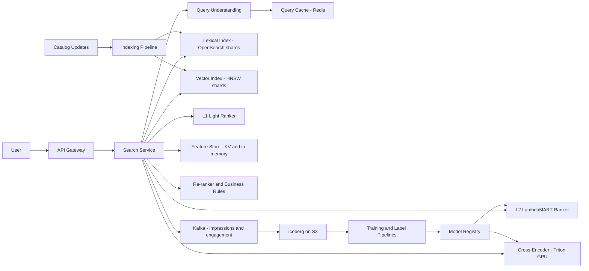

# Search Ranking

**Category:** AI/ML System Design
**Difficulty:** 🔴 Hard
**Seniority:** staff
**Companies:** Google, Amazon, Airbnb, LinkedIn, Microsoft, eBay, Etsy
**Tags:** learning-to-rank, query-understanding, hybrid-retrieval, cross-encoder, position-bias, ndcg
**Time:** 60 min

---

## Problem Statement

Design the ranking system for a large e-commerce product search engine. Given a text query, the system must retrieve relevant products from a catalog and order them to maximize relevance and purchases, while respecting business constraints such as availability and seller diversity.

Scale hint: a catalog of 500M products, ~50K search QPS at peak, p99 latency under 300 ms for the full search request, and a long tail where ~50% of queries are seen fewer than 10 times per month. A staff-level answer covers query understanding, hybrid lexical plus semantic retrieval, multi-stage learning-to-rank, label strategy (clicks vs human judgments), position-bias correction, and experimentation.

## Clarifying Questions

- What surfaces does this power? *The main product search results page; autocomplete and ads are separate.*
- What is the primary business objective? *Purchases / gross merchandise value per search, with relevance as a hard constraint.*
- Do we have human relevance judgments? *Yes, a rater program that can grade ~100K query-product pairs/month on a 4-point scale.*
- Personalization? *Light: location, past categories, price affinity; relevance must dominate.*
- Languages and markets? *10 markets, multilingual queries, misspellings common.*
- Filters and sorting? *Users can filter by category, price, brand, rating; default sort is relevance.*
- Freshness of catalog? *Price and availability change constantly; must reflect within minutes.*

## Requirements

### Functional

- Parse and understand queries: spelling correction, tokenization, category/attribute intent, synonyms.
- Retrieve candidates from 500M products using lexical and semantic matching with filters.
- Rank top results using a learned model combining relevance, quality, and conversion signals.
- Support pagination, facets, and filters.
- Log impressions, clicks, add-to-cart, purchases with positions for training.

### Non-Functional

- p99 300 ms end to end; ranking stages within ~120 ms.
- 50K QPS peak; 99.99% availability with graceful degradation to lexical-only ranking.
- Price/stock updates reflected within 5 minutes; new products searchable within 15 minutes.
- Zero-result rate under 2%.

### Out of Scope

- Sponsored product ads auction.
- Query autocomplete.

## Problem Framing

- **ML task:** learning to rank. For a query q and candidate set D, learn a scoring function s(q, d) whose ordering maximizes a graded relevance + business utility.
- **Business metrics:** conversion rate per search, GMV per search, search abandonment rate, zero-result rate, query reformulation rate, time to first click.
- **Model metrics:** NDCG@10 on human-graded relevance, MRR, recall@1000 for retrieval, and offline purchase-weighted NDCG on logged data.
- **Two notions of "good":** relevance (is this the right product?) and utility (will the user buy it?). Optimizing only conversion surfaces popular but loosely related items; optimizing only relevance ignores price, quality, and availability. Use human relevance as a constraint/feature and engagement as the main training signal.
- **Constraints:** strict latency, long-tail queries with no engagement history, biased click logs (position bias, presentation bias), and multi-market language variation.

## Data Pipeline

- **Sources**
  - Search logs: query, results shown with positions, clicks, add-to-cart, purchases, dwell time, reformulations (Kafka to Iceberg on S3).
  - Catalog: title, description, attributes, category taxonomy, brand, price, stock, images, seller ratings.
  - Human judgments: 4-point scale (exact, substitute, complement, irrelevant), following ESCI-style guidelines.
- **Labels**
  - Graded engagement label per (query, product): purchase = 3, add-to-cart = 2, click with dwell over 10 s = 1, skipped impression = 0.
  - Position-bias correction: estimate propensity per position via result randomization on a small traffic slice (swap pairs of adjacent results), then weight by inverse propensity (unbiased LTR).
  - Human labels used for evaluation and for training the relevance model / cross-encoder (and distilled LLM labels to scale coverage).
- **Features (for ranking)**
  - Query-document text match: BM25 on title/description/attributes fields, exact phrase match, attribute matches (brand, color, size).
  - Semantic: bi-encoder cosine similarity, cross-encoder relevance score.
  - Product quality: rating, review count, return rate, seller score, image quality.
  - Behavioral: historical CTR and conversion for (query, product) and (query category, product), smoothed with Bayesian priors for sparsity.
  - Commercial: price, price relative to category median for that query, discount, delivery speed, in-stock.
  - Query features: query length, predicted category, specificity (head/torso/tail), intent class.
  - Personalization: user's category affinity, price band, location for delivery time.
- **Storage:** inverted + vector indexes in the search cluster; product features in a columnar in-memory store co-located with rankers; query-product engagement aggregates in a KV store (Cassandra/Redis) refreshed hourly; offline training data in Iceberg.

## Model Design

### Query understanding

- Spell correction (noisy channel / seq2seq trained on reformulation pairs), normalization, tokenization per language.
- Query classification into category taxonomy (fine-tuned BERT-class model, cached for head queries) to boost or filter categories.
- Attribute extraction (NER for brand, color, size) to map to structured filters.
- Query rewriting/expansion: synonyms mined from co-click data, and LLM-generated rewrites for tail queries computed offline and cached.

### Retrieval (recall stage, 500M to ~5K)

- **Lexical:** BM25F in Elasticsearch/OpenSearch or Vespa across fields; strong for exact model numbers and brands.
- **Semantic:** bi-encoder (e.g. fine-tuned E5/BERT-base, 256-d) for query and product, ANN via HNSW; handles vocabulary mismatch ("couch" vs "sofa").
- **Hybrid merge:** union of top-K from each (e.g. 3K lexical + 2K semantic) with reciprocal rank fusion or a learned light scorer; apply hard filters (stock, market) during retrieval.

### Ranking stages

| Stage | Candidates | Model | Latency |
|---|---|---|---|
| L1 light ranker | 5K to 500 | GBDT on cheap features, or linear model | 15 ms |
| L2 main ranker | 500 to 100 | LambdaMART (LightGBM) with ~300 features, or DNN | 30 ms |
| L3 cross-encoder | top 50-100 | Distilled cross-encoder (MiniLM 6-layer) relevance score fed into final blend | 40 ms on GPU |
| Re-rank | 100 to page | Diversity, business rules, dedupe variants | 5 ms |

- **Baseline:** BM25 plus popularity sort. Easy, but poor for semantic mismatch and conversion.
- **Chosen:** LambdaMART with listwise objective optimizing NDCG directly; robust on heterogeneous tabular features and interpretable. A neural ranker (DNN with feature crosses) can replace or ensemble with it at scale, but GBDT is a strong production standard.
- **Cross-encoder:** a teacher (large cross-encoder or LLM judge) trained on human labels generates relevance labels for millions of pairs; a small student cross-encoder serves online. Its score becomes a top feature in the final ranker.
- **Multi-objective:** final score = ranker score optimized for engagement label, with relevance as a feature and a hard relevance floor (items with cross-encoder relevance below threshold are demoted regardless of conversion).

```text
FUNCTION search(query, user, filters)
    SET q ← query_understanding(query)                      // spell, category, attributes, rewrites
    SET lex ← lexical_index.search(q.terms, q.rewrites, filters, k=3000)
    SET sem ← vector_index.search(bi_encoder.embed(q.text), filters, k=2000)
    SET cands ← reciprocal_rank_fusion(lex, sem)[0:5000]
    SET cands ← l1_ranker.top_k(q, cands, 500)
    SET feats ← feature_store.fetch(q, cands, user)
    SET cands ← l2_ranker.top_k(q, cands, feats, 100)
    FOR d IN cands[0:100]
        SET d.relevance ← cross_encoder.score(q.text, d.title_and_attrs)   // batched GPU
    SET final ← blend(cands, weights, relevance_floor=0.3)
    SET page ← diversify(final, max_per_seller=3, collapse_variants=TRUE)
    log_impressions(query, user, page, positions, features, model_versions)
    RETURN page
```

## Training & Evaluation

- **Training data:** ~2B search impressions/week; sample by query to avoid head queries dominating (cap impressions per query) and keep tail coverage.
- **Unbiased LTR:** inverse propensity weighting with propensities from randomization experiments, or a dual-learning approach (jointly learn a position-bias tower and a relevance tower).
- **Validation:** time-based split; evaluate separately on head, torso, tail queries and per market.
- **Offline metrics**
  - Human-graded NDCG@10 on a fixed, versioned judgment set (~20K queries) — the main relevance gate.
  - Engagement NDCG@10 / purchase MRR on held-out logs (IPS-weighted).
  - Retrieval recall@1000 of purchased products.
  - Zero-result and low-result rates on a query sample.
- **LLM-assisted judgments:** a calibrated LLM judge grades pairs at ~1/100 the human cost; validated against human raters (agreement above ~85%) and used to expand coverage for tail queries.
- **Online experiments**
  - A/B tests randomized by user, 1-2 weeks; primary GMV per search and conversion; secondary abandonment, reformulation rate; guardrails latency and zero-result rate.
  - Interleaving (team-draft) for sensitive and fast ranker comparisons with ~10x less traffic.
- **Launch criteria:** no regression in human-graded NDCG, statistically significant gain in the business metric, no market regressing beyond a threshold.

## Serving Architecture



1. Query understanding results are cached for head queries (the top 1M queries cover ~60% of traffic).
2. Lexical and vector retrieval run in parallel across shards (catalog sharded by product ID into ~64 shards, each replicated 3-4x).
3. L1 runs on the shard nodes themselves so only scored winners cross the network: each of 64 shards returns its top ~10-20 by local L1 score, and the aggregator merges them into the global top 500.
4. L2 and cross-encoder run in the aggregator tier; results are hydrated with display data and returned.

**Latency budget (p99 300 ms):**

| Step | Budget |
|---|---|
| Query understanding (cache miss) | 20 ms |
| Retrieval lexical + vector (parallel) | 50 ms |
| L1 + merge | 20 ms |
| Feature fetch | 15 ms |
| L2 ranker (500 candidates) | 30 ms |
| Cross-encoder (100 pairs, batched) | 40 ms |
| Re-rank + hydration | 25 ms |
| Network and headroom | 100 ms |

**Capacity:** cross-encoder at 50K QPS x 100 pairs = 5M pairs/s. A 6-layer MiniLM at seq length 64 does ~10-15K pairs/s per L4/A10 GPU with TensorRT, so ~400-500 GPUs at peak; reduce by caching (query, product) scores for head queries (hit rate ~50%) and only cross-encoding the top 50.

**Freshness:** catalog changes stream through Kafka; price and stock are updated as partial document updates (fast), while text changes trigger re-embedding and re-indexing within 15 minutes.

**Degradation:** if the cross-encoder pool is saturated, skip L3 (feature defaults to L2-only model variant trained without it); if L2 fails, serve BM25 + popularity.

## Monitoring & Iteration

- **Quality dashboards:** zero-result rate, abandonment, reformulation, CTR@position, conversion per search, by market and query segment.
- **Relevance audits:** weekly human-graded sample of live results (NDCG@10) to catch relevance erosion from conversion-optimized models.
- **Drift:** new products, seasonal queries ("halloween costume"), new slang; monitor out-of-vocabulary rate and query-category distribution; retrain query classifiers monthly, rankers weekly.
- **Feedback loops:** ranker trained on its own exposures entrenches incumbents; keep a small randomization slice for propensity estimation and new-product exploration boosts.
- **Feature health:** freshness of engagement aggregates, null/default rates, online-offline skew checks via feature logging.
- **Abuse:** sellers stuffing keywords or faking reviews; spam classifiers on titles and review velocity anomaly detection feed into quality features.
- **Cost control:** cache query understanding and cross-encoder scores, tune candidate counts per stage, distill models, autoscale GPU pools by traffic.

## Trade-offs

| Decision | Option A | Option B | Choice & Why |
|---|---|---|---|
| Retrieval | Lexical only | Hybrid lexical + semantic | Hybrid: lexical for exact SKUs/brands, semantic for vocabulary mismatch and tail queries |
| Labels | Clicks only | Human judgments only | Both: engagement for scale and utility, human labels for relevance gating and cross-encoder training |
| Main ranker | DNN | LambdaMART GBDT | LambdaMART first: strong on tabular features, cheap, interpretable; DNN when features/data justify |
| Cross-encoder | Online on all candidates | Top 50-100 only, cached | Top-K + caching: most of the gain at a fraction of GPU cost |
| Position bias | Ignore | IPS / dual-learning correction | Correct: otherwise the model learns to reproduce current ranking |

## Follow-up Questions

1. **How do you improve tail queries with no engagement?** Rely on semantic retrieval, cross-encoder relevance, query rewriting (LLM or co-click synonyms), and category-level behavioral features instead of query-product ones.
2. **How do you estimate position bias?** Run randomized swaps of adjacent positions (RandPair) on a small slice and fit click propensity per position, or learn it jointly with a bias tower.
3. **How would you use LLMs here?** Offline: generate relevance labels, query rewrites, and product attribute extraction; online: distill into small models because full LLM reranking at 50K QPS is too costly.
4. **How do you prevent conversion optimization from hurting relevance?** Enforce a relevance floor using the cross-encoder, gate launches on human-graded NDCG, and monitor relevance audits weekly.
5. **How do you personalize without breaking relevance?** Add personalization features only to L2 with limited weight, keep retrieval query-driven, and evaluate per-segment to ensure gains are not trading off relevance.

## Common Mistakes

- Treating clicks as ground truth without position-bias correction.
- Using a single retrieval method and ignoring either exact-match or semantic needs.
- Proposing a cross-encoder or LLM over thousands of candidates per query without capacity math.
- Evaluating only on head queries; tail queries are where most failures are.
- Ignoring query understanding (spelling, category intent, attributes), which often yields the largest gains.
- No relevance gate, letting conversion-optimized rankers drift toward popular but irrelevant items.

## Key Takeaways

- Search ranking is a multi-stage funnel: query understanding, hybrid retrieval, progressively heavier rankers, business re-ranking.
- Combine engagement labels (corrected for bias) with human and LLM-distilled relevance judgments.
- LambdaMART remains a strong main ranker; cross-encoders add semantic precision on the top few.
- Segment evaluation by head, torso, and tail queries and by market.
- Do capacity math per stage and design degradation paths.
