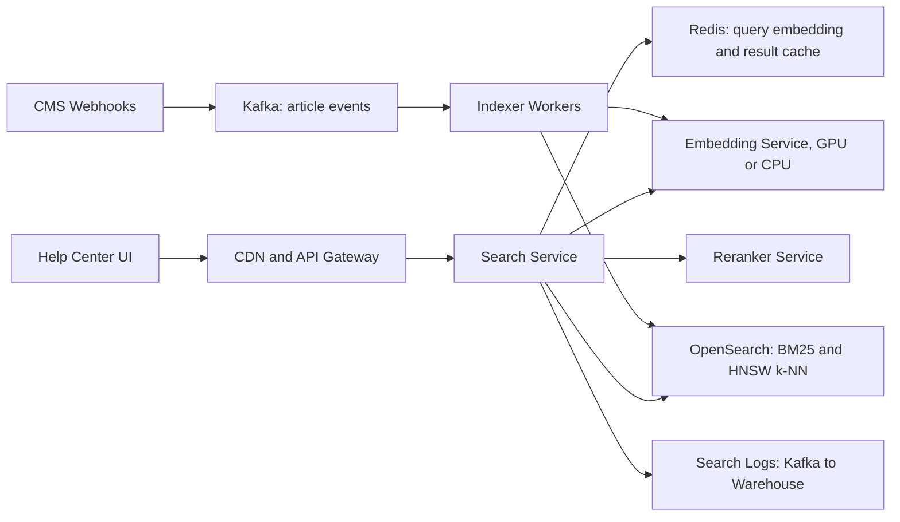

# Semantic FAQ Search

**Category:** AI/ML System Design
**Difficulty:** 🟢 Easy
**Seniority:** mid
**Companies:** Shopify, Intercom, Zendesk, Atlassian, Airbnb, Uber
**Tags:** embeddings, vector-search, semantic-search, hybrid-retrieval, reranking, ann-index
**Time:** 45 min

---

## Problem Statement

Design a semantic search feature for a company's help center. Users type a question in natural language ("my package never showed up") and should get the most relevant FAQ articles even when they use different words than the article ("Order not delivered"). The goal is to deflect support tickets by helping users self-serve.

The help center has about **20,000 FAQ articles** in 8 languages and serves **500 search queries/s** at peak. Articles are edited daily by the support content team.

## Clarifying Questions

- How large is the corpus? *20K articles, average 600 words; ~100K chunks after splitting.*
- What do we return? *Top 5 articles with title, snippet, and link. No generated answer (that would be a RAG system).*
- How fresh must the index be? *Edits should be searchable within 5 minutes.*
- Latency target? *p99 < 200 ms end to end, including search-as-you-type debounce on the client.*
- Languages? *8 languages; users may query in a language different from the article.*
- Is there click and ticket data? *Yes: search logs, clicks, and whether a ticket was filed after searching.*
- Personalization or access control? *Some articles are only for merchants vs buyers; filter by audience.*

## Requirements

### Functional

- Natural-language search returning top-k relevant articles with snippets.
- Filters: language, audience (buyer/merchant), product area.
- Index updates within 5 minutes of article publish/edit/delete.
- Log queries, impressions, and clicks for evaluation.

### Non-Functional

- 500 QPS peak, p99 < 200 ms.
- Recall@5 ≥ 0.85 on the labeled eval set.
- 99.9% availability; degrade to keyword search if the embedding service is down.
- Low cost: corpus is small, so avoid over-engineering.

### Out of Scope

- LLM-generated answers and chat.
- Web-scale search across user-generated content.

## Problem Framing

- **ML objective:** given a query q, rank articles by relevance; learn embeddings so that sim(q, relevant doc) > sim(q, irrelevant doc).
- **Business metrics:** ticket deflection rate (searches not followed by a ticket within 24 h), self-service success rate, CSAT on articles.
- **Model metrics:** Recall@k, MRR, nDCG@5 on a labeled query set; online CTR@5 and zero-click rate.
- **Constraints:** small corpus (fits in memory), modest QPS, strict latency, multilingual, frequent updates.

Why semantic over keyword only: BM25 fails on vocabulary mismatch ("refund" vs "money back", "can't log in" vs "password reset"). Embeddings fail on exact identifiers (error codes "E-1043", product names). Hybrid retrieval gets both.

## Data Pipeline

**Sources**

- CMS (Zendesk Guide / Contentful) publishing article change events via webhooks.
- Search logs: query, results shown, clicks, dwell time, subsequent ticket filed.
- Support tickets with the article agents linked in the reply (strong query-article pairs).

**Chunking**

- Split articles by heading into chunks of ~200-400 tokens with ~15% overlap; prepend the article title to each chunk so it carries context.
- 20K articles × ~5 chunks ≈ 100K chunks.
- Store `chunk_id, article_id, lang, audience, product_area, text, updated_at`.

**Embeddings**

- Multilingual embedding model, e.g. `multilingual-e5-base` or `bge-m3` (768-1024 dims), self-hosted. Cross-lingual alignment lets an English query match a Spanish article if desired.
- 100K chunks × 768 dims × 4 bytes ≈ 300 MB float32 (~75 MB with int8). Fits easily in memory on one node.
- Re-embedding the full corpus takes minutes on one GPU, so model upgrades are cheap.

**Indexing pipeline**

```text
ON article_changed(event):
    SET article ← cms.fetch(event.article_id)
    IF event.type = DELETE OR article.status ≠ PUBLISHED:
        index.delete_by_article(event.article_id)
        RETURN
    SET chunks ← split_by_headings(article.body, max_tokens = 350, overlap = 50)
    FOR c IN chunks:
        SET c.text ← article.title + "\n" + c.text
        SET c.vector ← embed("passage: " + c.text)          // e5 uses query/passage prefixes
    index.upsert_atomic(article.id, chunks)                   // replace all chunks for the article
```

**Training data for fine-tuning**

- Positive pairs: (query, clicked article with dwell > 30 s and no ticket), (ticket text, agent-linked article). ~300K pairs.
- Hard negatives: articles ranked high by BM25 but not clicked.
- Eval set: 2K queries labeled by support experts with graded relevance (0-3).

## Model Design

**Baseline:** BM25 in Elasticsearch/OpenSearch with synonyms. Fast and strong on exact terms; Recall@5 ~0.65.

**Step 1: off-the-shelf bi-encoder.** Embed query and chunks separately, cosine similarity. Recall@5 ~0.78.

**Step 2 (chosen): hybrid retrieval + fine-tuned bi-encoder + light reranker**

- **Retrieval:** BM25 top-50 and vector kNN top-50, merged with **Reciprocal Rank Fusion** (RRF, k = 60). RRF needs no score calibration between the two systems.
- **Bi-encoder fine-tuning:** contrastive loss (MultipleNegativesRankingLoss) on query-article pairs with hard negatives; +5-8 points Recall@5 typically, because help-center vocabulary is domain-specific.
- **Reranker:** a small cross-encoder (e.g. `bge-reranker-base` / MiniLM cross-encoder) scores the top 30 (query, chunk) pairs jointly. Higher precision, ~20 ms on GPU for 30 pairs.
- **Aggregation:** collapse chunks to articles (max chunk score), apply audience/language filters before ranking.

```text
FUNCTION search(query, lang, audience, k = 5):
    SET q ← normalize(query)
    SET qvec ← cache.get_or_compute(q, embed("query: " + q))
    SET lexical ← opensearch.bm25(q, filters = {lang, audience}, top = 50)
    SET semantic ← vector_index.knn(qvec, filters = {lang, audience}, top = 50)
    SET fused ← rrf_merge(lexical, semantic, k_const = 60)[:30]
    SET scores ← reranker.score([(q, c.text) FOR c IN fused])
    SET articles ← group_by_article(fused, scores, agg = MAX)
    RETURN top(articles, k) WITH highlighted snippets
```

**Vector index choice:** with 100K vectors, OpenSearch's built-in k-NN (HNSW, Lucene/FAISS engine) keeps BM25 and vectors in one system with shared filters. pgvector would also work. A dedicated vector DB (Pinecone, Milvus) is unnecessary at this scale.

## Training & Evaluation

**Offline**

- Metrics: Recall@5, Recall@20 (retrieval stage), MRR, nDCG@5 (after reranking).
- Split eval queries by time and by product area; ensure no paraphrase of an eval query appears in training pairs.
- Per-language metrics; low-resource languages often need more fine-tuning data or translation-augmented pairs.
- Ablation table each release: BM25 only / vector only / hybrid / hybrid + reranker.

**Online A/B**

- Primary: ticket deflection rate (search sessions not followed by a ticket within 24 h).
- Secondary: CTR@5, mean reciprocal rank of first click, zero-result and zero-click rate, query reformulation rate.
- Guardrail: p99 latency, article "was this helpful? no" rate.
- Use interleaving (team-draft) for faster, lower-variance ranking comparisons before full A/B.

**Bias in click data:** position bias inflates clicks on rank 1; use inverse propensity weighting or randomize top-3 for a small traffic slice to estimate propensities.

## Serving Architecture



**Online path**

1. Client debounces keystrokes (250 ms) and calls `GET /search?q=...&lang=...&audience=...`.
2. Search service checks Redis for a cached result for the normalized query + filters (popular queries follow a power law; ~40% hit rate, TTL 10 minutes, invalidated on index updates of affected articles via version stamp).
3. On miss: embed the query (~8 ms), run BM25 and kNN in parallel in OpenSearch (~15 ms), fuse, rerank top 30 (~20 ms), aggregate to articles.
4. Log impressions; clicks logged by the client.

**Latency budget (p99)**

| Step | Budget |
|---|---|
| Gateway | 10 ms |
| Cache check | 2 ms |
| Query embedding | 15 ms |
| BM25 + kNN in parallel | 30 ms |
| Rerank 30 pairs | 40 ms |
| Aggregate + snippets | 10 ms |
| **Total** | **~110 ms** |

**Capacity:** 500 QPS × 60% miss = 300 embed + rerank calls/s. One T4 handles this with batching; run 2-3 replicas for HA. OpenSearch: 3-node cluster with 1 replica; the 100K-vector HNSW index (~400 MB with graph) sits in memory on every node.

**Fallback:** if embedding or reranker times out (> 80 ms), return BM25 results only. Users get slightly worse results instead of an error.

## Monitoring & Iteration

- **Quality:** daily CTR@5, zero-click rate, deflection rate per language and product area.
- **Content gaps:** cluster zero-click and high-reformulation queries weekly (HDBSCAN on query embeddings) and send top clusters to the content team as "missing article" candidates. This often deflects more tickets than model work does.
- **Drift:** new product launches bring new vocabulary; watch the share of queries whose top-1 similarity is below 0.5.
- **Index health:** lag between CMS publish and index availability (target < 5 min), document count consistency between CMS and index.
- **Retraining:** fine-tune the bi-encoder quarterly with fresh click pairs; re-embed the whole corpus atomically using index aliases (build new index, swap alias).
- **Cost:** a small embedding model, one GPU, and one OpenSearch cluster; caching popular queries removes ~40% of compute.

## Trade-offs

| Decision | Option A | Option B | Choice & Why |
|---|---|---|---|
| Retrieval | Pure vector search | Hybrid BM25 + vector with RRF | Hybrid: vectors fix vocabulary mismatch, BM25 keeps exact error codes and product names |
| Vector store | Dedicated vector DB | OpenSearch k-NN or pgvector | OpenSearch: 100K vectors is small; one system for filters, BM25, and vectors |
| Reranker | None | Cross-encoder on top 30 | Cross-encoder: +5-10% nDCG for ~20-40 ms, within budget |
| Embedding model | Hosted API | Self-hosted multilingual model | Self-hosted: cheap at 500 QPS, no data egress, can fine-tune |
| Granularity | Whole-article embeddings | Chunk embeddings aggregated to article | Chunks: long articles cover many topics; max-chunk aggregation surfaces the right one |

## Follow-up Questions

1. **How would you add a generated answer on top?** Turn it into RAG: pass the top 3-5 chunks to an LLM with a grounded prompt and citations, adding hallucination evaluation and a larger latency budget.
2. **How do you handle a query in Portuguese when the best article only exists in English?** Use cross-lingual embeddings and allow fallback to English results when the same-language top score is below a threshold, labeled as "in English".
3. **How do you evaluate without labeled data at launch?** Use an LLM-as-judge to grade top-5 relevance on a sample of real queries, validated against a few hundred expert labels.
4. **How do you swap embedding models without downtime?** Build a new index with the new model offline, run shadow traffic and offline eval, then atomically switch the alias; query and document embeddings must come from the same model.
5. **Why not fine-tune and skip BM25?** Rare tokens like SKUs and error codes are poorly represented by dense models; BM25 is cheap insurance.

## Common Mistakes

- Embedding queries and documents with different models or forgetting model-specific prefixes (e.g. "query:"/"passage:" for e5).
- Reaching for a distributed vector database for a 100K-vector corpus.
- Ignoring index freshness and deletes, so users see outdated or removed articles.
- Evaluating only with cosine similarity scores instead of labeled Recall@k / nDCG and online deflection.
- Training on raw clicks without correcting for position bias.

## Key Takeaways

- Hybrid retrieval (BM25 + dense) with RRF is a strong, simple default for FAQ search.
- At small scale, the vector index fits in memory; spend effort on chunking, fine-tuning, and evaluation instead.
- A cross-encoder reranker on a small candidate set gives the biggest precision gain per millisecond.
- Ticket deflection is the real metric; content-gap analysis from failed queries is a major lever.
