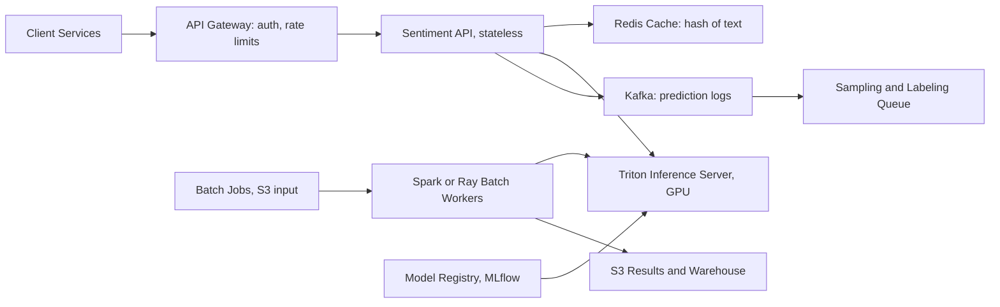

# Sentiment Analysis Service

**Category:** AI/ML System Design
**Difficulty:** 🟢 Easy
**Seniority:** mid
**Companies:** Amazon, Microsoft, Salesforce, Yelp, Zendesk, Sprinklr
**Tags:** nlp, text-classification, transformers, model-serving, batching, distillation
**Time:** 45 min

---

## Problem Statement

Design a sentiment analysis service that internal teams call to classify text (product reviews, support tickets, social posts) as **positive, negative, or neutral**, with a confidence score. The service is used both synchronously (a support tool flags angry tickets as they arrive) and in bulk (analytics re-scores millions of reviews nightly).

Expect around **2,000 requests/s** of real-time traffic at peak and **50M documents/day** of batch jobs, in English plus 10 other major languages.

## Clarifying Questions

- What labels do we need? *Three classes (positive/negative/neutral) plus a score; aspect-level sentiment is a stretch goal.*
- What's the input length? *Mostly short: reviews median 60 tokens, tickets up to ~1,000 tokens.*
- What latency do real-time callers need? *p99 < 150 ms for a single text.*
- Is there labeled data? *~200K labeled reviews (star ratings) and ~20K human-labeled support tickets.*
- Do different domains need different models? *Ideally one service; domain shift between reviews and tickets is real.*
- Is cost a concern? *Yes, keep GPU footprint modest; batch traffic should use spare capacity.*
- Any privacy constraints? *Tickets contain PII; data must stay in our cloud, no third-party APIs.*

## Requirements

### Functional

- `POST /v1/sentiment` for 1-64 texts, returns label, score, and model version per text.
- Async batch API that reads from S3 and writes results back.
- Support 11 languages; return `language` detected.
- Optional domain hint (`review`, `ticket`, `social`).

### Non-Functional

- Real-time: 2K req/s peak, p99 < 150 ms.
- Batch: 50M docs/day completed within a 6-hour window.
- Macro-F1 ≥ 0.85 on the English eval set, ≥ 0.80 on others.
- 99.9% availability for the real-time API.
- Versioned models with reproducible outputs for analytics.

### Out of Scope

- Emotion classification (anger, joy...) and sarcasm-specific modeling beyond what the model learns.
- Training a foundation model from scratch.

## Problem Framing

- **ML objective:** 3-class text classification with calibrated probabilities.
- **Business metrics:** for support, time-to-first-response on negative tickets and CSAT; for analytics, correlation between sentiment trends and star ratings / churn.
- **Model metrics:** macro-F1 (neutral is the hardest and minority-ish class), per-class precision/recall, expected calibration error (ECE).
- **Constraints:**
  - Latency 150 ms p99 rules out large LLM calls on the hot path (a hosted LLM is 500 ms-2 s and ~100x the cost per call).
  - Throughput: 2K req/s real-time + 50M/6h ≈ 2.3K docs/s batch.
  - Privacy: self-hosted model.

## Data Pipeline

**Data sources**

- Product reviews with star ratings: weak labels (1-2 stars → negative, 3 → neutral, 4-5 → positive). ~5M available, noisy around 3 stars.
- Human-labeled support tickets (20K) and social posts (30K) for domain coverage.
- Public datasets for pretraining/fine-tuning: SST-2/SST-5, Amazon Reviews Multi, TweetEval (check licenses).

**Labeling**

- Annotation guideline with examples for edge cases: mixed sentiment, sarcasm, questions, neutral factual statements.
- 3 annotators per item for the eval set; report Cohen's/Fleiss' kappa (target > 0.7). Disagreement items are adjudicated.
- Active learning: send low-confidence production samples (entropy-ranked) to labelers weekly, ~2K items.
- LLM-assisted labeling: a large LLM pre-labels; humans verify a sample. Speeds labeling ~3x, but evaluation labels stay human-only.

**Preprocessing**

- Language detection (fastText lid.176, < 1 ms).
- Unicode normalization, emoji kept (strong signal), URLs and emails replaced by tokens, PII masked for tickets.
- Truncate to 256 tokens head + tail 128 for long tickets (the end often has the complaint summary).

**Storage**

- Labeled datasets versioned in S3 with DVC or Delta Lake; each model records the dataset snapshot hash.
- Predictions from batch jobs written to Parquet in S3 and loaded into the warehouse (Snowflake/BigQuery).

## Model Design

| Approach | Macro-F1 (est.) | Latency | Notes |
|---|---|---|---|
| Lexicon (VADER) | ~0.60 | < 1 ms | No training, poor on domain text and negation |
| TF-IDF + Logistic Regression | ~0.72 | < 1 ms | Strong baseline, English-centric |
| Fine-tuned XLM-RoBERTa-base (270M) | ~0.88 | ~15 ms GPU | Multilingual, robust to negation |
| Distilled multilingual MiniLM (~118M) | ~0.86 | ~5 ms GPU / 25 ms CPU | Chosen for serving |
| LLM zero/few-shot (GPT-4-class) | ~0.85-0.90 | 500 ms+ | Great for labeling, too slow/expensive inline |

**Chosen architecture**

- **Teacher:** XLM-RoBERTa-large fine-tuned on all labeled data, domain token prepended (`[TICKET]`, `[REVIEW]`).
- **Student:** multilingual MiniLM distilled from the teacher on ~10M unlabeled in-domain texts (soft labels). Retains ~97% of teacher F1 at 1/5 the latency.
- Export to ONNX, INT8/FP16 quantization, served on Triton.
- Keep a TF-IDF LR model as a CPU fallback if GPUs are unavailable.

```text
FUNCTION predict(texts, domain_hint):
    SET results ← []
    FOR text IN texts:
        SET lang ← detect_language(text)
        SET clean ← mask_pii(normalize(text))
        SET input ← domain_token(domain_hint) + truncate_head_tail(clean, 256, 128)
        APPEND (input, lang) TO batch
    SET logits ← triton.infer("sentiment-student", batch)      // dynamic batching server-side
    FOR i, l IN enumerate(logits):
        SET probs ← softmax(l / temperature)                     // temperature from calibration
        APPEND {label: argmax(probs), score: max(probs), lang: batch[i].lang} TO results
    RETURN results
```

## Training & Evaluation

**Training**

- Fine-tune teacher: AdamW, lr 1e-5, 3 epochs, class weights to counter the neutral imbalance.
- Distill student: loss = 0.5 · CE(hard labels) + 0.5 · KL(student ‖ teacher, T = 2).
- Temperature scaling on validation for calibration (ECE target < 0.03).

**Validation**

- Stratified split by language and domain; also hold out whole products/customers to avoid leakage of near-duplicate reviews.
- Golden eval set: 5K human-labeled per major language, never used for training.
- Challenge sets: negation ("not bad at all"), sarcasm, mixed sentiment, emoji-only, code-switched text. Track these separately, as with CheckList-style behavioral tests.

**Offline metrics:** macro-F1, per-class recall (especially negative recall for the support use case), ECE, per-language F1.

**Online evaluation**

- Support tool: A/B test routing with the new model; metric is time-to-first-response for truly negative tickets and agent override rate ("agent changed the label").
- Analytics: compare new vs old model on a rolling sample; large distribution shifts need sign-off because they break historical dashboards.

## Serving Architecture



**Online path**

1. Gateway authenticates the caller (per-team quotas) and forwards to the stateless API pods.
2. API computes `sha256(normalized_text + model_version)` and checks Redis; social posts and templated tickets give ~15-25% hit rate. TTL 7 days.
3. Misses are preprocessed and sent to Triton, which batches dynamically (max batch 64, max queue delay 5 ms).
4. Response returned; prediction logged (text hashed, PII-masked sample kept) to Kafka.

**Latency budget (p99)**

| Step | Budget |
|---|---|
| Gateway + auth | 10 ms |
| Preprocess + language detect | 5 ms |
| Cache lookup | 2 ms |
| Queue + batched inference (seq 256, FP16) | 40 ms |
| Postprocess + serialize | 3 ms |
| **Total** | **~60 ms**, headroom to 150 ms |

**Capacity**

- A10G running MiniLM FP16 at seq ~128 handles ~1,500-2,000 seq/s with batching.
- Real-time 2K req/s × ~1.5 texts avg = 3K texts/s → 3 GPUs at 60% utilization, run 4-5 across 2 AZs.
- Batch 2.3K docs/s runs on the same Triton fleet at night when real-time traffic is low, with a priority queue so real-time requests preempt batch.

## Monitoring & Iteration

- **System:** p50/p99 latency, GPU utilization, queue depth, error rate, cache hit rate. Autoscale Triton on queue depth and GPU utilization.
- **Prediction drift:** daily label distribution per domain/language; alert if negative share shifts > 5 points without a known event (could be a product incident or a model bug).
- **Input drift:** language mix, text length, OOV-token rate. A new product launch or new market introduces new vocabulary.
- **Feedback:** agent overrides in the support tool become labels; low-confidence samples go to the active learning queue.
- **Retraining:** monthly or when golden-set F1 drops > 2 points on a fresh human-labeled sample; candidate must beat production on golden + challenge sets.
- **Versioning:** callers can pin `model_version` for analytics consistency; old versions kept for 90 days.
- **Cost:** caching, distillation, and sharing the GPU fleet between real-time and batch keeps the footprint at ~5 GPUs.

## Trade-offs

| Decision | Option A | Option B | Choice & Why |
|---|---|---|---|
| Model | LLM API zero-shot | Fine-tuned distilled transformer | Distilled: 10x lower latency, ~100x cheaper, data stays in-house |
| Languages | One model per language | Single multilingual model | Multilingual: simpler ops, cross-lingual transfer helps low-resource languages |
| Hardware | CPU-only | GPU with dynamic batching | GPU: 2K+ req/s at 256 tokens is cheaper on GPUs; CPU fallback kept for resilience |
| Batch vs real-time infra | Separate fleets | Shared fleet with priority | Shared: batch fills idle night capacity |
| Labels | Star ratings only | Stars + human labels | Both: stars give scale, humans fix neutral and domain shift |

## Follow-up Questions

1. **How would you add aspect-based sentiment ("battery great, screen bad")?** Extract aspects with a span tagger or LLM-assisted labeling, then classify sentiment per (text, aspect) pair as a cross-encoder input.
2. **How do you handle sarcasm?** Hard in general; add sarcasm-rich training data (social media), monitor a sarcasm challenge set, and accept lower confidence there rather than overpromising.
3. **A team says the scores shifted after an upgrade and broke their dashboards. How do you prevent this?** Version pinning, shadow scoring of the new version, publish distribution diffs, and backfill history with the new model on request.
4. **Traffic grows 10x. What changes?** Horizontal Triton scale-out, more aggressive caching, INT8 quantization, and moving short texts to CPU replicas.
5. **How would you use LLMs here?** As teachers and labelers offline, and possibly as a fallback for low-confidence or long texts where the latency budget allows.

## Common Mistakes

- Using accuracy on an imbalanced 3-class problem instead of macro-F1 and per-class recall.
- Treating star ratings as clean labels, especially for 3-star reviews.
- Calling a large LLM per request without considering latency and cost at 2K req/s.
- Ignoring calibration, so downstream thresholds ("alert if negative > 0.8") are meaningless.
- No model versioning, which breaks historical analytics when the model changes.

## Key Takeaways

- A fine-tuned, distilled transformer is the sweet spot for accuracy, latency, and cost.
- Weak labels give scale; a human-labeled golden set and challenge sets give trustworthy evaluation.
- Dynamic batching, caching, and a shared fleet for real-time and batch keep GPU cost low.
- Version and calibrate outputs because downstream teams build dashboards and alerts on them.
