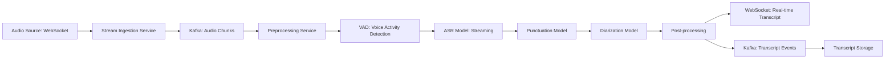
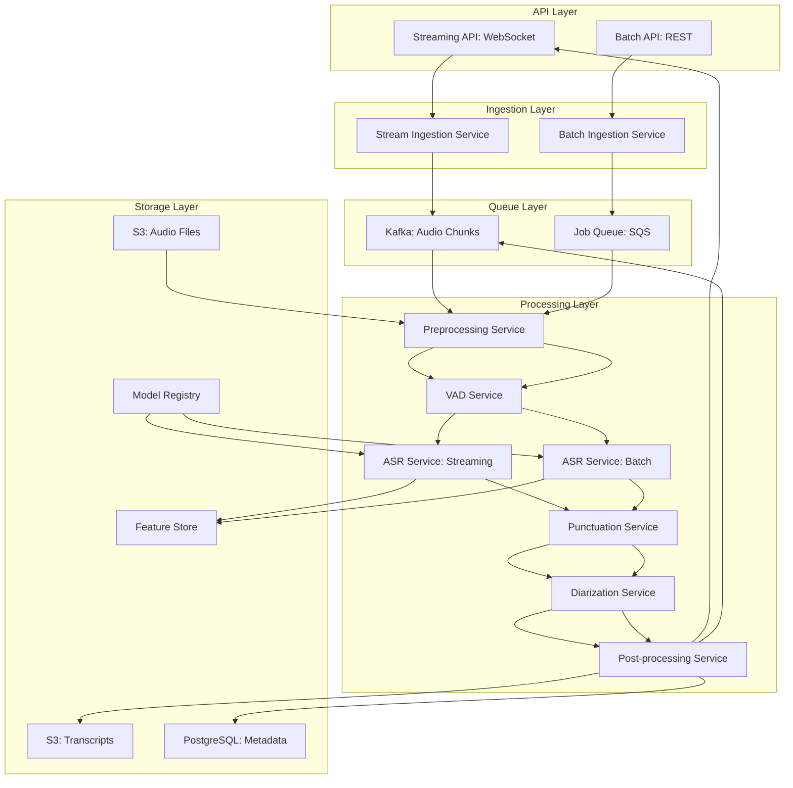

# Speech to Text Pipeline

**Category:** AI/ML System Design
**Difficulty:** 🟡 Medium
**Seniority:** mid-level
**Companies:** Google, Amazon
**Tags:** ASR, streaming, batching
**Time:** 60-90 min

---

## Problem Statement

Design a speech-to-text (Automatic Speech Recognition - ASR) pipeline that can transcribe audio streams in real-time for live applications and process batch audio files for offline use cases. The system should handle multiple audio formats, support speaker diarization (identifying different speakers), and provide word-level timestamps.

The platform processes **10,000 hours of audio per day** with two main use cases:
1. **Real-time streaming:** 1,000 concurrent live streams (meetings, calls, broadcasts) with latency < 2 seconds
2. **Batch processing:** 8,000 hours of pre-recorded audio (podcasts, call recordings, voicemails) processed within 24 hours

Audio quality varies from studio recordings to phone calls with background noise. The system must support multiple languages and accents.

## Clarifying Questions

- What audio formats and quality? *WAV, MP3, FLAC, Opus; sample rates 8kHz-48kHz; phone quality to studio quality.*
- What languages? *Start with English; mention extensibility for 50+ languages.*
- What's the real-time latency requirement? *< 2 seconds from speech to transcript for live streams.*
- Do we need speaker diarization? *Yes, identify and label different speakers (Speaker A, Speaker B, or names if known).*
- Do we need word timestamps? *Yes, for highlighting and synchronization.*
- What accuracy requirements? *WER (Word Error Rate) < 10% for clean audio, < 20% for noisy audio.*
- What's the batch SLA? *24 hours for all batch jobs, with priority tiers.*
- Do we need punctuation and capitalization? *Yes, output readable text with proper formatting.*
- Do we need custom vocabulary? *Yes, support domain-specific terms (product names, acronyms).*

## Requirements

### Functional

- Accept audio via streaming API (WebSocket) and file upload.
- Transcribe audio to text with word-level timestamps.
- Perform speaker diarization (identify and segment speakers).
- Add punctuation and capitalization to transcripts.
- Support custom vocabulary and language models per customer.
- Return transcripts in real-time for streaming and asynchronously for batch.
- Provide confidence scores at word and segment level.
- Support multiple audio channels (stereo, multi-track recordings).

### Non-Functional

- 1,000 concurrent real-time streams with p95 latency < 2s.
- 10,000 hours/day batch throughput (8 hours processed in parallel).
- 99.9% availability for streaming; 99.5% for batch.
- Scalable to handle burst traffic (e.g., live events).
- Cost-efficient: optimize GPU utilization and batching.
- Data privacy: encrypt audio at rest, support auto-deletion policies.

### Out of Scope

- Speech synthesis (text-to-speech).
- Translation (speech-to-speech or speech-to-text translation).
- Voice biometrics or speaker verification.
- Audio enhancement or noise reduction as a standalone service.

## Problem Framing

- **ML objective:** transcribe audio to text with minimal latency and high accuracy, handling streaming and batch modes.
- **Pipeline stages:**

```text
Audio Input → Preprocessing → VAD → ASR Model → 
Punctuation → Diarization → Post-processing → Output
```

- **Business metrics:** transcription accuracy (WER), latency (streaming), throughput (batch), cost per hour, customer satisfaction.
- **Model metrics:** WER, CER (Character Error Rate), RTF (Real-Time Factor), speaker diarization error rate (DER).
- **Constraints:** real-time latency for streaming, high throughput for batch, variable audio quality, multiple languages.

## Data Pipeline

**Data sources**

- Streaming audio: WebSocket connections, live calls, meetings.
- Batch audio: file uploads (S3, direct upload), call recordings.
- Ground truth: human-corrected transcripts for training.
- Custom vocabularies: per-customer term lists.

**Storage**

- **Object storage** (S3/GCS) for batch audio files and processed transcripts.
- **Streaming storage:** Kafka for real-time audio chunks and transcripts.
- **Database** (PostgreSQL) for metadata, job status, custom vocabularies.
- **Feature store:** audio features, model outputs, intermediate results.

**Streaming pipeline**



**Batch pipeline**


**Preprocessing**

- Audio format conversion: normalize to WAV 16kHz mono for ASR.
- Resampling: convert various sample rates to model input rate.
- Noise reduction: optional enhancement for low-quality audio.
- VAD (Voice Activity Detection): detect speech segments, skip silence.
- Chunking: split audio into overlapping chunks for streaming and batch.

## Model Design

**ASR Models**

| Model Type | Architecture | Use Case | Pros | Cons |
|---|---|---|---|---|
| **Whisper** | Transformer encoder-decoder | General purpose | State-of-the-art accuracy, multilingual | Higher latency, larger model |
| **Conformer** | Conformer (convolution + attention) | Streaming | Good accuracy, efficient | Complex to implement |
| **RNN-Transducer** | RNN + transducer loss | Low-latency streaming | Very low latency | Slightly lower accuracy |
| **Wav2Vec 2.0** | Self-supervised + fine-tune | Batch processing | Good with limited labeled data | Higher compute |

**Chosen architecture:**

- **Streaming:** Conformer-based streaming ASR (similar to Google's current production) for low latency.
- **Batch:** Whisper Large-v3 for highest accuracy.
- **Multi-language:** Separate models per language family or multilingual model.

**Model selection trade-offs**

```text
Streaming mode:
- Model size: Small/Medium (100-300M parameters) for latency
- Chunk size: 500-800ms chunks with 200ms overlap
- Beam size: 1-2 for speed (larger beam for accuracy in batch)

Batch mode:
- Model size: Large (1B+ parameters) for accuracy
- Full audio context: no chunking or large chunks
- Beam size: 5-10 for best accuracy
- Ensemble: multiple models for consensus
```

**Supporting models**

**Punctuation and Capitalization**

- BERT-based model fine-tuned on punctuation restoration.
- Input: raw ASR output (lowercase, no punctuation).
- Output: text with punctuation, capitalization, and sentence boundaries.

**Speaker Diarization**

- **Speaker embedding:** ECAPA-TDNN or x-vector model to extract speaker embeddings.
- **Clustering:** Agglomerative clustering on embeddings to group segments by speaker.
- **Overlap detection:** detect when speakers talk simultaneously.
- **Alternative:** End-to-end diarization models (e.g., Pyannote.audio).

**Voice Activity Detection (VAD)**

- Lightweight model (Silero VAD) to detect speech vs silence.
- Reduces processing by skipping silent segments.
- Critical for streaming to minimize latency.

**Custom vocabulary**

- **Language model bias:** add custom terms to the decoder's language model (n-gram or neural LM).
- **Finite state transducer (FST):** incorporate custom vocabulary into the decoding graph.
- **Post-processing:** replace placeholders with custom terms using fuzzy matching.

```text
FUNCTION transcribe_streaming(audio_stream, config):
    SET transcript ← ""
    SET speaker_embeddings ← []
    
    FOR EACH chunk IN audio_stream.chunks(500ms, 200ms_overlap):
        SET is_speech ← vad.predict(chunk)
        IF NOT is_speech:
            CONTINUE
        
        SET features ← extract_features(chunk)
        SET partial ← asr_model.streaming_decode(features, config.lm_bias)
        SET punctuated ← punctuation_model.add_punctuation(partial.text)
        
        SET speaker_emb ← speaker_embedding_model.extract(features)
        speaker_embeddings.append(speaker_emb)
        
        IF len(speaker_embeddings) > 10:  // Enough for clustering
            SET speaker_label ← cluster_speakers(speaker_embeddings)
        
        SET result ← {
            text: punctuated,
            speaker: speaker_label,
            timestamp: chunk.start_time,
            confidence: partial.confidence
        }
        
        SEND_TO_CLIENT(result)
        transcript += punctuated + " "
    
    RETURN finalize_transcript(transcript)
```

## Training & Evaluation

**Training data**

- **Public datasets:** LibriSpeech (clean English), Common Voice (diverse accents), VoxPopuli (multilingual), Switchboard (conversational).
- **Internal data:** customer call recordings with human transcripts (with consent).
- **Data augmentation:** speed perturbation (0.8x, 0.9x, 1.0x, 1.1x, 1.2x), noise injection (SpecAugment), reverberation.
- **Domain adaptation:** fine-tune on specific domains (medical, legal, technical) with custom vocabulary.

**Validation strategy**

- **Holdout test sets:** LibriSpeech test-clean, test-other; internal test set.
- **Cross-validation:** for hyperparameter tuning.
- **A/B testing:** compare models in production on subset of traffic.

**Offline metrics**

- **WER (Word Error Rate):** standard ASR metric.
- **CER (Character Error Rate):** for languages without word boundaries.
- **RTF (Real-Time Factor):** processing time / audio duration (target < 1 for streaming).
- **DER (Diarization Error Rate):** speaker identification accuracy.
- **Latency metrics:** time from audio end to transcript delivery.

**Online evaluation**

- **Streaming:** measure end-to-end latency, compare with human spot-checks.
- **Batch:** random sample of transcripts reviewed by humans.
- **Customer feedback:** correction mechanisms for bad transcripts.

## System Architecture

**Service components**



**Streaming architecture**

- **WebSocket gateway:** handles 1,000+ concurrent connections.
- **Stream processing:** each connection has a dedicated worker or shared worker pool.
- **State management:** maintain decoder state across chunks for continuity.
- **Chunk buffering:** small buffer (100-200ms) to smooth network jitter.

**Batch architecture**

- **Job queue:** SQS or similar for distributed task distribution.
- **Worker pool:** auto-scaling based on queue depth.
- **GPU instances:** optimized for batch throughput (larger batch sizes).
- **Priority queues:** expedited processing for high-priority jobs.

**Latency budget (streaming, p95)**

| Step | Budget |
|---|---|
| Audio chunk receipt | 50ms |
| Preprocessing + VAD | 100ms |
| ASR inference (500ms chunk) | 800ms |
| Punctuation | 50ms |
| Diarization (async) | 300ms |
| Network + serialization | 100ms |
| **Total** | **~1.4s** (target < 2s) |

**Capacity planning**

**Streaming:**
- 1,000 concurrent streams × 2 hours avg duration = 2,000 hours/day streaming
- Each stream: 1 core for preprocessing + VAD, 0.5 GPU for ASR
- Total: 1,000 cores, 500 GPUs for streaming (with batching, can share GPUs)

**Batch:**
- 8,000 hours/day = 333 hours/hour average
- Batch ASR: 0.1 RTF on GPU → 33 GPUs needed
- Peak (2x): 66 GPUs
- Total GPU capacity: 500 (streaming) + 100 (batch) = 600 GPUs

**Optimization:**

- **GPU sharing:** multiple streams can share a GPU with batching.
- **Model quantization:** INT8 quantization for 2x throughput improvement.
- **Spot instances:** use spot instances for batch processing to reduce cost.
- **Regional deployment:** deploy closer to users for lower latency.

## Monitoring & Iteration

**Real-time monitoring**

- **Streaming:** concurrent connections, latency percentiles, error rates, GPU utilization.
- **Batch:** queue depth, processing time, job completion rate, cost.
- **Model metrics:** WER on sampled transcripts, confidence distribution.
- **Infrastructure:** GPU temperature, memory usage, network bandwidth.

**Model monitoring**

- **Drift detection:** monitor audio quality distribution, WER trends.
- **Error analysis:** categorize common errors (homophones, proper nouns, accents).
- **A/B testing:** deploy new models to subset of traffic, compare metrics.

**Retraining pipeline**

- Monthly retraining with new data from customer recordings.
- Continuous evaluation on holdout sets.
- Automated rollback if performance degrades.
- Domain-specific fine-tuning for high-value customers.

**Feedback loop**

- **Correction interface:** allow users to edit transcripts.
- **Active learning:** prioritize uncertain transcripts for human review.
- **Custom vocabulary:** learn from corrections to improve domain-specific terms.

## Trade-offs

| Decision | Option A | Option B | Choice & Why |
|---|---|---|---|
| ASR Model | Single model for all | Separate streaming/batch models | Separate: streaming optimized for latency, batch for accuracy |
| Diarization | Real-time per chunk | Batch after full audio | Batch: more accurate with full context; async for streaming |
| Punctuation | Integrated in ASR | Separate model | Separate: cleaner architecture, can update independently |
| GPU utilization | Dedicated per stream | Shared with batching | Shared: better cost efficiency, handle burst traffic |
| Custom vocab | FST in decoder | Post-processing replacement | FST: better integration with language model |

## Follow-up Questions

1. **How do you handle overlapping speech in diarization?** Use overlap detection model, separate overlapping segments, or use end-to-end diarization models designed for overlap.
2. **How do you handle different accents and dialects?** Train on diverse datasets (Common Voice), include accent as a feature, or use accent-specific models for major regions.
3. **How do you optimize for low-latency live events?** Pre-warm GPU instances, use smaller model, reduce beam size, deploy edge nodes closer to event.
4. **How do you handle very long audio files (10+ hours)?** Split into manageable chunks, process in parallel, merge transcripts with timestamp alignment.
5. **How do you ensure data privacy for sensitive audio?** Encrypt at rest and in transit, auto-delete after retention period, comply with regulations (GDPR, HIPAA).

## Common Mistakes

- Using the same model for streaming and batch without optimization.
- Ignoring VAD, processing silence and wasting compute.
- Not handling speaker diarization, resulting in confusing transcripts.
- Overlooking punctuation and capitalization, producing unreadable output.
- Not planning for GPU sharing and cost optimization.
- Ignoring audio quality variations and domain-specific vocabulary.

## Key Takeaways

- ASR requires different optimizations for streaming (latency) vs batch (accuracy).
- Pipeline: preprocessing → VAD → ASR → punctuation → diarization → post-processing.
- Speaker diarization is critical for multi-speaker audio; use embeddings + clustering.
- Custom vocabulary integration via language model biasing improves domain accuracy.
- GPU sharing and batching are essential for cost efficiency at scale.
- Continuous feedback from corrections drives model improvement.
- Monitor both technical metrics (latency, throughput) and quality metrics (WER).
