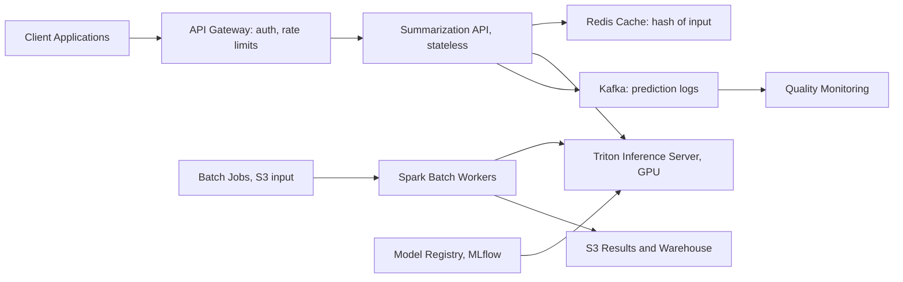

# Text Summarization Service

**Category:** AI/ML System Design
**Difficulty:** 🟢 Easy
**Seniority:** Junior
**Companies:** Common ML service (Google, Microsoft, Meta, OpenAI, Anthropic)
**Tags:** nlp, seq2seq, caching, model-serving, batching, abstractive-summarization
**Time:** 45-60 min

---

## Problem Statement

Design a text summarization service that takes long-form content (articles, reports, meeting transcripts) and generates concise summaries. The service is used by internal teams for content curation, by a news aggregator for article previews, and by a meeting platform for automatic meeting summaries.

Expect around **500 requests/s** of real-time traffic and **10M documents/day** of batch processing. Input texts range from 500 to 10,000 tokens, with target summaries of 100-300 tokens. Support for English and Spanish is required.

## Clarifying Questions

- What type of summarization? *Abstractive (generate new sentences) preferred over extractive (select sentences).*
- What's the target summary length? *Flexible: 10-20% of input length, or user-specified length.*
- What latency for real-time? *p99 < 500 ms for typical 2K-token inputs.*
- What quality metrics matter? *ROUGE scores, factual consistency, readability.*
- Do we need different summary styles? *Bullet points for meetings, paragraph for articles.*
- Is there labeled data? *~50K article-summary pairs for training.*
- Cost constraints? *Yes, minimize GPU usage; batch can use spare capacity.*
- Any domain-specific requirements? *Meeting transcripts have speaker labels; articles have titles.*

## Requirements

### Functional

- `POST /v1/summarize` with text, optional `max_length`, `style` (paragraph/bullets), `language`.
- Async batch API for processing large document collections.
- Support English and Spanish; auto-detect language.
- Return summary with confidence score and model version.

### Non-Functional

- Real-time: 500 req/s peak, p99 < 500 ms for 2K-token inputs.
- Batch: 10M docs/day completed within 8-hour window.
- ROUGE-2 ≥ 0.45 on English eval set, ≥ 0.40 on Spanish.
- 99.9% availability for real-time API.
- Versioned models with reproducible outputs.

### Out of Scope

- Multi-document summarization (summarizing multiple related documents).
- Query-focused summarization (summarizing based on a specific question).
- Training a foundation model from scratch.

## Problem Framing

- **ML objective:** sequence-to-sequence abstractive summarization with length control.
- **Business metrics:** user engagement (click-through on summaries), time saved reading, editor satisfaction.
- **Model metrics:** ROUGE-1/2/L, BERTScore, factual consistency (via NLI or LLM judge), summary length adherence.
- **Constraints:**
  - Latency 500 ms p99 for real-time requires efficient models and batching.
  - Throughput: 500 req/s real-time + 10M/8h ≈ 350 docs/s batch.
  - Cost: GPU infrastructure must be justified by value.

## Data Pipeline

**Data sources**

- News article-summary pairs from public datasets (CNN/DailyMail, XSum, MLSum) - ~300K pairs.
- Internal article summaries from editors - ~50K high-quality pairs.
- Meeting transcripts with human-written summaries - ~20K pairs.
- Synthetic data: use LLMs to generate summaries from unlabeled articles for pretraining.

**Labeling**

- Annotation guidelines for summary quality: factual accuracy, coverage, fluency, length.
- Human evaluation on a golden set of 1K articles across domains.
- Active learning: send low-confidence or high-disagreement samples to editors for labeling.
- LLM-assisted labeling: large LLM generates summaries, editors refine (saves ~60% time).

**Preprocessing**

- Language detection (fastText or CLD3).
- Text cleaning: remove HTML, normalize whitespace, handle special characters.
- For meeting transcripts: preserve speaker labels as special tokens `[SPEAKER_A]:`.
- Truncate long inputs to 8K tokens (head + tail strategy for very long documents).

**Storage**

- Training datasets versioned in S3 with DVC or Delta Lake.
- Predictions from batch jobs written to Parquet and loaded into data warehouse.
- Summary cache in Redis for identical or near-identical inputs.

## Model Design

| Approach | ROUGE-2 (est.) | Latency | Notes |
|---|---|---|---|
| Extractive (TextRank) | ~0.35 | < 10 ms | No training, robotic output |
| T5-base (220M) | ~0.42 | ~50 ms GPU | Good baseline, multilingual |
| BART-large (400M) | ~0.46 | ~80 ms GPU | Stronger, slower |
| PEGASUS (568M) | ~0.48 | ~100 ms GPU | Summarization-optimized |
| Distilled T5-small (60M) | ~0.40 | ~15 ms GPU | Chosen for serving |
| LLM (GPT-4-class) | ~0.50+ | 500-1000 ms | Too slow/expensive for volume |

**Chosen architecture**

- **Teacher:** BART-large fine-tuned on all labeled data with domain adapters (news, meetings).
- **Student:** T5-small distilled from teacher on ~5M unlabeled articles using sequence-level knowledge distillation.
- Export to ONNX, INT8 quantization for serving.
- Keep extractive baseline as CPU fallback.

```text
FUNCTION summarize(text, max_length, style, language):
    SET clean ← normalize(text)
    SET lang ← detect_language(clean) OR language
    SET input ← truncate(clean, max_tokens = 8192)
    IF style == "bullets":
        SET prefix ← "summarize in bullet points: "
    ELSE:
        SET prefix ← "summarize: "
    SET encoded ← tokenizer(prefix + input, max_length = 8192)
    SET summary ← model.generate(encoded,
                                max_length = max_length,
                                min_length = max(50, max_length // 4),
                                num_beams = 4,
                                length_penalty = 1.0)
    RETURN {summary: summary, language: lang, model_version: current}
```

## Training & Evaluation

**Training**

- Fine-tune teacher: AdamW, lr 3e-5, 3 epochs, gradient accumulation for large batches.
- Distillation: student learns from teacher's soft labels with temperature T=2, plus hard label loss.
- Length penalty tuned during training to match target length constraints.

**Validation**

- Stratified split by domain (news, meetings, reports) and language.
- Golden eval set: 2K human-graded summaries, never used in training.
- Challenge sets: very long documents, multi-speaker meetings, documents with numbers/quotes.

**Offline metrics:** ROUGE-1/2/L, BERTScore, length adherence, factual consistency (using NLI models or LLM-as-judge).

**Online evaluation**

- A/B test new model vs old on production traffic.
- Metrics: user click-through rate on summaries, editor approval rate, summary edit rate.
- Monitor for factual errors via user feedback flags.

## Serving Architecture



**Online path**

1. Gateway authenticates and rate-limits per API key.
2. API computes cache key from normalized text + parameters; ~20% hit rate for duplicate content. TTL 24 hours.
3. Misses are preprocessed and sent to Triton with dynamic batching (max batch 32, max wait 10 ms).
4. Response returned; prediction logged to Kafka for quality monitoring.

**Latency budget (p99)**

| Step | Budget |
|---|---|
| Gateway + auth | 20 ms |
| Preprocess + language detect | 10 ms |
| Cache lookup | 5 ms |
| Queue + batched inference (seq 2K, INT8) | 200 ms |
| Postprocess + serialize | 5 ms |
| **Total** | **~240 ms**, headroom to 500 ms |

**Capacity**

- T5-small INT8 on A10G handles ~3,000 seq/s with batching.
- Real-time 500 req/s × ~1.5K tokens avg = 750K tokens/s → 1 GPU at 25% utilization, run 2 for redundancy.
- Batch 350 docs/s runs on same fleet during off-peak hours.

## Monitoring & Iteration

- **System:** p50/p99 latency, GPU utilization, queue depth, error rate, cache hit rate.
- **Quality:** daily ROUGE scores on golden set, factual consistency checks, user feedback (thumbs up/down).
- **Input drift:** text length distribution, language mix, domain distribution.
- **Feedback:** user edits to summaries become training data; low-confidence samples sent for labeling.
- **Retraining:** quarterly or when golden-set ROUGE drops > 2 points.
- **Versioning:** callers can pin `model_version` for consistency; old versions kept 60 days.
- **Cost:** distillation, caching, and shared fleet keep GPU footprint at ~2 GPUs.

## Trade-offs

| Decision | Option A | Option B | Choice & Why |
|---|---|---|---|
| Model | Large LLM API | Distilled seq2seq | Distilled: 5x lower latency, 20x cheaper, data control |
| Summarization | Extractive | Abstractive | Abstractive: more natural, better user experience |
| Batching | Static batch size | Dynamic batching | Dynamic: better latency/throughput tradeoff |
| Languages | Separate models | Single multilingual | Multilingual: simpler ops, cross-lingual transfer |
| Length control | Hard truncation | Learned length penalty | Learned: more natural summaries |

## Follow-up Questions

1. **How would you handle very long documents (>10K tokens)?** Hierarchical summarization: summarize sections first, then summarize section summaries, or use map-reduce with overlapping windows.
2. **How do you ensure factual consistency?** Use NLI models to check summary facts against source, add factual consistency to training loss, and monitor user-reported errors.
3. **A user wants different summary styles (executive, technical, simple). How?** Add style adapters or prompts, train style-specific models, or use a larger model with style conditioning.
4. **How would you add query-focused summarization?** Use query-aware attention mechanisms, or retrieve relevant passages first then summarize with query context.
5. **Traffic grows 10x. What changes?** More GPUs, aggressive caching, move short texts to CPU, consider model sharding across regions.

## Common Mistakes

- Using only ROUGE scores without checking factual consistency.
- Ignoring length constraints, leading to summaries that are too long or too short.
- Not handling different domains (news vs meetings) with domain-specific fine-tuning.
- Over-truncating long documents, losing important information.
- No model versioning, breaking downstream systems when models change.

## Key Takeaways

- Distilled seq2seq models balance quality, latency, and cost for summarization at scale.
- Multi-metric evaluation (ROUGE + factual consistency) is essential for summarization.
- Dynamic batching and caching maximize GPU efficiency.
- Domain-specific adapters improve quality across different content types.
- Version models and monitor quality continuously to catch degradation.
