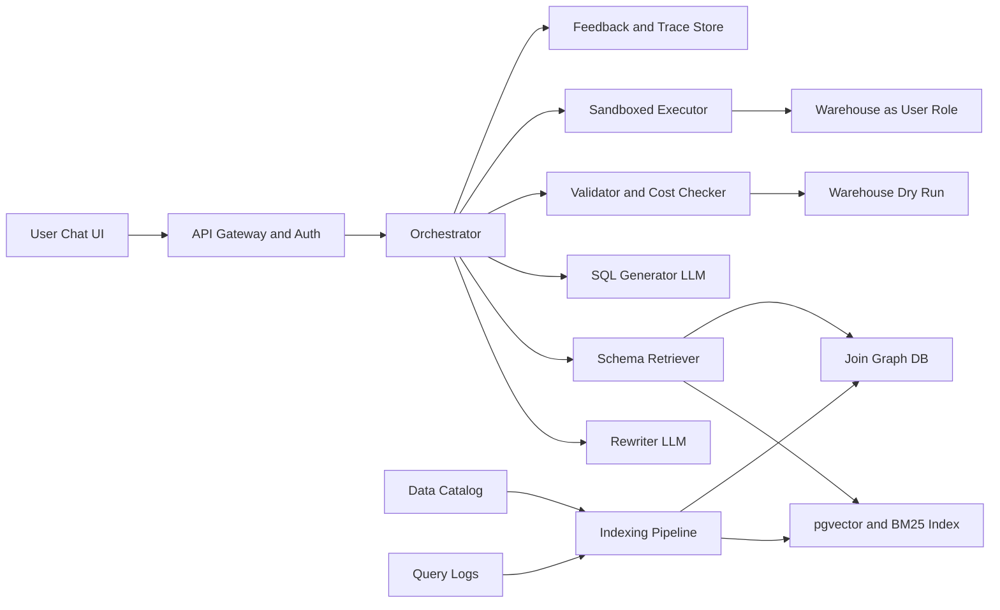

# Text-to-SQL Assistant

**Category:** AI/ML System Design
**Difficulty:** 🟡 Medium
**Seniority:** senior
**Companies:** Databricks, Snowflake, Microsoft, Google, Uber, Airbnb, Salesforce
**Tags:** llm, text-to-sql, schema-retrieval, sql-validation, sandboxing, access-control, llm-evaluation
**Time:** 45 min

---

## Problem Statement

Design an assistant that lets business users ask natural-language questions ("What was weekly revenue by region last quarter, excluding refunds?") over a company data warehouse and get back a correct SQL query, the result table, and an optional chart with a short explanation. The assistant must work over a large, messy schema and must never expose data a user is not allowed to see.

Scale hint: a warehouse (Snowflake, BigQuery, or Databricks) with ~5,000 tables, ~200,000 columns, and ~20,000 internal users issuing ~100K questions/day. Answers should start streaming within ~3 s and complete within ~15 s for typical queries. The interviewer wants schema retrieval (the full schema does not fit in a prompt), SQL generation, validation and sandboxed execution, permission enforcement, and how you measure correctness.

## Clarifying Questions

- Who are the users? *Analysts and non-technical business users; analysts can edit the SQL, others only see results.*
- Which SQL dialect and engine? *Snowflake primarily; design should be dialect-pluggable via a SQL parser such as sqlglot.*
- Is there existing metadata? *A data catalog (DataHub or Unity Catalog) with table/column descriptions for ~30% of tables, plus query logs for the last 90 days.*
- Read-only? *Yes. Only SELECT queries; no DDL/DML ever.*
- How are permissions defined? *Warehouse RBAC roles plus row-level and column-masking policies; the assistant must run as the end user.*
- Multi-turn? *Yes, follow-ups like "now break that down by channel" should reuse context.*
- Is there a semantic layer? *A curated metrics layer (dbt Semantic Layer / LookML) exists for ~300 key metrics like revenue and active users.*
- Cost limits? *Queries capped at a warehouse credit budget; LLM cost target below $0.05 per question.*

## Requirements

### Functional

- Translate NL questions (and follow-ups) into dialect-correct SQL.
- Retrieve relevant tables, columns, join paths, and metric definitions from a large schema.
- Validate, cost-check, and execute SQL in a read-only sandbox under the user's identity.
- Return result table, auto-chart, SQL, and a plain-language explanation of assumptions.
- Ask clarifying questions when the question is ambiguous (e.g. "revenue" gross vs net).
- Collect feedback (thumbs, edits) to improve the system.

### Non-Functional

- Time to first token under 3 s, p95 end-to-end under 15 s excluding long-running warehouse queries.
- Execution accuracy target above 85% on internal golden set; zero permission leaks.
- Never run mutating statements; queries limited by timeout (60 s) and scanned-bytes caps.
- Data residency: no warehouse rows sent to external LLM providers unless approved; prefer hosted models in the VPC.

### Out of Scope

- Building the warehouse, ETL, or BI dashboards.
- Writing back to tables or scheduling queries.

## Problem Framing

- **Task:** conditional generation: given question q, conversation history h, and retrieved schema context S, generate SQL y such that executing y returns the answer the user intended.
- **Why not just prompt with the schema:** 200K columns at ~15 tokens each is ~3M tokens; even a 1M-token context is slow, costly, and degrades accuracy. Retrieval over schema is the core problem, closer to RAG than to a pure generation task.
- **Business metrics:** weekly active askers, questions answered without analyst help, analyst hours saved, share of answers accepted without edit.
- **Model metrics:** execution accuracy (result set matches gold), exact-set-match on SQL components, schema-retrieval recall@k (gold tables present in context), valid-SQL rate, clarification precision.
- **Constraints:** correctness over fluency (a plausible wrong number is worse than "I don't know"), strict access control, warehouse cost, latency, and LLM cost.

## Data Pipeline

- **Schema metadata (nightly + on DDL change events)**
  - Tables, columns, types, primary/foreign keys from information_schema.
  - Catalog descriptions, owners, tags (PII, deprecated, certified).
  - Column value profiles: cardinality, top-50 distinct values for low-cardinality string columns (so "EMEA" maps to `region = 'EMEA'`), min/max for dates.
- **Query logs (90 days)**
  - Mine frequent join paths (table A joins B on col X, with counts) into a join graph.
  - Table popularity and freshness used as retrieval priors; deprecated or unused tables down-weighted.
  - Pair historical queries with LLM-generated question descriptions to build NL-SQL few-shot examples.
- **Semantic layer:** metric definitions (revenue = sum(amount) where status != 'refunded') indexed as first-class documents.
- **Documents to embed:**
  - One doc per table: name, description, column list with descriptions, sample joins.
  - One doc per column for wide tables (above ~100 columns).
  - One doc per metric and per verified NL-SQL example.
- **Storage:** embeddings in pgvector or OpenSearch k-NN (hybrid BM25 + vector, since column names like `cust_ltv_usd` match lexically); join graph in PostgreSQL; profiles in a key-value cache.
- **Labels:** golden set of ~1,500 question/SQL pairs written by analysts across domains, plus accepted user answers and analyst edits as weak labels.

## Model Design

- **Baseline:** single prompt with hand-picked tables per domain + GPT-4-class model. Works for demos; fails on cross-domain questions and large schemas.
- **Chosen pipeline (multi-step, each step small and testable):**
  1. **Question rewriting:** resolve follow-ups into a standalone question using conversation history.
  2. **Metric match:** if the question maps to a certified metric, generate a semantic-layer query instead of raw SQL (higher accuracy, consistent definitions).
  3. **Schema retrieval:** hybrid search returns top-30 tables; a cross-encoder or small LLM reranks to top-5-8; expand with join-graph neighbors needed to connect them; prune columns to the relevant ~50.
  4. **Few-shot selection:** retrieve 3-5 similar verified NL-SQL pairs.
  5. **SQL generation:** LLM produces SQL plus a short list of assumptions, in structured JSON output.
  6. **Validate and repair:** parse, check, dry-run; on error feed the error message back for up to 2 repair attempts.
  7. **Explain:** summarize what the SQL computes and highlight assumptions ("used order_date, not ship_date").
- **Model choice:** a strong hosted model (Claude/GPT-4-class) for generation; a cheap model for rewriting and reranking. Optionally fine-tune an open model (e.g. Qwen2.5-Coder or Llama-3 70B, served with vLLM) on internal NL-SQL pairs for data residency and cost.
- **Fine-tuning vs retrieval:** schema changes daily, so schema knowledge must come from retrieval; fine-tuning only teaches dialect style and company conventions.
- **Ambiguity handling:** if top candidate tables or metrics have close scores, or the LLM flags ambiguity, ask a clarifying question with options instead of guessing.
- **Self-consistency (optional):** generate 3 candidates, execute all on a LIMIT sample, choose the majority result. Adds cost; use only for low-confidence questions.

```text
FUNCTION answer(user, question, history)
    SET q ← rewrite_standalone(question, history)
    IF metric ← match_certified_metric(q) THEN
        RETURN run_semantic_layer(user, metric, q)
    SET tables ← hybrid_search(q, k = 30) FILTERED BY tables_visible_to(user)
    SET tables ← rerank(q, tables, top = 8)
    SET tables ← tables ∪ join_path_tables(tables)
    SET context ← build_schema_prompt(tables, column_profiles, few_shots(q))
    FOR attempt IN 1..3
        SET sql ← llm_generate(q, context)
        SET err ← validate(sql, user)          // parse, allow-list, cost, dry-run
        IF err IS NULL THEN BREAK
        SET context ← context + err
    IF err IS NOT NULL THEN RETURN ask_for_help(q, err)
    SET rows ← execute_as_user(user, sql, timeout = 60s, limit = 10000)
    RETURN {sql, rows, chart(rows), explain(sql, q)}
```

## Training & Evaluation

- **Golden set:** ~1,500 analyst-written pairs stratified by domain and difficulty (single-table, joins, window functions, time logic). Refresh quarterly; keep a held-out slice never used as few-shot examples.
- **Execution accuracy:** run predicted and gold SQL against a frozen snapshot; compare result sets ignoring row order and column aliases. This is the primary metric because many distinct SQL strings are correct.
- **Component metrics:** retrieval recall@8 of gold tables (target above 95%; generation cannot fix missed tables), valid-SQL rate, repair success rate, clarification rate.
- **Public benchmarks:** Spider and BIRD for sanity checks only; internal schemas are far messier.
- **LLM-as-judge:** grade explanation faithfulness and whether assumptions were surfaced; calibrate against human labels.
- **Regression gating:** every prompt, model, or retrieval change runs the full golden set in CI; block if accuracy drops more than 1 point.
- **Online metrics:** answer acceptance rate, edit distance of analyst edits, follow-up "that's wrong" rate, thumbs-down rate, time to answer, and warehouse cost per question. A/B test new prompts on 10% traffic.

## Serving Architecture



1. User sends a question; gateway authenticates via SSO and attaches the user's warehouse role.
2. Orchestrator rewrites the question, retrieves schema (filtered to tables the user can see), and generates SQL.
3. Validator parses with sqlglot, checks the statement is a single SELECT, rejects banned functions, injects LIMIT, and runs `EXPLAIN` to estimate bytes scanned.
4. Executor runs the query using the user's own OAuth token in a dedicated low-priority warehouse with statement timeout; results streamed back and cached.
5. Explanation and chart spec are generated from SQL and result schema (not raw rows, to limit data sent to the LLM).

**Latency budget (typical):** rewrite 300 ms, retrieval + rerank 400 ms, generation 2-4 s (streamed), validation + dry-run 500 ms, execution 1-10 s, explanation 1 s in parallel with execution.

**Caching:** semantic cache on (normalized question, user role, schema version) → SQL; result cache keyed by SQL hash plus role with TTL matching table freshness.

### Security and Permissions

- Execute as the user, never as a service account, so row-level security and column masking are enforced by the warehouse itself.
- Filter retrieval to visible tables so the model never even sees names of restricted tables.
- SQL allow-list via AST: only SELECT/WITH; no multiple statements, no `COPY`, `CALL`, external functions, or system tables.
- Prompt injection: column comments and data values are untrusted; never let retrieved text change system instructions, and validation is deterministic regardless of model output.
- Audit log of every question, SQL, and execution for compliance.

## Monitoring & Iteration

- **Quality dashboards:** acceptance rate, error rate by error type (unknown column, timeout, wrong join), clarification rate, per-domain accuracy.
- **Schema drift:** DDL change events trigger reindexing; renamed or dropped columns invalidate cached SQL and few-shot examples referencing them.
- **Feedback loop:** analyst-edited SQL that runs successfully becomes a candidate few-shot example after review; thumbs-down cases are triaged weekly and added to the golden set.
- **Cost control:** route easy questions (single table, matched metric) to a smaller model; cap scanned bytes per query (e.g. 1 TB) and per user per day; alert on runaway warehouse spend.
- **Guardrails:** confidence threshold below which the assistant shows SQL with a "please verify" banner; certified-metric badge when answers come from the semantic layer.

## Trade-offs

| Decision | Option A | Option B | Choice & Why |
|----------|----------|----------|--------------|
| Schema context | Full schema in long context | Retrieve relevant tables | Retrieval: 3M tokens of schema is slow and costly; recall@8 above 95% is achievable with hybrid search plus join graph |
| Execution identity | Shared service account | User's own credentials | User credentials: warehouse RLS/masking enforces permissions; no reimplementation of ACLs |
| Metrics | Free-form SQL always | Route to semantic layer when matched | Semantic layer when possible: consistent definitions and higher accuracy for top metrics |
| Model | Hosted frontier model | Fine-tuned open model in VPC | Start hosted for accuracy, move high-volume steps to fine-tuned open model for cost and residency |
| Ambiguity | Always guess best answer | Ask clarifying question | Ask when confidence is low: a wrong confident number erodes trust faster than one extra turn |

## Follow-up Questions

1. **How do you know a generated query is correct when there is no gold SQL?** Use proxies: execution succeeded, result non-empty, self-consistency agreement across samples, user acceptance, and spot-checks by analysts; surface assumptions so users can catch errors.
2. **How would you handle a 2,000-column table?** Index columns individually, retrieve top-N columns per table, and always include keys and date columns needed for joins and filters.
3. **How do you prevent a query from scanning 50 TB?** Dry-run/EXPLAIN to estimate bytes, enforce partition filters on large tables, inject LIMIT, run in a capped warehouse with timeouts, and ask the user to confirm expensive queries.
4. **How do you support multiple dialects?** Generate in the target dialect with dialect-specific few-shots, and use sqlglot to parse and transpile; validation is per-dialect.
5. **How would you make the assistant learn company jargon?** A glossary of business terms mapped to columns/metrics, indexed for retrieval and editable by data owners.
6. **What if results contain PII that then goes to the LLM for explanation?** Explain from SQL and column metadata only, or send masked/aggregated rows; respect PII tags from the catalog.

## Common Mistakes

- Stuffing the entire schema into the prompt and ignoring retrieval recall as the main bottleneck.
- Running queries under a privileged service account and trying to filter results afterward.
- Relying on the LLM to "not write DELETE" instead of deterministic AST validation and read-only roles.
- Evaluating by SQL string match instead of execution accuracy.
- Ignoring value grounding (the model guesses `'Europe'` when the column stores `'EMEA'`).
- No cost guardrails on warehouse execution.

## Key Takeaways

- Text-to-SQL at enterprise scale is primarily a schema-retrieval and grounding problem; generation is the easier part.
- Enforce safety deterministically: read-only user credentials, AST allow-lists, cost caps, and timeouts.
- Prefer the semantic layer for certified metrics; free-form SQL for the long tail.
- Execution accuracy on an internal golden set, gated in CI, is the backbone of iteration.
- Surface SQL and assumptions so users can verify, and turn their edits into training signal.
