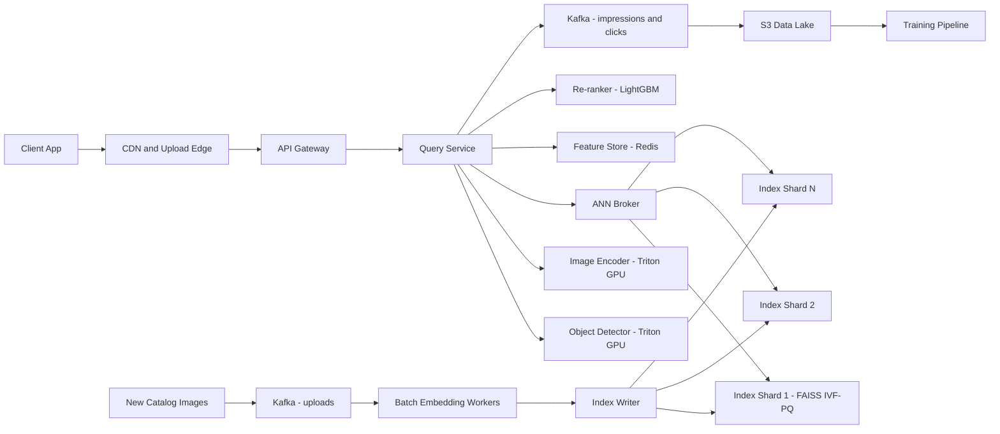

# Visual Image Search

**Category:** AI/ML System Design
**Difficulty:** 🟡 Medium
**Seniority:** senior
**Companies:** Pinterest, Google, Amazon, Meta, eBay, Shopify
**Tags:** embeddings, vector-search, ann-index, contrastive-learning, computer-vision, retrieval
**Time:** 45 min

---

## Problem Statement

Design a visual search system for an e-commerce or social platform: a user uploads a photo (or crops part of an existing image) and gets back visually similar items from a catalog. Think Pinterest Lens or Google Lens shopping: "find me this lamp" or "show me shoes like these".

Scale hint: a catalog of ~1B images, ~5M new images/day, ~20M visual queries/day, p95 latency under 300 ms end-to-end. The interviewer expects an embedding-based retrieval design with object detection, an approximate nearest neighbor index, re-ranking, and a sound evaluation plan.

## Clarifying Questions

- Is the query only an image, or image + text? *Primarily image; optional text refinement ("in red") as a stretch.*
- What does "similar" mean: exact product or visually similar style? *Both: exact match first if it exists, then similar items.*
- Do query images contain multiple objects? *Yes, user photos are cluttered; we must detect and let users pick the object.*
- How fresh must new catalog items be? *Searchable within 1 hour of upload.*
- Do we need filters like price, availability, region? *Yes, availability and region filters are required.*
- What signals exist for training? *Click, save, add-to-cart logs on search results, and product catalog metadata (category, brand).*
- Latency target? *p95 300 ms, including upload processing.*

## Requirements

### Functional

- Accept an image query (upload or crop), detect salient objects, and return top-K (e.g. 50) similar catalog items.
- Support user selecting a detected object region to search on.
- Apply metadata filters (in-stock, region, category) and deduplicate near-identical results.
- Index new catalog images within 1 hour.
- Log impressions and engagement for training and evaluation.

### Non-Functional

- p95 latency 300 ms; throughput ~250 QPS average, ~1,000 QPS peak.
- Index 1B items with recall@100 at least 0.95 versus brute force.
- Availability 99.9%; degrade to fewer results rather than failing.
- Cost-efficient memory footprint for the index.

### Out of Scope

- Text-only search ranking.
- Content moderation of uploaded images (assume an upstream service).

## Problem Framing

- **ML task:** learn an embedding function f(image) such that visually and semantically similar items are close in vector space, then retrieve nearest neighbors and re-rank.
- **Business metrics:** search-to-engagement rate (click, save), add-to-cart / purchase conversion from visual search, queries per session, zero-result rate.
- **Model metrics:** recall@K and mAP on labeled query-product pairs, NDCG@10 after re-ranking, exact-match top-1 accuracy for product identification.
- **Constraints:** 300 ms latency (detection + embedding + ANN + re-rank), index memory at billion scale, freshness of 1 hour, and handling domain gap between user photos (cluttered, poor lighting) and catalog photos (clean studio shots).

## Data Pipeline

- **Data sources**
  - Catalog images with metadata (category, brand, color, price, seller).
  - Engagement logs: query image, shown results, clicks, saves, purchases (Kafka to S3).
  - User-generated content showing products (reviews with photos, pins linked to products) providing real "in the wild" positives.
- **Training pairs**
  - Positives: (user photo, product clicked/purchased), (multiple images of the same SKU), (pin image, linked product).
  - Negatives: in-batch negatives plus hard negatives mined from the current index (visually close but different SKU/category).
  - Label noise from clicks handled by weighting purchases and saves higher than clicks.
- **Labeling:** human raters grade a sample of query-result pairs (exact / similar / irrelevant) for the eval set; ~50K graded pairs across top categories.
- **Preprocessing:** resize to 224 or 336 px, near-duplicate removal via perceptual hash (pHash), object detection to produce crops for catalog images too so query crops and catalog crops are aligned.
- **Storage**
  - Raw images in S3, served via CDN.
  - Embeddings: Parquet in S3 (offline), ANN index shards in memory on serving nodes.
  - Metadata for filtering: a key-value store (Cassandra / DynamoDB) plus filter attributes stored alongside vectors in the index.
- **Index pipeline:** new uploads go to Kafka, then a GPU embedding job (batch size 256), then an incremental index writer; a nightly full rebuild recompacts the index.

## Model Design

- **Baseline:** pretrained ImageNet CNN (ResNet-50) penultimate layer, cosine similarity. Fast to ship but captures generic features, weak on fine-grained product identity.
- **Better:** CLIP / SigLIP ViT-B/16 image encoder, zero-shot. Strong semantic similarity and enables text refinement, but not tuned for SKU-level matching.
- **Chosen:** fine-tune a ViT-B/16 (initialized from CLIP or DINOv2) with a contrastive / metric learning objective on in-domain pairs.
  - Loss: InfoNCE with in-batch negatives (batch 4,096 across GPUs) + hard negatives; optionally an auxiliary category classification head for multi-task signal.
  - Output: 256-d L2-normalized embedding (projected from 768) to cut memory; product quantization later.
- **Object detection:** a lightweight detector (YOLOv8-m or DETR-style) trained on product categories detects objects in query images; top object is auto-selected, others shown as tappable dots.
- **Two-stage retrieval**
  - Stage 1: ANN retrieval of top 1,000 candidates using FAISS IVF-PQ or ScaNN.
  - Stage 2: re-rank the top 1,000 to top 50 with a lightweight model combining exact cosine (on full-precision vectors), metadata match (predicted category vs item category), popularity, quality, and personalization features, using a GBDT (LightGBM LambdaMART).
- **Exact-match boost:** local-feature or high-precision embedding check for near-duplicate (same product) to put exact matches at position 1.

```text
FUNCTION visual_search(query_image, crop_box, filters)
    SET img ← preprocess(query_image)
    IF crop_box IS NULL THEN
        SET boxes ← detector.detect(img)               // ~25 ms on GPU
        SET crop_box ← highest_salience(boxes)
    SET q ← encoder.embed(crop(img, crop_box))         // ~15 ms, 256-d
    SET candidates ← []
    FOR shard IN index_shards PARALLEL
        candidates.extend(shard.search(q, k=200, nprobe=64, filters))
    SET candidates ← top_k_by_score(candidates, 1000)
    SET feats ← feature_store.fetch(candidates)        // metadata, popularity
    SET ranked ← reranker.score(q, candidates, feats)
    RETURN dedupe_by_phash(ranked)[0:50]
```

## Training & Evaluation

- **Offline metrics**
  - Retrieval: recall@10/100, mAP@100 on graded eval set, split by category and by query type (user photo vs catalog crop).
  - Re-rank: NDCG@10, MRR for exact matches.
  - ANN quality: recall@100 of ANN vs brute force on a 10M sample (target at least 0.95).
- **Validation strategy:** split by SKU and time (train on older weeks, evaluate on the latest week) to avoid leakage of the same product in both sets.
- **Training infra:** 32x A100 for ~1 day on ~500M pairs; mixed precision; large batch for contrastive learning.
- **Index re-embedding cost:** a new encoder version invalidates all 1B embeddings. Re-embedding at ~3,000 img/s per A100 is ~4 GPU-days; done as a backfill with a dual-index cutover.
- **Online A/B:** primary metric engagement rate per visual search; secondary conversion and zero-result rate; guardrail metrics latency p95 and error rate. Run 1-2 weeks, segment by category.
- **Human eval:** side-by-side raters for new model vs control on 2K queries, especially for fine-grained categories.

## Serving Architecture



1. Client uploads a resized image (max 512 px, JPEG ~60 KB) to reduce upload latency.
2. Query service runs detection and embedding on GPU with Triton dynamic batching.
3. ANN broker fans out to shards in parallel, each returns top 200 with filters applied, broker merges to top 1,000.
4. Re-ranker fetches features from Redis and scores candidates; results deduped and returned with CDN image URLs.

**Index sizing:** 1B x 256-d float32 = 1 TB raw. With PQ (32 bytes/vector) the compressed index is ~32 GB + IVF overhead; with ids and filter attributes ~80 GB. Shard into 16 shards of ~5 GB each (fits comfortably in RAM with replicas), 3 replicas per shard for QPS and availability. Keep full-precision vectors for the top 1,000 re-scoring in a separate memory-mapped store or fetch from a KV store.

**Latency budget (p95):**

| Step | Budget |
|---|---|
| Upload + network | 80 ms |
| Detection | 25 ms |
| Embedding | 15 ms |
| ANN fan-out and merge | 40 ms |
| Feature fetch + re-rank 1,000 | 40 ms |
| Response assembly | 10 ms |
| Headroom | 90 ms |

**Freshness:** new items go into a small in-memory HNSW "delta" index per shard (searchable within minutes), merged into the main IVF-PQ index nightly. Deletions/out-of-stock handled by a tombstone bitmap checked at query time.

**Caching:** cache embeddings of popular catalog images used as queries (crop-from-existing-pin flow) keyed by image ID + crop box; cache result lists for 10 minutes for exact repeated queries.

## Monitoring & Iteration

- **Online health:** latency per stage, GPU utilization, ANN recall canary (nightly brute-force comparison on a sample), zero-result rate, filter hit rate.
- **Quality:** engagement rate per category, exact-match rate, rater-graded sample weekly.
- **Drift:** monitor distribution of query embeddings (cluster centroids, mean cosine to nearest catalog item); a rise in nearest-neighbor distance signals new query domains (e.g. new product types, seasonal items).
- **Feedback loop:** clicks/saves/purchases become new positive pairs; hard negatives mined from impressions with no engagement; retrain encoder quarterly, re-ranker weekly.
- **Model versioning:** embeddings tagged with model version; query encoder and index must match, so deploy encoder and index atomically via blue/green index clusters.
- **Cost control:** PQ compression, GPU batching, autoscaling encoders with traffic, and rebuilding IVF centroids only when drift warrants it.

## Trade-offs

| Decision | Option A | Option B | Choice & Why |
|---|---|---|---|
| Encoder | Off-the-shelf CLIP | Fine-tuned in-domain ViT | Fine-tuned: large gain on SKU-level matching; CLIP init keeps text-refinement possible |
| ANN index | HNSW | IVF-PQ | IVF-PQ for the 1B main index due to memory; HNSW for the small fresh delta index |
| Embedding dim | 768-d | 256-d | 256-d: 3x less memory with ~1% recall loss |
| Re-rank | Pure cosine | GBDT with metadata and popularity | GBDT re-rank: cheap, adds business signals and personalization |
| Freshness | Rebuild index often | Delta index + nightly merge | Delta index: minute-level freshness without rebuild cost |

## Follow-up Questions

1. **How would you add text refinement like "same but in red"?** Use a joint image-text embedding (CLIP-style) and compose query vectors (image embedding plus text delta), or apply attribute filters predicted from text.
2. **How do you upgrade the encoder without downtime?** Backfill new embeddings into a parallel index cluster, shadow-test, then switch query encoder and index atomically; keep old cluster for rollback.
3. **How do you handle filters that are very selective (e.g. a small brand)?** Pre-filtering in IVF can return too few results; detect high selectivity and switch to a filtered brute-force search over the small subset or a per-attribute partitioned index.
4. **How do you prevent near-duplicate results crowding the page?** Deduplicate by pHash and embedding similarity threshold, and apply diversity (MMR) in the final ranking.
5. **How do you personalize?** Add user features (style embedding from history) to the re-ranker; keep retrieval content-based so cold-start users still get good results.

## Common Mistakes

- Embedding the whole cluttered photo instead of detecting and cropping the target object.
- Ignoring the domain gap between user photos and studio catalog images in training data.
- Forgetting that changing the encoder requires re-embedding the entire catalog.
- Using brute-force or uncompressed HNSW at billion scale without doing the memory math.
- Evaluating with random splits so the same SKU appears in train and test.
- Not measuring ANN recall loss separately from model quality.

## Key Takeaways

- Visual search is retrieval: detector, metric-learned embeddings, ANN index, then a re-ranker.
- Contrastive training with hard negatives on in-domain pairs is the main quality lever.
- Do the index memory math; PQ compression and sharding make billion-scale feasible.
- Use a delta index for freshness and version embeddings with the encoder.
- Evaluate retrieval, ANN approximation, and re-ranking separately, then confirm with A/B tests.
