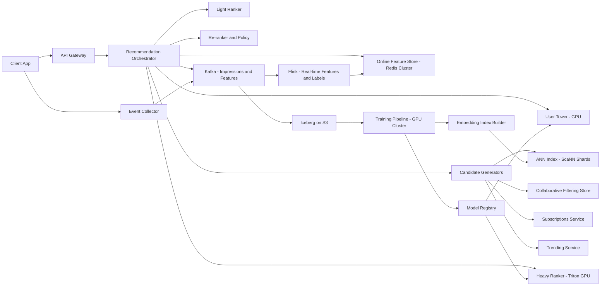

# YouTube Video Recommendations

**Category:** AI/ML System Design
**Difficulty:** 🔴 Hard
**Seniority:** Senior
**Companies:** YouTube, Netflix, TikTok, Meta, Amazon Prime Video
**Tags:** recommendation, deep-learning, ranking, candidate-generation, multi-objective, exploration
**Time:** 90-120 min

---

## Problem Statement

Design the video recommendation system for YouTube's home feed. When a user opens the YouTube app or visits the homepage, the system must select and rank ~20-50 videos from a corpus of billions of videos to maximize long-term user engagement and satisfaction.

Scale: 2.5B logged-in users, ~1B hours watched daily, ~500M hours uploaded daily, ~50B home feed requests/day (~580K QPS average, ~1.5M peak), corpus of 10B+ videos with ~500K new uploads/hour. The system must return recommendations within 200ms p99 latency.

## Clarifying Questions

- What is the primary objective? *Maximize long-term user satisfaction and engagement (watch time, retention), not just clicks.*
- What signals are available? *Watch time, likes, shares, comments, subscriptions, video completion, skips, "not interested", search history, demographics.*
- How fresh must recommendations be? *New videos should be recommendable within minutes; user interests should update within the session.*
- Are there content constraints? *Policy violations (demonetized, age-restricted), regional licensing, quality filters, creator diversity.*
- What about logged-out users? *Yes, ~15% of traffic; rely on context and short-term session history.*
- Latency budget? *200ms p99 for the entire recommendation pipeline.*
- Existing system? *Assume replacing a simpler collaborative filtering system.*

## Requirements

### Functional

- Return personalized ranked list of 20-50 videos per home feed request.
- Balance multiple objectives: watch time, satisfaction, diversity, freshness, exploration.
- Respect user preferences: blocked channels, "not interested", watch history.
- Support real-time updates from in-session behavior.
- Provide explanations for recommendations ("because you watched X").

### Non-Functional

- p99 latency 200ms; ~1.5M QPS peak.
- 99.99% availability; degrade gracefully on failure.
- New videos eligible within 15 minutes of upload.
- User features updated within 1 minute of interaction.
- Training pipeline processes ~100B+ events/day.

### Out of Scope

- Search recommendations, notification recommendations, shorts feed (separate systems).
- Ads insertion (separate auction system).
- Video upload and processing pipeline.

## Problem Framing

- **Objective:** maximize long-term user satisfaction. Proxy with multi-objective score: value = w1 × P(click) × E(watch_time | click) + w2 × P(like) + w3 × P(share) + w4 × P(subscribe) - w5 × P(skip) - w6 × P(not_interested).
- **Why not CTR alone:** Clickbait optimization harms satisfaction; watch time alone rewards long videos. Weights tuned via online experiments against retention and surveys.
- **Business metrics:** daily active users, 7/28-day retention, satisfied watch time, survey satisfaction, creator diversity.
- **Model metrics:** retrieval recall@K, ranking AUC/NDCG, calibration, coverage metrics.
- **Constraints:** extreme scale (10B videos), latency budget (200ms), feedback loops, position bias, cold start for new users/videos.

## Data Pipeline

**Event logging**

- Client logs: impressions (position, context, model version), watch events (play, pause, seek, completion), engagement (like, share, comment, subscribe), negative feedback (not interested, remove from history).
- Server logs: recommendation requests, features used at serve time, model versions.
- All events streamed to Kafka (~5M events/s peak).

**Label construction**

- Join impressions with engagements within attribution window (e.g., 1 hour for watch, 24 hours for subscribe).
- Multiple labels per impression: click, watch_time, like, share, comment, subscribe, skip, not_interested.
- Position bias correction: log position and use inverse propensity weighting.

**Features**

| Category | Examples | Freshness |
|---|---|---|
| User | Long-term interest embeddings, topic affinities, demographics, device, language, subscription list | Daily |
| User sequence | Last 100-500 video watches (IDs, watch time, actions) for sequence models | Real-time |
| Video | Content embeddings (frames, audio, title, description via multimodal encoder), channel ID, duration, language, upload time, quality scores | Near real-time |
| Video stats | Real-time CTR, completion rate, watch time over 1h/24h/7d windows | Real-time |
| Cross | User-channel affinity, user-topic engagement rate, past interactions with similar videos | Daily |
| Context | Time of day, device type, network, surface (home vs related), session depth | Real-time |

**Storage**

- Online feature store: Redis/Aerospike for user features (~2.5B users × ~10KB ≈ 25TB, sharded).
- Video features: replicated in-memory store for low-latency access.
- Offline: S3/Iceberg tables for logged features and labels.
- Embedding tables: billions of embeddings (user, video, channel) sharded across parameter servers.

## Model Design

### Multi-stage funnel

| Stage | Input | Output | Model | Budget |
|---|---|---|---|---|
| Candidate generation | 10B videos | ~500 | Multiple retrievers (two-tower ANN, collaborative filtering, subscriptions, trending) | 50ms |
| Pre-ranking | ~500 | ~200 | Light two-tower or distilled MLP | 30ms |
| Ranking | ~200 | ~50 | Large multi-task DNN | 80ms |
| Re-ranking | ~50 | ~20-50 | Diversity, freshness, policy filters, MMR | 20ms |

### Candidate generation

**Two-tower retrieval (primary)**

- User tower: user features + sequence of recent watches pooled via attention → 256-d embedding.
- Video tower: content embeddings + ID embeddings + statistics → 256-d embedding.
- Trained with sampled softmax over in-batch negatives with logQ correction for popularity bias.
- Video embeddings indexed in ScaNN/FAISS (10B × 256-d, quantized ≈ 1.2TB, sharded across 1000+ servers).
- User embedding computed at request time; ANN search retrieves nearest videos.

**Other retrieval sources**

- **Collaborative filtering:** item-to-item co-watch matrix (users who watched X also watched Y).
- **Subscriptions:** recent uploads from subscribed channels.
- **Trending:** popular videos in user's region/language (real-time counters).
- **Graph-based:** PinSage-style GNN embeddings on video-channel-user graph.
- **Fresh content:** content-only embeddings for new videos without watch history.
- **Exploration:** random sample from long-tail for discovery.

Merge sources with per-source quotas, deduplicate, apply filters (watched, blocked, policy, region).

### Ranking

**Multi-task deep neural network**

- Shared bottom layers process dense features and sparse ID embeddings.
- MMoE (Multi-gate Mixture-of-Experts) or PLE architecture with task-specific towers.
- Task heads: click, watch_time, like, share, comment, subscribe, skip, not_interested.
- Feature interaction: DCN-v2 cross layers for automatic feature crossing.
- User history: target attention (DIN-style) or transformer over recent watches relative to candidate.
- Position bias tower: takes position during training, removed at inference.

**Final score computation**

```text
score = w_click × p_click +
        w_watch × p_watch × expected_duration +
        w_like × p_like +
        w_share × p_share +
        w_subscribe × p_subscribe -
        w_skip × p_skip -
        w_not_interested × p_not_interested
```

Weights tuned via online experiments against long-term retention.

### Re-ranking

- Diversity via MMR (Maximal Marginal Relevance) on video embeddings.
- Creator caps: max 2-3 videos per channel in top 20.
- Freshness boost for new videos (exponential decay with upload time).
- Policy filters: age-restricted, demonetized, region-blocked.
- Explanation generation: "because you watched X" from similar videos in history.

```text
FUNCTION recommend_home(user_id, context):
    SET u ← feature_store.get_user(user_id)
    SET u_emb ← user_tower.embed(u, context)

    // Parallel candidate generation
    SET cands ← PARALLEL(
        ann_search(u_emb, k=200),
        collab_filter(u.recent_watches, k=100),
        subscriptions.recent(user_id, k=50),
        trending.by_region(context.region, k=50),
        fresh.content_only(k=50),
        explore.sample(k=50)
    )
    SET cands ← filter(dedupe(cands), watched_bloom(user_id), blocked, policy, region)

    // Pre-ranking
    SET cands ← light_ranker.top_k(u, cands, 200)

    // Heavy ranking
    SET heads ← ranker.predict_batch(u, cands, context)  // GPU batched
    FOR c IN cands:
        c.score ← weighted_sum(heads[c], weights)

    // Re-ranking
    SET feed ← mmr_rerank(cands, lambda=0.3, creator_cap=2)
    SET feed ← apply_freshness_boost(feed, context.time)
    SET feed ← apply_policy_filters(feed)

    log_impressions(user_id, feed, features, model_versions)
    RETURN feed[0:20]
```

### Cold start

**New users**

- Onboarding: ask for topic interests during signup.
- Contextual features: region, language, device, time of day.
- Popularity-based recommendations for the region.
- Heavy exploration to gather signals quickly.

**New videos**

- Content-only embeddings from multimodal encoder (frames, audio, text) place videos in embedding space immediately.
- Fresh-content quota ensures new videos get impressions.
- Bandit-style exploration: allocate impressions to new videos, gather early signals.

## Training & Evaluation

**Training infrastructure**

- TensorFlow/PyTorch with embedding sharding (model parallel for embeddings, data parallel for dense layers).
- Training on ~100B examples/day (downsampled to ~10B for efficiency).
- Continuous training: incremental updates every few hours, full retrain weekly.

**Offline metrics**

- Retrieval: recall@K of next-day watched videos, coverage of corpus, diversity metrics.
- Ranking: AUC per head, normalized cross-entropy, calibration, NDCG on watch-time-weighted labels.
- Slice analysis: new users, new videos, regions, languages, content categories.

**Validation strategy**

- Time-based split: train on days 1-N, validate on day N+1.
- Never random split: prevents leakage from future interactions.
- Group by user to prevent user leakage across splits.

**Counterfactual evaluation**

- Logged data is biased by current policy.
- Use inverse propensity scoring (IPS) with logged exploration propensities.
- Off-policy evaluation to estimate new policy performance before A/B test.

**Online A/B testing**

- User-level randomization, 1-2 weeks minimum for novelty effects.
- Long-term holdouts (1% of users on old model for months) to measure retention.
- Primary metrics: satisfied watch time, DAU/MAU retention, survey satisfaction.
- Guardrail metrics: latency, diversity, creator exposure distribution, policy compliance.

**Interleaving**

- For faster ranking comparisons: interleave results from two models, measure engagement difference.

## Serving Architecture



**Request flow**

1. Orchestrator fetches user features from online store (including session events updated by Flink).
2. User tower computes query embedding (~5ms on GPU).
3. Candidate generators run in parallel with hard timeout (drop slow sources).
4. Light ranker prunes to ~200 candidates (~20ms).
5. Heavy ranker scores on GPU with batched inference (~60ms for 200 candidates).
6. Re-ranker applies diversity, freshness, policy filters (~15ms).
7. Impressions and served features logged to Kafka.

**Latency budget (p99 200ms)**

| Step | Budget |
|---|---|
| Feature fetch | 20ms |
| User tower + candidate generation (parallel) | 50ms |
| Filtering + light ranker | 30ms |
| Heavy ranker (200 candidates) | 60ms |
| Re-rank + policy | 20ms |
| Network + headroom | 20ms |

**Compute sizing**

- 1.5M QPS × 200 candidates = 300M candidate scorings/s.
- Heavy ranker: ~20 MFLOP per candidate = 6 PFLOP/s.
- A100 GPU: ~300 TFLOPS (FP16) → ~20 GPUs at 100% utilization.
- Realistically: 200+ GPUs across regions for headroom, tail latency, and redundancy.

**Caching and degradation**

- Precompute fallback feed per user (refreshed hourly) in KV store.
- On ranker failure: serve cached feed.
- On total failure: serve regional trending.
- Prefetch next page while user scrolls.

## Monitoring & Iteration

**System monitoring**

- Latency per stage, candidate counts per source, timeout rates.
- GPU utilization, feature store hit rate, ANN search latency.
- Cache hit rates, fallback trigger rates.

**Model health**

- Calibration per head in real time (predicted vs observed CTR).
- Prediction distribution shift, feature PSI (Population Stability Index).
- Online/offline feature skew comparison.
- NaN/missing feature rates.

**Ecosystem metrics**

- Corpus coverage, creator exposure concentration (Gini coefficient).
- Fresh content share, topic diversity per user.
- Policy violation exposure rate.
- New user/new video performance.

**Feedback loop management**

- Exploration traffic: 1-5% epsilon-greedy or Thompson sampling.
- Logged propensities for counterfactual evaluation.
- Position bias correction in training.
- Novelty degradation detection.

**Retraining and rollout**

- Automated validation: AUC and calibration not worse than production on holdout.
- Shadow scoring before canary.
- Canary at 1%, then gradual ramp.
- Automated rollback on metric degradation.

**Cost optimization**

- Tune candidate counts per stage.
- Distill heavy ranker to light ranker.
- Int8/FP16 quantization for embeddings.
- Cache user embeddings within session.
- Prune ANN index with quality thresholds.

## Trade-offs

| Decision | Option A | Option B | Choice & Why |
|---|---|---|---|
| Objective | Single CTR | Multi-task weighted score | Multi-task: aligns with satisfaction, resists clickbait |
| Retrieval | Single two-tower | Multiple heterogeneous sources | Multiple: coverage, freshness, subscriptions need different approaches |
| Ranking model | GBDT | Multi-task DNN with DCN-v2 | DNN: handles sparse ID features and sequences; better for multi-task |
| Training cadence | Daily batch | Continuous incremental | Continuous: captures trends within hours; weekly full retrain prevents drift |
| Feature consistency | Recompute offline | Log served features | Log served: eliminates skew at storage cost |
| Exploration | None | Dedicated exploration slots | Exploration: unbiased data, cold-start discovery, counterfactual eval |
| ANN index | Single global index | Sharded per region/language | Sharded: reduces latency, supports regional filtering |

## Follow-up Questions

1. **How do you handle in-session intent updates?** Stream watch events to feature store within seconds; use sequence model (transformer) in user tower and ranker to incorporate recent behavior.
2. **How do you mitigate popularity bias?** LogQ correction in sampled softmax, cap popular videos per page, dedicated long-tail retriever with quotas, diversity re-ranking.
3. **How do you choose multi-objective weights?** Start from business priors, run parameter sweeps in online experiments, fit weights against long-term retention using holdout groups.
4. **What if offline AUC improves but A/B is flat?** Check training-serving skew, calibration, stage interactions (retrieval bottleneck), position bias, label alignment with online metric.
5. **How do you handle GDPR deletion?** Delete user data from feature stores and logs, exclude from future training, retrain embeddings; handle embedding IDs for deleted users.
6. **How would you add Shorts to the feed?** Separate retrieval and ranking for Shorts (different engagement patterns), blend via re-ranking with surface-specific quotas.
7. **How do you ensure creator diversity?** Creator caps in re-ranking, monitor Gini coefficient of exposure, boost underrepresented creators in exploration slots.

## Common Mistakes

- Single-stage approach without funnel (can't handle 10B corpus in 200ms).
- Optimizing CTR only, ignoring watch quality and long-term satisfaction.
- Random train/test splits causing leakage.
- Ignoring feedback loops and position bias.
- No exploration strategy, leading to filter bubbles.
- Underestimating compute for ranking 200 candidates at 1.5M QPS.
- Not doing the math on ANN index size and query latency.

## Key Takeaways

- Video recommendation is a multi-stage funnel: diverse retrieval → light ranking → heavy multi-task ranking → policy re-ranking.
- Multi-objective optimization with tuned weights aligns model with business goals.
- Feature logging and point-in-time correctness prevent training-serving skew.
- Exploration and bias correction are essential for unbiased learning and cold-start.
- Scale requires careful compute planning: ANN sharding, GPU batching, caching strategies.
- Evaluate with time-based splits, counterfactual methods, and long-term online holdouts.
