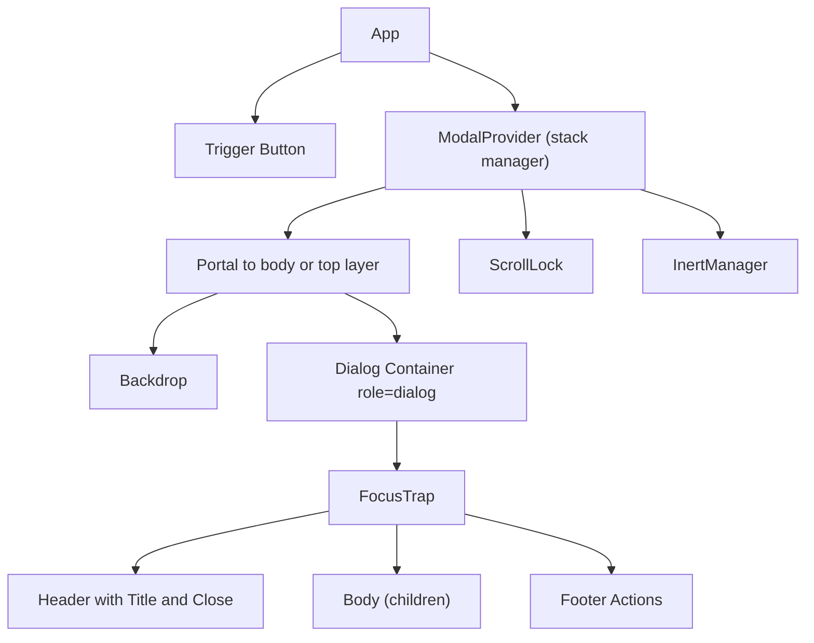

# Accessible Modal Dialog

**Category:** Frontend System Design
**Difficulty:** 🟢 Easy
**Seniority:** junior
**Companies:** Google, Microsoft, Atlassian, Meta, Shopify, Salesforce
**Tags:** accessibility, focus-management, aria, portals, component-api, keyboard-navigation
**Time:** 45 min

---

## Problem Statement

Design a reusable modal dialog component for a design system (think Material UI `Dialog`, Atlassian `Modal`, or the native `<dialog>` element). It is used for confirmations ("Delete this file?"), forms ("Edit profile"), and informational content. While open, it blocks interaction with the page behind it.

The interviewer cares most about accessibility (focus trap, focus return, ARIA, Escape), the component API, stacking/z-index, scroll locking, and how it behaves when multiple dialogs or async actions are involved.

## Clarifying Questions

- What types of content? *Confirm dialogs, forms, and arbitrary content passed as children.*
- Can dialogs be nested/stacked? *Yes, rarely — e.g. a confirm on top of an edit form.*
- Should clicking the backdrop close it? *Configurable; default yes for informational, no for forms with unsaved data.*
- Is there a mobile variant? *On small screens it becomes a full-screen sheet.*
- Does it need animation? *Fade/scale in, respecting reduced motion.*
- Can we use the native `<dialog>` element? *Yes, if browser support is acceptable (all evergreen since 2022).*
- SSR? *The app is SSR'd; the dialog is closed on initial render.*

## Requirements

### Functional

- Open/close via controlled `open` prop or imperative API.
- Header (title), body, footer (actions) slots.
- Close via close button, Escape key, and (optionally) backdrop click.
- Support an `alertdialog` variant for destructive confirmations.
- Stacking of multiple dialogs; only the top one is interactive.
- Async confirm actions with loading state ("Deleting...").

### Non-Functional

- WCAG 2.2 AA: focus trapped inside, focus returned to trigger, background inert, announced by screen readers.
- Renders above everything regardless of parent `overflow`/`z-index` (portal or top layer).
- No layout shift when body scroll is locked (scrollbar width compensation).
- Tiny footprint; zero dependencies beyond the framework.

### Out of Scope

- Non-modal popovers and toasts (different patterns), drag-to-move windows.

## Component Architecture



- **ModalProvider**: optional context/service holding the stack of open dialogs so Escape and inert apply only to the top-most.
- **Portal**: renders outside the app tree (`createPortal` in React, CDK Overlay / `ViewContainerRef` in Angular) to escape `overflow: hidden` and stacking contexts. With native `<dialog>.showModal()`, the browser's **top layer** does this for free.
- **Backdrop**: dims the page; click handler optionally closes.
- **FocusTrap**: moves focus inside on open, cycles Tab/Shift+Tab, restores focus on close.
- **ScrollLock**: `overflow: hidden` on `<html>` + padding-right equal to scrollbar width.
- **InertManager**: sets `inert` on sibling roots of the portal (native `showModal()` does this automatically).

## Data Model & State

```text
props:
  open: boolean
  onClose: (reason: "escape" | "backdrop" | "closeButton" | "action") => void
  title: string | node
  role: "dialog" | "alertdialog" = "dialog"
  closeOnBackdrop: boolean = true
  closeOnEscape: boolean = true
  initialFocusRef?: ref
  returnFocusRef?: ref           // default: element focused before open
  size: "sm" | "md" | "lg" | "fullscreen"

internal state:
  phase: "closed" | "opening" | "open" | "closing"   // for enter/exit animation
  previouslyFocused: Element | null
  titleId, descriptionId: generated unique ids

global (provider) state:
  stack: [dialogId]             // top = last
  scrollLockCount: number       // lock released when count returns to 0
```

- No server cache; async actions (e.g. delete) live in the consumer's data layer (React Query / NgRx); the dialog only shows `pending` via props.
- Controlled pattern keeps the parent the single source of truth (works with routing: `?modal=edit` deep links).

## API & Interfaces

Example server interaction for a confirm-delete dialog (owned by consumer):

```text
DELETE /api/files/{id}
204 → success  → consumer calls onClose("action")
409 → conflict → show inline error inside dialog, keep open
```

Public component API:

```text
<Dialog open onClose=fn title="Delete file?" role="alertdialog">
  <Dialog.Body>This cannot be undone.</Dialog.Body>
  <Dialog.Footer>
    <Button onClick=close>Cancel</Button>
    <Button variant="danger" loading=pending onClick=confirm>Delete</Button>
  </Dialog.Footer>
</Dialog>

Imperative/service API (Angular MatDialog-style):
  ref ← dialogService.open(Component, { data, role })
  result ← await ref.afterClosed()

Promise helper:
  ok ← await confirm({ title, message, confirmLabel })
```

## Rendering & Performance

- **Lazy mount**: don't render children until first open; optionally keep mounted after close to preserve form state (`keepMounted`).
- **Code splitting**: heavy dialog content (rich editors) loaded via dynamic `import()` / Angular lazy component on open; show skeleton inside the dialog.
- **Animation**: animate `opacity` and `transform` only; on close, wait for `transitionend` (or `animationend`) before unmounting; skip under `prefers-reduced-motion`.
- **SSR**: portal target doesn't exist on the server — render nothing when closed; guard `document` access behind mount effects.
- **Scroll lock without CLS**: compensate scrollbar width, or use `scrollbar-gutter: stable` on `<html>`.
- **INP**: opening should be a cheap state flip; avoid synchronous heavy work in the click handler.

```text
FUNCTION lockScroll()
  SET scrollLockCount ← scrollLockCount + 1
  IF scrollLockCount = 1 THEN
    SET gap ← window.innerWidth - documentElement.clientWidth
    SET html.style.overflow ← "hidden"
    SET html.style.paddingRight ← gap + "px"

FUNCTION unlockScroll()
  SET scrollLockCount ← scrollLockCount - 1
  IF scrollLockCount = 0 THEN restore original styles
```

## Accessibility & UX

- Container: `role="dialog"` (or `alertdialog`), `aria-modal="true"`, `aria-labelledby=titleId`, `aria-describedby=descriptionId`.
- **Initial focus**: first focusable element, or `initialFocusRef`. For destructive alertdialogs focus the least destructive action (Cancel). For long content, focus the container/title (`tabindex="-1"`).
- **Focus trap**: Tab from last wraps to first, Shift+Tab from first wraps to last. Prefer `inert` on the background, which makes trap logic nearly unnecessary.
- **Focus return**: on close, focus `previouslyFocused` (if still in DOM), otherwise a sensible fallback.
- **Escape** closes the top-most dialog only; stop propagation so parent dialogs don't also close.
- Close button has `aria-label="Close"`; visible focus ring everywhere.
- Background: `inert` attribute (or `aria-hidden="true"` fallback) on app root.
- Mobile: full-screen layout, respect safe-area insets, handle virtual keyboard resizing with `dvh` units.
- RTL: close button position mirrors via logical properties (`inset-inline-end`).

```text
FUNCTION onKeyDown(event)
  IF event.key = "Escape" AND closeOnEscape AND isTopOfStack(id) THEN
    CALL event.stopPropagation()
    CALL onClose("escape")
  IF event.key = "Tab" THEN
    SET items ← focusable elements inside container
    IF event.shiftKey AND activeElement = items.first THEN
      focus(items.last); preventDefault()
    ELSE IF NOT event.shiftKey AND activeElement = items.last THEN
      focus(items.first); preventDefault()
```

## Edge Cases & Resilience

- **Unsaved changes**: intercept Escape/backdrop/route change → confirm "Discard changes?" (stacked dialog).
- **Backdrop click vs drag**: user starts text selection inside dialog and releases on backdrop — only close if `pointerdown` and `pointerup` both happened on the backdrop.
- **Async confirm**: disable buttons while pending, prevent double submit, keep dialog open on error with inline message; ignore Escape while a non-cancellable request is in flight.
- **Trigger removed**: e.g. the deleted row's button no longer exists — return focus to the list container.
- **Route change while open**: close and clean up scroll lock/inert in unmount cleanup to avoid a stuck locked page.
- **Nested dialogs**: stack manager ensures only top is interactive and scroll unlocks after the last closes.
- **Security**: never inject `message` via `innerHTML`; destructive actions use CSRF-protected requests.

## Trade-offs

| Decision | Option A | Option B | Choice & Why |
|---|---|---|---|
| Implementation | Native `<dialog>` + `showModal()` | Custom div + portal | Native: free top layer, inert background, Escape handling; custom only for legacy needs or exotic animations |
| Background blocking | `inert` attribute | Manual focus trap + `aria-hidden` | `inert` (widely supported) — blocks focus, clicks, and AT in one attribute |
| API style | Declarative `open` prop | Imperative `service.open()` | Offer both: declarative for in-page dialogs, promise-based imperative for quick confirms |
| Mount strategy | Unmount on close | Keep mounted | Unmount by default (fresh state, less memory); `keepMounted` opt-in for preserving form drafts |
| Backdrop close | Always | Configurable | Configurable — default off for forms to prevent data loss |

## Follow-up Questions

1. **How do you test accessibility?** Unit tests with Testing Library querying by role (`getByRole("dialog")`), keyboard simulations, axe-core in CI, plus manual NVDA/VoiceOver checks.
2. **How do you deep-link a dialog?** Drive `open` from the URL (`/files?edit=42`); back button closes it naturally, and refresh restores it.
3. **How do you handle a dialog with very long content?** Scroll the body region only, keep header/footer sticky, and focus the title so screen readers start at the top.
4. **What about animations with native `<dialog>`?** Use `@starting-style` and `transition-behavior: allow-discrete` for entry/exit, or delay `close()` until animation completes.
5. **How do you prevent z-index wars?** Top layer (native) or a single portal root with a managed stacking order from the provider; never rely on arbitrary `z-index: 9999`.

## Common Mistakes

- Not returning focus to the trigger on close, leaving keyboard users lost at the top of the page.
- Rendering the dialog inside a parent with `overflow: hidden` or a `transform`, causing clipping.
- Escape closing every stacked dialog at once.
- Locking scroll without scrollbar compensation, causing the page to jump.
- Missing `aria-labelledby`, so screen readers announce just "dialog".
- Forgetting cleanup on unmount, leaving the page permanently scroll-locked or inert.

## Key Takeaways

- A modal is mostly an accessibility problem: focus in, focus trapped, focus back, background inert.
- Prefer the native `<dialog>` element and `inert` — the platform solves most of the hard parts.
- Escape stacking contexts via portal or top layer and manage a dialog stack for nesting.
- Offer a controlled declarative API plus a promise-based imperative helper.
