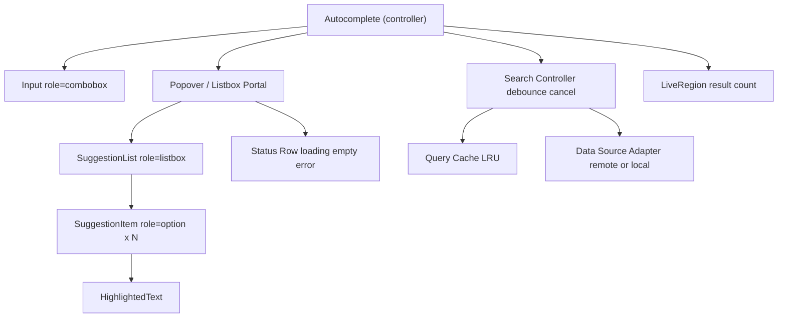

# Autocomplete Component

**Category:** Frontend System Design
**Difficulty:** 🟡 Medium
**Seniority:** mid
**Companies:** Google, Meta, Amazon, Uber, Airbnb, LinkedIn, Microsoft
**Tags:** debouncing, caching, race-conditions, combobox, keyboard-navigation, virtualization
**Time:** 45 min

---

## Problem Statement

Design a reusable autocomplete (typeahead) component, like the Google search box, Facebook people search, or the destination picker on Airbnb. As the user types, a dropdown shows matching suggestions fetched from a server; the user can navigate with the keyboard or mouse and select one.

The component lives in a design system and is used by many product teams with different data sources (people, places, products). It must feel instant, avoid flooding the backend, handle out-of-order responses, and be fully accessible.

## Clarifying Questions

- Is the data local or remote? *Remote by default; also support a local list for small datasets.*
- How large is the dataset? *Millions of entries server-side; return top 10 per query.*
- Minimum characters before searching? *1 for search, configurable.*
- What does a suggestion look like? *Text with highlighted match; customizable rendering (avatar, subtitle).*
- Single or multi-select? *Single select; multi-select chips is a follow-up.*
- Should recent searches show on focus with empty input? *Yes, from local storage.*
- Mobile support? *Yes, touch and virtual keyboard.*
- Free text allowed? *Yes, Enter submits the raw query if no item is highlighted.*

## Requirements

### Functional

- Fetch suggestions as the user types; show in a dropdown.
- Highlight matched substring.
- Keyboard: Up/Down to move, Enter to select, Escape to close, Tab to accept/leave.
- Mouse/touch selection.
- Recent searches on empty focus.
- Customizable item rendering and data source.

### Non-Functional

- Perceived latency < 100ms for cached queries, < 300ms for network.
- Reduce request volume (debounce, cache, cancel).
- Never show stale results for a previous query.
- WCAG 2.2 AA via WAI-ARIA combobox pattern.
- Handle long lists without jank.

### Out of Scope

- Ranking algorithm and search backend internals.

## Component Architecture



- **Autocomplete controller**: owns query, results, highlighted index, open state; wires keyboard handling.
- **Input**: the only focused element; focus never moves into the list (uses `aria-activedescendant`).
- **Popover**: positioned below the input (Floating UI / Angular CDK Overlay), flips when no space.
- **SuggestionList / Item**: presentational; virtualized if > ~50 items.
- **Search Controller**: debounce, AbortController cancellation, cache lookup, latest-request-wins.
- **Data Source Adapter**: `fetchSuggestions(query, signal)` interface so teams plug in their API or a local fuzzy matcher.

## Data Model & State

```text
UI state:
  query: string
  isOpen: boolean
  highlightedIndex: number        // -1 = none
  status: "idle" | "loading" | "success" | "error"
  results: Suggestion[]
  selected: Suggestion | null

Suggestion:
  { id, label, secondary?, icon?, type?, payload? }

server cache (in-memory LRU, per data source):
  cache: Map<normalizedQuery, { results, fetchedAt }>   // max ~100 entries, TTL 5 min

persisted:
  recentSearches: localStorage["ac:recent:<source>"] = [{ id, label, ts }]  // max 10
```

- Normalize cache key: trim, lowercase, collapse whitespace (and Unicode NFC).
- Prefix reuse: if query `"new y"` is cached, `"new yo"` can be filtered locally while the network request is in flight (when the server returns complete result sets for small domains).

## API & Interfaces

```text
GET /api/suggest?q=new%20yo&limit=10&type=city&locale=en-US
200 → {
  query: "new yo",
  results: [
    { id: "c_5128581", label: "New York", secondary: "NY, United States",
      type: "city", matches: [[0, 6]] }
  ]
}
Cache-Control: public, max-age=300     // CDN can cache popular prefixes
429 → rate limited (back off)
```

Component props/events:

```text
<Autocomplete
  fetchSuggestions=(query, { signal }) => Promise<Suggestion[]>
  minChars=1
  debounceMs=200
  maxResults=10
  renderItem=(item, { highlighted, query }) => node
  getItemLabel=(item) => string
  onSelect=(item) => void
  onSubmit=(rawQuery) => void
  showRecent=true
  placeholder="Search cities"
/>
Controlled variant: value / onChange (React) or ControlValueAccessor (Angular forms).
```

## Rendering & Performance

- **Debounce** keystrokes (150-300ms). Optionally fire on the leading edge for the first char for snappier feel.
- **Cache first**: check LRU before debouncing; cached queries render synchronously.
- **Cancel stale requests** with `AbortController`; also guard with a request id so only the latest response updates state (latest-wins). In RxJS: `debounceTime` + `distinctUntilChanged` + `switchMap`.
- **Virtualize** long lists (react-window / CDK virtual scroll); for 10 items, plain rendering is fine.
- **Highlighting**: use server-provided match ranges, or compute safely by splitting text into spans — never build HTML strings.
- **Avoid layout jank**: fixed item height, popover rendered in a portal, `min-height` during loading to avoid flicker. Show spinner only if loading > ~150ms.
- **CDN caching** for popular prefixes; server returns small payloads (id, label, secondary).
- **Bundle**: positioning library is the biggest dependency; lazy-load the popover code on first focus if needed.
- **INP**: keystroke handler only updates `query`; expensive filtering for local sources runs in a `useDeferredValue`/`startTransition` or Web Worker for large lists.

```text
FUNCTION onQueryChange(text)
  SET query ← text
  SET key ← normalize(text)
  IF length(key) < minChars THEN show recent searches; RETURN
  IF cache.has(key) THEN
    SET results ← cache.get(key); SET status ← "success"; RETURN
  CALL debounced(search, key)

FUNCTION search(key)
  CALL currentController?.abort()
  SET controller ← new AbortController
  SET requestId ← requestId + 1; SET myId ← requestId
  SET status ← "loading"
  TRY
    SET data ← await fetchSuggestions(key, controller.signal)
    cache.set(key, data)
    IF myId = requestId THEN SET results ← data; SET status ← "success"
  CATCH err
    IF err is AbortError THEN RETURN
    IF myId = requestId THEN SET status ← "error"
```

## Accessibility & UX

Follow the WAI-ARIA APG **combobox with listbox popup** pattern:

- Input: `role="combobox"`, `aria-expanded`, `aria-controls=listboxId`, `aria-autocomplete="list"`, `aria-activedescendant=optionId` of the highlighted option.
- List: `role="listbox"`; items `role="option"`, `aria-selected="true"` on highlighted.
- Focus stays in the input; arrow keys update `highlightedIndex` and scroll the item into view.
- Keys: Down opens/moves, Up moves, Enter selects highlighted or submits raw query, Escape closes (second Escape clears), Home/End move caret in input, Tab selects-and-moves on (configurable).
- Live region announces "5 suggestions available" after results settle (debounced to avoid chatter).
- Mouse hover updates highlight; use `pointerdown` + `preventDefault` on items so the input doesn't blur before click registers.
- States: loading row, "No results for 'xyz'", error row with retry, recent searches header with "Clear".
- Mobile: `inputmode="search"`, `enterkeyhint="search"`, `autocomplete="off"` to suppress browser autofill, `autocapitalize="none"`.
- i18n: IME composition — don't search during `compositionstart`…`compositionend` (Chinese/Japanese input); case-folding per locale; RTL dropdown alignment.

## Edge Cases & Resilience

- **Out-of-order responses**: abort + request id guard ensures a slow `"ne"` response never overwrites `"new"`.
- **Blur races**: closing on blur must not cancel a click on an option — handle selection on `pointerdown` or delay close.
- **Rate limiting (429)**: back off, increase debounce, keep showing last good results.
- **Network errors**: show inline error with retry; keep cached results usable offline.
- **Empty/whitespace query**: don't request; show recents.
- **Selection then edit**: editing text after selection clears `selected` so forms don't submit stale ids.
- **Very fast typists / paste**: debounce handles; paste triggers immediate search.
- **XSS**: suggestion labels come from user data — render as text nodes; highlight via split spans.
- **Privacy**: recent searches stored locally; provide clear option; don't cache sensitive queries in CDN (`private` for personalized results).

## Trade-offs

| Decision | Option A | Option B | Choice & Why |
|---|---|---|---|
| Request throttling | Debounce | Throttle | Debounce (~200ms) — fewer requests, results match final input; throttle suits continuous preview |
| Stale response handling | AbortController | Ignore by request id | Both: abort saves bandwidth, id check is the correctness guarantee |
| Focus model | `aria-activedescendant` | Move DOM focus to options | activedescendant — user keeps typing without losing caret |
| Filtering location | Server | Client | Server for large datasets; client for < ~5K items preloaded (zero latency) |
| Cache | In-memory LRU | localStorage | In-memory for freshness and privacy; localStorage only for recents |

## Follow-up Questions

1. **How would you support multi-select with chips?** Selected items render as removable chips before the input; Backspace on empty input removes the last chip; listbox gets `aria-multiselectable`.
2. **How would you do it fully offline for 50K items?** Preload a compressed index, build a trie or use a fuzzy matcher in a Web Worker, and return results via `postMessage`.
3. **How do you group results (People, Pages, Groups)?** Use `role="group"` with labels inside the listbox; keyboard navigation flattens groups into a single index sequence.
4. **How would you prefetch?** On input focus, warm the connection (`preconnect`) and prefetch recent/popular suggestions.
5. **How would you measure quality?** Track time-to-first-suggestion, selection rate, position of selected item, zero-result rate, and requests per session.

## Common Mistakes

- Firing a request on every keystroke with no debounce or cancellation.
- Letting slower, older responses overwrite newer results.
- Moving DOM focus into the list, breaking typing, or omitting ARIA combobox roles entirely.
- Closing the dropdown on blur before the click on an option registers.
- Building highlight markup with `innerHTML` from server strings.
- Ignoring IME composition, causing garbage requests for CJK users.

## Key Takeaways

- Core loop: debounce → cache lookup → cancellable request → latest-wins update.
- Keep focus in the input and use `aria-activedescendant` per the combobox pattern.
- Abstract the data source so the component serves many teams.
- Handle the subtle races: out-of-order responses, blur vs click, IME composition.
