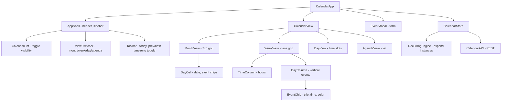

# Calendar

**Category:** Frontend System Design
**Difficulty:** 🟡 Medium
**Seniority:** Mid-level
**Companies:** Google, Microsoft, Apple, Outlook, Calendly
**Tags:** date-handling, events, recurring, timezone, drag-drop, virtualization
**Time:** 45-60 min

---

## Problem Statement

Design a web calendar application like Google Calendar or Outlook Calendar. Users view their schedule in month, week, day, and agenda views. They can create single and recurring events, drag events to reschedule, handle multiple calendars with color coding, and see events across different timezones.

The calendar must handle thousands of events, including complex recurring patterns (daily, weekly, monthly with custom rules), and remain performant when navigating between dates. The interviewer cares about date/time handling, recurring event expansion, efficient rendering of large date ranges, and timezone correctness.

## Clarifying Questions

- What is the scale of events? *A typical user has 500-2,000 events. Power users may have 10,000+ including recurring instances.*
- Which views are required? *Month, week (7-day grid), day (time slots), and agenda (list).*
- What recurring patterns? *Daily, weekly, monthly (e.g., "first Monday"), yearly, and custom rules like "every 2 weeks on Tue/Thu" with end dates or counts.*
- Do we need multi-calendar support? *Yes. Users can have multiple calendars (personal, work, shared) with different colors and toggle visibility.*
- Are attendees and invitations in scope? *Basic attendee list and RSVP status. Full invitation workflow is out of scope.*
- Timezone handling? *Events have a specific timezone. The UI should display in the user's local timezone with an option to view in the event's timezone.*
- Offline support? *Read-only offline with cached events. Mutations require a connection.*
- Mobile? *Yes, responsive design with touch interactions.*

## Requirements

### Functional
- Display events in month, week, day, and agenda views with smooth navigation.
- Create, edit, and delete single and recurring events with a modal form.
- Drag events to reschedule (change date/time) and resize to change duration.
- Toggle multiple calendars with color coding and per-calendar visibility.
- Support timezone conversion and display events in user's local timezone.
- Handle recurring events with expansion for the visible date range.

### Non-Functional
- View renders in under 500 ms for a month with 2,000 events.
- Drag and resize at 60 fps.
- Correct timezone handling across DST transitions.
- WCAG 2.1 AA accessible, including keyboard navigation.
- Initial load under 2 s for a typical user's event set.

### Out of Scope
- Room booking, resource scheduling, complex availability APIs, and full invitation workflow with email.

## Component Architecture



- **CalendarView** is a container that renders the appropriate view component based on the selected view mode. It manages the current date range and passes it to child views.
- **MonthView** renders a 7-column grid with 5-6 rows. Each cell is a `DayCell` that shows the date and compressed event chips for events on that day.
- **WeekView** and **DayView** share a time grid layout. `TimeColumn` shows hour labels (00:00-23:00). `DayColumn` renders events positioned vertically based on their start time and duration.
- **EventChip** is a memoized component that displays event title, time, and color. It handles drag and resize interactions.
- **RecurringEngine** is a service that expands recurring event rules into concrete instances for a given date range. It caches expansions to avoid recomputation.
- **CalendarStore** holds events, calendars, and the current view state. It's normalized with events stored once and derived views for each date range.

## Data Model & State

```text
CalendarState {
  calendars: Map<CalendarId, {
    id, title, color, isVisible, timezone
  }>
  events: Map<EventId, {
    id, calendarId, title, description, location,
    start: DateTime, end: DateTime,              // ISO 8601 with timezone
    timezone: String,                             // event's original timezone
    isRecurring: Boolean,
    recurrence: RecurrenceRule | null,
    attendees: Attendee[]
  }>
  view: {
    mode: 'month' | 'week' | 'day' | 'agenda',
    currentDate: Date,                            // anchor date for navigation
    timezone: String                              // display timezone (user's local)
  }
  ui: {
    selectedEventId: EventId | null,
    drag: { eventId, startDate, startTime, duration } | null,
    modalOpen: Boolean
  }
}

RecurrenceRule {
  frequency: 'daily' | 'weekly' | 'monthly' | 'yearly',
  interval: Int,                                  // e.g., 2 for "every 2 weeks"
  byDay: ['MO', 'TU', ...] | null,               // for weekly patterns
  byMonthDay: [1, 15, ...] | null,                // for monthly "on the 15th"
  until: Date | null,                             // end date
  count: Int | null                               // max occurrences
}
```

- **Date/time handling.** Store all times as ISO 8601 strings with timezone (e.g., `2024-03-15T14:30:00-07:00`). Use a library like date-fns-tz or Luxon for timezone conversions and DST-aware arithmetic.
- **Recurring expansion.** The `RecurringEngine` takes a base event and a date range, then generates instances using RRULE-like logic. Results are cached keyed by `(eventId, rangeStart, rangeEnd)`.
- **Normalization.** Events are stored once. The views derive which events to show by filtering based on the current date range.
- **Timezone display.** The `view.timezone` determines how times are displayed. Event times are converted from their `timezone` to the display timezone for rendering.

## API & Interfaces

```text
GET  /api/calendars
     200 { calendars: [...] }

GET  /api/events?start=2024-03-01&end=2024-03-31&calendar_ids=...
     200 { events: [...] }

POST /api/events
     { calendarId, title, start, end, timezone, recurrence, ... }
     201 Event

PATCH /api/events/{id}
     { title?, start?, end?, recurrence?, ... }
     200 Event

DELETE /api/events/{id}
     204

Component interfaces:

EventChip
  props:  eventId, startDate, endDate, color, isDraggable, isResizable
  events: onDragStart(), onResizeStart(), onClick()

MonthView
  props:  year, month, events, onDayClick(date), onEventClick(eventId)
  emits:  onNavigate(date)

WeekView
  props:  startDate, endDate, events, onSlotClick(date, time), onEventClick(eventId)
  emits:  onNavigate(date)
```

- **Date range queries.** Fetch events for a window larger than the visible range to enable smooth navigation without immediate network requests. For month view, fetch the full month plus one week on each side.
- **Recurring events.** The server returns the base recurring event with its rule. The client expands instances for the visible range. Alternatively, the server can pre-expand, but this increases payload size.

## Rendering & Performance

**Rendering.** CSR with an app shell. The initial fetch loads calendars and events for the current month plus adjacent months. Subsequent navigation fetches additional ranges as needed.

**Virtualization.**
- **Month view.** With 35-42 cells, virtualization is usually unnecessary. However, if a single day has hundreds of events, the `DayCell` can virtualize its event chips list.
- **Week/Day view.** The time grid can have many events. Use virtualization for the vertical axis, rendering only visible time slots. Events are positioned absolutely based on their time.
- **Agenda view.** Virtualize the list of events for long date ranges.

**Recurring event expansion.**

```text
FUNCTION getEventsInRange(start, end)
  SET results ← []
  FOR EACH event IN events
    IF NOT event.isRecurring
      IF event.start >= start AND event.start < end
        results.push(event)
    ELSE
      SET cached ← cache.get(event.id, start, end)
      IF cached
        results.push(...cached)
      ELSE
        SET instances ← expandRecurrence(event, start, end)
        cache.set(event.id, start, end, instances)
        results.push(...instances)
  RETURN results

FUNCTION expandRecurrence(event, rangeStart, rangeEnd)
  SET instances ← []
  SET current ← alignToRule(event.start, event.recurrence)
  WHILE current <= rangeEnd
    IF current >= rangeStart
      instances.push({
        ...event,
        id: event.id + ":" + current.toISOString(),
        start: current,
        end: current + (event.end - event.start)
      })
    current ← applyRule(current, event.recurrence)
    IF event.recurrence.until AND current > event.recurrence.until THEN BREAK
    IF event.recurrence.count AND instances.length >= event.recurrence.count THEN BREAK
  RETURN instances
```

- Cache expanded instances per date range. Invalidate the cache when the base event is modified.
- For very long date ranges (e.g., year view), limit expansion or use server-side pre-expansion.

**Drag and resize.**
- Use pointer events for drag and resize. During drag, update the event's visual position using CSS transforms without re-rendering.
- On drop, compute the new start time based on the drop position and send a PATCH request.
- Optimistically update the store before the server responds, with rollback on error.

**Timezone conversion.**
- Convert event times to the display timezone when rendering. Use `Intl.DateTimeFormat` for user-friendly time strings.
- Handle DST transitions correctly by using timezone-aware libraries.

**Memory.**
- Cache expanded recurring instances with a size limit (e.g., last 10 date ranges per event).
- Evict event data for date ranges far from the current view.

## Accessibility & UX

- **Keyboard navigation.** Arrow keys navigate between days in month view. Enter opens the event details. Escape closes modals. Tab moves through interactive elements.
- **Screen readers.** Use `aria-label` on day cells with the date and event count. Event chips have accessible names like "Meeting: 2:00 PM to 3:00 PM". Use `role="grid"` for the month view with proper row and cell semantics.
- **Focus management.** When opening the event modal, move focus to the title input. When closing, return focus to the triggering event chip.
- **Color contrast.** Ensure event text contrasts with background colors. Provide a high-contrast mode.
- **Timezone display.** Show the timezone abbreviation (e.g., "PDT") next to times. Provide a tooltip with the full timezone name and the event's original timezone if different.
- **Drag alternatives.** Provide a "Move to" menu in the event details for users who cannot drag.
- **States.** Show loading skeletons while fetching events. Empty states prompt users to create events. Error states display retry options.

## Edge Cases & Resilience

- **DST transitions.** Events crossing DST boundaries may appear to shift in duration. Use timezone-aware libraries to handle this correctly. Display the original duration in the event's timezone.
- **Recurring event modification.** When editing a recurring event, ask whether to apply changes to "This event only", "This and following events", or "All events". This requires creating a new base event for the modified series.
- **Very long recurring series.** Limit expansion to the visible range. For year view, consider server-side pre-expansion or a simplified representation.
- **Overlapping events.** In week/day views, overlapping events should be displayed side-by-side with reduced width. Use a layout algorithm to assign columns.
- **Timezone changes.** If the user changes their display timezone, re-render all times without refetching events.
- **Offline.** Cache events in IndexedDB. Allow viewing cached events offline. Queue mutations and apply on reconnect.
- **Concurrent edits.** Use versioning or last-write-wins with conflict detection. If another user edits an event, show a notification and refresh.
- **Performance with many calendars.** If a user has 20+ calendars, lazy-load calendar data and only fetch events for visible calendars.

## Trade-offs

| Decision | Option A | Option B | Choice & Why |
|---|---|---|---|
| Recurring expansion | Client-side | Server-side | Client-side. Reduces payload and allows flexible date ranges. Cache for performance. |
| Timezone storage | Store in UTC | Store with timezone | With timezone. Preserves original intent and handles DST correctly. |
| Drag implementation | Native HTML5 DnD | Pointer events | Pointer events. Better touch support and custom styling. |
| Virtualization | All views | Only large views | Only large views. Simpler for typical use cases; virtualize when needed. |
| Event overlap handling | Stack vertically | Side-by-side columns | Side-by-side. Better visibility of overlapping events. |

## Follow-up Questions

1. **How would you handle all-day events?** Store them with a flag and render them at the top of the day column in week/day views, spanning the full width.
2. **How do you support multi-day events?** Store start and end dates. In month view, render the event across multiple days with continuation indicators.
3. **How would you add resource booking (e.g., meeting rooms)?** Add a resource calendar type with availability rules. Check conflicts when creating events and show availability in the UI.
4. **How do you handle very large recurring series (e.g., daily for 10 years)?** Limit expansion to the visible range. For export or search, use server-side expansion on demand.
5. **How would you test timezone handling?** Use test fixtures with events across DST boundaries in various timezones. Automate with timezone-aware date libraries.

## Common Mistakes

- Storing times in UTC without timezone information, losing the original intent.
- Expanding all recurring events upfront, causing performance issues.
- Not handling DST transitions correctly, causing events to shift unexpectedly.
- Re-rendering the entire view on every drag move instead of using transforms.
- Ignoring keyboard navigation and screen reader accessibility.
- Not caching recurring expansions, causing redundant computation.

## Key Takeaways

- Use timezone-aware date libraries and store times with timezone information.
- Expand recurring events on-demand for the visible range and cache results.
- Use transforms for drag/resize performance and optimistic updates for responsiveness.
- Design for accessibility with keyboard navigation and proper ARIA semantics.
- Handle edge cases like DST transitions, overlapping events, and concurrent edits.
