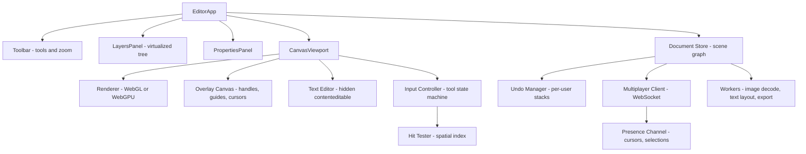

# Canvas Design Editor

**Category:** Frontend System Design
**Difficulty:** 🔴 Hard
**Seniority:** staff
**Companies:** Figma, Canva, Adobe, Miro, Microsoft, Google
**Tags:** webgl, scene-graph, hit-testing, spatial-index, undo-redo, multiplayer, transforms
**Time:** 60 min

---

## Problem Statement

Design the frontend of a browser-based vector design editor like Figma or Canva. Users work on an infinite canvas containing frames, shapes, text, images and groups. They can zoom and pan smoothly, select one or many objects, move/resize/rotate them with handles, edit properties in a side panel, undo and redo, and see other collaborators' cursors and selections live.

Documents can contain 100k+ nodes, and the editor must stay at 60 fps while panning and dragging. The interviewer wants to hear how you represent the document (scene graph), how you render it (Canvas 2D vs WebGL), how you find what is under the pointer (hit testing), how coordinate transforms work for zoom/pan/rotation, how undo works in a multiplayer setting, and how presence is streamed.

## Clarifying Questions

- How large can a document get? *Up to ~100k nodes per page, a few hundred images, several pages per file.*
- Which object types? *Rectangles, ellipses, vector paths, text, images, frames (clip containers), groups and components/instances.*
- Real-time collaboration? *Yes. Up to ~50 concurrent editors, plus viewers; live cursors and selections.*
- Undo semantics in multiplayer? *Each user undoes only their own changes.*
- Target devices? *Desktop Chrome/Safari/Firefox with GPU; tablet support is nice to have.*
- Offline editing? *Short disconnects must not lose work; full offline is out of scope.*
- Export? *PNG/SVG export of a selection is in scope; PDF and code export are not.*

## Requirements

### Functional
- Infinite canvas with zoom (2%–25600%) and pan via wheel, trackpad pinch, space+drag and keyboard.
- Create, select (click, shift-click, marquee), move, resize, rotate, group, reorder (z-index) and delete nodes.
- Property panel editing fill, stroke, opacity, text style, constraints; multi-selection shows mixed values.
- Snapping and smart guides to other objects and pixel grid.
- Per-user undo/redo across all operations.
- Multiplayer: live document sync, remote cursors with names, remote selection outlines.

### Non-Functional
- 60 fps pan/zoom/drag with 100k nodes; pointer-to-pixel latency under 16 ms.
- Initial open of a 50 MB file in under 3 s on a good connection (progressive load).
- Memory under ~1.5 GB for the largest files; GPU texture budget managed.
- Edits converge across all clients; no lost updates on reconnect.

### Out of Scope
- Prototyping/animation, plugins API, comments, version history UI, server-side rendering pipeline.

## Component Architecture



- **Document Store** is the single source of truth: a flat map of nodes keyed by ID plus parent/child ordering. It emits fine-grained change events. UI panels are thin views over it (React: `useSyncExternalStore` selectors; Angular: signals or an RxJS store).
- **Renderer** draws the scene graph to a single `<canvas>` with WebGL (Figma uses a C++ engine compiled to WebAssembly on WebGL/WebGPU). It owns GPU buffers, tile caches and the render loop; it is not a React/Angular component tree.
- **Overlay Canvas** is a separate 2D canvas for selection handles, smart guides, marquee and remote cursors, so these redraw cheaply without re-rendering the scene.
- **Input Controller** is an explicit state machine per tool (Idle, Hovering, Dragging, Resizing, Rotating, Marquee, Panning, EditingText). It converts screen events into document commands.
- **Hit Tester** answers "which node is under point P" and "which nodes intersect rect R" using a spatial index (R-tree) plus precise geometry tests.
- **Text Editor** places an invisible `contenteditable` at the caret so IME, spellcheck and accessibility work, while glyphs are still rendered by the canvas.
- **Multiplayer Client** sends local ops, applies remote ops, and streams presence on a lighter channel.
- **Layers/Properties panels** are normal DOM components; the layers tree is virtualized because it can have 100k rows.

## Data Model & State

```text
Document {
  nodes: Map<NodeId, Node>             // flat, normalized
  pages: [PageId]
}
Node {
  id, type: FRAME | RECT | ELLIPSE | PATH | TEXT | IMAGE | GROUP | INSTANCE
  parentId, sortKey                     // fractional index string for z-order
  transform: [a, b, c, d, tx, ty]       // 2x3 affine, relative to parent
  size: {w, h}
  style: {fills[], strokes[], opacity, blendMode, effects[]}
  props: {...type-specific: path data, text runs, imageHash, clipContent}
}
Derived (not persisted, recomputed lazily):
  worldTransform[id]  = parent.worldTransform * node.transform
  worldBounds[id]     = AABB of transformed geometry (incl. stroke/effects)
  rtree               = R-tree over worldBounds for current page
  dirtyRegions        = set of rects needing repaint
Ephemeral UI state (local only):
  camera: {x, y, zoom}
  tool, selection: Set<NodeId>, hoverId, dragSession
Presence (per remote user, not persisted):
  {userId, color, cursor: {x, y} in world coords, selection: [NodeId], viewport}
```

- **Flat normalized map with parentId + fractional `sortKey`** instead of nested children arrays: reparenting and reordering are single-property changes, which makes multiplayer merges trivial (last-writer-wins per property) and avoids index-based conflicts.
- **Transforms are relative to parent**; world transforms are cached and invalidated down the subtree when an ancestor changes.
- **Server cache vs UI state:** the document is server-authoritative and synced; camera, tool, hover and selection are local (selection is broadcast as presence but not persisted).
- **Coordinate spaces:** screen → world is `world = (screen - pan) / zoom`; world → local applies the inverse of the node's world transform. All hit testing happens in world or local space, never in screen pixels.

## API & Interfaces

```text
GET  /files/:fileId                  -> { meta, pages: [{id, name}], schemaVersion }
GET  /files/:fileId/pages/:pageId    -> binary snapshot (nodes) + lastSeq
GET  /images/:hash                   -> CDN, content-addressed, immutable cache

WS   /files/:fileId/multiplayer
  client -> server: { type: "ops", clientSeq, ops: [ {nodeId, prop, value} | {create} | {delete} ] }
  server -> client: { type: "ack", clientSeq, serverSeq }
  server -> client: { type: "ops", serverSeq, userId, ops }
  client <-> server: { type: "presence", cursor, selection, viewport }   // unreliable, throttled ~30 Hz
  server -> client: { type: "join" | "leave", user }
```

Internal component interfaces:

```text
Renderer.setScene(doc), Renderer.setCamera(camera), Renderer.invalidate(rects)
HitTester.pointQuery(worldPt, opts{deep, ignoreLocked}) -> NodeId | null
HitTester.rectQuery(worldRect, mode: INTERSECT | CONTAIN) -> [NodeId]
Document.apply(ops, origin: LOCAL | REMOTE | UNDO) -> inverseOps
Document.subscribe(selector, callback)
Editor events: selectionchange, camerachange, toolchange, docchange
```

## Rendering & Performance

- **WebGL over Canvas 2D over SVG/DOM.** DOM/SVG collapses beyond a few thousand nodes; Canvas 2D is simple but CPU-bound for 100k shapes and complex effects; WebGL (or WebGPU) gives batched GPU draws, cheap transforms and blur/blend shaders. Vector paths are tessellated into triangles (or rendered with stencil-and-cover / signed distance fields for text) and cached per node.
- **Render loop:** a single `requestAnimationFrame` loop that runs only when something is dirty. Input handlers mutate state and mark dirty; they never draw directly.
- **Culling:** query the R-tree with the viewport rect; only visible nodes are submitted. Nodes smaller than ~0.5 px at current zoom are skipped or drawn as a dot.
- **Tiling and caching:** render the scene into GPU tiles (e.g. 512×512) at the current zoom level. Panning reuses tiles; only newly exposed tiles render. During an active zoom gesture, scale existing tiles (blurry for a few frames) and re-rasterize at the final zoom when the gesture settles.
- **Drag fast path:** while dragging a selection, render the unselected scene from cache and draw the moving nodes on top each frame; commit the op on pointerup (and stream intermediate positions to collaborators at a throttled rate).
- **Level of detail for images:** store mipmaps/multiple resolutions; request the resolution matching zoom; decode with `createImageBitmap` in a worker; LRU-evict textures under a GPU memory budget.
- **Text layout** (shaping, line breaking) in a worker or WASM (HarfBuzz) with results cached by text+style hash.
- **Progressive load:** fetch page snapshot as a compact binary format, decode in a worker, render the visible page first, lazily load other pages and images.
- **Hit testing pipeline:**

```text
FUNCTION pointQuery(screenPt)
  SET worldPt ← (screenPt - camera.pan) / camera.zoom
  SET candidates ← rtree.search(rectAround(worldPt, tolerance / camera.zoom))
  SORT candidates BY z-order DESC                   // topmost first
  FOR node IN candidates
    IF node.locked OR node.hidden OR clippedOut(node, worldPt) THEN CONTINUE
    SET localPt ← inverse(node.worldTransform) * worldPt
    IF node.type = RECT AND insideRoundedRect(localPt, node.size, node.radius) THEN RETURN node
    IF node.type = PATH AND (pathContains(node.path, localPt, fillRule)
                             OR distanceToStroke(localPt) <= strokeWidth / 2 + tol) THEN RETURN node
    IF node.type = TEXT AND insideGlyphBoxes(localPt) THEN RETURN node
  RETURN null
// Selection resolves to the outermost unselected group ancestor unless deep-select (Cmd/Ctrl-click).
```

- An alternative is **GPU color picking** (render IDs to an offscreen buffer and read back one pixel); it is exact for complex shapes but `readPixels` stalls the pipeline, so use it only as a fallback.
- **Transforms with handles:** resize computes a new local transform/size from the drag delta expressed in the node's rotated local frame; for multi-selection, apply a group transform to each node and decompose back into each node's parent space. Shift locks aspect ratio, Alt scales from center.
- **Snapping:** on drag start, collect edges/centers of nearby nodes from the R-tree into sorted arrays; each move does a binary search within a threshold of `4px / zoom`.
- **Bundle:** editor core (WASM + shaders) is large; ship a lightweight file browser shell first and stream the editor bundle with a loading skeleton; cache aggressively via service worker.

## Accessibility & UX

- Canvas content is invisible to screen readers, so maintain a **parallel accessible tree**: the layers panel is a `role="tree"` with `aria-selected`, and selection changes announce via an `aria-live="polite"` region ("Rectangle 12 selected, 200 by 100").
- Full keyboard operation: Tab/Shift-Tab cycle through siblings, Enter goes into a group, Esc selects parent, arrow keys nudge 1 px (Shift: 10 px), shortcuts for every tool, `Cmd/Ctrl+0/1/+/-` for zoom.
- Focus management: the canvas container is focusable; text editing moves focus into the hidden `contenteditable`; Esc returns focus to the canvas.
- Respect `prefers-reduced-motion` for animated zoom-to-fit; high-contrast selection colors; remote cursor colors with sufficient contrast and name labels.
- Loading states: page skeleton, then low-res images replaced by high-res; error banner when offline ("Changes will sync when reconnected").
- i18n/RTL: panels mirror for RTL; text nodes support bidi shaping and vertical text via the shaping engine.

## Edge Cases & Resilience

- **Multiplayer conflicts:** server-authoritative ordering with last-writer-wins per (nodeId, property). Concurrent edits to different properties both survive. Local unacknowledged ops are kept in a pending queue and reapplied on top of incoming server ops so the local user never sees their change "flicker back".
- **Delete vs edit:** edits to a deleted node are dropped; if a user deletes a parent while another adds a child, the server either rejects the orphan or resurrects to a fallback parent; reparenting cycles (A into B while B into A) are detected and rejected server-side.
- **Per-user undo:** each local op records its inverse ops at apply time. Undo applies the inverse as a *new* op, skipping properties that a remote user has since changed (or applying anyway with LWW — be explicit). Group drag frames into a single undo entry using a transaction boundary at pointerup.

```text
FUNCTION commitTransaction(ops)
  SET inverse ← document.apply(ops, LOCAL)
  undoStack.push({ ops: ops, inverse: inverse })
  redoStack.clear()
  sync.send(ops)

FUNCTION undo()
  SET entry ← undoStack.pop()
  IF entry = null THEN RETURN
  SET applicable ← FILTER entry.inverse WHERE nodeExists(op.nodeId)
  SET redoInverse ← document.apply(applicable, UNDO)
  redoStack.push({ ops: applicable, inverse: redoInverse })
  sync.send(applicable)
```

- **Reconnect:** on drop, keep editing locally; buffer ops in memory and IndexedDB; on reconnect, send `lastServerSeq`; server replays missed ops (or a fresh snapshot if too far behind), then pending local ops are resent idempotently (`clientId + clientSeq`).
- **Presence:** cursors sent ~30 Hz, interpolated on receivers for smoothness; stale presence expires after a few seconds; throttle broadcast for files with many viewers.
- **GPU context loss:** listen for `webglcontextlost`, rebuild buffers and textures from the document on restore.
- **Huge pastes / image imports:** process in workers, chunk ops, show progress; cap image dimensions and downscale.
- **Security:** pasted SVG and HTML are parsed and sanitized (no scripts, no external references); image URLs are content-addressed from your own CDN; WebSocket auth via short-lived token, server enforces view vs edit permission per op.
- **Precision:** at extreme zoom, use doubles in CPU math and render relative to the camera origin to avoid float32 jitter on the GPU.

## Trade-offs

| Decision | Option A | Option B | Choice & Why |
|---|---|---|---|
| Rendering tech | SVG/DOM | Canvas 2D / WebGL | WebGL: only GPU batching sustains 60 fps at 100k nodes; DOM kept for panels and text input overlay |
| Hit testing | GPU color picking | R-tree + geometric tests | R-tree: no GPU stalls, supports tolerance and rect queries; GPU picking as fallback for complex paths |
| Sync model | OT / full CRDT | Server-ordered LWW per property | LWW per property: design docs are tree of objects with independent props, so simpler than text CRDTs (Figma's approach) |
| Tree ordering | Children index arrays | Fractional index sortKey | Fractional index: concurrent inserts/reorders do not conflict |
| Undo scope | Global history | Per-user inverse ops | Per-user: undoing a teammate's work is surprising and destructive |
| Engine language | TypeScript | C++/Rust to WASM | WASM for the core at staff scale: predictable memory and speed; TS is fine for an MVP |

## Follow-up Questions

1. **How would you support components and instances?** Instances reference a master node and store only overrides; rendering resolves master + overrides, and a change to the master invalidates all instances through a reverse dependency index.
2. **How do you make zoom feel instant on a huge file?** Scale existing raster tiles during the gesture, re-rasterize visible tiles progressively at the target zoom, and prioritize tiles near the pointer.
3. **How would you implement a plugin API safely?** Run plugins in a sandboxed iframe or a QuickJS-in-WASM realm, exposing a message-based document API with permission checks and op batching.
4. **What changes for 500 simultaneous viewers?** Separate viewer presence fan-out from editors, sample/aggregate cursors, and serve read-only clients snapshots plus op streams through an edge relay.
5. **How do you export PNG at 4x?** Render the selection offscreen (OffscreenCanvas in a worker) with the same renderer at the requested scale, tiling if it exceeds max texture size.
6. **How would you test rendering correctness?** Pixel-diff screenshot tests across GPU vendors with tolerance, plus deterministic unit tests for geometry and hit testing.

## Common Mistakes

- Rendering each shape as a DOM/SVG element or a framework component and expecting it to scale.
- Doing hit testing by iterating all nodes linearly in screen space, ignoring rotation and nested transforms.
- Re-rendering the entire scene on every pointermove instead of using dirty flags, culling and tile caches.
- Using array indices for z-order in a multiplayer document, causing conflicting reorders.
- Implementing undo as global snapshot restore, which wipes collaborators' concurrent edits.
- Forgetting text input: drawing glyphs on canvas but having no IME, spellcheck or accessibility path.

## Key Takeaways

- Separate the normalized document model, derived caches (world transforms, R-tree) and the renderer; panels are just views over the store.
- WebGL with culling, tiling and a dirty-driven rAF loop is what makes infinite-canvas editors feel native.
- Hit testing = spatial index for candidates, then exact geometry in local coordinates, topmost first.
- Property-level LWW with fractional indexing and per-user inverse-op undo is a pragmatic, proven multiplayer model.
- Canvas apps still need DOM for text input and a parallel accessible tree.
