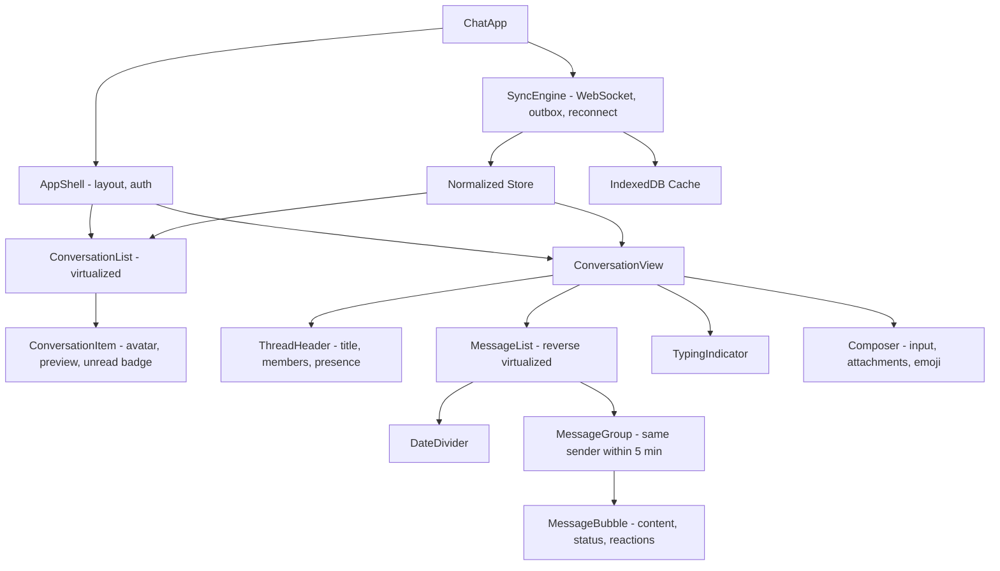

# Chat Application UI

**Category:** Frontend System Design
**Difficulty:** 🟡 Medium
**Seniority:** senior
**Companies:** Meta, Slack, Discord, Microsoft, WhatsApp, Telegram
**Tags:** websockets, optimistic-updates, virtualized-list, real-time, offline-first, message-ordering
**Time:** 45 min

---

## Problem Statement

Design the web client for a chat application like Messenger, Slack or WhatsApp Web. Users see a list of conversations with unread counts. Inside a conversation they can scroll back through history, send messages and see them appear instantly, see typing indicators and read receipts, and get new messages in real time.

The client must handle thousands of conversations and conversations with 100k+ messages. It has to stay correct through flaky networks, multiple open tabs and reconnects. The interviewer cares most about the real-time transport, message ordering, optimistic sends, and an efficient reverse-scrolling message list.

## Clarifying Questions

- Is this 1:1 only, or groups and channels too? *Both. Groups have up to 1,000 members.*
- Which message types? *Text with markdown-lite formatting, images and files, replies and reactions. No voice or video calls.*
- Is end-to-end encryption required? *No. That is out of scope (it would change the storage design).*
- Is multi-device or multi-tab sync expected? *Yes. Read state and sent messages must sync across tabs and devices.*
- Do we need offline support? *Yes. Read cached history offline, and queue outgoing messages to send on reconnect.*
- What is the expected message volume? *An active user gets about 1 message/s at peak across all chats, and a busy channel about 20 messages/s.*
- Does search exist? *Server-side search exists. The client just renders the results.*

## Requirements

### Functional
- Conversation list sorted by last activity, with unread badges, previews and presence.
- Message thread with infinite scroll upward through history, and jump-to-latest.
- Send text and attachments with optimistic display and per-message status (sending, sent, delivered, read, failed).
- Real-time incoming messages, typing indicators, reactions and read receipts.
- Notifications for messages in background tabs or other conversations.

### Non-Functional
- A sent message appears in under 50 ms locally, and other users receive it in under 500 ms (p95).
- No lost, duplicated or out-of-order messages after reconnects.
- Smooth scrolling in threads with 100k messages. Bounded memory.
- Accessible, keyboard-first, and works on mobile web.

### Out of Scope
- Voice/video calls, E2EE, and the bot platform.

## Component Architecture



- **SyncEngine** is a non-UI service, and the only module that talks to the network. It owns the WebSocket, heartbeats, reconnect with backoff, the outgoing message outbox, and gap-filling after a reconnect. It writes into the store and IndexedDB. UI components only read from the store and dispatch intents.
- **ConversationList** is virtualized because power users have thousands of conversations. Its order is derived from `lastMessageAt`.
- **MessageList** is a reverse (bottom-anchored) virtualized list with variable-height items. It keeps scroll position stable when older messages are prepended.
- **Composer** keeps the draft per conversation, persisted so drafts survive navigation. It sends typing events throttled to one every 3 s.
- **Framework notes.** React can use context plus an external store (Zustand/Redux) subscribed through `useSyncExternalStore`. Angular can use an injectable `SyncService` exposing signals or RxJS `Observable`s, with `OnPush` components.

## Data Model & State

```text
Store {
  conversations: Map<ConvId, {
    id, type: dm | group, title, memberIds,
    lastMessageId, lastMessageAt, unreadCount,
    lastReadSeq, draft: String
  }>
  conversationOrder: List<ConvId>             // derived: sort by lastMessageAt desc
  messagesByConv: Map<ConvId, {
    ids: List<MessageId>                       // sorted by seq
    hasOlder: Boolean, oldestCursor, newestSeq
  }>
  messages: Map<MessageId | ClientId, {
    id: MessageId | null, clientId: UUID,      // clientId for optimistic dedupe
    convId, senderId, seq: Int | null,         // server-assigned per-conversation sequence
    body, attachments, replyToId, reactions: Map<emoji, Set<UserId>>,
    status: pending | sent | delivered | read | failed,
    createdAt (client), serverTs
  }>
  users: Map<UserId, { name, avatarUrl, presence }>
  typing: Map<ConvId, Map<UserId, expiresAt>>
  connection: connecting | open | reconnecting | offline
  outbox: List<ClientId>                       // persisted in IndexedDB
}
```

- **Server cache.** Conversations, messages and users are server data mirrored locally, and persisted to IndexedDB for instant start and offline reading.
- **Ephemeral UI state.** Typing indicators, presence, scroll position per conversation, composer focus and open menus. None of this is persisted, except drafts.
- **Ordering.** Sort by server-assigned per-conversation `seq`. Client clocks are not trusted. Pending messages, which have no seq yet, render after the newest confirmed message in creation order.
- **Normalization.** Users are stored once, so renaming a user or changing their avatar updates every bubble. Reactions are stored as sets so concurrent toggles merge cleanly.

## API & Interfaces

```text
REST (history, bootstrap):
GET  /api/conversations?cursor=&limit=50
     200 { items: [Conversation], nextCursor }
GET  /api/conversations/{id}/messages?before_seq=48210&limit=50
     200 { items: [Message], hasOlder }
GET  /api/conversations/{id}/messages?after_seq=48210     // gap fill after reconnect
POST /api/uploads                                         // returns presigned S3 URL
     200 { uploadUrl, attachmentId }

WebSocket wss://chat.example.com/ws?token=...   (JSON frames)
client -> server
  { type: "send", clientId, convId, body, attachmentIds, replyToId }
  { type: "typing", convId }
  { type: "read", convId, seq }
  { type: "resume", lastEventId }                // on reconnect
  { type: "ping" }
server -> client
  { type: "ack", clientId, id, seq, serverTs }
  { type: "message", message, eventId }
  { type: "reaction", messageId, emoji, userId, op: add|remove, eventId }
  { type: "receipt", convId, userId, seq }
  { type: "typing", convId, userId }
  { type: "presence", userId, status }
  { type: "pong" }
```

Component interfaces:

```text
MessageList
  props:  convId, messageIds, renderMessage(id), initialAnchor: latest | messageId
  events: onLoadOlder(), onVisibleRange(firstSeq, lastSeq)   // drives read receipts

Composer
  props:  convId, draft, disabled, maxLength = 4000
  events: onSend({ body, attachments, replyToId }), onTyping(), onDraftChange(text)
```

WebSocket is the right transport because traffic is bidirectional, frequent and low-latency. SSE plus POST works for read-mostly cases, and long-polling is the fallback for restrictive proxies.

## Rendering & Performance

**Rendering.** CSR inside an app shell. SSR adds little behind auth. The shell is cached by a Service Worker, and the conversation list paints from IndexedDB before the network responds.

**Reverse virtualized list.**
- Variable heights are measured with `ResizeObserver` and cached by message id. Unmeasured rows use an estimated height.
- **Prepending history.** Before inserting older messages, record the first visible item and its offset. After render, set `scrollTop` so that item stays put. CSS `overflow-anchor` helps in Chromium, but do the anchoring explicitly for Safari.
- **Stick to bottom.** If the user is within 100 px of the bottom when a message arrives, auto-scroll. Otherwise show a "N new messages" pill.
- An alternative is `flex-direction: column-reverse`, which gives native bottom anchoring but complicates virtualization and accessibility order.

**Optimistic send flow.**

```text
FUNCTION sendMessage(convId, body)
  SET clientId ← uuid()
  SET msg ← { clientId, convId, body, senderId: me, status: pending, createdAt: now() }
  store.insertPending(msg)                 // renders instantly
  outbox.persist(msg)                      // IndexedDB, survives reload
  IF socket.isOpen THEN socket.send({ type: "send", clientId, convId, body })
  START timer(10s) -> IF still pending THEN mark failed (show retry)

ON ack { clientId, id, seq }
  store.confirm(clientId, id, seq)         // re-key, status sent, re-sort by seq
  outbox.remove(clientId)

ON message m
  IF store.has(m.clientId) THEN store.confirm(m.clientId, m.id, m.seq)   // own echo, dedupe
  ELSE IF m.seq > conv.newestSeq + 1 THEN fetchGap(conv, conv.newestSeq) // detected a gap
  ELSE store.append(m)
```

**Batching.** Coalesce WebSocket events arriving in the same frame and apply them in one store update per animation frame, so a 20 msg/s channel does not trigger 20 renders. Use memoized bubbles (React `memo`, Angular `OnPush`).

**Lazy loading.** The emoji picker, image viewer, markdown renderer and file previews load through dynamic `import()`. Attachments use thumbnails, `loading="lazy"` and fixed dimensions.

**Memory.** Keep at most about 500 messages per inactive conversation in memory and evict the rest. They can be reloaded from IndexedDB.

**Multi-tab.** Hold one WebSocket per browser: one leader tab elected through the Web Locks API, with the others fed over BroadcastChannel. A SharedWorker that owns the socket also works.

## Accessibility & UX

- **Message list.** Use `role="log"` with `aria-live="polite"` so screen readers announce new messages without stealing focus. Give each message an accessible name: "Alice, 10:42, message text".
- **Keyboard.** Up/Down arrows move through messages (roving tabindex). Up in an empty composer edits your last message. Ctrl/Cmd+K is the conversation switcher. Esc closes menus or the reply preview.
- **Composer.** Enter sends and Shift+Enter adds a newline. Do not send while an IME is composing (check `event.isComposing`). Label the composer clearly and link it to a character count with `aria-describedby`.
- **Focus.** When switching conversations, move focus to the composer. When a menu or dialog closes, return focus to its trigger.
- **States.** Skeleton bubbles while history loads. An empty conversation gets a "Say hi" prompt. A connection banner shows "Reconnecting…" or "Offline – messages will send when you're back". A failed message shows an inline retry or delete with a red status.
- **i18n/RTL.** Use logical CSS properties (`margin-inline-start`) so own and other bubbles mirror correctly. Format timestamps with `Intl.DateTimeFormat` and relative times with `Intl.RelativeTimeFormat`. Mixed-direction text needs `dir="auto"` on each bubble.

## Edge Cases & Resilience

- **Reconnect.** Use exponential backoff with jitter (1 s, 2 s, 4 s … capped at 30 s), and reconnect immediately on the `online` event or when the tab becomes visible. After reconnecting, send `resume` with `lastEventId`. If the server cannot replay that far, fall back to REST `after_seq` gap fetches per active conversation.
- **Heartbeat.** Send a ping every 25 s. Two missed pongs mean the socket is dead, even if `readyState` says OPEN, which happens with half-open TCP connections behind NATs.
- **Duplicates.** The server deduplicates sends by `clientId` (an idempotency key), and the client deduplicates echoes and replays by `id`/`clientId`.
- **Out-of-order delivery.** Insert by `seq`, and buffer messages that arrive past a gap until the gap is filled.
- **Offline send.** The outbox in IndexedDB is flushed in order on reconnect. Messages pending for more than 24 h are marked failed.
- **Attachments.** Upload directly to S3 with a presigned URL and show progress. Only send the message after the upload completes, and support cancel and retry.
- **Security.** Render message bodies as text. If markdown is supported, use a safe parser with an allowlist and run DOMPurify on the output. Add `rel="noopener noreferrer"` to links. The WebSocket uses a short-lived token and the server checks Origin, because cookies on WS upgrades are vulnerable to cross-site WebSocket hijacking. Image previews go through a proxy so tracking pixels cannot leak IPs.

## Trade-offs

| Decision | Option A | Option B | Choice & Why |
|---|---|---|---|
| Transport | Long-polling / SSE | WebSocket | WebSocket. Bidirectional and low overhead for typing and receipts. SSE as a fallback. |
| Ordering key | Client timestamp | Server per-conversation seq | Server seq. Clock skew breaks timestamps, and seq also makes gaps detectable. |
| Send UX | Wait for ack | Optimistic with clientId | Optimistic. Feels instant, and the clientId makes it idempotent and dedupable. |
| Local persistence | Memory only | IndexedDB | IndexedDB. Instant startup, offline reading, and a durable outbox. |
| Multi-tab | Socket per tab | Leader tab + BroadcastChannel | Leader tab. Fewer server connections and consistent state. Small complexity cost. |

## Follow-up Questions

1. **How do you compute unread counts across devices?** The server stores `lastReadSeq` per user per conversation, and unread = `newestSeq - lastReadSeq` minus your own messages. The client sends `read` when messages become visible (debounced), and other devices update through a `receipt` event.
2. **How do you implement "jump to message" from search?** Load a window around the target seq with `around_seq`. The list then holds a disjoint segment, so track loaded ranges as intervals and fetch in both directions.
3. **How would you add E2EE?** Encryption happens on the client (Signal protocol). The server stores only ciphertext, so search, previews and link unfurls must move to the client, and keys must be synced across devices.
4. **Group of 10k members typing?** Rate-limit typing events on the server, show "Several people are typing", and drop per-user presence fan-out for large channels.
5. **How do you test this?** Unit-test the sync reducer with scripted event sequences (dupes, gaps, reorders). Run E2E tests with mocked WebSocket servers that inject disconnects, and add visual regression tests for bubbles.

## Common Mistakes

- Ordering messages by client `Date.now()`, which breaks under clock skew and across devices.
- Not deduplicating the server echo of an optimistically inserted message, so it shows twice.
- Assuming the socket never drops, with no heartbeat, no backoff and no gap-fill after reconnect.
- Losing scroll position when prepending older history.
- Re-rendering the entire list for every incoming event instead of batching updates and memoizing rows.
- Rendering message HTML directly, which opens the door to XSS.

## Key Takeaways

- Put all networking in a single SyncEngine. The UI renders from a normalized store and dispatches intents.
- Optimistic UI plus a client-generated idempotency key plus server sequence numbers gives instant sends with no dupes and correct ordering.
- A reverse virtualized list with measured heights and explicit scroll anchoring is the core rendering challenge.
- Design for failure from the start: heartbeats, backoff, resume tokens, a durable outbox and multi-tab coordination.
