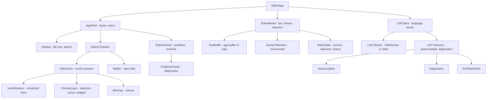

# Code Editor

**Category:** Frontend System Design
**Difficulty:** 🔴 Hard
**Seniority:** senior
**Companies:** VS Code, Monaco Editor, CodeMirror, Atom, Sublime Text, JetBrains
**Tags:** syntax-highlighting, language-server, performance, virtualization, accessibility, state-management
**Time:** 60-90 min

---

## Problem Statement

Design a web-based code editor like VS Code for the browser or Monaco Editor (the editor that powers VS Code). Users can edit code with syntax highlighting, autocomplete, error diagnostics, go-to-definition, find/replace, multi-cursor editing, and keyboard shortcuts. The editor must handle large files (100k+ lines) smoothly, support multiple languages, and integrate with Language Server Protocol (LSP) for advanced features.

The editor renders text with complex styling (syntax highlighting, line numbers, minimap, selection, cursor), handles incremental updates efficiently, and communicates with a language server for IDE features. The interviewer cares about the rendering approach (DOM vs canvas), syntax highlighting performance, LSP integration, and handling large files.

## Clarifying Questions

- File size limits? *Up to 10MB files, 100k+ lines. Must remain responsive.*
- Languages supported? *JavaScript, TypeScript, Python, Java, C++, Go, Rust, and others via LSP.*
- LSP integration? *Yes. Full LSP support: autocomplete, diagnostics, go-to-definition, hover, references.*
- Multi-file editing? *Yes. Tabs for multiple files, with a file tree sidebar.*
- Collaborative editing? *No. Single-user for this scope.*
- Offline support? *Yes. Basic editing works offline. LSP features require connection.*
- Mobile support? *Responsive design, but focus on desktop. Mobile has limited keyboard support.*
- What's the rendering approach? *DOM-based (like CodeMirror) or canvas-based (like Monaco)? We'll discuss trade-offs.*

## Requirements

### Functional
- Text editing with syntax highlighting, line numbers, and code folding.
- Autocomplete with signature help and parameter hints.
- Error diagnostics with inline squiggles and a problems panel.
- Go-to-definition, find references, and hover information.
- Find/replace with regex support and global search across files.
- Multi-cursor editing, block selection, and keyboard shortcuts (VS Code-style).
- Minimap, breadcrumb navigation, and status bar (language, line/col, encoding).

### Non-Functional
- 60fps typing and scrolling even with 100k-line files.
- Syntax highlighting latency under 50ms for a single line.
- Autocomplete latency under 100ms (p95).
- Memory usage proportional to visible content, not file size.
- Accessible to keyboard-only and screen reader users.

### Out of Scope
- Collaborative editing, debugging, terminal integration, and extensions API.

## Component Architecture



- **EditorView** is the main rendering component. It uses virtualization to render only visible lines (typically 50-100 out of 100k+). It coordinates the line renderer, overlay layer, and minimap.
- **LineRenderer** renders individual lines with syntax highlighting. It can use DOM elements (spans for tokens) or canvas (Monaco-style). DOM is more accessible; canvas is faster.
- **OverlayLayer** renders selection, cursors, and widgets (autocomplete dropdowns, hover tooltips) on top of the text. It's a separate layer to avoid re-rendering text on cursor movement.
- **TextBuffer** uses a gap buffer or rope data structure for efficient insert/delete operations at any position. A simple array would be O(n) for edits at the beginning of large files.
- **SyntaxTokenizer** performs incremental syntax highlighting. It tokenizes only visible lines and caches results. Changes trigger re-tokenization of affected lines.
- **LSPClient** communicates with a language server (running in a Web Worker or via WebSocket) to provide IDE features. It handles LSP requests/responses and manages the server lifecycle.
- **EditorState** holds cursors, selection, and undo/redo history. It's separate from the text buffer to support multi-cursor editing.

## Data Model & State

```text
Document {
  uri, language, content, version,
  isDirty: Boolean,
  lineCount: Number
}

TextBuffer {
  // Gap buffer or rope structure
  // Efficient insert/delete at any position
  // O(1) for most operations near the gap
}

Line {
  index, text, tokens: Array<Token>,
  isFolded: Boolean, foldLevel: Number
}

Token {
  type: 'keyword' | 'string' | 'comment' | 'function' | ...,
  startOffset, endOffset,
  className: String  // for CSS styling
}

EditorState {
  cursors: Array<{ line, column, preferredColumn }>,
  selection: Array<{ start: {line, column}, end: {line, column} }>,
  history: Array<{ changes, before, after }>,
  historyIndex: Number
}

LSPState {
  diagnostics: Map<Uri, Array<{
    range, severity, message, source
  }>>,
  completions: Array<{ label, kind, detail, documentation }>,
  hover: { contents, range } | null
}

UIState {
  openFiles: Array<Uri>,
  activeFile: Uri | null,
  sidebarTab: 'files' | 'search' | null,
  panelTab: 'problems' | 'terminal' | null,
  minimapVisible: Boolean,
  fontSize: Number
}
```

- **TextBuffer** uses a gap buffer or rope for efficient edits. A gap buffer is simpler and works well for most cases. A rope is better for very large files with edits scattered throughout.
- **Tokens** are cached per line to avoid re-tokenizing on every render. Changes invalidate the cache for affected lines.
- **EditorState** supports multiple cursors for multi-cursor editing. Each cursor has a preferred column to maintain vertical position.
- **LSPState** holds language server results. Diagnostics are keyed by document URI. Completions and hover are ephemeral (per request).

## API & Interfaces

```text
LSP Protocol (over WebSocket or Web Worker stdio)
  client -> server
    { jsonrpc: "2.0", id: 1, method: "initialize", params: { ... } }
    { jsonrpc: "2.0", method: "textDocument/didOpen", params: { textDocument: { uri, languageId, version, text } } }
    { jsonrpc: "2.0", id: 2, method: "textDocument/completion", params: { textDocument, position } }
    { jsonrpc: "2.0", id: 3, method: "textDocument/definition", params: { textDocument, position } }
    { jsonrpc: "2.0", method: "textDocument/didChange", params: { contentChanges, textDocument } }
  server -> client
    { jsonrpc: "2.0", id: 1, result: { capabilities: { ... } } }
    { jsonrpc: "2.0", method: "textDocument/publishDiagnostics", params: { uri, diagnostics } }
    { jsonrpc: "2.0", id: 2, result: { items: [ ... ] } }
    { jsonrpc: "2.0", id: 3, result: [ { uri, range } ] }

EditorView
  props:  document, state, lspState, theme
  events: onEdit(changes), onCursorChange(positions), onSelectionChange(selections),
          onScroll(scrollTop), onCommand(command)

LSPClient
  methods:
    async initialize()
    openDocument(uri, language, text)
    changeDocument(uri, changes, version)
    closeDocument(uri)
    async getCompletions(uri, position)
    async getDefinition(uri, position)
    async getHover(uri, position)
```

## Rendering & Performance

**Virtualized line rendering.**
- Use react-window or a custom virtualization library to render only visible lines (typically 50-100).
- Measure line heights dynamically (lines may have different heights due to folding or wrapped text).
- Use a `ResizeObserver` to detect container size changes and update the visible range.
- Maintain a buffer of extra lines above/below the visible range to avoid flickering during scroll.

**Syntax highlighting.**
- Use an incremental tokenizer (e.g., Prism.js, Shiki, or a custom tokenizer). Tokenize only visible lines on initial load.
- Cache tokenized lines in a Map. Invalidate the cache for lines that change.
- For large files, tokenize in chunks using `requestIdleCallback` or a Web Worker to avoid blocking the UI.
- Use CSS classes for token types (e.g., `.token.keyword`, `.token.string`) for themeability.

**Cursor and selection rendering.**
- Render cursors and selections in a separate overlay layer on top of the text. This avoids re-rendering text on cursor movement.
- Use CSS `transform` for cursor positioning to avoid layout thrashing.
- For multi-cursor, render each cursor as a separate element with a unique ID.

**Minimap rendering.**
- Use a canvas for the minimap to avoid creating thousands of DOM elements.
- Render the minimap at a lower resolution (e.g., 1 pixel per 2-4 characters) to save memory.
- Update the minimap incrementally: only re-render changed lines.
- Show the visible region as a highlighted rectangle on the minimap.

**Text buffer operations.**
- Use a gap buffer for efficient insert/delete. Maintain a "gap" at the current cursor position.
- For multi-cursor edits, apply edits in reverse order (from bottom to top) to avoid position shifting issues.
- For very large files, consider a rope data structure (balanced binary tree of text chunks).

**Autocomplete rendering.**
- Show the autocomplete dropdown as a floating DOM element positioned near the cursor.
- Virtualize the dropdown if it has many items (e.g., 100+).
- Use fuzzy matching for filtering completions (e.g., fuse.js or a custom implementation).
- Debounce autocomplete requests to avoid flooding the LSP server.

**LSP performance.**
- Run the LSP server in a Web Worker to avoid blocking the UI.
- Batch document change notifications: send changes every 500ms or after 10 edits, whichever comes first.
- Cache LSP results (e.g., diagnostics) locally and invalidate on document change.
- Use a cancellation token for LSP requests to cancel pending requests when the user continues typing.

**Memory management.**
- Evict tokenized lines for files that are not active.
- Limit the undo/redo history size (e.g., 100 entries).
- Clear LSP caches for closed documents.

## Accessibility & UX

- **Keyboard navigation.** Support VS Code-style shortcuts: Ctrl+S (save), Ctrl+F (find), Ctrl+H (replace), Ctrl+G (go to line), Ctrl+D (multi-cursor), Ctrl+Shift+K (delete line).
- **Screen reader support.** Use `role="textbox"` with `aria-multiline="true"`. Announce line and column on cursor movement. Provide accessible descriptions for syntax-highlighted tokens.
- **High contrast mode.** Support high-contrast themes. Use CSS custom properties for theme colors to make them switchable.
- **Font rendering.** Use a monospace font (e.g., Fira Code, JetBrains Mono). Support ligatures if the font provides them.
- **Code folding.** Show foldable markers in the gutter. Allow folding/unfolding with keyboard shortcuts (Ctrl+K Ctrl+0/1/2).
- **Indent guides.** Show vertical lines to indicate indentation levels. Help with visual alignment.
- **Bracket matching.** Highlight matching brackets when the cursor is on a bracket. Show mismatched brackets in red.
- **Error indicators.** Show squiggly underlines for errors/warnings. Use red for errors, yellow for warnings, blue for info. Provide tooltips with the full message.

## Edge Cases & Resilience

- **Very long lines.** Handle lines that exceed the viewport width. Use soft wrapping or horizontal scrolling. Soft wrapping is more user-friendly but harder to implement.
- **Binary files.** Detect binary files (e.g., by null bytes) and show a warning instead of attempting to render.
- **Large files.** For files >10MB, show a warning and offer to open in a simplified mode (no syntax highlighting, no LSP).
- **LSP server crash.** Detect when the LSP server stops responding. Restart it or show a "Language server unavailable" warning. Fall back to basic editing without LSP features.
- **Network issues.** If the LSP server is remote (WebSocket), handle network disconnects gracefully. Queue change notifications and sync on reconnect.
- **Undo/redo with LSP.** When undoing, send the reverted content to the LSP server to keep diagnostics in sync.
- **Multi-cursor edge cases.** Handle overlapping cursors (merge them). Handle cursors at the same position (show as one cursor with a different style).
- **IME input.** Support IME (Input Method Editor) for non-Latin languages. Use the `compositionstart` and `compositionend` events to handle IME composition.

## Trade-offs

| Decision | Option A | Option B | Choice & Why |
|---|---|---|---|
| Rendering | DOM-based (CodeMirror) | Canvas-based (Monaco) | DOM for accessibility, canvas for performance. Hybrid approach: DOM for text, canvas for minimap. |
| Text buffer | Array | Gap buffer / Rope | Gap buffer. Efficient for most editing patterns. Rope for very large files with scattered edits. |
| Syntax highlighting | On-demand | Pre-tokenized | On-demand. Tokenize only visible lines. Pre-tokenizing is too slow for large files. |
| LSP transport | WebSocket | Web Worker stdio | Web Worker stdio. Lower latency, no network overhead. WebSocket for remote servers. |
| Autocomplete | Client-side fuzzy | Server-side LSP | LSP for accuracy, client-side fuzzy for speed. Hybrid: use LSP but filter client-side. |

## Follow-up Questions

1. **How would you add collaborative editing?** Use Operational Transformation (OT) or Conflict-free Replicated Data Types (CRDTs) to sync edits across users. Show remote cursors and selections. Handle conflict resolution.
2. **How would you support debugging?** Add a breakpoint gutter (click to toggle breakpoints). Integrate with a debugger protocol (DAP) to set breakpoints, step through code, and inspect variables. Show inline variable values.
3. **How do you handle themes?** Use CSS custom properties for colors. Allow users to switch between light/dark themes. Support custom themes via JSON or CSS.
4. **How would you add an extensions API?** Provide a well-defined API for extensions to add features (e.g., new languages, themes, commands). Use a sandbox (iframe or Web Worker) for security.
5. **How do you test the editor?** Unit test the text buffer and tokenizer. Integration test LSP communication. Visual regression tests for rendering. Load test with large files.

## Common Mistakes

- Using a simple array for the text buffer, causing O(n) performance for edits at the beginning of large files.
- Rendering all lines instead of virtualizing, causing UI freezes with large files.
- Re-tokenizing the entire file on every edit, causing syntax highlighting to lag.
- Not handling IME input, breaking the editor for non-Latin languages.
- Forgetting accessibility, making the editor unusable for screen reader users.
- Not debouncing LSP requests, flooding the server and causing performance issues.

## Key Takeaways

- Virtualization is essential for rendering large files smoothly.
- Gap buffer or rope data structures enable efficient text editing at any position.
- Incremental syntax highlighting with caching keeps the editor responsive.
- LSP integration in a Web Worker provides IDE features without blocking the UI.
- Accessibility is critical: use semantic HTML, keyboard navigation, and screen reader support.
- Design for performance from the start: measure, profile, and optimize bottlenecks.
