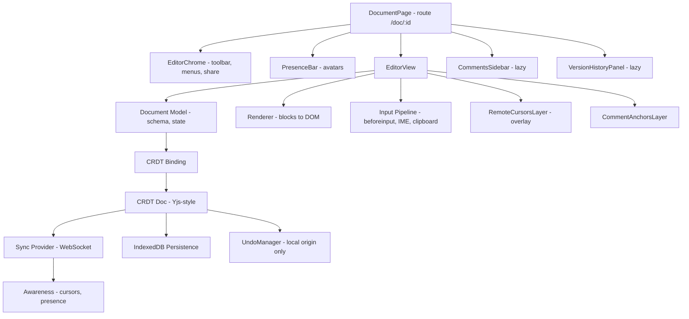

# Collaborative Document Editor

**Category:** Frontend System Design
**Difficulty:** 🔴 Hard
**Seniority:** staff
**Companies:** Google, Microsoft, Notion, Figma, Dropbox, Atlassian, Coda
**Tags:** crdt, operational-transformation, rich-text, real-time-collaboration, contenteditable, offline-first, presence
**Time:** 60 min

---

## Problem Statement

Design the frontend of a real-time collaborative rich-text editor like Google Docs, Notion or Dropbox Paper. Multiple users edit the same document at the same time. They see each other's cursors and selections, and changes converge to the same result on every client. Documents support headings, lists, bold/italic, links, images, tables and comments.

Documents can be 100+ pages, with up to about 50 concurrent editors and hundreds of viewers. Users expect typing latency to feel local, offline edits to merge cleanly on reconnect, and undo to affect only their own changes. The interviewer wants to hear about the document model, the choice of concurrency algorithm (OT vs CRDT), taming `contenteditable`, rendering performance and resilience.

## Clarifying Questions

- What content types? *Rich text blocks (paragraph, heading, list, quote, code), inline marks, links, images, simple tables, and comment anchors.*
- How many concurrent editors? *Typically under 10, with a peak around 50 per document. Viewers can be many more.*
- Is offline editing required? *Yes. A user can edit offline for hours and merge on reconnect.*
- Version history? *Yes. Named versions and restore. Change attribution is a bonus.*
- Do we have a central server? *Yes, a collaboration service that relays and persists updates. Pure peer-to-peer is not required.*
- Mobile? *Mobile web needs viewing and light editing. Native apps are separate.*
- Do we need export or import? *Paste from Word or Google Docs (HTML) must work. Export is server-side.*

## Requirements

### Functional
- Rich-text editing with block and inline formatting, lists, links, images and tables.
- Real-time co-editing that converges, with remote cursors, selections and presence avatars.
- Comments anchored to text ranges that survive edits around them.
- Per-user undo/redo, version history, and offline editing with merge.
- Copy/paste with HTML sanitization, keyboard shortcuts, and IME support (CJK input).

### Non-Functional
- Keystroke-to-paint under 16 ms locally. Remote edits visible in under 200 ms (p95).
- Strong eventual consistency: all replicas converge without user-visible conflicts.
- Good performance at 100 pages (about 50k words) and 50 editors.
- WCAG 2.1 AA: screen reader-friendly editing and keyboard access to every feature.

### Out of Scope
- Spreadsheets and drawings, server-side export pipelines, and the permissions admin UI.

## Component Architecture



- **EditorView** is a framework-agnostic editor core (ProseMirror, Lexical, Slate or Tiptap style). It owns the DOM inside the `contenteditable` root, and the UI framework (React, Angular) never reconciles that subtree. Doing so would fight the browser's selection and IME handling. Framework components render the toolbar, sidebars and menus, and communicate through commands and state subscriptions.
- **Document Model** is a schema-validated tree: doc, then blocks, then inline text with marks. Every change is a transaction, and the DOM is a projection of the model, never the source of truth.
- **Input Pipeline** intercepts `beforeinput` events (`insertText`, `deleteContentBackward`, `insertFromPaste`, `formatBold`…) and turns them into model transactions. It lets IME composition proceed natively and reconciles on `compositionend`.
- **CRDT Binding** maps model transactions to CRDT operations and maps remote CRDT updates back into model transactions, mapping selections through the changes.
- **Sync Provider** exchanges binary updates over a WebSocket, does the initial state-vector handshake and reconnects. **Awareness** is a separate ephemeral channel for cursors and presence.
- **UndoManager** tracks only operations with local origin. Undo therefore reverts *my* changes and never a collaborator's.

## Data Model & State

```text
CRDT Document (shared, persisted)
  Y.XmlFragment "content"                       // block tree
    Y.XmlElement { nodeName: "heading", attrs: { level: 2, blockId } }
      Y.XmlText  [ "Intro", { bold: true } ] ...  // text with formatting attributes
  Y.Map "comments"  commentId -> { anchor: RelativePosition(start/end), threadId, resolved }
  Y.Map "meta"      { title, lastEditedBy }

Each character/item has a unique id: (clientId, clock)  // Lamport-like, never reused
State vector: Map<clientId, maxClock>                    // what this replica has seen

Awareness (ephemeral, not persisted)
  clientId -> { user: { id, name, color }, cursor: { anchor: RelPos, head: RelPos }, lastActive }

Local UI State
  selection (model positions), activeMarks, openMenus, commentDraft,
  connection: synced | syncing | offline, pendingUpdateBytes
```

**OT vs CRDT.**
- **OT** (Google Docs, the original ShareDB) represents edits as index-based operations. A central server transforms concurrent ops against each other (`transform(opA, opB)`). It is compact and well proven, but the transform functions are hard to get right for rich trees, and offline edits need a server round trip to rebase.
- **CRDT** (Yjs, Automerge, Peritext-style marks) gives every inserted element a unique id and positions inserts relative to neighbor ids. Merges are commutative, associative and idempotent, so any order of delivery converges. Offline and peer-to-peer come naturally. The costs are metadata overhead (mitigated by run-length encoding and garbage collection of deletions) and harder intent preservation for formatting.
- **Choice: a CRDT (Yjs-like).** Offline editing for hours is a requirement, the server becomes a simple relay plus persistence, and mature bindings exist for ProseMirror, Lexical and others.

**Anchoring cursors and comments.** Store `RelativePosition(itemId, assoc)` rather than integer offsets. This way an anchor stays attached to the same character even when text is inserted before it.

## API & Interfaces

```text
REST
GET  /api/docs/{id}                      200 { meta, permissions, snapshotUrl }
GET  /api/docs/{id}/snapshot             200 application/octet-stream (encoded CRDT state)
GET  /api/docs/{id}/versions             200 [ { versionId, name, createdAt, authorIds } ]
POST /api/docs/{id}/versions             { name }  -> snapshot current state
POST /api/docs/{id}/images               -> presigned upload URL

WebSocket wss://collab.example.com/doc/{id}   (binary frames, y-protocol style)
  sync step 1: client -> { stateVector }
  sync step 2: server -> { diffUpdate since stateVector }  + server -> { its stateVector }
               client -> { diffUpdate server is missing }   // offline edits
  update:      both directions { update: bytes }            // incremental
  awareness:   both directions { clientId, clock, state }   // cursors, throttled
  auth:        token in first message; server enforces read-only for viewers
```

Editor public interface (embeddable component):

```text
CollaborativeEditor
  props:  docId, user {id, name, color}, readOnly, schema, extensions[], placeholder
  events: onReady(), onSyncStatus(status), onSelectionChange(range),
          onCommentCreate(range), onError(err)
  commands: toggleMark(mark), setBlock(type, attrs), insertImage(src),
            undo(), redo(), focus(), getJSON()
```

## Rendering & Performance

**Rendering strategy.** CSR. An SSR read-only HTML render of the latest snapshot can be used for fast first paint and link previews, then upgraded to the editor.

**Load path.** In parallel: load the snapshot from IndexedDB if cached (instant), fetch the server snapshot or diff, and connect the WebSocket. Render as soon as any of these is available, and merge the rest when it arrives.

**Keystroke path (must fit in one frame).**

```text
ON beforeinput(e)
  IF e.isComposing THEN RETURN                 // let IME render natively
  e.preventDefault()
  SET tr ← model.transaction().applyInput(e.inputType, e.data, selection)
  model.dispatch(tr)                          // 1. update model
  renderer.patch(tr.changedBlocks)            // 2. patch only affected block DOM
  binding.toCrdt(tr, origin = LOCAL)          // 3. CRDT ops (sub-ms)
  provider.queueUpdate()                      // 4. batched, sent within ~50 ms
```

**Incremental rendering.** Each block has a stable `blockId`, and the renderer re-renders only changed blocks. A remote update affecting paragraph 900 should not touch paragraphs 1–899.

**Large documents.**
- Use CSS `content-visibility: auto` with `contain-intrinsic-size` on blocks, so off-screen blocks skip layout and paint while staying in the DOM. Find-in-page, selection and screen readers keep working.
- Full virtualization (unmounting off-screen blocks) is risky in a contenteditable because of selection across unmounted nodes and native find. Consider it only for read-only mode or with a custom selection model, which is how Google Docs moved to canvas rendering.

**Network batching.** Merge updates within a 50 ms window into one binary frame (Yjs `mergeUpdates`). Throttle awareness to about 10 Hz.

**Remote cursors.** Draw them in an absolutely positioned overlay computed from `Range.getClientRects()`, and recompute in rAF after layout changes. Never inject cursor spans into the editable DOM, because that corrupts the user's selection.

**Web Worker.** Decoding large snapshots and computing version diffs can run in a worker so they do not block typing.

**Bundle.** The core editor is about 100–150 KB. Load tables, code highlighting, the comments sidebar and history lazily. Prefetch common extensions on idle.

## Accessibility & UX

- **Editable semantics.** The root is a `contenteditable` with `role="textbox"`, `aria-multiline="true"` and an `aria-label` of the document title. Use semantic HTML inside (`h1–h6`, `ul/ol/li`, `strong`, `a`) so screen readers expose the structure. Avoid div soup.
- **Toolbar.** `role="toolbar"` with roving tabindex. Buttons expose `aria-pressed` for active marks. Alt+F10 (Docs convention) jumps from the editor to the toolbar and Esc returns.
- **Shortcuts.** Ctrl/Cmd+B/I/U/K, markdown shortcuts (`## `, `- `, `1. `), and Ctrl+Alt+M for comments. They must be discoverable through a shortcuts dialog (Ctrl+/) and must not clash with screen reader keys.
- **Collaborator announcements.** Announce joins and leaves politely, and never announce every remote keystroke. Offer an optional "describe collaborator location" command.
- **IME and i18n.** Never interrupt composition. Defer remote updates that touch the composing block until `compositionend`. Support bidi text with `dir="auto"` per block, and spellcheck through the native `spellcheck` attribute.
- **States.** A sync indicator shows "Saved", "Saving…" or "Offline – changes saved on this device". Read-only mode is visually and programmatically clear (`aria-readonly`). Image upload shows a placeholder block with progress.

## Edge Cases & Resilience

- **Offline.** Edits apply to the local CRDT and persist to IndexedDB on every change. On reconnect, the state-vector exchange sends exactly the missing updates, in either direction. Request `navigator.storage.persist()` so the browser does not evict the data.
- **Conflicting formatting.** Concurrent bold and italic on overlapping ranges both apply. Concurrent delete and format means the delete wins. Mark expansion rules decide whether typing at a boundary inherits a mark, following Peritext semantics.
- **Undo in collaboration.** Undo reverts only local-origin items, using a selective undo stack. Remote edits made after my change are preserved.
- **Server lost and recovered.** The server can be rebuilt from any client's full state, since CRDT state is self-contained. Periodic server snapshots plus compaction keep load times bounded.
- **Tombstone growth.** Deleted items leave tombstones. Use GC'd representations (Yjs keeps lightweight deletion sets), and compact snapshots when the document is idle.
- **Large paste.** Parse in chunks and show progress. Reject pastes over a few MB and offer an import instead.
- **Permission change mid-session.** The server sends a permission event. The client switches to read-only, keeps unsynced local edits, and offers "copy my changes".
- **Security.**
  - Pasted HTML is untrusted. Parse it with `DOMParser` into the schema (unknown tags and attributes are dropped) and never insert raw HTML.
  - Allow only `http(s)` and `mailto` link protocols, which blocks `javascript:`.
  - Use a CSP to prevent inline script execution. Proxy external images.
  - The server must validate that updates come from users with write permission. Read-only clients' updates are dropped.

## Trade-offs

| Decision | Option A | Option B | Choice & Why |
|---|---|---|---|
| Concurrency algorithm | OT with central server | CRDT (Yjs-style) | CRDT. Native offline and multi-path sync, and the server is a simple relay. Accept the metadata overhead. |
| DOM ownership | Framework renders contenteditable | Editor core owns DOM, framework owns chrome | Editor core. Framework reconciliation breaks selection and IME. |
| Large doc rendering | Full virtualization | `content-visibility: auto` | content-visibility. Keeps native selection, find and a11y, and gets most of the paint savings. |
| Cursor rendering | Inline spans in document | Overlay layer | Overlay. Does not mutate the editable DOM or disturb the selection. |
| Undo scope | Global undo stack | Per-user, origin-tracked | Per-user. Undoing a collaborator's work is surprising and destructive. |

## Follow-up Questions

1. **How would you implement suggestion mode (track changes)?** Store suggestions as marks or attributes (`suggestion: {author, type: insert|delete}`) in the CRDT. Render them with styles, and accept or reject by removing the mark or applying the delete.
2. **How do you scale to 1,000 viewers?** Viewers receive updates but never send them. Fan out through a pub/sub tier (Redis or NATS) behind the collab servers, and aggregate presence ("+980 viewers") instead of sending per-user cursors.
3. **Why might Google Docs render to canvas?** Full control over layout, pagination and performance across browsers, and no contenteditable quirks. The cost is re-implementing selection, IME, accessibility (a hidden accessible DOM) and find.
4. **How does version history work with CRDTs?** Periodically snapshot the encoded state with its state vector. Restore by computing the diff between the current state and the snapshot, then applying it as a new forward change so collaborators stay in sync.
5. **How do you test convergence?** Property-based tests that generate random concurrent op sequences across N simulated replicas with random delivery order, then assert identical final documents. Add fuzzing of `beforeinput` sequences in real browsers.
6. **How would you add end-to-end encryption?** Encrypt CRDT updates client-side with a per-document key. The server only relays and stores opaque blobs, so server-side search and export need client participation.

## Common Mistakes

- Treating the DOM as the source of truth, or letting React/Angular re-render the contenteditable subtree.
- Using absolute integer offsets for cursors and comment anchors, which drift with concurrent edits.
- Hand-waving "last write wins" for text, which loses characters under concurrency.
- A global undo that reverts collaborators' changes.
- Ignoring IME composition, which breaks CJK and mobile keyboards.
- Inserting pasted HTML without schema-based sanitization, leading to XSS.

## Key Takeaways

- Separate the model, the view and the sync layer. The editor core owns the editable DOM, and the framework renders everything around it.
- CRDTs with relative positions give convergence, offline merge and stable anchors. OT is a valid alternative when everything goes through a central server.
- Performance comes from per-block incremental rendering, `content-visibility`, update batching and an overlay for cursors.
- Robustness depends on IME-safe input handling, per-user undo, schema-based paste sanitization and durable local persistence.
