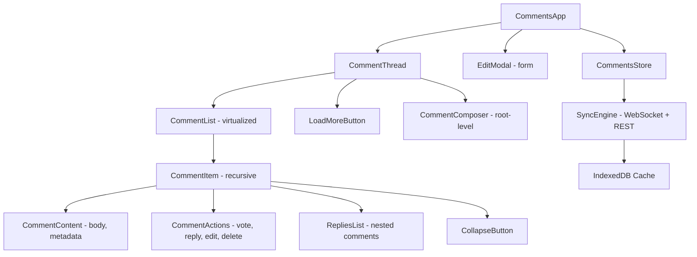

# Comments Thread

**Category:** Frontend System Design
**Difficulty:** 🟡 Medium
**Seniority:** Mid-level
**Companies:** Reddit, Disqus, Stack Overflow, GitHub, YouTube
**Tags:** nested-data, real-time, pagination, optimistic-updates, virtualization, offline-first
**Time:** 45-60 min

---

## Problem Statement

Design a comments thread system like Reddit, Disqus, or GitHub discussions. Users can view nested (threaded) comments, reply to comments at any depth, upvote/downvote, edit and delete their comments, and see new comments appear in real-time.

Threads can have thousands of comments with deep nesting (up to 10 levels). The interviewer cares about handling nested data structures, efficient pagination for large threads, real-time updates, and maintaining performance while rendering complex comment trees.

## Clarifying Questions

- What is the maximum thread size? *Up to 10,000 comments with nesting up to 10 levels deep. Typical threads have 50-500 comments.*
- What nesting depth is supported? *Up to 10 levels. Some platforms limit to 3-5, but we support deeper.*
- Do we need real-time updates? *Yes. New comments and votes should appear within 1-2 seconds.*
- What comment features? *Text with basic formatting (markdown-lite), upvote/downvote, edit, delete, reply, and collapse threads.*
- Are users authenticated? *Yes. Authenticated users can post, vote, edit, and delete. Guests can only read.*
- Do we need moderation? *Basic flag/report for moderation. Full moderation tools are out of scope.*
- Offline support? *Read-only offline with cached comments. Mutations require a connection.*
- Mobile? *Yes, responsive design with touch interactions.*

## Requirements

### Functional
- Display comments in a nested/threaded view with collapse/expand for subtrees.
- Create replies at any nesting level with inline reply forms.
- Upvote/downvote with optimistic updates and vote counts.
- Edit and delete own comments with confirmation.
- Real-time updates for new comments, votes, and edits.
- Pagination for large threads (load more comments).

### Non-Functional
- Render a thread with 1,000 comments in under 1 s.
- Optimistic updates (vote, reply) appear in under 100 ms.
- Real-time updates appear within 1-2 seconds.
- WCAG 2.1 AA accessible, including keyboard navigation.
- Smooth scrolling when navigating nested threads.

### Out of Scope
- Rich text editing, file attachments, advanced moderation tools, and user profiles.

## Component Architecture



- **CommentThread** is the main container that fetches and displays comments for a specific resource (e.g., a post). It manages pagination and real-time subscriptions.
- **CommentList** is a virtualized list that renders only visible comments. For nested threads, it flattens the tree into a list with depth information for rendering.
- **CommentItem** is a recursive component that renders a comment and its replies. It handles collapse/expand state and inline reply forms.
- **CommentContent** displays the comment body, author, timestamp, and vote count. It sanitizes user content to prevent XSS.
- **CommentActions** provides buttons for voting, replying, editing, and deleting. It dispatches actions to the store.
- **SyncEngine** manages WebSocket connections for real-time updates and REST API calls for mutations. It handles optimistic updates and conflict resolution.
- **CommentsStore** holds comments in a normalized structure with a tree representation for efficient traversal.

## Data Model & State

```text
CommentsState {
  comments: Map<CommentId, {
    id, parentId: CommentId | null,          // null for root comments
    resourceId,                               // the post/article being commented on
    authorId, authorName, authorAvatar,
    body, bodyHtml,                           // sanitized HTML
    score: Int,                               // upvotes - downvotes
    userVote: 1 | 0 | -1 | null,              // current user's vote
    createdAt, updatedAt,
    isDeleted: Boolean,
    depth: Int,                               // nesting level
    replyCount: Int                           // number of direct replies
  }>
  rootCommentIds: List<CommentId>             // top-level comments, sorted
  repliesByParent: Map<CommentId, List<CommentId>>  // direct replies, sorted
  ui: {
    collapsed: Set<CommentId>,                 // collapsed subtrees
    replyingTo: CommentId | null,             // inline reply form
    editing: CommentId | null,                // edit modal
    loading: Boolean,
    hasMore: Boolean,
    cursor: String | null                     // pagination cursor
  }
  user: { id, name, avatar } | null
}
```

- **Normalization.** Comments are stored once by id. The tree structure is derived from `parentId` and `repliesByParent`. This makes updates (e.g., vote, edit) efficient.
- **Sorting.** Comments are sorted by score (hot algorithm) or newest first. The sort order is maintained in the lists.
- **Depth.** Computed from the parent chain. Used for indentation and to enforce max depth.
- **Collapsed state.** Stored in `ui.collapsed` as a set of comment IDs. Collapsed subtrees are not rendered, but their children remain in the store.

## API & Interfaces

```text
GET  /api/resources/{id}/comments?cursor=&limit=50&sort=hot
     200 { comments: [...], nextCursor, hasMore }

GET  /api/comments/{id}/replies?cursor=&limit=20
     200 { comments: [...], nextCursor, hasMore }

POST /api/comments
     { resourceId, parentId, body }
     201 Comment

PATCH /api/comments/{id}
     { body }
     200 Comment

DELETE /api/comments/{id}
     204

POST /api/comments/{id}/vote
     { value: 1 | -1 | 0 }
     200 { score, userVote }

WebSocket wss://comments.example.com/ws?resource={id}
server -> client
  { type: "comment.created", comment }
  { type: "comment.updated", comment }
  { type: "comment.deleted", commentId }
  { type: "comment.voted", commentId, score, delta }
client -> server
  { type: "subscribe", resourceId }
```

- **Pagination.** Use cursor-based pagination for efficient traversal. The cursor encodes the last comment's ID and score.
- **Nested pagination.** Load replies lazily when a user expands a comment with many replies. This reduces initial payload size.
- **Real-time.** Subscribe to a WebSocket channel for the resource. Receive events for new comments, updates, and votes.

## Rendering & Performance

**Rendering.** CSR with an app shell. The initial fetch loads the first 50 root comments and their top-level replies. Nested replies are loaded on demand.

**Virtualization.**
- Flatten the comment tree into a list with depth information for virtualization. Each item includes `commentId`, `depth`, and `isVisible` (for collapsed subtrees).
- Use a virtualized list (e.g., react-window, Angular CDK virtual scroll) to render only visible comments.
- For collapsed subtrees, skip rendering their children in the flattened list.

**Real-time updates.**

```text
FUNCTION handleWebSocketEvent(event)
  SWITCH event.type
    CASE "comment.created"
      IF event.comment.parentId == null
        rootCommentIds.unshift(event.comment.id)
      ELSE
        repliesByParent[event.comment.parentId].push(event.comment.id)
      comments.set(event.comment.id, event.comment)
      IF isViewingThread THEN refreshVirtualList()

    CASE "comment.updated"
      comments.set(event.comment.id, event.comment)
      IF isViewingThread THEN refreshVirtualList()

    CASE "comment.deleted"
      comments.delete(event.commentId)
      removeFromLists(event.commentId)
      IF isViewingThread THEN refreshVirtualList()

    CASE "comment.voted"
      SET comment ← comments.get(event.commentId)
      comment.score ← event.score
      IF comment.authorId == user.id
        comment.userVote ← comment.userVote + event.delta
```

- Batch multiple events arriving in the same frame to avoid excessive re-renders.
- Use memoized comment items to re-render only changed comments.

**Optimistic updates.**

```text
FUNCTION vote(commentId, value)
  SET before ← snapshot(comments.get(commentId))
  SET comment ← comments.get(commentId)
  SET delta ← value - (comment.userVote || 0)
  comment.score ← comment.score + delta
  comment.userVote ← value
  pending.set(voteOpId, { before })
  TRY
    AWAIT POST /api/comments/{id}/vote { value }
    DELETE pending[voteOpId]
  CATCH error
    comments.set(commentId, before)
    DELETE pending[voteOpId]
    toast("Vote failed")
```

- Use a similar pattern for replies: optimistically insert the comment, then rollback on error.
- For edits, optimistically update the body and revert on error.

**Nested reply loading.**
- When a user expands a comment with many replies, load its replies with a separate API call.
- Cache loaded replies in the store to avoid redundant fetches.

**Memory.**
- Limit the number of comments kept in memory (e.g., 1,000). Evict older comments when the limit is exceeded.
- Use IndexedDB to cache comments for offline viewing.

## Accessibility & UX

- **Keyboard navigation.** Tab moves through comments. Enter expands/collapses a comment. Arrow keys navigate nested comments (with a roving tabindex).
- **Screen readers.** Use `aria-expanded` on collapse buttons. Announce the number of replies when collapsed. Use `role="tree"` for the nested structure with proper `treeitem` roles.
- **Focus management.** When opening an inline reply form, move focus to the textarea. When canceling, return focus to the reply button.
- **Collapse/expand.** Provide clear visual indicators (e.g., `[+] 5 replies`). Allow collapsing entire subtrees.
- **Vote feedback.** Show animation when voting. Display the updated score immediately.
- **Edit/delete confirmation.** Show a confirmation dialog before deleting. For edits, show a modal with the current content.
- **Empty states.** Show a "No comments yet" message with a call-to-action to comment.
- **Error states.** Display retry options for failed mutations. Show toasts for optimistic update rollbacks.

## Edge Cases & Resilience

- **Deep nesting.** Limit nesting depth to 10 levels. When replying at max depth, show a warning or disable the reply button.
- **Very long threads.** Use pagination and virtualization to handle 10,000+ comments. Load comments incrementally.
- **Concurrent edits.** If two users edit the same comment, use last-write-wins with versioning. Show a notification if the comment was modified by another user.
- **Deleted comments.** Replace deleted comments with a placeholder: "[deleted]". Keep the comment in the tree to preserve structure.
- **Offline.** Cache comments in IndexedDB. Allow viewing cached comments offline. Queue mutations and apply on reconnect.
- **Real-time disconnect.** Use exponential backoff for reconnection. Buffer events during disconnect and apply on reconnect.
- **Vote spam.** Rate-limit vote requests on the client and server. Debounce rapid vote clicks.
- **XSS prevention.** Sanitize comment bodies using DOMPurify or a similar library. Render as text unless markdown is supported.

## Trade-offs

| Decision | Option A | Option B | Choice & Why |
|---|---|---|---|
| Data structure | Nested tree | Flat with parent references | Flat with parent refs. Easier to update and normalize. Derive tree for rendering. |
| Pagination | Cursor-based | Offset-based | Cursor-based. Stable across new comments and more efficient for large datasets. |
| Real-time transport | Polling | WebSocket | WebSocket. Lower latency and better for frequent updates. |
| Virtualization | Always | Only for large threads | Only for large threads. Simpler for typical use cases; virtualize when needed. |
| Reply loading | Eager (all at once) | Lazy (on expand) | Lazy. Reduces initial payload and improves performance. |

## Follow-up Questions

1. **How would you handle comment sorting (hot, new, top)?** Store sort order in the API response. For "hot", use an algorithm that considers score and time. Re-sort on the server to avoid client-side complexity.
2. **How do you support thread collapsing?** Maintain a set of collapsed comment IDs in the UI state. When rendering, skip children of collapsed comments in the flattened list.
3. **How would you add rich text editing?** Use a library like TipTap or Quill. Store content as JSON or HTML. Sanitize on both client and server.
4. **How do you handle very deep nesting in the UI?** Limit visual indentation (e.g., max 5 levels) and use a "continue thread" link for deeper levels.
5. **How would you test real-time updates?** Use a mock WebSocket server that emits events at controlled intervals. Test optimistic updates with network delays.

## Common Mistakes

- Storing comments as a nested tree, making updates inefficient.
- Loading all comments upfront, causing performance issues for large threads.
- Not sanitizing user content, leading to XSS vulnerabilities.
- Re-rendering the entire thread on every vote instead of using memoization.
- Ignoring keyboard navigation and screen reader accessibility.
- Not handling concurrent edits or optimistic update rollbacks.

## Key Takeaways

- Use a normalized flat data structure with parent references for efficient updates.
- Flatten the tree for virtualization and efficient rendering.
- Use cursor-based pagination and lazy loading for nested replies.
- Implement optimistic updates with rollback for a responsive UI.
- Design for accessibility with keyboard navigation and proper ARIA semantics.
- Handle real-time updates with WebSocket and batch events to avoid excessive re-renders.
